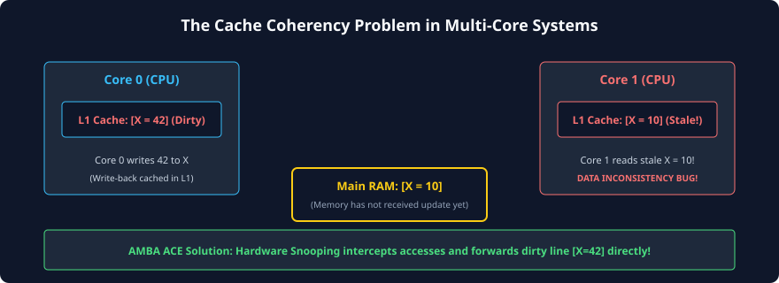
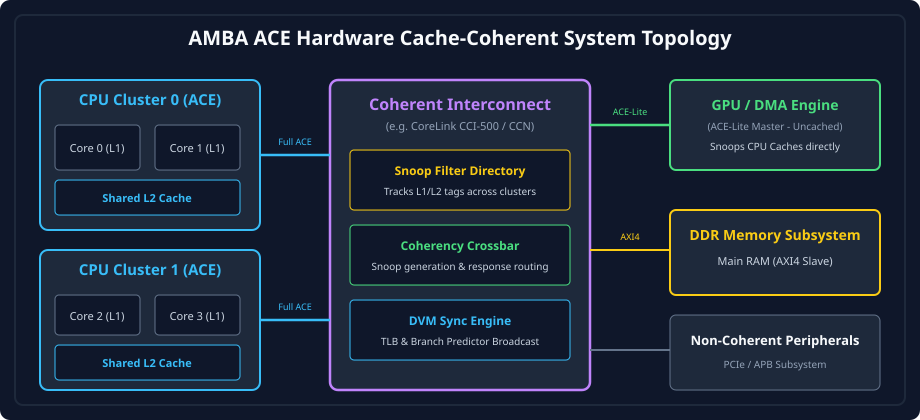

# Introduction to Hardware Cache Coherency and AMBA ACE

## The Multi-Core Era and the Memory Wall

Modern computing architectures have long surpassed the era where processor frequency could scale monotonically with transistor shrinking. As Dennard scaling ended and power density reached thermal dissipation limits, processor architects pivoted toward multi-core and heterogeneous computing topologies. Today's System-on-Chip (SoC) platforms integrate dozens of heterogeneous processing elements—including high-performance application CPU cores, energy-efficient CPU clusters, Graphics Processing Units (GPUs), Neural Processing Units (NPUs), Digital Signal Processors (DSPs), and direct memory access (DMA) engines.

However, processing speed scales far faster than main memory (DRAM) access latency—a phenomenon famously termed the **Memory Wall**. To hide this latency, modern processors integrate deeply nested, multi-level hierarchical cache subsystems (L1, L2, and system-level L3 caches). These caches store recently referenced memory lines locally in low-latency SRAM, allowing memory operations to execute in a handful of clock cycles rather than hundreds of cycles over external DRAM buses.

```
+-------------------------------------------------------------------------+
|                              PROCESSOR CORE                             |
|  +--------------------+                     +------------------------+  |
|  | L1 Instruction     |                     | L1 Data Cache          |  |
|  | Cache (e.g. 32KB)  |                     | (e.g. 32KB, 64B Lines) |  |
|  +---------+----------+                     +-----------+------------+  |
|            |                                            |               |
|            +--------------------+  +--------------------+               |
|                                 |  |                                    |
|                                 v  v                                    |
|                      +------------------------+                         |
|                      | Unified L2 Cache       |                         |
|                      | (e.g. 512KB - 1MB)     |                         |
|                      +-----------+------------+                         |
+----------------------------------|--------------------------------------+
                                   v
             [ Interconnect / Shared L3 Cache / DRAM ]
```

When multiple processor cores independently cache and modify identical physical memory addresses, an acute architectural crisis arises: **Cache Inconsistency**.

---

## The Cache Incoherency Problem

Consider an uncoordinated multi-core system where CPU 0 and CPU 1 both read physical memory address `0x8000_1000`, which initially contains the value `0x0000_0000`.

1. **Step 1 (Concurrent Read):** Both cores allocate a copy of address `0x8000_1000` into their local L1 data caches. Both observe the value `0x0000_0000`.
2. **Step 2 (Local Write):** CPU 0 issues a store instruction updating `0x8000_1000` with the value `0xDEAD_BEEF`. Because CPU 0 uses a write-back caching policy for performance, the updated value is written exclusively into its local L1 cache line, marking that cache line as "dirty". The update is **not** immediately pushed to external DRAM.
3. **Step 3 (Stale Observation):** CPU 1 reads `0x8000_1000`. Its local L1 cache reports a cache hit and delivers the stale value `0x0000_0000`.
4. **Step 4 (Memory Divergence):** Main memory still holds `0x0000_0000`, CPU 1's cache holds `0x0000_0000`, and CPU 0's cache holds `0xDEAD_BEEF`. The single address now possesses multiple, conflicting values across the hardware hierarchy.



Without an underlying coordination protocol, software algorithms that rely on shared memory communication, multi-threaded task queues, semaphores, mutex locks, and message buffers inevitably experience catastrophic race conditions and silent data corruption.

---

## Software-Managed vs. Hardware-Managed Coherency

Historically, embedded and digital signal processing systems managed cache consistency through explicit software intervention. While software cache management is conceptually straightforward, it incurs severe system penalties in high-performance general-purpose operating systems.

| Coherency Approach   | Mechanism                                                                                                                                                                  | Latency Impact                                                                | Software Overhead                                                                   | Silicon Area & Complexity                                                            |
| :------------------- | :------------------------------------------------------------------------------------------------------------------------------------------------------------------------- | :---------------------------------------------------------------------------- | :---------------------------------------------------------------------------------- | :----------------------------------------------------------------------------------- |
| **Software-Managed** | OS/compiler explicitly flushes (cleans) and invalidates cache lines using special CPU instructions before and after DMA/shared memory transfers.                           | High (hundreds of clock cycles spent executing maintenance instructions).     | High (programmer must manually track line sharing and memory synchronization).      | Minimal (hardware needs no extra inter-cache communication buses).                   |
| **Hardware-Managed** | Dedicated hardware protocols (such as AMBA ACE) track cache line status across cores, snooping memory transactions and automatically updating or invalidating peer caches. | Low (coherency handshakes occur concurrently over hardware buses in silicon). | Zero (completely transparent to application software and operating system threads). | High (requires snoop channels, state machines, duplicate directories/snoop filters). |

### The Cost of Software Flushing

In a software-managed regime, before a DMA controller can transmit a buffer to a network interface, the host CPU must iterate across every cache line in the buffer, executing cache flush (`CLEAN`) instructions to force dirty bytes back to DRAM. Conversely, once the DMA finishes writing an incoming packet into memory, the CPU must execute cache invalidate (`INVALIDATE`) instructions so its next load fetches fresh data from DRAM.

In modern Gigabit networking, high-speed NVMe storage, and real-time graphics pipelines, the CPU cycles wasted on software cache maintenance can consume up to 30% to 50% of the entire processing budget. **Hardware cache coherency** shifts this burden entirely to dedicated silicon logic, executing cache-to-cache handshakes at wire speed.

---

## Evolution: From AXI3/AXI4 to AMBA ACE

The Advanced Microcontroller Bus Architecture (AMBA) standard developed by ARM established the **Advanced eXtensible Interface (AXI)** as the de facto point-to-point interconnect standard for high-bandwidth SoC design.

- **AXI3 (2003):** Introduced the decoupled five-channel architecture (`AW`, `W`, `B`, `AR`, `R`), separate address/data phases, burst transfers, and ID tags enabling out-of-order transaction completion.
- **AXI4 (2010):** Refined burst lengths (up to 256 beats for incrementing bursts), eliminated write interleaving (`WID`) to simplify interconnect routing, and introduced Quality of Service (`QoS`) signals.

However, neither AXI3 nor AXI4 had any architectural concept of cache state sharing between multiple masters. An AXI4 master cannot query the cache contents of another master; it can only address physical memory slaves through the interconnect.

To eliminate this fundamental bottleneck, ARM introduced **AMBA 4 ACE (AXI Coherency Extensions)** in 2011. ACE augments the standard AXI4 specification with:

1. **Three Additional Snoop Channels (`AC`, `CR`, `CD`):** Transforming the point-to-point master interface into a fully coherent, bi-directional snooping interface.
2. **Standardized Hardware Cache State Model (MOESI):** Establishing deterministic cache line lifecycle tracking across all masters.
3. **Coherency Domains:** Allowing transactions to be scoped to specific master groups (Inner Shareable, Outer Shareable, Non-shareable).
4. **Hardware Barrier Transactions:** Guaranteeing memory ordering and synchronization without proprietary sideband signals.
5. **Distributed Virtual Memory (DVM) Messages:** Providing broadcast hardware transport for Translation Lookaside Buffer (TLB) invalidation and branch predictor maintenance across heterogeneous clusters.

---

## System-Level Topology: ACE Masters, Interconnect, and Slaves

In an ACE-enabled SoC, the coherent interconnect serves as the central orchestration crossbar. Unlike passive bus crossbars, a coherent interconnect is an active participant in memory operations: it decodes incoming master requests, broadcasts snoop requests to other cached masters, collects snoop responses, forwards cache lines directly between masters, and performs writebacks to downstream memory controllers.



### System Components:

1. **Fully Coherent Masters (ACE):**
   - Typically multi-core application CPU clusters (e.g., Cortex-A series).
   - Possess local L1/L2 caches operating under the MOESI protocol.
   - Implement all 8 ACE channels (5 standard AXI channels + 3 Snoop channels).
   - Can issue coherent transactions and accept incoming snoop requests from the interconnect.
2. **I/O Coherent Masters (ACE-Lite):**
   - High-throughput streaming masters without internal coherent caches (or with private caches that do not accept incoming snoops), such as GPUs, NPUs, and PCIe Root Complexes.
   - Can issue coherent read and write transactions to access CPU cache data directly without software flushes.
   - Do **not** implement snoop channels (`AC`, `CR`, `CD`), saving area and pin overhead.
3. **Coherent Interconnect (e.g., ARM CoreLink CCI-400 / CCI-500 / CMN-600):**
   - Contains snoop directories, crossbars, routing arbiters, and snoop filters.
   - Inspects address tags, determines sharing status, broadcasts snoops to relevant cores, and resolves concurrent write conflicts.
4. **Memory Subsystems (Downstream Slaves):**
   - Dynamic Memory Controllers (DDR4/DDR5/LPDDR5), On-Chip SRAM (TCM/OCM), and peripheral sub-buses (accessed via AXI or APB bridges).
   - Slaves remain standard AXI4 or AXI3 devices; all cache coherency complexities are absorbed and resolved upstream by the interconnect.

---

## Snooping vs. Directory-Based Coherency

Hardware cache coherency implementations broadly fall into two fundamental architectural paradigms:

### Broadcast Snooping (Bus-Based Snooping)

In a broadcast snooping scheme, whenever a master requires a memory line, it broadcasts its address request across a shared interconnect. Every other master in the system continuously listens to ("snoops") the bus, checks its internal cache tag directory, and reports whether it holds a valid or modified copy of that line.

- **Strengths:** Lowest possible inter-core latency. Minimal hardware state tracking; no need for central directory tables.
- **Weaknesses:** Bus bandwidth scales poorly as core counts increase ($O(N^2)$ broadcast traffic). Every transaction interrupts tag directories in all cores, consuming dynamic power.

### Directory-Based Coherency

In a directory-based scheme, a centralized (or distributed) directory keeps track of the sharing state and location of every cache line in the system. When Master A requests an address, it queries the directory. The directory looks up which specific cores hold that line and sends targeted point-to-point snoop requests _only_ to those holding cores.

- **Strengths:** Excellent scalability to dozens or hundreds of cores (e.g., enterprise server chips and multi-socket interconnects). Drastically reduces unneeded tag lookups.
- **Weaknesses:** Directory tag storage consumes substantial on-chip SRAM area. Introduces an extra hop of directory lookup latency before snoops can be issued.

### The ACE Hybrid Approach

AMBA ACE is architected to support both models. In smaller multi-cluster configurations (e.g., smartphone SoCs with 4 to 8 cores), interconnects like the ARM CCI-400 use broad snooping. In larger scale architectures (e.g., server SoCs with 16 to 128 cores), interconnects like the ARM CoreLink CCI-550 or CMN-600 integrate **Snoop Filters** (directory-based tag caches) inside the interconnect to filter out unnecessary snoop broadcasts while maintaining full software compatibility with the ACE protocol.

---

## Chapter Summary

- Multi-core processors require local caches to overcome DRAM latency, but uncoordinated local writes cause **cache incoherency**.
- While software can maintain coherency via manual cache flushes and invalidations, it imposes massive latency and throughput penalties on modern workloads.
- **AMBA ACE** extends AXI4 by adding 3 snoop channels, a formal MOESI cache state model, coherency domains, barrier transactions, and DVM broadcast signaling.
- An ACE-based SoC combines fully coherent ACE masters, one-way coherent ACE-Lite masters, an active coherent interconnect, and standard memory controllers.

---

## Review Questions

1. **Why does a write-back caching policy cause cache inconsistency across multiple cores, whereas a write-through policy only partially alleviates it?**
   <details>
   <summary>Click to view answer</summary>
   Under a write-back policy, store data is written solely to the local core's cache line and marked dirty; external memory is not updated until eviction. Other cores reading from memory or their own caches observe stale data. Under a write-through policy, stores are immediately pushed to external memory. While external memory stays up-to-date, other cores holding a local copy of that line in their own caches still observe their stale local copy unless an explicit hardware or software mechanism invalidates or updates their copy. Thus, write-through alone does not solve cache incoherency.
   </details>

2. **What is the fundamental functional difference between an ACE master and an ACE-Lite master?**
   <details>
   <summary>Click to view answer</summary>
   An ACE master is fully coherent: it has internal caches, implements all 8 ACE channels (5 standard AXI + 3 Snoop channels: AC, CR, CD), can issue coherent requests, and must accept and respond to snoop requests from other masters. An ACE-Lite master implements only the 5 standard channels (with ACE sideband extensions on AxDOMAIN/AxSNOOP) and lacks snoop channels. It can coherently read and write other masters' cached data, but cannot be snooped itself because it does not maintain a coherent cache.
   </details>

3. **How does an ACE coherent interconnect prevent every read transaction from overwhelming the memory bus?**
   <details>
   <summary>Click to view answer</summary>
   When a master requests a cache line, the interconnect snoops peer caches. If a peer cache holds the requested line in a dirty or shared state, the peer can transfer the line directly across the snoop data channel (CD) to the requesting master without accessing external DRAM (Direct Cache-to-Cache Transfer). Furthermore, if the line is clean across peer caches, the interconnect can resolve the request without performing expensive off-chip memory writebacks.
   </details>

4. **In what scenarios would an SoC architect choose to use a Snoop Filter inside the coherent interconnect?**
   <details>
   <summary>Click to view answer</summary>
   A snoop filter is used when the system scales beyond a few cores (e.g., multi-cluster SoCs with 8+ cores). Without a snoop filter, every coherent read or write must be broadcast to all cores, consuming valuable L1/L2 tag access bandwidth and burning dynamic power. A snoop filter maintains a duplicate tracking directory of all lines cached in the system, allowing the interconnect to send targeted snoop requests only to the exact cores currently caching the target address.
   </details>

---

##### Copyright (c) 2026 squared-studio
