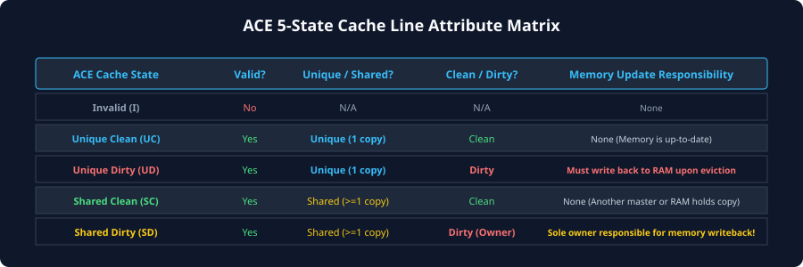
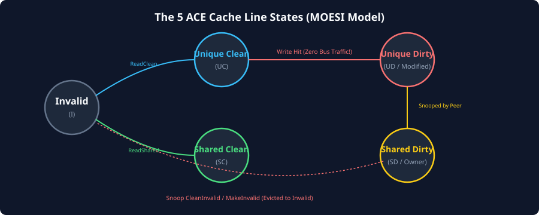

# Cache States and the MOESI / MESI Coherency Model

## The Foundations of Cache Line States
To coordinate multiple caches deterministically without continuously broadcasting data or locking entire memory regions, hardware coherency protocols attach metadata bits to every line in a cache. In modern architectures, a cache line typically spans 64 contiguous bytes (512 bits) aligned to a 64-byte boundary.

Every cache tag directory stores not only the physical address tag and data bytes, but also **coherency state bits**. These bits characterize the line along three fundamental orthogonal axes:

1. **Validity:** Does the line contain valid data that the local core can read without generating a bus transaction?
2. **Exclusivity (Uniqueness):** Is this line guaranteed to exist *only* in this local cache, or do peer caches potentially hold copies of the same physical address?
3. **Dirty Ownership (Memory Consistency):** Has the line been modified locally relative to main memory (DRAM), and is this local cache responsible for eventually writing the line back to memory upon eviction?



---

## The Five MOESI Cache States
The **MOESI** protocol represents the most comprehensive snooping coherency model in mainstream computer architecture. It extends the classic 4-state **MESI** protocol (Modified, Exclusive, Shared, Invalid) by introducing a fifth state: **Owned (O)**.

The AMBA ACE specification formally maps all coherent master transactions to these five fundamental states:

| State | Name | Valid? | Unique? | Dirty? | Memory Consistent? | Writeback Responsibility |
| :---: | :--- | :---: | :---: | :---: | :---: | :--- |
| **M** | **Modified** | **Yes** | **Yes** (Unique) | **Yes** (Dirty) | **No** (Stale DRAM) | **Yes** (Must write back upon eviction) |
| **O** | **Owned** | **Yes** | **No** (Shared) | **Yes** (Dirty) | **No** (Stale DRAM) | **Yes** (Responsible for writing back to DRAM) |
| **E** | **Exclusive** | **Yes** | **Yes** (Unique) | **No** (Clean) | **Yes** (DRAM is identical) | **No** (May be silently discarded upon eviction) |
| **S** | **Shared** | **Yes** | **No** (Shared) | **No** (Clean or non-owning) | **Depends** (May be clean or stale DRAM) | **No** (Does not write back to DRAM upon eviction) |
| **I** | **Invalid** | **No** | **N/A** | **N/A** | **N/A** | **No** (Line contains no valid data) |

### State-by-State Architectural Breakdown

### Invalid (I)
- The cache line is empty, unallocated, or has been invalidated by a peer write.
- The local processor cannot read or write this line. Any load or store instruction hitting an Invalid line causes a **cache miss** and triggers an external bus transaction.

### Exclusive (E)
- The cache line is valid and exists **only** in this local cache.
- The data is identical to main memory (Clean).
- **Key Advantage:** The local processor can perform a store instruction to this line immediately without notifying the interconnect or snooping other cores, transitioning silently from `Exclusive` to `Modified`. This saves bus bandwidth during private memory operations.

### Modified (M)
- The cache line is valid and exists **only** in this local cache (Unique).
- The data has been modified locally and is **dirty** (main memory contains stale data).
- The local processor has exclusive ownership. If another master requests this address, this core must supply the modified data and/or push it to memory.

### Shared (S)
- The cache line is valid and may be present in one or more other peer caches.
- The local core can freely read this line without bus transactions.
- The local core **cannot write** to this line directly. To execute a store, it must issue an invalidation transaction across the bus to force all peer caches to transition their copies to `Invalid`.
- In MESI, a line in `Shared` is always clean relative to memory. In MOESI, a line in `Shared` may be dirty relative to DRAM if another core currently holds the line in the `Owned` state!

### Owned (O)
- The cache line is valid and shared among multiple caches, but it is **dirty** with respect to main memory.
- Exactly **one** cache in the entire SoC holds the line in the `Owned` state; all other caches caching this address hold it in the `Shared` state.
- The `Owner` is the sole designated custodian of the dirty line. It is responsible for supplying data to peer snoop requests and performing the eventual writeback to DRAM when evicting the line.

---

## MOESI State Transition Dynamics
Cache line state transitions are triggered by two distinct classes of events:
1. **Local Core Events:** Load (Read) or Store (Write) operations executed by the processor core attached to this cache.
2. **External Snoop Events:** Inbound snoop requests received from the interconnect via the ACE snoop channels (`AC`), initiated by peer masters.



### Master State Transition Matrix

The table below details state transitions for both local processor actions and external snoop requests:

| Current State | Local Load (Read) | Local Store (Write) | External Snoop Read (`ReadShared`) | External Snoop Invalidate (`CleanInvalid` / `MakeUnique`) | Local Eviction |
| :---: | :--- | :--- | :--- | :--- | :--- |
| **I** | Miss $\rightarrow$ Issue `ReadShared` / `ReadOnce` $\rightarrow$ **E** or **S** | Miss $\rightarrow$ Issue `ReadUnique` $\rightarrow$ **M** | N/A (Ignore snoop) | N/A (Ignore snoop) | No action needed |
| **S** | Hit $\rightarrow$ Remain in **S** | Hit $\rightarrow$ Issue `CleanUnique` $\rightarrow$ **M** | Hit $\rightarrow$ Remain in **S** (Peer reads line) | Invalidate $\rightarrow$ **I** | Silent discard $\rightarrow$ **I** |
| **E** | Hit $\rightarrow$ Remain in **E** | Hit $\rightarrow$ Silent upgrade $\rightarrow$ **M** (No bus transaction!) | Hit $\rightarrow$ Transition to **S** (Supply data to peer) | Invalidate $\rightarrow$ **I** | Silent discard $\rightarrow$ **I** |
| **O** | Hit $\rightarrow$ Remain in **O** | Hit $\rightarrow$ Issue `CleanUnique` $\rightarrow$ **M** (Invalidate peers) | Hit $\rightarrow$ Remain in **O** (Supply data on CD channel) | Invalidate $\rightarrow$ Writeback to memory $\rightarrow$ **I** | Must Writeback $\rightarrow$ **I** |
| **M** | Hit $\rightarrow$ Remain in **M** | Hit $\rightarrow$ Remain in **M** | Hit $\rightarrow$ Transition to **O** (MOESI) or **S** + writeback (MESI) | Invalidate $\rightarrow$ Writeback to memory $\rightarrow$ **I** | Must Writeback $\rightarrow$ **I** |

---

## The Critical Advantage of MOESI Over MESI
To appreciate why high-performance ARM architectures adopt MOESI, consider what occurs when Core 0 holds a line in the `Modified` state, and Core 1 attempts to read that same line:

```
[MESI Protocol Sequence]
Core 1: Issues Read
Interconnect: Snoops Core 0
Core 0: Holds line in Modified (Dirty)
  Step 1: Core 0 MUST write dirty data back to DRAM (High Latency Writeback)
  Step 2: Core 0 transitions its line to Shared (Clean)
  Step 3: DRAM controller accepts data, then serves data to Core 1
  Step 4: Core 1 transitions its line to Shared (Clean)
RESULT: High latency, unnecessary off-chip memory traffic.
```

Now consider the same scenario under **MOESI**:

```
[MOESI Protocol Sequence]
Core 1: Issues ReadShared
Interconnect: Snoops Core 0
Core 0: Holds line in Modified (Dirty)
  Step 1: Core 0 transitions its state from Modified -> Owned
  Step 2: Core 0 supplies dirty data DIRECTLY to Core 1 over CD bus
  Step 3: Core 1 receives data and transitions to Shared
  Step 4: NO DRAM ACCESS OCCURS! DRAM remains stale, but system is coherent.
RESULT: Near-zero latency, zero DRAM energy consumed.
```

By allowing dirty data to be shared directly between peer caches without forcing a synchronous writeback to external memory, MOESI dramatically reduces off-chip memory bus contention and energy consumption in multi-threaded workloads.

---

## State Invariants in Coherent Systems
For any coherent address $A$ across the entire multi-core system, a set of fundamental **protocol invariants** must be upheld at all times:

1. **Single-Writer Invariant (SWMR - Single Writer, Multiple Readers):**
   $$\sum \text{Modified}(A) + \sum \text{Owned}(A) \le 1$$
   If any cache holds address $A$ in the `Modified` state, no other cache in the system may hold address $A$ in any valid state (`E`, `O`, `S`, or `M`). It is uniquely owned.
   If a cache holds address $A$ in the `Owned` state, no other cache may hold address $A$ in `Modified`, `Exclusive`, or `Owned`; other caches may only hold it in `Shared` or `Invalid`.

2. **Clean Exclusivity Invariant:**
   $$\text{Exclusive}(A) \implies \text{TotalCopies}(A) == 1 \land \text{IsClean}(A) == \text{True}$$
   If a cache holds address $A$ in `Exclusive`, no other cache may hold that line, and main memory is guaranteed to be identical to the cache content.

3. **Silent Eviction Boundary:**
   Only lines in clean states (`Exclusive` and `Shared` in MESI; `Exclusive` and clean `Shared` in MOESI) may be evicted silently without initiating bus writeback transactions. Lines in dirty states (`Modified` and `Owned`) **must** initiate an eviction writeback to guarantee that data updates are never lost.

---

## Chapter Summary
- Cache lines are defined by three orthogonal attributes: **Validity**, **Uniqueness**, and **Dirty Ownership**.
- The **MOESI** model defines five discrete states: Modified, Owned, Exclusive, Shared, and Invalid.
- The **Owned (O)** state permits sharing of dirty data between multiple caches without forcing an immediate writeback to main memory.
- The **Exclusive (E)** state allows a core to upgrade to `Modified` silently upon a local store without issuing a bus invalidation, saving significant interconnect bandwidth.
- Hardware coherency strictly maintains the **Single Writer, Multiple Readers (SWMR)** invariant to eliminate memory hazards.

---

## Review Questions

1. **Why does transitioning from `Exclusive` to `Modified` require no bus transactions, whereas transitioning from `Shared` to `Modified` requires an explicit bus transaction?**
   <details>
   <summary>Click to view answer</summary>
   In the `Exclusive` state, the local cache is guaranteed to be the sole holder of that cache line in the entire system; no peer caches hold copies. Therefore, modifying the line locally cannot invalidate or corrupt any peer copy, allowing a silent local transition. In contrast, in the `Shared` state, one or more peer caches may hold identical copies. Before the local core can modify the line, it must issue an invalidation request (`CleanUnique` or `MakeUnique`) over the bus to force all peer caches to transition their copies to `Invalid`, ensuring single-writer exclusivity.
   </details>

2. **Under MOESI, if Core A has a line in the `Owned` state and Core B has the same line in `Shared`, what happens if Core B attempts to write to that line?**
   <details>
   <summary>Click to view answer</summary>
   Core B cannot write while in `Shared`. Core B must issue a `CleanUnique` transaction across the interconnect. The interconnect snoops all peers, including Core A. Core A responds to the snoop by invalidating its copy (transitioning from `Owned` to `Invalid`) and passing the dirty responsibility to Core B (or Core B fetches the line). Once all peers are invalidated, Core B transitions to `Modified` and commits its write.
   </details>

3. **Can multiple caches hold the same physical address in the `Owned` state simultaneously? Explain why or why not.**
   <details>
   <summary>Click to view answer</summary>
   No. By definition of the MOESI protocol, the `Owned` state designates the single, unique custodian responsible for writing back the dirty line to main memory upon eviction. If multiple caches held the line in `Owned`, they would both attempt writebacks upon eviction and could cause conflicting snoop data responses, violating the Single-Owner invariant.
   </details>

4. **What is a "silent eviction", and which MOESI states permit it?**
   <details>
   <summary>Click to view answer</summary>
   A silent eviction occurs when a cache discards a cache line to make room for a new allocation without notifying the interconnect or issuing a bus transaction. Silent evictions are permitted only for lines that are clean and non-owning: specifically `Exclusive` (E) and clean `Shared` (S). Dirty lines in `Modified` (M) or `Owned` (O) cannot be evicted silently because doing so would cause permanent data loss; they must initiate a writeback transaction to DRAM or downstream caches.
   </details>

---

##### Copyright (c) 2026 squared-studio

