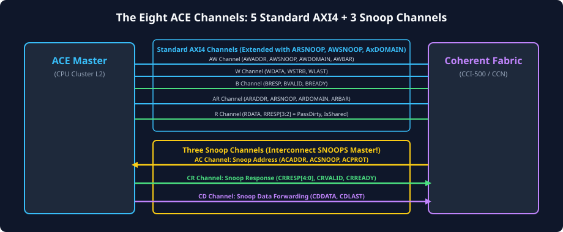
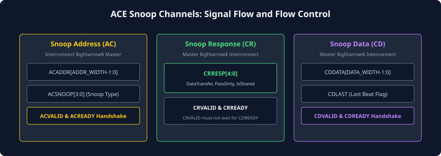

# ACE Channel Architecture & Signal Dictionary

## Expanding the Five AXI Channels into Eight ACE Channels
The foundational innovation of standard AMBA AXI4 is its five decoupled, unidirectional transaction channels:
1. **Read Address Channel (`AR`)**
2. **Read Data Channel (`R`)**
3. **Write Address Channel (`AW`)**
4. **Write Data Channel (`W`)**
5. **Write Response Channel (`B`)**

In standard AXI, transaction flow is strictly unidirectional: a master issues requests on the address channels (`AR`/`AW`), transfers data on data channels (`R`/`W`), and receives status responses (`R`/`B`). Slaves never initiate requests toward a master.

To support hardware cache coherency, the interconnect must be able to **reverse the direction of inquiry**. When Master A issues a read request for an address cached inside Master B, the interconnect must actively query ("snoop") Master B's private cache tag directory and extract the line if necessary.

AMBA ACE achieves this by adding **three dedicated snoop channels** flowing from the interconnect into the master:
6. **Snoop Address Channel (`AC`):** Interconnect sends snoop addresses and snoop transaction types to the master.
7. **Snoop Response Channel (`CR`):** Master responds with its cache line state (`CRRESP`), indicating whether it hit, held dirty data, or retained a shared copy.
8. **Snoop Data Channel (`CD`):** Master outputs the requested dirty or shared cache line data back to the interconnect.



---

## Master-to-Interconnect Extensions on Existing AXI Channels
Rather than creating entirely separate command interfaces, ACE augments the existing `AR`, `AW`, and `R` channels with additional sideband signals:

### Coherency Extensions on `AR` and `AW`:
- **`AxDOMAIN[1:0]` (Address Domain):** Indicates the shareability domain of the transaction (Non-shareable, Inner Shareable, Outer Shareable, System).
- **`AxSNOOP[2:0]` / `AxSNOOP[3:0]` (Snoop Transaction Type):** Specifies the exact coherent operation being requested (e.g., `ReadShared`, `ReadUnique`, `CleanShared`, `CleanInvalid`, `MakeUnique`).
- **`AxBAR[1:0]` (Barrier Signaling):** Encodes memory and synchronization barrier requests across the interconnect.

### Coherency Extensions on `R` (Read Data):
- **`RRESP[3:2]` (Extended Read Response):**
  - Standard AXI uses `RRESP[1:0]` for `OKAY`, `EXOKAY`, `SLVERR`, and `DECERR`.
  - ACE expands `RRESP` to convey cache allocation status back to the requesting master:
    - `RRESP[2]` (`PassDirty`): Interconnect passes dirty ownership responsibility to the reader.
    - `RRESP[3]` (`IsShared`): Interconnect notifies the reader that another master still holds a copy of this line in the `Shared` state.

---

## The Three Dedicated Snoop Channels
The three snoop channels (`AC`, `CR`, `CD`) operate concurrently and independently from the primary AXI channels. They allow the interconnect to interrogate a master's local cache without stalling or flushing the master's ongoing internal pipeline.



### Snoop Address Channel (`AC`)
The interconnect asserts `ACVALID` to present a snoop request to the cached master.
- **`ACADDR[M-1:0]`:** The cache-line-aligned physical address being snooped.
- **`ACSNOOP[3:0]`:** The specific snoop command sent to the cache (e.g., `ReadShared`, `ReadUnique`, `CleanInvalid`, `MakeInvalid`).
- **`ACPROT[2:0]`:** Protection attributes of the snoop request (Privileged/User, Secure/Non-secure, Instruction/Data).
- Handshake: The request is accepted when both `ACVALID` and `ACREADY` are asserted HIGH on the same rising clock edge.

### Snoop Response Channel (`CR`)
Once the master's cache controller looks up the requested address in its tag directory, it asserts `CRVALID` and returns the snoop status on `CRRESP[4:0]`.
- **`CRRESP[0]` (`DataTransfer`):** Asserted HIGH if the master will provide the cache line data on the `CD` channel.
- **`CRRESP[1]` (`Error`):** Asserted HIGH if an uncorrectable cache error (e.g., multi-bit ECC failure) occurred during tag or data lookup.
- **`CRRESP[2]` (`PassDirty`):** Asserted HIGH if the master held dirty data and is transferring dirty ownership to the interconnect.
- **`CRRESP[3]` (`IsShared`):** Asserted HIGH if the master continues to hold a valid copy of this line in the `Shared` state after completing the snoop.
- Handshake: The response commits when both `CRVALID` and `CRREADY` are HIGH.

### Snoop Data Channel (`CD`)
If and only if `CRRESP[0]` (`DataTransfer`) is asserted HIGH, the master must transmit the actual cache line data across the `CD` channel.
- **`CDDATA[DATA_WIDTH-1:0]`:** The cache line data words (typically 64, 128, 256, or 512 bits wide).
- **`CDLAST`:** Asserted HIGH on the final beat of a multi-beat cache line data burst.
- Handshake: Data beats are transferred on any clock cycle where both `CDVALID` and `CDREADY` are HIGH.

---

## Comprehensive ACE Signal Dictionary

The following table summarizes all primary ACE interface signals, their physical widths, their direction relative to the ACE Master, and their protocol function:

| Signal | Width | Direction | Channel | Description |
| :--- | :---: | :---: | :---: | :--- |
| **`ACLK`** | 1 | Input | Global | Global clock source. All signals sampled on rising edge. |
| **`ARESETn`** | 1 | Input | Global | Active-LOW asynchronous/synchronous reset. |
| **`ARADDR`** | 32/64 | Output | AR | Read physical address. |
| **`ARVALID`** | 1 | Output | AR | Indicates valid read address and control signals. |
| **`ARREADY`** | 1 | Input | AR | Slave/Interconnect ready to accept read address. |
| **`ARDOMAIN`**| 2 | Output | AR | Shareability domain for read request (Non/Inner/Outer/System). |
| **`ARSNOOP`** | 4 | Output | AR | Coherent read transaction type. |
| **`ARBAR`**   | 2 | Output | AR | Barrier attribute encoding for read transactions. |
| **`RDATA`**   | Config | Input | R | Read data payload returned to master. |
| **`RRESP`**   | 4 | Input | R | Read status: bits [1:0] error status; bits [3:2] coherency flags. |
| **`RLAST`**   | 1 | Input | R | Indicates final beat of read data burst. |
| **`RVALID`**  | 1 | Input | R | Indicates valid read data is available. |
| **`RREADY`**  | 1 | Output | R | Master ready to accept read data. |
| **`AWADDR`** | 32/64 | Output | AW | Write physical address. |
| **`AWVALID`** | 1 | Output | AW | Indicates valid write address and control signals. |
| **`AWREADY`** | 1 | Input | AW | Slave/Interconnect ready to accept write address. |
| **`AWDOMAIN`**| 2 | Output | AW | Shareability domain for write request. |
| **`AWSNOOP`** | 3 | Output | AW | Coherent write transaction type. |
| **`AWBAR`**   | 2 | Output | AW | Barrier attribute encoding for write transactions. |
| **`WDATA`**   | Config | Output | W | Write data payload from master. |
| **`WSTRB`**   | Data/8 | Output | W | Byte-level write strobes. |
| **`WLAST`**   | 1 | Output | W | Indicates final beat of write burst. |
| **`WVALID`**  | 1 | Output | W | Indicates valid write data is present. |
| **`WREADY`**  | 1 | Input | W | Interconnect ready to accept write data. |
| **`BRESP`**   | 2 | Input | B | Write transaction completion response. |
| **`BVALID`**  | 1 | Input | B | Indicates valid write response is present. |
| **`BREADY`**  | 1 | Output | B | Master ready to accept write response. |
| **`ACADDR`**  | 32/64 | Input | AC | Inbound snoop address from interconnect. |
| **`ACSNOOP`** | 4 | Input | AC | Inbound snoop transaction type. |
| **`ACPROT`**  | 3 | Input | AC | Inbound snoop protection attributes. |
| **`ACVALID`** | 1 | Input | AC | Interconnect asserts valid snoop address. |
| **`ACREADY`** | 1 | Output | AC | Master ready to accept snoop request into pipeline. |
| **`CRRESP`**  | 5 | Output | CR | Outbound snoop response status flags. |
| **`CRVALID`** | 1 | Output | CR | Master asserts valid snoop response. |
| **`CRREADY`** | 1 | Input | CR | Interconnect ready to accept snoop response. |
| **`CDDATA`**  | Config | Output | CD | Outbound snoop data payload from master cache. |
| **`CDLAST`**  | 1 | Output | CD | Indicates final beat of snoop data burst. |
| **`CDVALID`** | 1 | Output | CD | Master asserts valid snoop data. |
| **`CDREADY`** | 1 | Input | CD | Interconnect ready to accept snoop data. |

---

## Handshake Dependencies and Deadlock Prevention
Deadlock prevention is the single most critical verification imperative in coherent interconnect design. When two masters issue transactions simultaneously, cross-dependent waiting cycles can permanently lock the entire SoC bus.

### Permitted vs. Prohibited Handshake Dependencies

```
[Master Request Channels]
ARVALID / AWVALID ----------------------> Interconnect ACREADY
       ^                                            |
       |                                            v
(PROHIBITED: ACREADY must NOT depend on AR/AWVALID) (CANNOT WAIT)
```

The ACE specification mandates strict, unidirectional handshake dependency rules:

1. **`ACREADY` Independence Rule:**
   - A master **must never** make the assertion of `ACREADY` dependent on the assertion or completion of any master-initiated transaction (`ARVALID`, `AWVALID`, `WVALID`, `BREADY`, or `RREADY`).
   - If an incoming snoop arrives on `AC`, the master *must* accept and process it regardless of whether the master's own read or write requests are stalled waiting for bus grants. Violating this rule creates a circular wait deadlock.

2. **`CRVALID` Dependency on `ACVALID`:**
   - A master can only assert `CRVALID` after an `AC` handshake has completed (or concurrently, once `ACVALID` is observed).

3. **`CDVALID` Dependency on `CRVALID`:**
   - A master is permitted to assert `CDVALID` before, during, or after `CRVALID`. However, the interconnect typically pairs the snoop data transfer with the matching response tag.

4. **Snoop Response Cannot Wait on External Memory:**
   - A master's response on `CR` and `CD` must be derived purely from its internal cache state. A master cannot pause a snoop response to wait for its own pending memory fills from downstream DRAM.

---

## Chapter Summary
- AMBA ACE expands the 5 AXI channels into **8 channels** by adding `AC` (Snoop Address), `CR` (Snoop Response), and `CD` (Snoop Data).
- Standard channels are extended with `AxDOMAIN` (shareability scope), `AxSNOOP` (coherent operation encoding), `AxBAR` (barriers), and extended `RRESP` bits (`PassDirty`, `IsShared`).
- The snoop channels are unidirectional from interconnect to master (`AC`) and master back to interconnect (`CR`, `CD`).
- Deadlock avoidance rules strictly prohibit `ACREADY` from depending on any outgoing master requests (`ARVALID`/`AWVALID`).

---

## Review Questions

1. **Why does ACE add three dedicated channels (`AC`, `CR`, `CD`) rather than multiplexing snoop traffic onto the existing `AR`, `R`, and `W` channels?**
   <details>
   <summary>Click to view answer</summary>
   Multiplexing snoop requests onto the existing AXI channels would cause severe pipeline stalls and head-of-line blocking. Normal read/write requests flow from Master to Slave, whereas snoop requests flow from Interconnect to Master. Dedicated snoop channels provide independent bandwidth, allow the core to process snoops concurrently with ongoing memory transfers, and eliminate circular handshake dependencies that would otherwise cause interconnect deadlocks.
   </details>

2. **What information does the master communicate via `CRRESP[3]` (`IsShared`), and why is it essential for the interconnect?**
   <details>
   <summary>Click to view answer</summary>
   `CRRESP[3]` (`IsShared`) tells the interconnect whether the snooped master is retaining a valid copy of the cache line in the `Shared` state after the snoop completes. If no snooped master asserts `IsShared`, the requesting master knows that it is the sole holder of the line and can allocate it in the `Exclusive` state instead of `Shared`. This allows future local writes to proceed silently without bus invalidations.
   </details>

3. **Explain the protocol rule regarding `ACREADY` assertion and how violating it leads to system deadlock.**
   <details>
   <summary>Click to view answer</summary>
   The rule mandates that `ACREADY` must never depend on the interconnect asserting `ARREADY` or `AWREADY`. If Master A issues an `ARVALID` to the interconnect, and the interconnect needs to snoop Master A (or Master B) before acknowledging Master A's read, but Master A stalls its `ACREADY` waiting for its `ARREADY` to assert first, neither side can ever make forward progress. The system becomes permanently deadlocked.
   </details>

4. **When is a master required to assert `CDVALID` to transfer data on the `CD` channel?**
   <details>
   <summary>Click to view answer</summary>
   A master is required to assert `CDVALID` and transmit cache line data on the `CD` channel if and only if it asserts `CRRESP[0]` (`DataTransfer`) HIGH during its snoop response on the `CR` channel. If `CRRESP[0]` is LOW (indicating a cache miss, clean line without transfer, or invalidation without data return), the master must not drive the `CD` channel.
   </details>

---

##### Copyright (c) 2026 squared-studio

