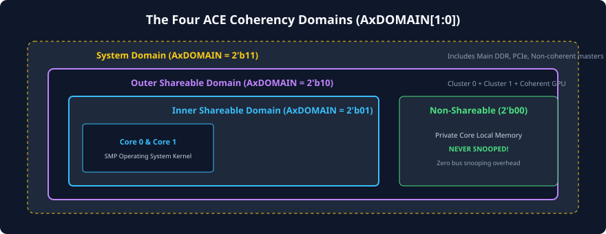
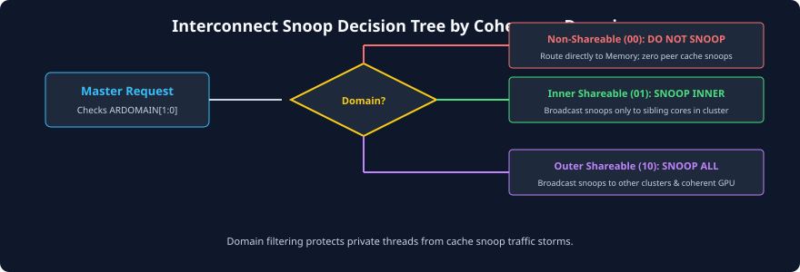

# Coherency Domains and Memory Types

## The Concept of Coherency Domains

In an enterprise or mobile SoC containing dozens of processing units, broadcasting every single memory transaction to every single cache tag directory in the system is disastrous for energy efficiency and bus performance. If an application core accesses private stack memory or a thread-local variable, broadcasting snoop inquiries to the GPU, video decoder, and secondary CPU clusters burns useless dynamic power and stalls their tag RAMs.

To eliminate this waste, the AMBA ACE protocol introduces the concept of **Coherency Domains** (also known as **Shareability Domains**). A coherency domain defines the precise boundary within which hardware must enforce cache coherency for a given memory transaction.



---

## The Four AMBA ACE Shareability Domains

The ACE specification classifies memory transactions into four hierarchically nested domains, encoded on the 2-bit bus signals **`ARDOMAIN[1:0]`** (for reads) and **`AWDOMAIN[1:0]`** (for writes):

| `AxDOMAIN[1:0]` | Domain Name         | Scope and Participating Masters                                                                                                       | Typical Use Cases                                                                                   |
| :-------------: | :------------------ | :------------------------------------------------------------------------------------------------------------------------------------ | :-------------------------------------------------------------------------------------------------- |
|   **`0b00`**    | **Non-shareable**   | Private to the issuing master only. No other masters in the SoC can share or cache this memory address.                               | Private core stack, thread-local storage, private operating system data structures.                 |
|   **`0b01`**    | **Inner Shareable** | Coherent across all cores within the local processing cluster (e.g., all 4 cores in a multi-core CPU cluster sharing an L2/L3 cache). | Multi-threaded SMP applications running across CPU cores of the same cluster.                       |
|   **`0b10`**    | **Outer Shareable** | Coherent across multiple heterogeneous clusters (e.g., CPU Cluster 0, CPU Cluster 1, and an integrated GPU or DSP).                   | Heterogeneous compute pipelines, shared framebuffers, zero-copy machine learning inference buffers. |
|   **`0b11`**    | **System**          | Encompasses all observers across the entire SoC, including external PCIe agents, DMA engines, and off-chip peripherals.               | System-wide memory-mapped I/O, boot ROMs, system initialization barriers.                           |

---

## Mapping Software MMU Attributes to Bus Signals

In modern systems, coherency domains are not hard-coded in silicon; they are dynamically programmed by the operating system (Linux, Android, Windows) inside the processor's **Memory Management Unit (MMU) Page Tables**.

When a CPU core executes a load or store instruction:

1. The **Translation Lookaside Buffer (TLB)** resolves the virtual address to a physical address.
2. The page table entry provides the memory type attributes:
   - **Shareability:** Non-shareable, Inner Shareable, or Outer Shareable.
   - **Cacheability:** Write-Back, Write-Through, or Non-cacheable.
3. The core's bus interface unit automatically converts these architectural attributes directly into the hardware bus signals **`AxDOMAIN[1:0]`** and **`AxCACHE[3:0]`**.

```
[Virtual Memory Page Table Entry]
  +-------------------------------------------------------+
  | Physical Address | Shareability (SH) | Cacheable (Mem)|
  +------------------+-------------------+----------------+
          |                   |                  |
          v                   v                  v
       [Physical Address] [AxDOMAIN[1:0]]    [AxCACHE[3:0]]
```

### AxDOMAIN and AxCACHE Interaction Matrix

| Memory Type                        | `AxDOMAIN[1:0]` |   `AxCACHE[3:0]`    | Interconnect Snooping Behavior                                                      |
| :--------------------------------- | :-------------: | :-----------------: | :---------------------------------------------------------------------------------- |
| **Normal Memory, Non-shareable**   |     `0b00`      | `0b1111` (WB Alloc) | Interconnect **never** snoops peer caches. Transmits directly to main memory/L3.    |
| **Normal Memory, Inner Shareable** |     `0b01`      | `0b1111` (WB Alloc) | Interconnect snoops **only** masters belonging to the Inner Shareable domain.       |
| **Normal Memory, Outer Shareable** |     `0b10`      | `0b1111` (WB Alloc) | Interconnect snoops **both** Inner and Outer Shareable masters across all clusters. |
| **Device / Non-cacheable**         |     `0b11`      |  `0b0000` (Device)  | No cache allocation permitted. Strictly ordered, uncached read/write to peripheral. |

---

## Interconnect Domain Filtering Mechanics

The coherent interconnect serves as the hardware gatekeeper that enforces domain boundaries. When a master issues a transaction on `AR` or `AW`, the interconnect immediately samples `AxDOMAIN[1:0]`.



### Interconnect Execution Flowchart:

1. **Decode Domain:** Interconnect inspects `AxDOMAIN`.
2. **If `Non-shareable` (`0b00`):**
   - The interconnect immediately suppresses snoop generation.
   - No snoop requests are driven onto any master's `AC` channel.
   - The read or write request bypasses peer caches and proceeds straight to downstream memory.
3. **If `Inner Shareable` (`0b01`):**
   - The interconnect filters the snoop destination mask.
   - It issues `AC` snoop requests _only_ to peer masters located inside the same physical cluster as the requesting core. Outer masters (such as the GPU or another CPU cluster) are not disturbed.
4. **If `Outer Shareable` (`0b10`):**
   - The interconnect broadens the snoop mask to include all coherent masters in both the Inner and Outer domains.
5. **If `System` (`0b11`):**
   - The interconnect treats the transaction as system-wide, typically applying to memory barriers or DVM operations.

---

## Performance and Power Implications

Domain filtering is vital for sustaining energy-efficient high-bandwidth SoCs:

### Tag RAM Port Contention

Every core's L1/L2 cache has a limited number of read/write ports on its tag RAM. If every memory read in the SoC resulted in a broadcast snoop, the local core's execution pipeline would constantly stall because inbound snoop requests would contend for the tag RAM ports against the local core's own load/store execution. Pruning snoop traffic via domains ensures that tag RAM ports remain available for local CPU execution.

### Dynamic Power Reduction

Driving high-speed snoop wires (`AC`, `CR`, `CD`) across long interconnect routing distances burns significant dynamic switching power ($P = C V^2 f$). Filtering out non-shareable and inner-shareable transactions cuts dynamic switching power in the crossbar by up to 60-70% in typical operating system workloads.

### Lowering Interconnect Latency

By pruning the number of cores that must be snooped, the interconnect avoids waiting for snoop responses from slow or distant masters. The interconnect can gather responses from a tight local cluster in 4 to 8 cycles, rather than waiting 20 to 30 cycles for remote clusters to acknowledge.

---

## Chapter Summary

- AMBA ACE establishes four hierarchically nested **Coherency Domains**: Non-shareable, Inner Shareable, Outer Shareable, and System.
- Domains are signaled on the bus using the 2-bit **`AxDOMAIN`** signals.
- Operating system page table attributes directly configure `AxDOMAIN` and `AxCACHE` during address translation.
- The coherent interconnect relies on `AxDOMAIN` to **filter and prune** snoop generation, preventing unnecessary tag lookups and saving substantial power and bus latency.

---

## Review Questions

1. **What would happen if an operating system incorrectly marked a multi-threaded shared variable as `Non-shareable` in the MMU page table?**
   <details>
   <summary>Click to view answer</summary>
   If marked `Non-shareable`, the master sets `AxDOMAIN = 0b00`. The coherent interconnect will not snoop peer caches when that core reads or writes the variable. As a result, if two threads running on different cores modify and read the variable, they will not observe each other's updates, causing stale cache hits, silent data corruption, and catastrophic software race conditions.
   </details>

2. **Why does the ACE protocol provide both Inner Shareable and Outer Shareable domains instead of a single "Shareable" setting?**
   <details>
   <summary>Click to view answer</summary>
   Modern SoCs are structured into clusters (e.g., big.LITTLE architectures with high-performance cores in Cluster 0 and high-efficiency cores in Cluster 1, plus GPUs). Many multi-threaded tasks run exclusively within a single cluster. Having separate Inner and Outer domains allows the interconnect to restrict snoop broadcasts strictly to the local cluster (Inner), preventing snoop traffic from crossing power-hungry inter-cluster bridges when remote clusters are not participating in the shared workload.
   </details>

3. **Can an ACE transaction have `AxDOMAIN = Non-shareable` and still be cacheable (`AxCACHE = Write-Back`)? Explain.**
   <details>
   <summary>Click to view answer</summary>
   Yes, absolutely. A memory region can be private to a single core (hence `Non-shareable`), but the local core still desires maximum performance by allocating and caching it in its private L1/L2 caches using a Write-Back policy. In this case, `AxDOMAIN = 0b00` and `AxCACHE = 0b1111`. The interconnect knows it does not need to snoop other cores, but the requesting core is free to cache the line locally.
   </details>

4. **Which domain encoding (`AxDOMAIN`) is typically used for memory transactions targeting memory-mapped I/O (MMIO) peripheral registers?**
   <details>
   <summary>Click to view answer</summary>
   MMIO peripheral accesses typically use `AxDOMAIN = 0b00` (Non-shareable) or `0b11` (System), combined with `AxCACHE = 0b0000` (Device / Non-cacheable). Peripheral registers must never be cached in CPU caches, and writes must reach the hardware device directly in strict program order.
   </details>

---

##### Copyright (c) 2026 squared-studio
