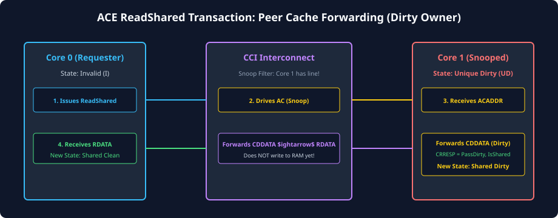
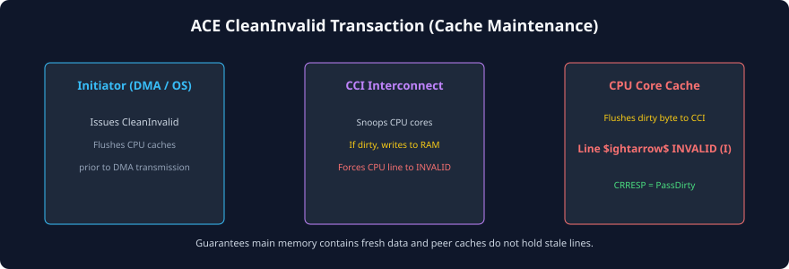

# Coherent Read and Clean Transactions

## Overview of Coherent Read Operations
In a standard AXI system, reading data is straightforward: the master drives an address on `AR` and receives data beats on `R`. In an AMBA ACE system, read operations are far more nuanced. A requesting master must declare its **caching intent** via the **`ARSNOOP[3:0]`** signals. 

Does the master intend to store the line in its private cache? Does it intend to modify the line in the immediate future? Can it accept responsibility for dirty data? By communicating its intent, the master enables the coherent interconnect to coordinate with peer caches, minimize DRAM accesses, and transition cache states seamlessly.

```
       [Requesting Master]                    [Coherent Interconnect]
                |                                        |
  Step 1: AR (ARSNOOP = ReadShared) -------------------->|
                |                                        |-- (Snoops Peers via AC)
                |                                        |<-- (Collects CRRESP / CDDATA)
  Step 2: R (RDATA, RRESP[3:2]) <-----------------------|
```

---

## Coherent Read Transaction Types
The ACE specification categorizes coherent read transactions according to how the requesting master and peer caches handle line allocation, sharing, and dirty ownership:

| `ARSNOOP[3:0]` | Transaction Name | Master Caching Intent | Permitted Master State | Peer Action Required |
| :---: | :--- | :--- | :---: | :--- |
| **`0b0000`** | **`ReadNoSnoop`** | Normal AXI read; no snooping. | N/A | None. Interconnect fetches data from memory/slave. |
| **`0b0000`** | **`ReadOnce`** | Master will read the data but **will not cache** it. | Remains Invalid | Peers do **not** invalidate; dirty peers provide data without writeback. |
| **`0b0001`** | **`ReadShared`** | Master intends to allocate line for read-only use. | **S** or **E** | Peers retain shared copy; dirty peers provide data and move to **O** or writeback. |
| **`0b0010`** | **`ReadClean`** | Master intends to allocate line; cannot accept dirty data. | **S** or **E** | Peers retain shared copy; dirty peers **must clean** line by writing back to DRAM. |
| **`0b0011`** | **`ReadNotSharedDirty`** | Master can accept dirty data only if it obtains exclusive ownership. | **S**, **E**, or **M** | If peer retains copy, dirty peer must write back to memory. |

### Architectural Deep-Dive on Read Types

### `ReadOnce`
Used predominantly by ACE-Lite masters (e.g., streaming DMA controllers or display processors) that need to read an up-to-date memory buffer without polluting their own internal buffers or forcing cached CPUs to evict their lines. If a peer CPU holds the buffer line in the `Modified` state, the interconnect snoops the CPU, retrieves the dirty data directly via the `CD` channel, delivers it to the DMA, and allows the CPU to retain its `Modified` state. Main memory is not touched!

### `ReadShared`
The standard instruction or data read used when a core experiences a cache read miss on shared memory. The master is prepared to share the line with peers. If any peer holds the line, the peer asserts `IsShared` on `CRRESP[3]`, and the requesting master allocates the line in the `Shared` (S) state. If no peer holds the line, the interconnect clears `IsShared`, allowing the master to allocate the line directly in the `Exclusive` (E) state.

### `ReadClean`
Used by cores with simpler cache controllers that lack the hardware logic to manage dirty shared data (i.e., pure MESI masters). If a peer holds dirty data, the peer is forced to write the dirty data back to DRAM so the requesting master receives a guaranteed clean copy.

---

## Detailed Transaction Walkthrough: `ReadShared` with Peer Dirty Hit
The sequence diagram below illustrates the complete lifecycle of a `ReadShared` transaction where Master 0 requests an address that Master 1 holds in the `Modified` (dirty) state:



### Step-by-Step Execution Sequence:
1. **Master 0 Issues Read:** Master 0 experiences a cache miss on physical address `0x4000_0000`. It asserts `ARVALID` on its `AR` channel with `ARSNOOP = ReadShared` and `ARDOMAIN = Inner Shareable`.
2. **Interconnect Broadcasts Snoop:** The interconnect receives the request, identifies address `0x4000_0000` as belonging to the Inner Shareable domain, and asserts `ACVALID` on Master 1's `AC` channel with `ACSNOOP = ReadShared`.
3. **Master 1 Tag Lookup:** Master 1's cache controller receives the snoop request, checks its tag directory, and detects a cache hit in the `Modified` state.
4. **Master 1 Responds via `CR` & `CD`:**
   - Master 1 transitions its internal cache state from `Modified` (M) to `Owned` (O).
   - Master 1 asserts `CRVALID` with `CRRESP = 0b01101` (`DataTransfer = 1`, `PassDirty = 1`, `IsShared = 1`).
   - Concurrently, Master 1 drives the 64-byte cache line data onto the `CD` channel (`CDDATA`, `CDLAST`, `CDVALID`).
5. **Direct Cache-to-Cache Forwarding:** The interconnect captures the snoop data from `CD` and routes it directly to Master 0's `R` channel. No DRAM read is needed!
6. **Master 0 Allocation:** Master 0 receives `RDATA` along with `RRESP[3:2]`. Because `IsShared = 1`, Master 0 allocates the cache line into its L1 cache in the `Shared` (S) state.
7. **Consistent System State:** Master 1 is now in `Owned` (responsible for future writeback), Master 0 is in `Shared`, and DRAM remains stale without causing any coherency violation.

---

## Clean Transactions and Cache Maintenance
Clean transactions are initiated when a master needs to force dirty cache data back to downstream memory or invalidate peer copies without performing an actual data read.

| `ARSNOOP[3:0]` | Transaction Name | Purpose | Master Cache State After Completion | Peer Cache State After Completion |
| :---: | :--- | :--- | :---: | :---: |
| **`0b1000`** | **`CleanShared`** | Flushes dirty data to main memory while allowing peers to keep clean copies. | Retains **S** or **E** | Retains **S**; dirty peers flush to memory and transition to **S**. |
| **`0b1001`** | **`CleanInvalid`** | Forces all dirty data to main memory and invalidates all copies in peer caches. | Transitions to **I** | Transitions to **I**; dirty peers flush to memory. |
| **`0b1011`** | **`MakeInvalid`** | Invalidates all peer caches without pushing dirty data to memory. | Transitions to **I** | Transitions to **I**; dirty data discarded (used for deallocating buffers). |
| **`0b1101`** | **`CleanUnique`** | Invalidates all peer copies before local store; master already has clean data. | Transitions to **M** | Peer copies invalidated (**I**). |



### Deep-Dive on `CleanUnique`
Consider a core that holds a cache line in the `Shared` state (read-only). The software thread now executes a store instruction to that line. The core already has valid, up-to-date data in its cache—it does not need to re-read the data from the bus! 

Instead, the core issues a **`CleanUnique`** transaction on the `AR` channel. The interconnect snoops all peer caches, forcing them to transition their copies to `Invalid`. The peer caches return snoop responses confirming invalidation. Once the interconnect confirms invalidation, it sends a read response (`RRESP`) with zero data beats or dummy acknowledgement back to the requesting core. The requesting core immediately promotes its line from `Shared` to `Modified` and commits the store locally.

---

## Extended Read Response Signaling (`RRESP[3:2]`)
Standard AXI4 read responses use `RRESP[1:0]` exclusively for transaction status:
- `0b00`: `OKAY`
- `0b01`: `EXOKAY`
- `0b10`: `SLVERR`
- `0b11`: `DECERR`

In AMBA ACE, the interconnect appends two additional bits: **`RRESP[3:2]`**. These bits provide the requesting master with critical coherency context:

```
RRESP[3:0] Bitfield:
 +---------------+----------------+---------------------------+
 | Bit 3: IsShared | Bit 2: PassDirty | Bits [1:0]: AXI Error Code|
 +---------------+----------------+---------------------------+
```

1. **`RRESP[3]` (`IsShared`):**
   - **`0` (Unique):** No peer cache holds a valid copy of this line. The master should allocate the line in the `Exclusive` (E) or `Modified` (M) state.
   - **`1` (Shared):** At least one peer cache holds a valid copy of this line. The master must allocate the line in the `Shared` (S) state.

2. **`RRESP[2]` (`PassDirty`):**
   - **`0` (Clean):** The data received is clean, or another master remains the designated dirty Owner. The master does not assume writeback responsibility.
   - **`1` (Dirty Ownership Transferred):** The master has been handed responsibility for writing this dirty data back to memory upon eviction.

---

## Chapter Summary
- Coherent reads convey caching intent via **`ARSNOOP`**, distinguishing between streaming non-cached reads (`ReadOnce`) and allocating cached reads (`ReadShared`, `ReadClean`).
- Peer caches holding dirty data can satisfy read requests directly over the **`CD` channel** (Direct Cache-to-Cache Transfer), bypassing slow DRAM.
- Clean transactions (`CleanShared`, `CleanInvalid`, `CleanUnique`) manage cache flushing and peer invalidation without requiring unneeded data re-fetching.
- The extended **`RRESP[3:2]`** signals inform the requesting master whether it may allocate the line exclusively and whether it has inherited dirty writeback responsibility.

---

## Review Questions

1. **How does the `ReadOnce` transaction benefit a high-bandwidth PCIe DMA engine in an SoC?**
   <details>
   <summary>Click to view answer</summary>
   A PCIe DMA engine typically streams large buffers across the bus without caching them. By issuing `ReadOnce`, the DMA engine allows the interconnect to retrieve dirty data directly from CPU caches if necessary, without requiring the CPU to execute manual flush instructions beforehand and without invalidating the CPU's cache line. Furthermore, the DMA engine does not pollute CPU caches or allocate useless entries in its own buffers.
   </details>

2. **Under what condition can a master that issues a `ReadShared` transaction allocate the line in the `Exclusive` state instead of `Shared`?**
   <details>
   <summary>Click to view answer</summary>
   A master issuing `ReadShared` can allocate the line in the `Exclusive` state if and only if the interconnect returns `RRESP[3]` (`IsShared`) as `0`. This informs the requesting master that no other cached master in the shareability domain currently holds a valid copy of the requested physical address.
   </details>

3. **What is the difference in purpose between `CleanInvalid` and `MakeInvalid`?**
   <details>
   <summary>Click to view answer</summary>
   `CleanInvalid` ensures that any modified (dirty) data present in peer caches is written back to main memory before peer copies are invalidated, guaranteeing zero data loss. In contrast, `MakeInvalid` invalidates peer caches immediately without pushing dirty data to memory, intentionally discarding any dirty contents. `MakeInvalid` is used when deallocating or reinitializing scratchpad memory buffers where previous contents are no longer needed.
   </details>

4. **Why is `CleanUnique` issued on the Read Address channel (`AR`) even though its primary purpose is to prepare the master for a Write operation?**
   <details>
   <summary>Click to view answer</summary>
   In AMBA ACE, `CleanUnique` is classified as an address inquiry that does not transfer write payload data from the master. It is routed over `AR` so that the interconnect can perform snoop lookups and peer invalidations, returning completion via the read response channel (`RRESP`), freeing the `AW` and `W` channels for actual memory data writebacks.
   </details>

---

##### Copyright (c) 2026 squared-studio

