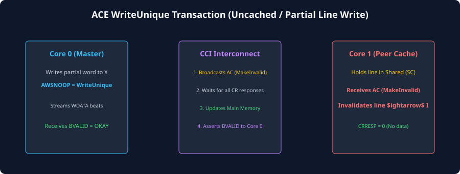
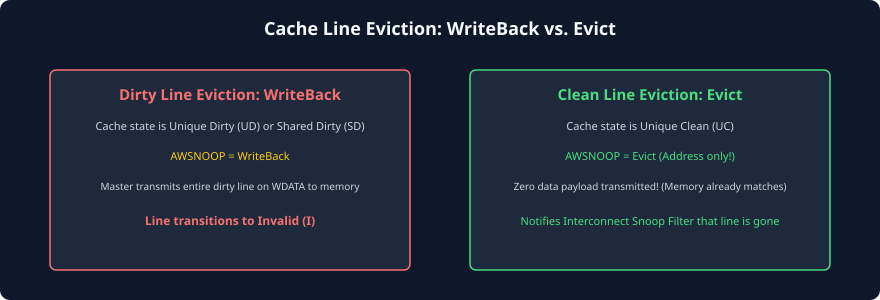

# Coherent Write, Eviction, and Make Transactions

## The Architecture of Coherent Writes
In a cache-coherent multi-core environment, modifying memory requires careful coordination to satisfy the Single-Writer Multiple-Readers (SWMR) invariant. A processor core cannot simply blast data onto a memory bus without first ensuring that:
1. All peer caches holding older copies of that memory line are **invalidated**.
2. Any peer cache holding a dirty copy of that memory line either yields its dirty data or has its dirty updates merged/overwritten deterministically.
3. The interconnect directory or snoop filter is notified of any line movements, upgrades, or evictions.

Coherent write operations in AMBA ACE occur across two primary interfaces:
- **Write Allocation Requests (via `AR`):** `ReadUnique` and `MakeUnique`, which acquire exclusive ownership before a write is performed locally.
- **Physical Write Transactions (via `AW`, `W`, `B`):** `WriteUnique`, `WriteLineUnique`, `WriteClean`, and `WriteBack`, which move data from the master to the interconnect and downstream memory.

```
+-----------------------------------------------------------------------------+
|                           WRITE TRANSACTION PHASES                          |
|                                                                             |
|  Phase 1: Ownership Acquisition (AR Channel)                                |
|  Master issues ReadUnique or MakeUnique  --> Peers Invalidated              |
|                                                                             |
|  Phase 2: Local Cache Commit                                                |
|  Processor modifies local L1 cache line  --> Line becomes Modified (M)      |
|                                                                             |
|  Phase 3: Eviction Writeback (AW/W Channels)                                |
|  Cache needs line space                  --> Issues WriteBack to DRAM       |
+-----------------------------------------------------------------------------+
```

---

## Write Allocation Transactions (`ReadUnique` and `MakeUnique`)
When a processor core executes a store instruction to an address that results in a cache miss, it must fetch and allocate the line before modifying it.

| Transaction Name | Channel | Master Initial State | Master Final State | Peer Action | Description |
| :--- | :---: | :---: | :---: | :---: | :--- |
| **`ReadUnique`** | `AR` | **I** (Invalid) | **M** (Modified) | All peers **invalidate**; dirty peer provides data. | Master reads line data with the explicit intention of immediately modifying it. Invalided all peers. |
| **`MakeUnique`** | `AR` | **I** or **S** | **M** (Modified) | All peers **invalidate**; dirty data discarded. | Master intends to overwrite the entire cache line completely. Fetches **no data** from peers or memory. |

### Why `MakeUnique` is a Critical Performance Optimization
Consider a standard C library function such as `memset(buf, 0, 4096)`. The processor is writing zeros to thousands of consecutive cache lines. 

If the processor used `ReadUnique`, it would waste massive bus bandwidth reading 4KB of old data from DRAM into its caches, only to overwrite that data with zeros one clock cycle later!

By issuing **`MakeUnique`**, the processor tells the interconnect: *"Invalidate all peer caches holding this line, but do NOT waste memory bandwidth fetching old data from DRAM or peer caches. I am going to overwrite every single byte myself."* This eliminates 100% of read traffic during large memory initializations and buffer allocations.

---

## Coherent Write Transactions on `AW` and `W`
When data is written out from a master's cache onto the interconnect, the master encodes the transaction on **`AWSNOOP[2:0]`**:

| `AWSNOOP[2:0]` | Transaction Name | Master Retains Copy? | Peer Caches Action | Destination |
| :---: | :--- | :---: | :--- | :--- |
| **`0b000`** | **`WriteNoSnoop`** | N/A | Ignored (No snoops generated) | Downstream slave / DRAM. |
| **`0b000`** | **`WriteUnique`** | **No** (Non-cached master) | Invalidate all peer caches. | Memory / downstream slave. |
| **`0b001`** | **`WriteLineUnique`** | **No** (Full line overwrite) | Invalidate all peer caches. | Memory / downstream slave. |
| **`0b010`** | **`WriteClean`** | **Yes** (Transitions to **S**) | Retain **S** (Peer clean copies untouched) | Main memory (cleans dirty line). |
| **`0b011`** | **`WriteBack`** | **No** (Transitions to **I**) | Untouched | Main memory (evicts dirty line). |



### Deep-Dive on `WriteUnique` and `WriteLineUnique`
These transactions are primarily used by I/O coherent masters (such as DMA engines or GPUs over ACE-Lite) that need to write data directly into memory without maintaining an internal cache.

1. **`WriteUnique`:** The master issues a partial or unaligned write. The interconnect snoops all cached CPUs. If a CPU holds that address in a dirty state, the interconnect extracts the dirty CPU data, merges the master's new write data with the existing dirty line, invalidates the CPU's copy, and writes the merged line back to DRAM.
2. **`WriteLineUnique`:** The master guarantees that it is writing an entire, aligned 64-byte cache line. The interconnect snoops all CPUs and invalidates their copies immediately without fetching their dirty data, since every byte in the line is being completely overwritten.

---

## Eviction Mechanics: `Evict` vs. `WriteBack`
In any cache architecture, allocating a new line into a full cache set requires **evicting** an existing line (the "victim"). The eviction behavior depends entirely on whether the victim line is dirty or clean.



### Dirty Eviction (`WriteBack`)
- If the victim line is in the **Modified (M)** or **Owned (O)** state, it contains modifications that do not exist in main memory.
- The master issues a **`WriteBack`** transaction on `AW` and `W`.
- The interconnect routes the 64-byte dirty payload downstream to DRAM or the system-level L3 cache.
- The master transitions its local state to **Invalid (I)**.

### Clean Eviction with Snoop Filters (`Evict`)
- In traditional MESI protocols, if the victim line is clean (**Exclusive** or **Shared**), the master simply discards the line silently. DRAM is already up-to-date, so no data needs to be written.
- **The Snoop Filter Dilemma:** In an advanced SoC with a central Snoop Filter (directory) inside the interconnect, silent evictions become a serious problem! If Master 0 silently discards a line, the central snoop filter still believes Master 0 holds a copy. Future transactions to that address will continue to snoop Master 0, causing wasted snoops and false sharing penalties.
- **The ACE Solution (`Evict` Transaction):** To solve this, ACE provides an explicit **`Evict`** transaction issued on the Read Address channel (`AR`):
  - `ARSNOOP = Evict` (`0b0100`).
  - Transfers **zero data**.
  - Serves as an address-only notification from the master to the interconnect: *"I have discarded address X from my local cache."*
  - The interconnect updates its internal snoop filter directory, removing Master 0 from the address tracking table.

---

## Write Barrier and Ordering Guarantees
Coherent writes must respect architectural ordering constraints. When a core issues a `WriteUnique` or `WriteBack`, the transaction is not considered globally observed simply because the address beat cleared the `AW` channel.

The write is only complete when the interconnect returns **`BVALID`** and **`BRESP`** on the Write Response channel (`B`). A valid response on the `B` channel certifies that:
1. All peer snoops have completed and all conflicting peer cache copies have been invalidated.
2. The write data has been accepted by downstream memory or committed to a serialized interconnect buffer.
3. Any subsequent read issued by any master in the shareability domain is guaranteed to observe the new write data.

---

## Chapter Summary
- Store misses trigger ownership acquisition on `AR` via **`ReadUnique`** (fetches data and invalidates peers) or **`MakeUnique`** (invalidates peers without fetching data).
- **`MakeUnique`** avoids wasting memory bandwidth when an entire cache line is about to be overwritten (e.g., in `memset`).
- Cache-line writebacks of dirty lines use **`WriteBack`** on `AW`/`W`.
- The address-only **`Evict`** transaction allows caches to notify central snoop filters when clean lines are discarded, preventing directory pollution.
- Write completion is signaled on the **`B` channel**, guaranteeing global observation and peer invalidation.

---

## Review Questions

1. **Why is `MakeUnique` significantly more power- and bandwidth-efficient than `ReadUnique` when initializing memory buffers?**
   <details>
   <summary>Click to view answer</summary>
   `ReadUnique` forces the interconnect to fetch the entire 64-byte cache line from DRAM or peer caches into the master's cache before the write occurs. When initializing memory (such as filling an array with zeros), this read traffic is completely wasted because every byte will be overwritten immediately. `MakeUnique` invalidates peer caches without fetching any data from DRAM or peers, saving 64 bytes of memory read bandwidth per cache line and eliminating unnecessary DRAM access energy.
   </details>

2. **What is the functional difference between `WriteUnique` and `WriteLineUnique`?**
   <details>
   <summary>Click to view answer</summary>
   `WriteUnique` can be a partial or unaligned write. If a peer cache holds that line in a dirty state, the interconnect must extract the peer's dirty line and merge the non-overwritten bytes before writing the line to DRAM. `WriteLineUnique` guarantees that the master is writing a complete, aligned 64-byte cache line. The interconnect can invalidate peer caches immediately without needing to read or merge their dirty data, since every single byte in the line will be replaced.
   </details>

3. **In what type of SoC interconnect architecture is the `Evict` transaction strictly required, and why?**
   <details>
   <summary>Click to view answer</summary>
   The `Evict` transaction is required in systems containing a centralized or distributed **Snoop Filter** (directory) inside the coherent interconnect. While clean lines can theoretically be dropped silently without data loss, a silent eviction leaves stale entries in the snoop filter. The snoop filter would continue to believe that the core holds the line, generating useless snoop broadcasts to that core for future accesses. The `Evict` transaction updates the directory so the core is deregistered from that address.
   </details>

4. **When does a master transition a cache line from `Shared` to `Modified` using `CleanUnique` versus `ReadUnique`?**
   <details>
   <summary>Click to view answer</summary>
   A master uses `CleanUnique` when it already holds a valid, up-to-date copy of the line in the `Shared` (S) state; it only needs to invalidate peer copies and does not need to fetch data. A master uses `ReadUnique` when it experiences a store miss and holds the line in the `Invalid` (I) state; it needs both to fetch the data and to invalidate peer copies before committing the store.
   </details>

---

##### Copyright (c) 2026 squared-studio

