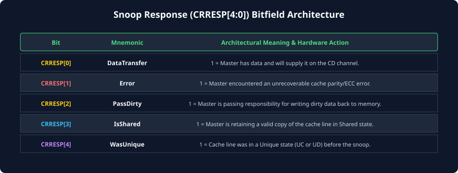
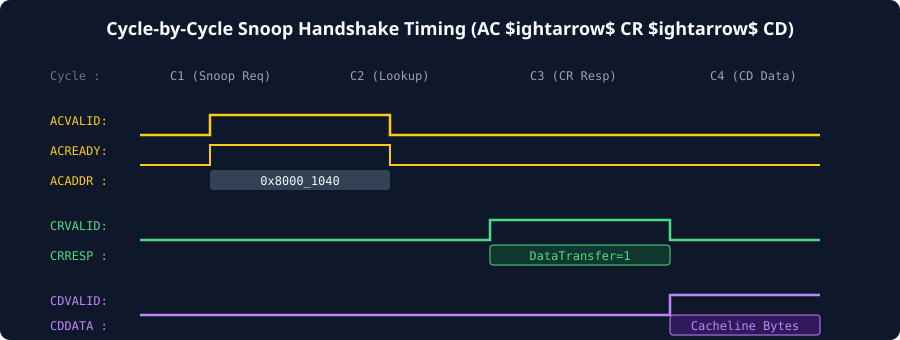

# Snoop Channel Mechanics & `CRRESP` Response Decoding

## The Inbound Snoop Pipeline
In an AMBA ACE coherent system, a cached master is not merely an initiator of bus traffic; it is also a **listener**. The coherent interconnect acts as a master to the cached core, driving memory inquiries into the core via the three snoop channels:
- **`AC` (Snoop Address):** Delivers the physical address and snoop transaction type.
- **`CR` (Snoop Response):** Returns the core's cache hit status and line disposition.
- **`CD` (Snoop Data):** Transmits data bytes if the snoop hits dirty or requested cache lines.

When an inbound snoop request arrives at the master's interface, it enters a dedicated **Snoop Pipeline**:

```
[Interconnect AC Channel]
       | ACVALID, ACADDR, ACSNOOP
       v
+-------------------------------------------------------------+
|                     MASTER CACHE CONTROLLER                 |
|                                                             |
|  +--------------------+        +-------------------------+  |
|  | L1/L2 Snoop Queue  | =====> | L1/L2 Tag RAM Lookup    |  |
|  +--------------------+        +------------+------------+  |
|                                             |               |
|                               +-------------+------------+  |
|                               | Hit/Miss & State Decode  |  |
|                               +-------------+------------+  |
+---------------------------------------------|---------------+
                                              v
                        [CR Channel] <---+----+---> [CD Channel]
                        (CRRESP Flags)              (CDDATA Payload)
```

1. **Snoop Queue:** Incoming snoop addresses are queued. To prevent protocol deadlocks, the snoop queue must never be blocked by ongoing master memory reads or writes (`ACREADY` independence).
2. **Tag RAM Lookup:** The controller probes its private tag arrays. This lookup occurs concurrently with normal CPU pipeline operations, typically using dedicated snoop tag ports or dual-ported SRAMs.
3. **State Decode & Response Generation:** The controller decodes the cache line state (M, O, E, S, or I) and drives the appropriate status flags onto **`CRRESP[4:0]`**.
4. **Data Egress:** If dirty data or cache-to-cache forwarding is required, data is fetched from the cache data RAM and driven onto **`CDDATA`**.

---

## Detailed Decoding of the `CRRESP[4:0]` Bitfield
The Snoop Response bus signal **`CRRESP[4:0]`** is the heart of the ACE snoop protocol. It compresses the complete cache outcome into a 5-bit status vector:



### Bit-by-Bit Breakdown:

### `CRRESP[0]` — `DataTransfer`
- **`0` (No Data Transfer):** The master will **not** transmit data on the `CD` channel. The snoop transaction is completed solely via the `CR` channel handshake.
- **`1` (Data Transfer Follows):** The master asserts that it will transmit the cache line data across the `CD` channel using `CDVALID` and `CDLAST`.

### `CRRESP[1]` — `Error`
- **`0` (Normal):** No error occurred during tag or data array access.
- **`1` (Error Detected):** An uncorrectable hardware error occurred (e.g., an unrecoverable multi-bit ECC error in the cache SRAM). The interconnect handles this as a slave error (`SLVERR`).

### `CRRESP[2]` — `PassDirty`
- **`0` (Clean or Retained Dirty):** The master does not transfer dirty writeback responsibility to the interconnect.
- **`1` (Dirty Responsibility Transferred):** The master held dirty data and is transferring the sole responsibility for eventually writing that dirty data back to main memory to the recipient/interconnect.

### `CRRESP[3]` — `IsShared`
- **`0` (Unique):** The master is invalidating its local copy or held no valid copy. After this snoop completes, this master will hold **no valid copy** of the line.
- **`1` (Shared):** The master continues to retain a valid copy of the line in the `Shared` (S) state.

### `CRRESP[4]` — `WasUnique` (or Reserved)
- In standard ACE configurations, bit 4 can indicate whether the line was held uniquely prior to this snoop transaction, aiding advanced interconnect directories in tracking tag exclusivity without secondary lookups.

---

## Canonical `CRRESP` Response Combinations

The table below catalogs the most critical and common `CRRESP` response vectors encountered in silicon operation:

| `CRRESP[4:0]` | Binary | `IsShared` | `PassDirty` | `Error` | `DataTransfer` | Architectural Meaning |
| :--- | :---: | :---: | :---: | :---: | :---: | :--- |
| **Miss / Invalid** | `0b00000` | 0 | 0 | 0 | 0 | Snoop Miss. Master does not hold the line. No data sent. |
| **Clean Shared Hit** | `0b01000` | 1 | 0 | 0 | 0 | Master holds clean copy in **S** state. Retains copy. No data sent. |
| **Clean Invalidate** | `0b00000` | 0 | 0 | 0 | 0 | Master invalidated a clean copy (**E** or **S** $\rightarrow$ **I**). No data sent. |
| **Shared Data Fwd** | `0b01001` | 1 | 0 | 0 | 1 | Master supplies clean data via `CD`, retains shared copy. |
| **Dirty Shared (Owner)**| `0b01101` | 1 | 1 | 0 | 1 | Master holds line in **O** state. Supplies dirty data via `CD`, retains copy, and passes dirty responsibility. |
| **Dirty Invalidate** | `0b00101` | 0 | 1 | 0 | 1 | Master was in **M** state. Supplies dirty data via `CD`, invalidates copy (**M** $\rightarrow$ **I**), and passes dirty responsibility. |
| **ECC Hardware Fault** | `0b00010` | 0 | 0 | 1 | 0 | Parity/ECC failure during tag or cache read. |

---

## Snoop Handshake Dynamics and Waveforms
The snoop channels execute their transfers using the standard AMBA two-way handshake (`VALID` / `READY`):



### ASCII Waveform Analysis: Snoop Request to Response & Data Transfer

```
Cycle:          1      2      3      4      5      6      7      8
ACLK:        __/¯¯\__/¯¯\__/¯¯\__/¯¯\__/¯¯\__/¯¯\__/¯¯\__/¯¯\__/¯¯\__
ACVALID:     _______/¯¯¯¯¯¯\_________________________________________
ACREADY:     ______________/¯¯¯¯¯¯\__________________________________
ACADDR:      -------< 0x4000_1000 >----------------------------------
ACSNOOP:     -------< ReadShared  >----------------------------------

[Master internal Tag Lookup: Cycles 3 to 5]

CRVALID:     _____________________________/¯¯¯¯¯¯\___________________
CRREADY:     ____________________________________/¯¯¯¯¯¯\____________
CRRESP:      -----------------------------< 0b01101 >-----------------

CDVALID:     ____________________________________/¯¯¯¯¯¯¯¯¯¯¯¯\_______
CDREADY:     ____________________________________/¯¯¯¯¯¯¯¯¯¯¯¯\_______
CDDATA:      ------------------------------------< Beat 0 >< Beat 1 >-
CDLAST:      ___________________________________________/¯¯¯¯¯¯\______
```

1. **Cycle 2-3 (Address Phase):** The interconnect drives `ACADDR = 0x4000_1000` and `ACSNOOP = ReadShared`, asserting `ACVALID`. The master accepts the snoop address in Cycle 3 when `ACREADY` is asserted.
2. **Cycle 4-5 (Tag Lookup):** The master's cache controller accesses the internal tag RAM. It discovers a cache hit in the `Modified` state.
3. **Cycle 6-7 (Response Phase):** The master asserts `CRVALID` with `CRRESP = 0b01101` (indicating `DataTransfer = 1`, `PassDirty = 1`, and `IsShared = 1`). The interconnect asserts `CRREADY` to acknowledge the response.
4. **Cycle 7-8 (Data Phase):** Because `DataTransfer` was asserted, the master drives the dirty cache line data onto `CDDATA`. In Cycle 8, `CDLAST` asserts, marking the final beat of the transfer.

---

## Resolving Simultaneous Cross-Snooping Races
In a distributed multi-core system, a classic race condition occurs when **two masters simultaneously attempt to write to the exact same cache line**:

```
[Cross-Snoop Race Hazard]
Master A: Holds Line in Shared (S) --> Issues CleanUnique on AR
Master B: Holds Line in Shared (S) --> Issues CleanUnique on AR
Interconnect receives BOTH requests concurrently!
```

If Master A waits for Master B to invalidate, and Master B simultaneously waits for Master A to invalidate, the system could deadlock.

### The ACE Serialization Invariant:
To resolve cross-snooping races deterministically:
1. **The Interconnect is the Sole Serializing Arbiter:**
   - The interconnect's internal address arbiter assigns a strict physical arrival order to conflicting transactions. Whichever transaction is granted arbitration first (e.g., Master A) becomes the **Winner**.
2. **Winner Proceed, Loser Snooped:**
   - The interconnect grants Master A's `CleanUnique` and dispatches an inbound snoop (`AC`) to Master B.
   - Master B's inbound snoop pipeline **must accept** the snoop and invalidate its local copy (`Shared` $\rightarrow$ `Invalid`), returning a snoop response (`CRRESP`) to the interconnect.
3. **Loser Retries or Upgrades to Miss:**
   - Because Master B's local copy has been invalidated by Master A's snoop, Master B's pending `CleanUnique` transaction is either converted by the interconnect into a `ReadUnique` (since Master B no longer holds valid data) or completed with a retry response, forcing Master B to re-issue its transaction as a full miss.

This strict hardware serialization guarantees that exactly one master gains write exclusivity, eliminating race conditions without software intervention.

---

## Chapter Summary
- Inbound snoops arrive over **`AC`**, query the core's private tag directories, and return status over **`CR`** and data over **`CD`**.
- **`CRRESP[4:0]`** conveys five discrete bits: `DataTransfer`, `Error`, `PassDirty`, `IsShared`, and `WasUnique`.
- If `CRRESP[0]` (`DataTransfer`) is asserted, the master **must** provide the cache line data across `CD` terminated by `CDLAST`.
- Simultaneous cross-snooping races are resolved through **central interconnect serialization**, where the first arbitrated master invalidates peer copies before peer requests are evaluated.

---

## Review Questions

1. **What specific value of `CRRESP[4:0]` does a master return when an inbound snoop misses its private cache entirely?**
   <details>
   <summary>Click to view answer</summary>
   A snoop miss returns `CRRESP[4:0] = 5'b00000`. This signifies: `DataTransfer = 0` (no data to send), `Error = 0` (no ECC fault), `PassDirty = 0` (no dirty ownership), `IsShared = 0` (line not retained), and `WasUnique = 0`.
   </details>

2. **Under what scenario will a master return `CRRESP[2]` (`PassDirty`) as `1` while simultaneously asserting `CRRESP[3]` (`IsShared`) as `1`?**
   <details>
   <summary>Click to view answer</summary>
   This occurs when the master holds a cache line in the **Owned (O)** state (or in the **Modified** state under MOESI) and receives a `ReadShared` snoop. The master supplies the dirty data to the interconnect, keeps a copy in the `Shared` (or `Owned`) state (`IsShared = 1`), and transfers the dirty ownership responsibility (`PassDirty = 1`) to the interconnect or requesting master.
   </details>

3. **Can a master assert `CDVALID` before asserting `CRVALID` on the snoop channels?**
   <details>
   <summary>Click to view answer</summary>
   Yes. The AMBA ACE specification permits `CDVALID` to be asserted before, concurrently with, or after `CRVALID`. There is no strict handshake ordering dependency between the `CR` and `CD` channels, allowing high-performance cache controllers to start streaming cache data onto `CD` as soon as SRAM read words are available without waiting for tag response encoding on `CR`.
   </details>

4. **How does the ACE protocol prevent two cores from deadlocking when both issue `CleanUnique` for the same cache line at the exact same clock cycle?**
   <details>
   <summary>Click to view answer</summary>
   The coherent interconnect contains internal address arbiters that serialize all concurrent requests to the same cache line. One core is awarded arbitration first and allowed to proceed; the interconnect broadcasts a snoop to the second core. The second core is architecturally required to process incoming snoops regardless of its own pending transactions, invalidating its local copy. The second core's request is then handled as a miss. This strict serialization prevents mutual circular wait deadlocks.
   </details>

---

##### Copyright (c) 2026 squared-studio

