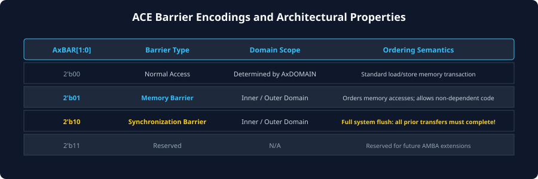
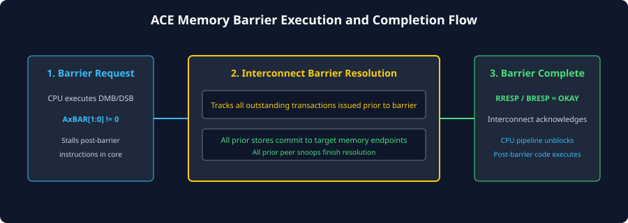

# Barrier Transactions and Memory Ordering

## The Reality of Relaxed Memory Ordering
Modern high-performance architectures (such as ARMv8-A, ARMv9-A, and RISC-V) implement **weakly ordered (relaxed) memory consistency models**. To maximize instruction-level parallelism and hide memory access latency, hardware incorporates aggressive performance optimizations:
- Out-of-order execution pipelines.
- Deep, speculative store buffers and fill buffers.
- Non-blocking L1/L2 caches supporting hit-under-miss and miss-under-miss.
- Interconnect crossbars with multiple independent internal routing paths and out-of-order completion.

While these optimizations drastically accelerate single-threaded execution, they can cause multiple memory transactions to arrive at main memory or peer caches out of their original program order.

```
[Program Order]                 [Observed Execution Order in Weakly Ordered Bus]
Store 1: Write Data (Buffer)     Store 2: Write Flag = 1 (Arrives FIRST!)
Store 2: Write Flag = 1          Store 1: Write Data     (Arrives SECOND!)
                                 --> HAZARD: Peer sees Flag=1 and reads garbage!
```

In multi-threaded software algorithms—such as spinlocks, ring buffers, producer-consumer queues, and message passing—program correctness relies entirely on **strict ordering guarantees**. A producer must ensure that all buffer data stores are globally visible before setting a "ready" flag. 

To enforce this ordering across a distributed, pipelined hardware bus, the AMBA ACE protocol integrates native **Hardware Barrier Transactions**.

---

## Barrier Signaling on Address Channels (`AxBAR[1:0]`)
In AMBA ACE, memory barriers are not sideband signals or proprietary interrupts; they are transmitted directly as in-band transactions across the standard Read Address (`AR`) and Write Address (`AW`) channels using the **`AxBAR[1:0]`** bitfield.



### `AxBAR[1:0]` Encoding Table

| `AxBAR[1:0]` | Barrier Type | Architectural Purpose | Behavior Across the Interconnect |
| :---: | :--- | :--- | :--- |
| **`0b00`** | **Normal Access** | Standard read or write. | Subject to standard AXI ordering rules; can be pipelined and re-ordered freely relative to other normal accesses. |
| **`0b01`** | **Memory Barrier** | Enforces ordering between normal transactions across the interconnect. | Flushes and serializes normal memory transactions issued before the barrier relative to transactions issued after the barrier. |
| **`0b10`** | **Reserved** | Reserved for future AMBA extensions. | Must not be driven by compliant masters. |
| **`0b11`** | **Synchronization Barrier** | The strongest barrier level. | Stalls until all transactions before the barrier are globally observed **and** all peer side-effects have completed. |

---

## Memory Barrier vs. Synchronization Barrier

### Memory Barrier (`AxBAR = 0b01`)
- Maps directly to software **Data Memory Barrier (`DMB`)** instructions.
- A Memory Barrier establishes a strict temporal divider between memory accesses initiated *before* the barrier and memory accesses initiated *after* the barrier.
- **Rules Enforced by the Interconnect:**
  - All transactions issued on this master interface **prior** to the barrier must be observed by all participating masters before any transaction issued **after** the barrier is observed.
  - Transactions do not necessarily have to reach final DRAM before the barrier finishes, provided that subsequent transactions cannot bypass them in interconnect buffers.

### Synchronization Barrier (`AxBAR = 0b11`)
- Maps directly to software **Data Synchronization Barrier (`DSB`)** instructions.
- A Synchronization Barrier is far more stringent: it guarantees that all outstanding memory transactions issued before the barrier have reached **full completion**.
- The barrier transaction itself will not receive its read or write response (`RRESP` / `BRESP`) until:
  - Every preceding write has returned its `BRESP` from the target slave/memory controller.
  - Every preceding read has returned its final data beat (`RLAST`) to the master.
  - All peer cache invalidations initiated by preceding coherent transactions have fully resolved.

---

## Barrier Scoping via Shareability Domains
A barrier transaction is not necessarily global to the entire SoC. Just like coherent memory reads and writes, an ACE barrier is qualified by **`AxDOMAIN[1:0]`**:

1. **Non-shareable Barrier (`AxDOMAIN = 0b00`):**
   - Serializes memory accesses strictly with respect to the issuing master and non-shareable slaves (e.g., ordering writes to a local peripheral).
2. **Inner Shareable Barrier (`AxDOMAIN = 0b01`):**
   - Orders transactions among all masters inside the local CPU cluster. Transactions targeting outer clusters or GPUs are not gated by this barrier.
3. **Outer Shareable Barrier (`AxDOMAIN = 0b10`):**
   - Orders transactions across all coherent clusters, GPUs, and DSPs in the Outer Shareable domain.
4. **System Barrier (`AxDOMAIN = 0b11`):**
   - Broadest scope. Orders memory transactions with respect to all observers in the entire system, including PCIe endpoints and system DMA controllers.

---

## Step-by-Step Interconnect Execution of Barrier Transactions
When an ACE master issues a barrier transaction, the coherent interconnect acts as a serialization gatekeeper.



### Detailed Transaction Execution Phases:

```
Cycle Phase:
 1. Issue Pre-Barrier Traffic   : Store Data [AW0, W0], Store Config [AW1, W1]
 2. Issue Barrier Request       : AW (AxBAR = 0b01 / 0b11, AxDOMAIN = Inner)
 3. Interconnect Serialization  : Drains Outstanding Transactions (Awaits BVALID)
 4. Interconnect Barrier Ack    : Drives BVALID for Barrier to Master
 5. Issue Post-Barrier Traffic  : Store Flag = 1 [AW2, W2] (NOW SAFE!)
```

### Phase 1: Pre-Barrier Draining
1. The master issues one or more normal memory writes (e.g., storing a payload to a shared ring buffer).
2. The master's execution pipeline hits a barrier instruction (`DMB` or `DSB`) and drives a barrier transaction onto the bus (`AWBAR = 0b01` or `0b11`, accompanied by dummy write address and control attributes).
3. The interconnect captures the barrier request. The interconnect's internal serialization logic **freezes** the barrier's response. It inspects its outstanding transaction queues to identify all pre-barrier reads and writes issued by this master.

### Phase 2: Outstanding Transaction Resolution
1. Pre-barrier write transactions propagate to their downstream targets (DRAM controller, peer caches).
2. Peer caches process any invalidation or clean snoops generated by those writes and return their `CRRESP` snoop responses.
3. Downstream memory controllers commit write data and drive `BVALID` write responses back into the interconnect.

### Phase 3: Barrier Completion Handshake
1. Once **all** pre-barrier transactions have completed and their responses have been registered, the interconnect generates a write response (`BVALID` with `BRESP = OKAY`) specifically for the barrier transaction.
2. The master accepts `BVALID` with `BREADY`. The barrier is now officially **retired**.

### Phase 4: Post-Barrier Execution
1. Only after the barrier transaction has completed is the master permitted to issue subsequent memory writes (e.g., setting the `Flag = 1` release lock).
2. Because all pre-barrier traffic has been drained, any peer master in the SoC that observes `Flag = 1` is mathematically guaranteed to observe the updated buffer data.

---

## Deadlock Prevention in Barrier Implementations
Barrier transactions inherently stall bus forward progress until dependent transactions complete. If an interconnect is poorly designed, barriers can easily cause deadlock:

- **The Dependency Hazard:** If a barrier transaction on `AW` blocks the interconnect from accepting new transactions, but an outstanding pre-barrier transaction requires a read data beat on `R` to complete, a circular stall occurs.
- **The Invariant Rule:** An interconnect must never stall the processing or reception of responses on `R`, `B`, `CR`, or `CD` while waiting for a barrier to complete. Responses must always be accepted and drained to ensure that the pre-barrier transactions reach completion.

---

## Chapter Summary
- Weakly ordered architectures allow memory transactions to be re-ordered, risking software synchronization bugs in multi-threaded programs.
- AMBA ACE provides in-band **Hardware Barrier Transactions** encoded on **`AxBAR[1:0]`** over standard `AR` and `AW` channels.
- **`AxBAR = 0b01`** (Memory Barrier / DMB) serializes memory access ordering across observers.
- **`AxBAR = 0b11`** (Synchronization Barrier / DSB) guarantees complete end-to-end execution and response draining of all pre-barrier transactions.
- Barriers are scoped by **`AxDOMAIN`** to prevent unnecessary stalls outside the required sharing domain.

---

## Review Questions

1. **Why does software require hardware barrier transactions in an out-of-order, multi-core SoC?**
   <details>
   <summary>Click to view answer</summary>
   Modern multi-core processors, caches, and interconnect crossbars execute, buffer, and route memory requests out of program order to maximize performance. In multi-threaded synchronization (e.g., mutex locks, producer-consumer queues), writing a flag before data buffer writes have committed will cause other cores to read corrupt or stale data. Hardware barriers force the interconnect and memory controllers to serialize transactions, guaranteeing that pre-barrier writes are observed before post-barrier writes.
   </details>

2. **What is the practical difference between a Memory Barrier (`AxBAR = 0b01`) and a Synchronization Barrier (`AxBAR = 0b11`)?**
   <details>
   <summary>Click to view answer</summary>
   A Memory Barrier (`AxBAR = 0b01`, corresponding to `DMB`) only enforces the relative observation order between transactions issued before and after the barrier; it does not require the core to stall until transactions reach their final memory destinations. A Synchronization Barrier (`AxBAR = 0b11`, corresponding to `DSB`) is much stricter: it forces the issuing master to halt further execution until all pre-barrier transactions have completely finished, returned their final read data or write responses, and completed all peer cache invalidations.
   </details>

3. **Can an ACE master issue a barrier transaction on the Read Address channel (`AR`), or must it always use the Write Address channel (`AW`)?**
   <details>
   <summary>Click to view answer</summary>
   ACE allows barrier transactions to be issued on both the Read Address channel (`ARBAR`) and the Write Address channel (`AWBAR`). A read barrier orders read transactions, a write barrier orders write transactions, and issuing barriers on both channels establishes a full read-and-write bidirectional memory barrier.
   </details>

4. **How does qualifying a barrier with `AxDOMAIN = Inner Shareable` improve performance compared to a `System` barrier?**
   <details>
   <summary>Click to view answer</summary>
   An `Inner Shareable` barrier only waits for transactions and peer caches within the local CPU cluster to serialize. It does not wait for slow peripheral writes, PCIe transactions, or remote GPU clusters to drain. This drastically reduces the latency of the barrier handshake, allowing local CPU threads to synchronize in a fraction of the time required for a full system-wide drain.
   </details>

---

##### Copyright (c) 2026 squared-studio

