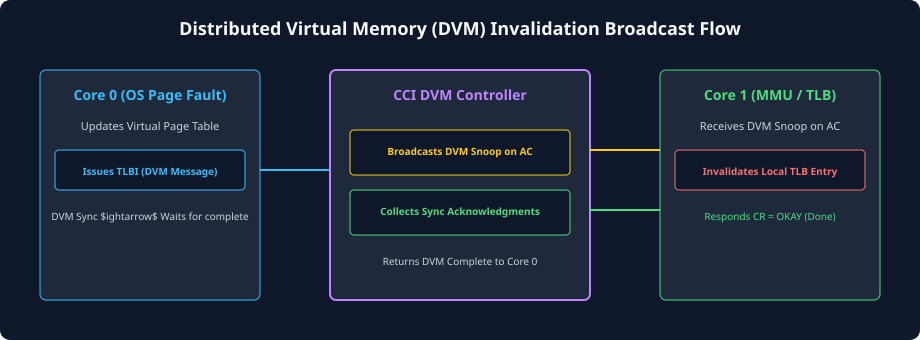
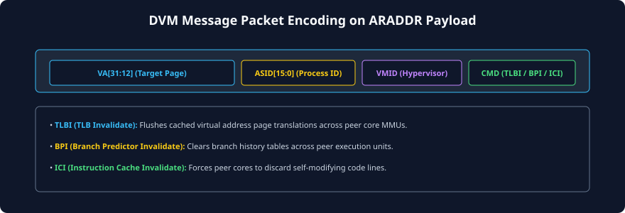

# Distributed Virtual Memory (DVM) and Message Signaling

## Virtual Memory in Heterogeneous Multi-Core SoCs
In modern operating systems (Linux, Android, macOS, Windows), every application runs in its own private **Virtual Address Space**. To execute instructions and access data, virtual addresses must be translated into physical DRAM addresses by the processor's **Memory Management Unit (MMU)** using hierarchical **Page Tables**.

Because walking multi-level page tables in memory takes dozens to hundreds of clock cycles, every processor core integrates high-speed hardware caches for page translations: **Translation Lookaside Buffers (TLBs)**.

```
+--------------------------------------------------------------------------+
|                              PROCESSOR CORE                              |
|                                                                          |
|  [Virtual Address]                                                       |
|         |                                                                |
|         v                                                                |
|  +--------------+  TLB Hit   +----------------------------------------+  |
|  |     TLB      | ---------> | Direct Physical Access (L1 Cache/DRAM) |  |
|  +--------------+            +----------------------------------------+  |
|         |                                                                |
|         | TLB Miss                                                       |
|         v                                                                |
|  +--------------------+                                                  |
|  | Hardware Page Walk | ===> Reads Multi-Level Page Tables in Memory     |
|  +--------------------+                                                  |
+--------------------------------------------------------------------------+
```

### The Problem: Multi-Core TLB Inconsistency
When an operating system modifies a page mapping—such as paging out an unreferenced memory page to disk, revoking write permissions on a shared memory segment, or remapping a virtual page—a critical consistency hazard occurs:
- The OS updates the page table in main memory.
- However, **other CPU cores in the system still hold the obsolete virtual-to-physical translation cached in their local TLBs!**
- If another core accesses that virtual address using its stale TLB entry, it may write to a deallocated physical page, corrupting user data or creating severe security vulnerabilities.

---

## The Overhead of Software TLB Shootdown
Historically, operating systems resolved TLB inconsistency through a mechanism called **Software TLB Shootdown**:

```
[Software TLB Shootdown via IPI]
 Core 0 (OS): Modifies Page Table Entry in Memory
 Core 0: Sends Inter-Processor Interrupts (IPIs) to Core 1, Core 2, Core 3
 Core 1/2/3: Take Hardware Interrupt Exception
 Core 1/2/3: Save Context, Execute OS ISR, Execute Local TLBI Instruction
 Core 1/2/3: Send IPI Acknowledgment back to Core 0
 Core 0: Spins waiting for all cores to acknowledge before proceeding.
 IMPACT: Enormous OS overhead, pipeline flushes, and hundreds of microseconds of latency!
```

In modern cloud servers and mobile devices with dozens of cores, software TLB shootdowns can consume up to 20% to 30% of total system CPU time.

---

## The AMBA ACE DVM Solution
The AMBA ACE specification solves this crisis by introducing **Distributed Virtual Memory (DVM)** signaling. DVM provides a **hardware-native broadcast transport** built directly on top of the existing ACE coherency channels, allowing a master to broadcast TLB invalidations to all cores across the SoC in a handful of clock cycles with zero software interrupt overhead.



### DVM Operational Responsibilities:
1. **DVM Master:** The core modifying the page table issues a hardware DVM transaction across its `AR` channel.
2. **Coherent Interconnect:** Captures the DVM command, decodes its scope, and broadcasts it to the `AC` snoop channels of all participating cores.
3. **Snooped Masters:** Receive the DVM command, invalidate the corresponding entry in their local TLB or branch predictor, and return a completion response on `CR`.
4. **DVM Synchronization (`DVMSync`):** The master issues a synchronization handshake to confirm that all peer cores have completed their local invalidations.

---

## DVM Transaction Types and Scopes
DVM commands are conveyed over standard ACE address channels. ACE defines a comprehensive catalog of DVM transaction types:

| DVM Command Type | Mnemonic | Hardware Action Performed on Snooped Cores |
| :--- | :---: | :--- |
| **TLB Invalidate** | `TLBI` | Invalidates cached virtual-to-physical page translations in peer TLBs. |
| **Branch Predictor Invalidate**| `BPI` | Clears branch history and target buffers (BTB) on peer cores. |
| **Instruction Cache Invalidate**| `ICI` | Invalidates peer instruction caches (used during JIT compilation / dynamic code loading). |
| **Physical Instruction Invalidate**| `PII` | Invalidates instruction caches by physical address. |
| **Virtual Processor ID Sync** | `VMID` | Scopes invalidation strictly to a specific virtual machine guest under a hypervisor. |
| **Address Space ID Sync** | `ASID` | Scopes invalidation to a specific user-space process ID. |
| **DVM Synchronization** | `DVMSync` | Waits for all previously broadcast DVM operations to reach full global completion. |
| **DVM Complete** | `DVMComplete`| Acknowledgment packet signaling completion of a `DVMSync`. |

---

## Two-Beat DVM Message Format over the `AR` Channel
Because DVM commands carry complex virtual memory metadata (such as 64-bit virtual addresses, ASIDs, VMIDs, page sizes, and invalidation scopes), a single 32-bit or 64-bit address beat is insufficient. 

AMBA ACE encodes DVM messages as a **two-beat burst** (`ARLEN = 1`, meaning two transfers) over the Read Address channel (`AR`):



### Bitfield Encoding Breakdown:

### Beat 0 (Command & Scope Payload):
- **`ARADDR[14:12]` (Command Type):** Encodes the operation (`0b000` = TLB Invalidate, `0b001` = Branch Predictor Invalidate, `0b010` = Physical Instruction Invalidate, `0b100` = DVM Sync).
- **`ARADDR[1:0]` (Message Part):** Must be `0b00` for the first beat.
- **`ARADDR[31:16]` (ASID / VMID):** Identifies the target process (Address Space Identifier) and virtual machine (Virtual Machine Identifier) so other processes are not penalized by unnecessary invalidations.

### Beat 1 (Address & Range Payload):
- **`ARADDR[1:0]` (Message Part):** Must be `0b01` for the second beat.
- **`ARADDR[47:12]` (Virtual Address):** Specifies the targeted virtual page address (aligned to 4KB, 64KB, or 2MB/1GB page sizes).
- **`ARADDR[11:8]` (Page Size / Range):** Indicates whether the invalidation applies to a single 4KB page, a range of pages, or an entire address space.

---

## Complete DVM Synchronization Protocol Sequence
To ensure that a page table update is safe, software must guarantee that every peer core has completed its TLB invalidation before the old physical page is reassigned. This is orchestrated through the **`DVMSync`** and **`DVMComplete`** protocol sequence:

```
[Master 0]                   [Coherent Interconnect]                   [Master 1]
    |                                   |                                   |
1.  |-- AR (DVM TLBI Beat 0) ---------->|                                   |
2.  |-- AR (DVM TLBI Beat 1) ---------->|                                   |
3.  |                                   |-- AC (DVM Invalidate) ----------->|
4.  |                                   |<-- CR (Snoop Acknowledgment) -----| (TLB Flushed)
5.  |-- AR (DVMSync) ------------------>|                                   |
6.  |                                   |-- AC (DVM Sync Request) --------->|
7.  |                                   |<-- CR (DVM Sync Complete) --------|
8.  |<-- R (DVMComplete, RRESP=OKAY) ---|                                   |
```

### Execution Steps:
1. **Master 0 Issues DVM TLBI:** Master 0 drives the two-beat DVM payload onto `AR` with `ARSNOOP = DVM Operation`.
2. **Interconnect Broadcasts Snoop:** The interconnect receives the DVM command and drives it onto the `AC` channel of Master 1 (and all other cached masters in the domain).
3. **Master 1 Invalidation:** Master 1's TLB management logic clears the targeted translation entry from its TLB and returns `CRRESP = OKAY` on `CR`.
4. **Master 0 Issues `DVMSync`:** Once Master 0 finishes queuing its DVM operations, it issues a `DVMSync` transaction on `AR`.
5. **Interconnect Barrier Tracking:** The interconnect issues a snoop sync request to all masters. It tracks responses from all cores.
6. **Completion Handshake:** When every snooped master has confirmed that its local queues are empty and TLB operations are committed, the interconnect returns an `R` channel beat with `DVMComplete` back to Master 0.
7. **Safe Memory Reclamation:** Master 0's core receives the completion response and retires the software synchronization barrier (`DSB`). The operating system can now safely deallocate or reuse the underlying physical memory page.

---

## Chapter Summary
- Virtual memory requires **TLB Invalidation** when page tables change; software-based IPI shootdowns cause severe performance bottlenecks.
- AMBA ACE provides **Distributed Virtual Memory (DVM)**, a hardware-native broadcast mechanism over existing coherency channels.
- DVM commands support invalidation of **TLBs**, **Branch Predictors**, and **Instruction Caches**, scoped by ASID and VMID.
- DVM messages are packaged as **two-beat bursts** over the Read Address (`AR`) channel.
- The **`DVMSync` / `DVMComplete`** handshake ensures that all peer cores have committed local invalidations before the initiating processor proceeds.

---

## Review Questions

1. **Why is software-managed TLB shootdown using Inter-Processor Interrupts (IPIs) considered a major performance bottleneck in cloud and server SoCs?**
   <details>
   <summary>Click to view answer</summary>
   Software IPI shootdown forces every participating CPU core to interrupt its current execution, save register state, switch to privileged kernel mode, execute an interrupt service routine (ISR), flush the local TLB via software instructions, and send an acknowledgment interrupt back to the initiator. In high-density multi-core systems, this causes massive thread latency, cache pollution, and hundreds of microseconds of wasted CPU cycles. Hardware DVM replaces this entire software flow with a low-latency hardware bus handshake completed in cycles.
   </details>

2. **How does an ACE master transmit a DVM message across the standard AXI Read Address channel (`AR`), given that DVM requires more than 64 bits of control payload?**
   <details>
   <summary>Click to view answer</summary>
   AMBA ACE packages DVM operations as a two-beat burst (`ARLEN = 1`) on the `AR` channel. The first beat delivers the command type, message scope, ASID (process ID), and VMID (virtual machine ID). The second beat delivers the target virtual page address and page size range. Bits `ARADDR[1:0]` differentiate Part 0 (`0b00`) from Part 1 (`0b01`).
   </details>

3. **What is the function of the `DVMSync` transaction, and why must software issue it after a DVM invalidation command?**
   <details>
   <summary>Click to view answer</summary>
   A DVM invalidation command is posted asynchronously to peer snoop queues. Software cannot know whether peer cores have actually flushed their TLB entries simply because the command cleared the bus. The `DVMSync` transaction forces the interconnect to poll and synchronize with all peer cores. Only when all peer cores acknowledge that their TLB invalidations have fully committed does the interconnect return a `DVMComplete` response on the `R` channel, guaranteeing memory safety.
   </details>

4. **Can DVM broadcast messages be filtered using Shareability Domains (`AxDOMAIN`)?**
   <details>
   <summary>Click to view answer</summary>
   Yes. DVM transactions use the `AxDOMAIN` signals just like normal coherent reads and writes. A DVM operation scoped to `Inner Shareable` will only invalidate TLBs and branch predictors of cores within the local processing cluster, leaving other clusters unaffected. A `System` or `Outer Shareable` DVM command broadcasts across the entire SoC.
   </details>

---

##### Copyright (c) 2026 squared-studio

