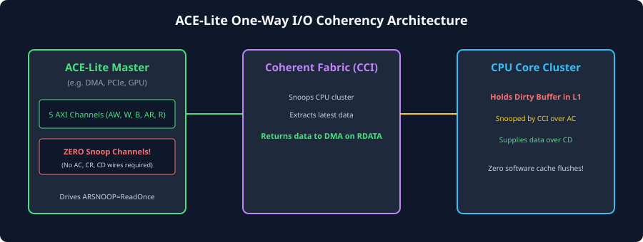
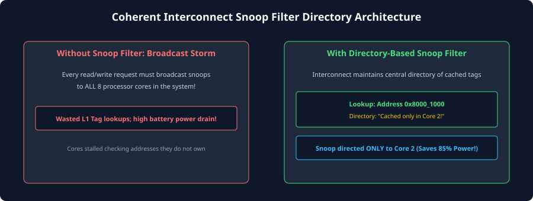

# ACE-Lite and Coherent Interconnect Architecture (CCI)

## The Role of ACE-Lite in Heterogeneous SoCs
In modern SoCs, not every processing unit maintains a local, hardware-snooped cache. High-throughput data movers and accelerators—such as Graphics Processing Units (GPUs), Neural Processing Units (NPUs), Direct Memory Access (DMA) engines, Ethernet controllers, and PCIe Root Complexes—primarily stream large data buffers.

Equipping these non-CPU masters with fully coherent snooping logic presents significant engineering challenges:
1. **Silicon Area & Power Overhead:** Implementing snoop queues, multi-ported tag directories, and snoop response pipelines consumes substantial silicon real estate and dynamic power.
2. **Tag Contention:** Constantly snooping a GPU's massive internal texture and shader caches would severely degrade graphics rendering throughput.
3. **Unnecessary Pin-Count:** Dedicated snoop channels (`AC`, `CR`, `CD`) add hundreds of physical wires to each master interface, leading to severe physical layout and routing congestion.

To provide an optimal architectural compromise, the AMBA specification defines **ACE-Lite**. ACE-Lite provides **One-Way Hardware Coherency** (often termed **I/O Coherency**).



---

## ACE-Lite Interface & Transaction Capabilities
An ACE-Lite master implements only the standard five AXI4 channels (`AR`, `R`, `AW`, `W`, `B`), augmented with the ACE sideband signals: **`AxDOMAIN`**, **`AxSNOOP`**, and **`AxBAR`**. It omits the three snoop channels (`AC`, `CR`, `CD`) entirely.

### What an ACE-Lite Master Can and Cannot Do:
- **Can Do (Outbound Coherent Requests):**
  - An ACE-Lite master can issue coherent read requests (`ReadOnce`, `ReadClean`, `ReadShared`) to read data directly from CPU caches, observing the latest modifications without requiring the CPU to perform software cache flushes.
  - An ACE-Lite master can issue coherent write requests (`WriteUnique`, `WriteLineUnique`) to write data directly into memory while automatically invalidating stale copies in CPU caches.
  - An ACE-Lite master can issue memory barriers (`AxBAR`) and DVM invalidation requests.
- **Cannot Do (Inbound Snooping):**
  - An ACE-Lite master **cannot be snooped** by other masters. It has no `AC`, `CR`, or `CD` channels.
  - It cannot hold cache lines in shared MOESI states (`Shared`, `Owned`, `Exclusive`, or `Modified`) with other masters.

### Permitted ACE-Lite Transaction Subset

| Channel | Supported ACE-Lite Transactions | Prohibited Transactions |
| :---: | :--- | :--- |
| **`AR`** | `ReadNoSnoop`, `ReadOnce`, `ReadClean`, `ReadShared`, `DVM Message` | `ReadUnique`, `CleanUnique`, `MakeUnique`, `CleanShared`, `CleanInvalid`, `Evict` |
| **`AW`** | `WriteNoSnoop`, `WriteUnique`, `WriteLineUnique` | `WriteClean`, `WriteBack` |

Because an ACE-Lite master does not maintain a snooped cache, it never allocates lines with dirty ownership; hence, transactions like `ReadUnique`, `CleanUnique`, and `WriteBack` are architecturally prohibited.

---

## Microarchitecture of a Coherent Interconnect
The **Coherent Interconnect** (such as ARM CoreLink CCI-400, CCI-500, CCI-550, or CMN-600) is the architectural centerpiece of a multi-core SoC. It performs four essential hardware functions:
1. **Transaction Crossbar & Arbitration:** Routes requests between multiple ACE masters, ACE-Lite masters, and downstream memory controllers.
2. **Snoop Generation & Serialization:** Detects coherent requests, serializes conflicting accesses to identical addresses, and generates inbound snoops over `AC`.
3. **Direct Cache-to-Cache Transfer:** Captures snoop data from `CD` and routes it directly to the requesting master's `R` channel.
4. **Snoop Filtering (Directory Management):** Tracks line residency across clusters to prevent broadcast snoop flooding.

### Evolution of Interconnect Topologies

```
+-----------------------------------------------------------------------------+
|                          INTERCONNECT TOPOLOGIES                            |
|                                                                             |
|  1. Crossbar / Switch Matrix (e.g. CCI-400)                                 |
|     * Point-to-point multiplexers between small clusters (2-4 masters).     |
|     * Broadcast snooping; low latency, but scales poorly beyond 4 ports.    |
|                                                                             |
|  2. Ring Bus Topology (e.g. CCI-500 / CCI-550)                              |
|     * High-frequency bidirectional clock rings.                             |
|     * Integrates central Snoop Filters; scales to 4-8 clusters.             |
|                                                                             |
|  3. 2D Mesh Network-on-Chip (e.g. CMN-600 / CMN-700)                         |
|     * Distributed Crosspoint (XP) routers on a 2D grid.                     |
|     * Distributed directories (Home Nodes); scales to 32-128+ cores.         |
+-----------------------------------------------------------------------------+
```

---

## Snoop Filters and Duplicate Tag Directories
In early coherent interconnects (e.g., CCI-400), every coherent read or write issued by any master was broadcast to every other master. As core counts grew to 8, 16, and 64 cores, this broadcast traffic overwhelmed the system:
- Snoop traffic saturated bus wires (**Snoop Flooding**).
- Continual tag lookups consumed excessive dynamic power.
- CPU pipelines frequently stalled waiting for tag RAM ports.

To eliminate snoop flooding, modern coherent interconnects incorporate a **Snoop Filter** (also called a **Duplicate Tag Directory**).



### How a Snoop Filter Operates:
1. **Replicated Tag Directory:** The interconnect contains an internal SRAM array that mirrors the cache tags of all cached masters in the system.
2. **Residency Tracking:** For every active cache line in the SoC, the snoop filter stores the physical address tag and a **Sharer Bitmask** (e.g., Bit 0 = Cluster 0, Bit 1 = Cluster 1).
3. **Lookup on Request:** When Master 0 issues a `ReadShared` request:
   - The interconnect queries its internal snoop filter directory.
   - If the directory indicates that *only* Cluster 1 holds the line, the interconnect sends a targeted snoop **strictly to Cluster 1**.
   - If the directory reports that *no* master holds the line (Snoop Filter Miss), the interconnect **completely suppresses snoop generation** and routes the request directly to DRAM!
4. **Maintenance on Evictions:** Whenever a master evicts a line, it issues an `Evict` or `WriteBack` transaction so the snoop filter can clear that master's bit in the sharer bitmask.

---

## Comparative Case Study: CoreLink CCI-400 vs. CCI-550 vs. CMN-600

| Metric | ARM CoreLink CCI-400 | ARM CoreLink CCI-550 | ARM CoreLink CMN-600 |
| :--- | :--- | :--- | :--- |
| **Target System** | Mobile Big.LITTLE (2 Clusters) | High-end Mobile / Compute | Enterprise Cloud & Infrastructure |
| **Topology** | Crossbar Switch Matrix | Dual Ring Bus | 2D Mesh Network-on-Chip |
| **Fully Coherent Ports** | 2 ACE Ports | Up to 4 ACE / ACE-Lite Ports | Up to 64 Crosspoint Nodes |
| **ACE-Lite Ports** | 3 Ports | Up to 6 Ports | Distributed PCIe / CXL / Accelerator Nodes |
| **Snoop Mechanism** | Broadcast Snooping | Central Snoop Filter (Directory) | Distributed System-Level Cache & Directory |
| **Coherency Protocol** | AMBA 4 ACE | AMBA 4 ACE / ACE-Lite | AMBA 5 CHI (Coherent Hub Interface) |

---

## The Future of Cache Coherency: From ACE to AMBA CHI and CXL
While AMBA ACE revolutionised mobile and embedded SoC design, high-performance computing (HPC) and cloud data centers face physical scaling limits:
- **Wire Routing Bottleneck:** ACE requires dozens of dedicated, wide physical point-to-point buses (`AW`, `W`, `B`, `AR`, `R`, `AC`, `CR`, `CD`) between every master and the interconnect. In a 64-core chip, routing these thousands of wires across silicon becomes physically impossible.
- **AMBA 5 CHI (Coherent Hub Interface):** To overcome the wire bottleneck, ARM developed **AMBA 5 CHI**. CHI replaces ACE's separate physical channels with a **packetized, layered network protocol** (Link Layer, Network Layer, Protocol Layer) designed specifically to run over high-speed packetized Ring and Mesh Network-on-Chip (NoC) topologies.
- **Compute Express Link (CXL):** To extend hardware cache coherency across physical circuit boards, server backplanes, and rack-scale disaggregated memory, the industry established **CXL (CXL.cache / CXL.mem)**, running coherent protocols over high-speed PCIe Gen5/Gen6 SerDes physical layers.

Nonetheless, the core concepts introduced in AMBA ACE—MOESI cache states, coherency domains, invalidation sweeps, direct cache forwarding, barriers, and DVM broadcast signaling—remain the universal foundation upon which all modern hardware coherency architectures operate.

---

## Chapter Summary
- **ACE-Lite** provides one-way (I/O) hardware coherency for streaming masters (GPUs, DMAs, PCIe), omitting snoop channels (`AC`, `CR`, `CD`) to minimize pin count, area, and power.
- ACE-Lite masters can read dirty CPU data via `ReadOnce` and invalidate CPU caches via `WriteUnique`, but cannot be snooped themselves.
- Modern coherent interconnects employ **Snoop Filters** to maintain duplicate tag directories, eliminating wasteful broadcast snoops to cores that do not hold the target line.
- As systems scale to hundreds of cores, the industry transitions from bus-based AMBA ACE to packetized **AMBA CHI** mesh networks and off-chip **CXL** interfaces.

---

## Review Questions

1. **Why does an ACE-Lite master omit the `AC`, `CR`, and `CD` channels, and what architectural tradeoff does this represent?**
   <details>
   <summary>Click to view answer</summary>
   An ACE-Lite master omits the snoop channels because it does not maintain an internal hardware-snooped cache. By eliminating these channels, the master saves hundreds of physical interface pins, reduces silicon area, eliminates tag array port contention, and simplifies interconnect routing. The tradeoff is that the ACE-Lite master cannot be snooped by other processors and cannot hold lines in shared MOESI cache states; it can only perform one-way coherent memory reads and writes.
   </details>

2. **How does an ACE-Lite GPU reading a frame buffer via `ReadOnce` prevent cache coherency bugs without requiring OS cache flushes?**
   <details>
   <summary>Click to view answer</summary>
   When the GPU issues `ReadOnce` on its `AR` channel, the coherent interconnect snoops the CPU cluster. If a CPU core holds updated pixels in its L1/L2 cache in a dirty (`Modified`) state, the CPU provides the modified data directly over its `CD` channel. The interconnect routes this fresh data to the GPU's `R` channel. The GPU reads the correct, updated frame buffer instantly without requiring the CPU to spend thousands of cycles flushing its caches to DRAM.
   </details>

3. **What is "Snoop Flooding", and how does a Snoop Filter prevent it in multi-cluster SoCs?**
   <details>
   <summary>Click to view answer</summary>
   Snoop flooding occurs in broadcast coherency systems when every read or write transaction is broadcast to all cores in the SoC, consuming bus bandwidth, burning dynamic switching power, and stalling CPU pipelines for tag lookups. A Snoop Filter maintains an internal duplicate directory of all cached lines. When a request arrives, the filter checks residency; if only one core holds the line, a targeted snoop is sent only to that core. If no core holds the line, all snoops are suppressed, eliminating broadcast overhead.
   </details>

4. **Why did the industry transition from AMBA ACE to AMBA CHI in high-core-count enterprise server chips?**
   <details>
   <summary>Click to view answer</summary>
   AMBA ACE relies on separate physical, parallel signal channels for address, data, responses, and snoops. As SoCs grew to dozens or hundreds of cores, routing these massive parallel bus bundles across the chip created severe routing congestion and wire delays. AMBA CHI solves this by packetizing all transactions into a layered network protocol (similar to internet packets) that routes seamlessly across high-frequency 2D Mesh Networks-on-Chip (NoCs) using standard packet routers.
   </details>

---

##### Copyright (c) 2026 squared-studio

