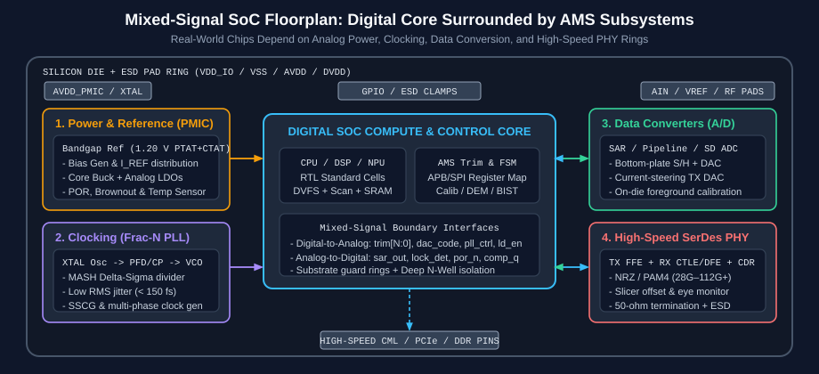
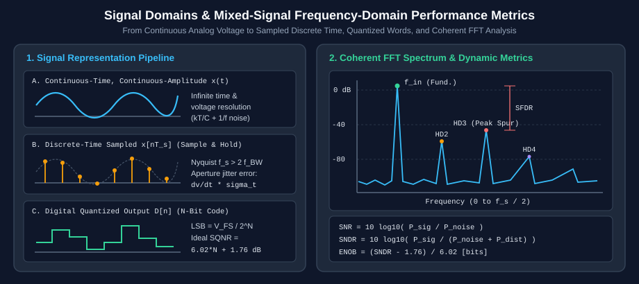

# Analog and Mixed-Signal Foundations in Modern SoCs

Every modern System-on-Chip (SoC)—whether powering a smartphone, an AI accelerator, an automotive radar microcontroller, or an RF edge sensor—interacts with a continuous physical world of voltages, currents, electromagnetic waves, and thermal gradients. While billions of standard-cell gates compute in clean binary `0` and `1` abstractions, they rely completely on surrounding **Analog & Mixed-Signal (AMS)** subsystems to generate precision voltage references, synthesize gigahertz clocks, power down-converted cores, digitize real-world sensors, and transmit multi-gigabit serial data over copper and optical links.

---

## Learning Goals

- Map the major **AMS IP blocks** on a modern mixed-signal SoC and understand how they interface across the analog–digital boundary.
- Contrast **continuous-time**, **discrete-time sampled**, and **quantized digital** signal domains along with their physical error mechanisms.
- Derive and interpret key mixed-signal frequency and dynamic metrics: **SNR**, **THD**, **SNDR**, **SFDR**, **ENOB**, and **aperture jitter limits**.
- Distinguish fundamental physical noise processes—**thermal ($k_BT/C$, Johnson-Nyquist)**, **shot**, and **flicker ($1/f$)** noise—from deterministic **digital switching and substrate coupling**.
- Run coherent **FFT verification** and **DFT spectral checks** cleanly without spectral leakage errors.

---

## Why Every Modern SoC Depends on Analog and Mixed-Signal Subsystems

Even a "purely digital" AI chip cannot boot without analog electronics. The digital standard-cell core sits inside an outer perimeter of precision AMS macros:



| AMS Subsystem | Physical Role in SoC | Digital Control & Calibration Interface | Primary Design Challenges |
| :--- | :--- | :--- | :--- |
| **Bandgap & Biasing** | Generates temperature-independent voltage (~1.2 V) & precision currents | Digital OTP/eFuse trim register (`trim[6:0]`) | Process mismatch, startup dead-states, PSRR |
| **PMIC / Buck / LDO** | Steps down battery/board rails to 0.65–1.8 V core & analog domains | DVFS voltage ID (VID), PFM/PWM enable, fault flags | Load-step droop, ESR stability, high-frequency ripple |
| **PLL / Clocking** | Multiplies crystal reference (24–50 MHz) to GHz clocks | Integer/Fractional FCW, lock detector, spread-spectrum | Phase noise, integrated jitter, reference spurs |
| **ADC / DAC** | Translates continuous sensor/RF/audio waveforms to/from digital words | Calibration FSM, DEM scrambler, sample trigger | `kT/C` noise, capacitor mismatch, INL/DNL, clock skew |
| **SerDes PHY** | Drives/recovers 10G–112G+ NRZ/PAM4 lanes across lossy channels | TX FFE taps, RX DFE adaptation, CDR PI updates | Inter-symbol interference (ISI), crosstalk, BER targets |

Notice the modern trend: **Digitally-Assisted Analog**. Instead of burning huge silicon area and current to make analog transistors ultra-linear by brute force, contemporary AMS designs pair compact, low-power analog stages with **digital background/foreground calibration RTL** (offset cancellation, gain calibration, LMS equalizer adaptation, and dynamic element matching). As a result, AMS verification today requires verifying closed-loop interactions across *both* analog SPICE/Verilog-A blocks and RTL control FSMs.

> [!IMPORTANT]
> **Analog Fails Softly and Permanently**: Unlike a digital timing race that might be hidden at slightly lower clock frequency or fixed by re-synthesizing RTL, an analog stability bug (low phase margin causing an LDO or PLL to oscillate), an insufficient bandgap startup current at cold temperature (`-40 C`), or an uncalibrated ADC comparator offset can render silicon completely non-functional—often requiring a costly full-mask or metal-layer spin.

---

## Continuous-Time, Discrete-Time, and Quantized Signal Domains

Moving information between analog physics and digital RTL crosses three mathematically distinct signal representations:



### 1. Continuous-Time, Continuous-Amplitude Signals `x(t)`

Voltages and currents inside amplifiers, continuous-time filters, and VCO control lines evolve continuously across real time $t \in \mathbb{R}$ and amplitude $x \in \mathbb{R}$. Behavior obeys Kirchhoff's Current/Voltage Laws (KCL/KVL) and ordinary differential equations (ODEs). Errors arise from thermal device noise, transistor $g_m$ non-linearity ($v_{ds}$, $v_{gs}$ harmonics), and power-supply bounce.

### 2. Discrete-Time, Continuous-Amplitude Signals `x[nT_s]`

A **Sample-and-Hold (S/H)** switch samples $x(t)$ every $T_s = 1/f_s$ seconds onto a sampling capacitor $C_s$, holding an exact analog voltage between clock edges:
- **Nyquist-Shannon Theorem**: Avoiding aliasing requires $f_s > 2 f_{\text{BW}}$. Any high-frequency tone or noise above $f_s/2$ folds back symmetrically into the baseband $[0, f_s/2]$.
- **Aperture Jitter**: Random clock-edge timing uncertainty $\sigma_{t_j}$ modulates the sampled voltage proportionally to signal slew rate: $\Delta v \approx (dx/dt)\,\sigma_{t_j}$. For a full-scale sine wave of frequency $f_{\text{in}}$, sampling jitter strictly caps achievable SNR regardless of resolution!

### 3. Discrete-Time, Quantized Digital Signals `D[n]`

An $N$-bit quantizer rounds $x[nT_s]$ to one of $2^N$ discrete levels spaced by $\Delta = \text{LSB} = V_{\text{FS}} / 2^N$. Modeling quantization error $e_q \in [-\Delta/2, +\Delta/2]$ as uniformly distributed white noise yields variance $\sigma_q^2 = \Delta^2 / 12$.

For a full-scale sinusoidal input of peak amplitude $V_{\text{FS}}/2$ (RMS power $P_{\text{sig}} = V_{\text{FS}}^2 / 8$):

$$\text{SQNR}_{\text{ideal}} = 10 \log_{10}\!\left(\frac{V_{\text{FS}}^2 / 8}{\Delta^2 / 12}\right) = 10 \log_{10}\!\left(\frac{3}{2} \cdot 2^{2N}\right) = 6.02\,N + 1.76\text{ dB}$$

Every **1 additional bit** of ideal converter resolution improves theoretical SNR by **6.02 dB**.

---

## Essential Mixed-Signal Metrics from SNR and SFDR to ENOB and Jitter

Data converters, amplifiers, and AFE chains are judged in the frequency domain using a **Coherent Fast Fourier Transform (FFT)** of $M$ captured samples:

### Dynamic Spectral Definitions

- **Signal-to-Noise Ratio (SNR)**: Ratio of fundamental signal power to total integrated in-band noise power (excluding DC and harmonics $2\text{nd}$ through $5\text{th}$+):
  $$\text{SNR} = 10 \log_{10}\!\left(\frac{P_{\text{sig}}}{\sum P_{\text{noise}}}\right)\text{ [dB]}$$
- **Total Harmonic Distortion (THD)**: Ratio of the sum of harmonic distortion powers ($HD_2, HD_3, \dots$) to the fundamental signal power (typically expressed in negative dB or dBc). Differential circuits cancel even harmonics ($HD_2, HD_4$), leaving odd harmonics ($HD_3, HD_5$) dominant.
- **Signal-to-Noise and Distortion Ratio (SNDR / SINAD)**: Combines *both* noise and harmonic distortion into one realistic dynamic score:
  $$\text{SNDR} = 10 \log_{10}\!\left(\frac{P_{\text{sig}}}{P_{\text{noise}} + P_{\text{dist}}}\right)\text{ [dB]}$$
- **Effective Number of Bits (ENOB)**: Translates measured SNDR into equivalent ideal bit resolution:
  $$\text{ENOB} = \frac{\text{SNDR} - 1.76}{6.02}$$
- **Spurious-Free Dynamic Range (SFDR)**: Difference in dB between the fundamental carrier and the single tallest unwanted spur (harmonic, interleaving spur, or clock feedthrough) inside the Nyquist band. Communications and radar receivers often demand high SFDR (80–95 dBc) even when ENOB is moderate, so weak signals are not masked by distortion spurs from strong adjacent blockers!

### Aperture Jitter SNR Ceiling

When digitizing a high-frequency input $f_{\text{in}}$, even a noiseless ideal ADC is bounded by sampling clock jitter $\sigma_{t_j}$:

$$\text{SNR}_{\text{jitter}} = -20 \log_{10}\!\left(2\pi f_{\text{in}} \sigma_{t_j}\right)$$

> [!TIP]
> **Quick Mental Benchmark**: At $f_{\text{in}} = 100\text{ MHz}$, achieving 74 dB SNR (~12 ENOB) requires total RMS clock jitter $\sigma_{t_j} < \frac{10^{-74/20}}{2\pi \cdot 10^8} \approx 317\text{ fs}$! High-speed RF ADCs demand femtosecond-class PLL clocks.

### Coherent Sampling Setup (Avoiding Spectral Leakage)

When running transient SPICE or SV-RNM FFT tests, non-integer cycles in the capture window cause energy to smear across adjacent FFT bins ("spectral leakage"), hiding weak spurs unless an exact integer-cycle relationship holds:

$$\frac{f_{\text{in}}}{f_s} = \frac{N_{\text{cycles}}}{M_{\text{FFT}}}$$

where $M_{\text{FFT}} = 2^k$ (e.g., 1024, 4096) and $N_{\text{cycles}}$ is a **prime / odd integer relatively prime to $M_{\text{FFT}}$** (so every sample phase hits a unique quantization trajectory).

```systemverilog
// SystemVerilog Coherent Test Tone Generator for Mixed-Signal FFT Verification
module coherent_sine_src #(
    parameter real FS_HZ     = 100.0e6,  // 100 MSPS sampling clock
    parameter int  M_FFT     = 1024,     // Power-of-2 FFT record length
    parameter int  N_CYCLES  = 137,      // Prime integer -> f_in = 13.37890625 MHz
    parameter real AMP_V     = 0.45,
    parameter real VCM_V     = 0.60
) (
    input  logic clk,
    output real  vout
);
    localparam real PI = 3.1415926535897932;
    int sample_idx = 0;

    always @(posedge clk) begin
        vout = VCM_V + AMP_V * $sin(2.0 * PI * N_CYCLES * sample_idx / M_FFT);
        sample_idx++;
    end
endmodule
```

---

## Noise Sources Thermal, Shot, Flicker, and Substrate Coupling

Analog signals are permanently constrained by fundamental physics and chip-level interference:

1. **Thermal Noise (Johnson–Nyquist)**: Caused by random thermal agitation of charge carriers inside resistors and MOSFET channels.
   - Resistor noise power spectral density (PSD): $\overline{v_n^2}/\Delta f = 4 k_B T R$ (white across frequency, where $k_B T \approx 4.14 \times 10^{-21}\text{ J}$ at $300\text{ K}$).
   - MOSFET channel noise in saturation: $\overline{i_n^2}/\Delta f = 4 k_B T \gamma g_m$ (where $\gamma \approx 2/3$ in long-channel devices, rising to $1\text{–}1.5$ in nanoscale FinFETs due to short-channel effects).
   - Crucially, when an RC network is sampled onto capacitor $C$, integrating white thermal noise across infinite bandwidth gives total variance strictly independent of $R$:
     $$\overline{v_{n,\text{tot}}^2} = \frac{k_B T}{C}$$
2. **Flicker ($1/f$) Noise**: Carrier trapping and detrapping at the $\text{Si–SiO}_2$ gate-oxide interface creates low-frequency noise scaling inversely with frequency and gate area ($W \cdot L$):
   $$\overline{v_{n,1/f}^2} = \frac{K_f}{C_{\text{ox}} W L \cdot f}$$
   Because $1/f$ noise scales as $1/(WL)$, precision input pairs, current mirrors, and VCO tail sources use **large non-minimum lengths and widths**—or employ **chopper stabilization / correlated double sampling (CDS)** to modulate DC/low-frequency noise above the signal band.
3. **Shot Noise**: Discrete Poisson fluctuation of electrons crossing potential barriers (PN junctions, BJTs, subthreshold leakage): $\overline{i_n^2}/\Delta f = 2 q I_{DC}$.
4. **Substrate & Power-Supply Coupling**: Unlike random thermal noise, synchronous millions-of-gates CMOS digital clocks inject sharp `dI/dt` spikes onto shared package bondwires (`L*dI/dt`), power grids, and conductive P-substrates—appearing directly in analog FFTs as discrete deterministic spurs at $f_{\text{clk}}$ and its harmonics!

---

## Best Practices and Common Pitfalls

1. **Never Compute an FFT on Unsettled Startup Transients**: Always discard initial settle cycles (e.g., first 32–128 clocks of filter/PLL/ADC startup) before collecting the $M_{\text{FFT}}$ coherent record; otherwise startup transients inject broad low-frequency energy that ruins SNR/SFDR measurements.
2. **Keep Coherent `N_cycles` Coprime to `M_FFT`**: Choosing an even integer like `N_cycles = 128` for `M_FFT = 1024` repeats the exact same 8 quantization phases over and over, underestimating quantization noise and hiding INL errors! Always choose an odd prime integer `N_cycles` (or apply a 4-term Blackman-Harris window strictly when coherent timing is impossible).
3. **Budget `kT/C` Noise Before Sizing Any Capacitor**: Never pick sampling capacitors arbitrarily at 10 fF for a 14-bit ADC—at 300 K, achieving $\sqrt{k_BT/C} \ll \text{LSB}/\sqrt{12}$ dictates minimum capacitor size mathematically before layout even starts!
4. **Separate Analog (`AVDD/AVSS`) and Digital (`DVDD/DVSS`) Domains Early**: Route noisy clock drivers and standard cells far away from high-impedance analog nodes, use Deep N-Well isolation, and budget dedicated quiet supply pins in package planning.
5. **Model Both Random and Deterministic Non-Idealities in System Checks**: Ideal functional behavioral models often pass system UVM tests while hiding real hardware failures caused by clock jitter, comparator offset, or quantization spurs.

---

## Practical Exercises with Solutions

### Exercise 1 Calculating Coherent Sampling Parameters and Jitter Limits

A 12-bit ADC samples at $f_s = 80\text{ MSPS}$ over an $M_{\text{FFT}} = 2048$-point record, digitizing an input tone near $f_{\text{in}} \approx 31\text{ MHz}$ with full-scale differential range $V_{\text{FS}} = 1.6\text{ V}_{\text{pp}}$.

1. Choose an exact prime $N_{\text{cycles}}$ near 31 MHz and compute the exact coherent test frequency $f_{\text{in}}$.
2. Compute the ideal 12-bit SQNR.
3. What is the **maximum RMS sampling clock jitter** $\sigma_{t_j}$ allowed so jitter noise alone does not degrade ideal 12-bit SNR below 70 dB?

#### Solution

1. **Exact Coherent Frequency**:
   - Approximate bin: $N_{\text{approx}} = \frac{31\text{ MHz}}{80\text{ MHz}} \times 2048 = 793.6$.
   - Nearby prime integer coprime to $2048 = 2^{11}$: pick $N_{\text{cycles}} = 797$ (prime; in fact any odd integer works for power-of-2 $M_{\text{FFT}}$, though primes avoid sub-harmonic factors cleanly).
   - Exact coherent frequency: $f_{\text{in}} = 80\text{ MHz} \times \frac{797}{2048} = 31.1328125\text{ MHz}$.
2. **Ideal SQNR**:
   - $\text{SQNR} = 6.02(12) + 1.76 = 74.00\text{ dB}$.
3. **Maximum Jitter Limit for 70 dB**:
   - Require $-20 \log_{10}(2\pi f_{\text{in}} \sigma_{t_j}) \ge 70\text{ dB}$, so:
     $$2\pi f_{\text{in}} \sigma_{t_j} \le 10^{-70/20} = 10^{-3.5} = 3.162 \times 10^{-4}$$
     $$\sigma_{t_j} \le \frac{3.162 \times 10^{-4}}{2\pi \times 31.133 \times 10^6} \approx 1.617\text{ ps}_{\text{rms}}$$
   - To keep total combined SNR well above 70 dB (combining quantization + thermal + jitter), practical clock budgets allocate jitter tighter (~0.5–0.8 ps RMS).

---

### Exercise 2 Deriving ENOB from Simulated Mixed-Signal FFT Output

A coherent 4096-point FFT of a 10-bit DAC + Reconstruction Filter reports:
- Fundamental tone power: $P_{\text{sig}} = -1.0\text{ dBFS}$
- Integrated in-band noise power: $P_{\text{noise}} = -62.5\text{ dBFS}$
- Harmonic powers: $HD_2 = -70.0\text{ dBc}$, $HD_3 = -65.0\text{ dBc}$, higher harmonics negligible ($< -85\text{ dBc}$).

Calculate **THD**, **SFDR**, **SNDR**, and **ENOB**.

#### Solution

1. **SFDR**: Dominant spur relative to the fundamental is $HD_3 = -65.0\text{ dBc}$, so $\text{SFDR} = 65.0\text{ dB}$.
2. **THD** (power sum of harmonics relative to fundamental):
   - $P_{\text{dist}} / P_{\text{sig}} = 10^{-70/10} + 10^{-65/10} = 1.0 \times 10^{-7} + 3.162 \times 10^{-7} = 4.162 \times 10^{-7}$.
   - $\text{THD} = 10 \log_{10}(4.162 \times 10^{-7}) = -63.81\text{ dBc}$.
3. **SNDR**:
   - First express noise relative to fundamental: $P_{\text{noise}} / P_{\text{sig}} = -62.5 - (-1.0) = -61.5\text{ dBc} \implies 10^{-6.15} = 7.079 \times 10^{-7}$.
   - Total Noise + Distortion relative to fundamental: $7.079 \times 10^{-7} + 4.162 \times 10^{-7} = 1.124 \times 10^{-6}$.
   - $\text{SNDR} = -10 \log_{10}(1.124 \times 10^{-6}) = 59.49\text{ dB}$.
4. **ENOB**:
   - $\text{ENOB} = \frac{59.49 - 1.76}{6.02} = 9.59\text{ bits}$.

---

### Exercise 3 Sizing Sampling Capacitance Against `kT/C` Noise

A high-precision 16-bit audio/sensor ADC uses a differential full-scale swing of $V_{\text{FS,diff}} = 2.0\text{ V}_{\text{pp}}$ (peak-to-peak differential, RMS signal $V_{\text{sig,rms}} = \frac{1.0}{\sqrt{2}} \approx 0.7071\text{ V}$). Determine the minimum differential sampling capacitance $C_s$ (per side, total $\overline{v_n^2} = \frac{2 k_B T}{C_s}$ for two switches) required at $T = 300\text{ K}$ ($k_B T = 4.14 \times 10^{-21}\text{ J}$) so that `kT/C` thermal sampling noise alone yields $\text{SNR}_{kT/C} \ge 98\text{ dB}$.

#### Solution

1. Signal power: $P_{\text{sig}} = V_{\text{sig,rms}}^2 = (0.7071)^2 = 0.50\text{ V}^2$.
2. Maximum allowed differential `kT/C` noise variance for 98 dB SNR:
   $$\overline{v_{n,kT/C}^2} \le \frac{0.50}{10^{98/10}} = \frac{0.50}{6.31 \times 10^9} = 7.924 \times 10^{-11}\text{ V}^2$$
   ($v_{n,\text{rms}} \approx 8.90\text{ }\mu\text{V}_{\text{rms}}$).
3. Solving $\frac{2 k_B T}{C_s} \le 7.924 \times 10^{-11}$:
   $$C_s \ge \frac{2 \times 4.14 \times 10^{-21}}{7.924 \times 10^{-11}} = 1.045 \times 10^{-10}\text{ F} = 104.5\text{ pF}$$
4. Note why high-resolution (>16-bit) ADCs almost always use **Oversampling (Sigma-Delta)**! Oversampling by $\text{OSR} = 64$ spreads the `kT/C` power across a 64x wider Nyquist band, shrinking the required capacitor $C_s$ by **64x** (~1.6 pF instead of 105 pF)!

---

##### Copyright (c) 2026 squared-studio
