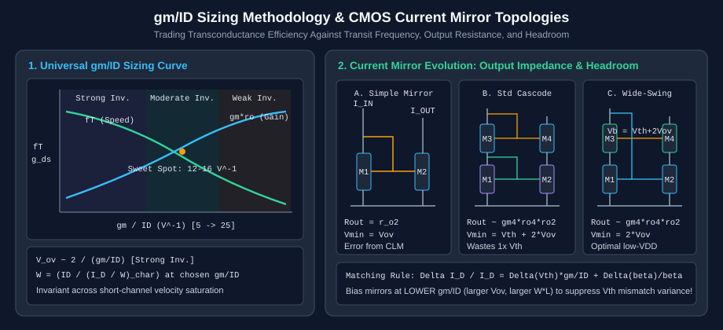
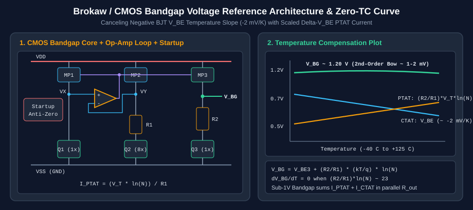

# CMOS Analog Building Blocks, Current Mirrors, and Biasing

Hand-calculated quadratic MOSFET equations (`I_D = 0.5 * uCox * (W/L) * (V_GS - V_th)^2`) fail severely below 65 nm due to velocity saturation, mobility degradation, drain-induced barrier lowering (DIBL), and moderate/weak-inversion operation. Modern FinFET and nanoscale planar analog designers rely on the **transconductance efficiency ($g_m/I_D$) methodology**, precision **current mirrors**, temperature-stabilized **bias generators**, and **bandgap voltage references** to build PVT-resilient analog cores.

---

## Learning Goals

- Size CMOS transistors accurately across weak, moderate, and strong inversion using the **lookup-table $g_m/I_D$ methodology**.
- Compare **simple**, **cascode**, **wide-swing cascode**, and **regulated (gain-boosted) current mirrors** across output resistance ($R_{\text{out}}$), minimum compliance voltage ($V_{\min}$), and mismatch sensitivity.
- Design **constant-$g_m$ self-biased circuits** along with failsafe **startup circuits** that escape the zero-current stable state.
- Analyze **CMOS Bandgap Voltage References** combining negative-TC BJT $V_{BE}$ (CTAT) with positive-TC $\Delta V_{BE}$ (PTAT) to produce ~1.20 V (or sub-1 V) temperature-flat outputs.
- Evaluate systematic offset, random threshold mismatch ($\sigma_{V_{th}}$ via Pelgrom's Law), and power-supply rejection in biasing networks.

---

## Modern gm/ID Design Methodology vs Square-Law Intuition

In advanced nodes (`28 nm`, `16 nm`, `5 nm`), mobility depends heavily on vertical fields and carriers hit saturation velocity $v_{\text{sat}}$, making classical $V_{ov} = V_{GS} - V_{th}$ poorly correlated with gain and speed. Instead, **$g_m/I_D$** directly quantifies **how much transconductance you get per unit of bias current burned**:

### Generating and Using Lookup Charts

Every foundry PDK supports generating normalized $I_D/W$, $g_m r_o$ (intrinsic gain), and $f_T = \frac{g_m}{2\pi C_{gg}}$ curves versus $g_m/I_D$ for fixed channel lengths $L$ via a fast DC sweep testbench in SPICE:

| Inversion Region | Typical `gm/ID` (`V^-1`) | Intrinsic Gain `gm * ro` | Transit Speed `fT` | Best Circuit Application |
| :--- | :--- | :--- | :--- | :--- |
| **Strong Inversion** | `4 – 8` | Low (short $L$ degrades $r_o$) | Highest (`GHz`) | Current mirrors (low mismatch!), RF switches, wide-swing drivers |
| **Moderate Inversion** | `10 – 16` | High | Moderate–High | **OTA input differential pairs**, SerDes AFE, general amplification |
| **Weak / Subthreshold** | `18 – 26` | Highest (approaches $1/(n V_T)$ limit) | Low (`MHz`) | Ultra-low-power sensor AFEs, IoT references, nanopower LDOs |

### Four-Step `gm/ID` Sizing Recipe

1. **Choose $L$** from spec priorities: minimum $L$ for highest $f_T$ (e.g., RF/comparator latches), `2x–5x` minimum $L$ for gain stages (`gm * ro`), and large `L` (`4x–10x` minimum) for current mirrors requiring tight matching and low $1/f$ noise.
2. **Choose $g_m/I_D$** on the lookup chart (`12–15 V^-1` for OTA diff pairs; `6–10 V^-1` for current mirrors to increase $V_{ov}$ and suppress threshold mismatch!).
3. **Compute $I_D$** directly from the required $g_m$ (e.g., from noise or unity-gain bandwidth $\text{UGF} = g_m / (2\pi C_L)$): $I_D = \frac{g_m}{(g_m/I_D)}$.
4. **Read current density $J_D = I_D / W$** from the PDK chart at the chosen $(L, g_m/I_D)$, giving exact transistor width $W = I_D / J_D$.

> [!TIP]
> **Matching vs. Gain Trade-Off Rule**: Pelgrom's Law shows random current mismatch $\sigma(\Delta I_D/I_D)$ depends directly on $\left(\frac{g_m}{I_D}\right) \sigma_{\Delta V_{th}}$. Choosing a *high* $g_m/I_D$ on a current mirror makes it exquisitely sensitive to tiny $V_{th}$ mismatches! Always bias **current mirrors at lower $g_m/I_D$ (`5–9 V^-1`)** and **diff pairs at higher $g_m/I_D$ (`12–18 V^-1`)**.

---

## Current Mirrors Simple, Cascode, Wide-Swing, and Gain-Boosted

Current mirrors copy a precision reference current $I_{\text{REF}}$ into scaled sink/source branches across the chip. Their key defects are **finite output resistance** ($r_{\text{out}}$ causing Channel-Length Modulation error when $V_{DS,2} \neq V_{DS,1}$) and **minimum compliance voltage** ($V_{\min}$ before the mirror drops out of saturation into the triode region).

| Topology | Small-Signal `R_out` | Minimum Output `V_min` | Advantages &amp; Disadvantages |
| :--- | :--- | :--- | :--- |
| **Simple Mirror** | $r_{o2}$ | $V_{ov2}$ | Lowest headroom requirement; poor PSRR and systematic CLM gain error when $V_{DS2} \neq V_{DS1}$. |
| **Standard Cascode** | $\approx g_{m4} r_{o4} r_{o2}$ | $V_{th4} + 2 V_{ov}$ | Huge $R_{\text{out}}$ boost ($\times A_i$); wastes one full threshold drop $V_{th}$ of voltage headroom! |
| **Wide-Swing (Sooch) Cascode** | $\approx g_{m4} r_{o4} r_{o2}$ | $V_{ov2} + V_{ov4}$ | Preserves full cascode $R_{\text{out}}$ while saving $V_{th}$ of swing by biasing cascode gate at $V_{th} + 2V_{ov}$. |
| **Regulated (Gain-Boosted) Cascode** | $\approx A_{\text{aux}} g_{m4} r_{o4} r_{o2}$ | $V_{ov2} + V_{ov4}$ | Auxiliary op-amp pins $V_{DS2} = V_{\text{ref}}$ tightly, raising $R_{\text{out}}$ into $\text{G}\Omega$ range (requires checking auxiliary loop stability!). |

### Matching Current Ratios with Unit Fingers

Never implement a `1:3.5` current mirror ratio using arbitrary widths like `W1 = 2 um` and `W2 = 7 um`! Edge effects (STI stress, lithography rounding, poly etch loading) depend on finger edge count. Instead, always choose an integer **unit cell width $W_u$** (`2 um`, fixed `L`) and build scaled branches using explicit multipliers (`m=2`, `m=7`) placed inside a common-centroid layout.

---

## Bias Distribution, Constant-gm Self-Biasing, and Startup Circuits

If current varies $\pm 35\%$ across Slow–Fast process and $-40^\circ\text{C}$ to $+125^\circ\text{C}$ temperature corners, OTA bandwidth and comparator regeneration speed swing wildly. **Constant-$g_m$ biasing** forces transistor transconductance to track an inverse precision resistor ratio:

$$g_{m1} = \frac{2\left(1 - \frac{1}{\sqrt{K}}\right)}{R_{\text{bias}}}$$

where $M_2$ has multiplier $K$ relative to $M_1$ ($K = 4$ gives $g_{m1} = 1/R_{\text{bias}}$ in square-law devices!). Notice a critical subtlety: **every self-biased loop has TWO mathematically stable operating points**:
1. The desired non-zero operating point $I_{\text{bias}} > 0$.
2. The **dead zero-current equilibrium ($I_{\text{bias}} = 0$)**! If all nodes power up near ground or $V_{DD}$, the loop sits stuck at `0 uA` forever!

### Startup Circuit Design Criteria

A valid **startup circuit** monitors the bias current loop:
- **During power-up ($I_{\text{bias}} = 0$)**: Injects a small kick current into the mirror gates to pull the self-biased loop into conduction.
- **Once active ($I_{\text{bias}} = I_{\text{nom}}$)**: Completely **switches OFF (`0 nA` leakage)** so it never corrupts the precision PTAT or constant-$g_m$ reference ratio!
- **Under slow supply ramps &amp; brownouts**: Must operate properly for both `1 us` fast ramps AND `10 ms` slow battery power-ups—plus recover cleanly if a brownout glitches rails down and back up!

> [!WARNING]
> Always verify startup circuits with transient SPICE simulations sweeping **ramp rates from `10 ns` to `20 ms`**, **initial condition `.ic` trapped at dead-state (`0 V` on gates)**, and **brownout re-ramping** across all PVT corners (`SS/-40C` is typically the hardest corner to kick-start!).

---

## Bandgap Voltage References (PTAT, CTAT, and Curvature Correction)

Every ADC, DAC, LDO, and precision oscillator needs a reference voltage immune to supply ($V_{DD}$), temperature ($T$), and process variation. A **Bandgap Voltage Reference (BGR)** exploits two opposite silicon physics trends:

1. **CTAT (Complementary To Absolute Temperature)**: Forward-biased parasitic PNP emitter-base voltage $V_{BE}$ falls nearly linearly with temperature:
   $$\frac{\partial V_{BE}}{\partial T} \approx -1.8\text{ to }-2.2\text{ mV/K}$$
2. **PTAT (Proportional To Absolute Temperature)**: Forcing two identical-topology PNPs $Q_1$ (area $1\times$) and $Q_2$ (area $N\times$, typically $N=8$ in a $3\times 3$ ring) to carry equal collector current $I_C$ forces an exact logarithmic difference across resistor $R_1$:
   $$\Delta V_{BE} = V_{BE1} - V_{BE2} = V_T \ln(N) = \frac{k_B T}{q} \ln(N)$$
   At room temperature ($300\text{ K}$), $V_T \approx 25.85\text{ mV}$, so for $N=8$, $\Delta V_{BE} \approx 53.75\text{ mV}$ with positive slope $+0.179\text{ mV/K}$.

Summing the amplified PTAT drop across $R_2$ with $V_{BE3}$ produces the classical silicon bandgap voltage:

$$V_{\text{BG}} = V_{BE3} + \frac{R_2}{R_1} V_T \ln(N) \approx 1.205\text{ V} \quad \text{when} \quad \frac{R_2}{R_1} \ln(N) \approx 22\text{–}23$$

### Sub-1V (Current-Mode) Bandgap References

When core SoC supplies drop to `0.8 V–1.0 V`, a `1.2 V` output cannot fit under $V_{DD}$. **Banba (Current-Mode) Bandgaps** generate two currents in parallel:
- $I_{\text{PTAT}} = \Delta V_{BE} / R_1$
- $I_{\text{CTAT}} = V_{BE1} / R_3$
Summing $I_{\text{BG}} = I_{\text{PTAT}} + I_{\text{CTAT}}$ through an output resistor $R_4$ scales $V_{\text{BG}}$ cleanly down to any desired sub-1 V level (e.g., `0.60 V` or `0.80 V`) while maintaining near-zero first-order TC!

### Precision Killers in Bandgaps

- **Op-Amp Input Offset ($V_{os}$)**: Appears *amplified* inside $V_{\text{BG}}$ by $\left(1 + \frac{R_2}{R_1}\right) \approx 12\times$! A `3 mV` op-amp offset shifts $V_{\text{BG}}$ by **`36 mV`**. Mitigation: large op-amp input pairs, chopper stabilization, or dynamic offset cancellation.
- **2nd-Order Bow Curvature**: Because $V_{BE}(T)$ contains a slight $T \ln(T)$ term, first-order zeroing leaves a parabolic bow (~1.5–3 mV across $-40^\circ\text{C}$ to $+125^\circ\text{C}$, ~10–20 ppm/K). Precision trims calibrate $R_2$ at wafer sort to center the flat parabola peak around $+40^\circ\text{C}$.

---

## Best Practices and Common Pitfalls

1. **Always Connect Well-Tied Bulk Bias Carefully**: Watch PMOS body ties (`VBP`) vs. NMOS substrate ties (`VSS`). If a cascode mirror transistor sits inside its own N-well, tie its source-to-body (`S-to-B`) only if it eliminates body effect safely without forward-biasing wells during startup transients!
2. **Distribute Current Mirrors via Currents, Never Remote Gate Voltages**: Routing an analog gate bias voltage $V_{\text{bias}}$ 500 um across an SoC allows resistive `IR` ground bounce ($\Delta V_{SS} = 10\text{ mV}$) between local and remote grounds to create huge exponential current mirroring errors ($\Delta I_D = g_m \Delta V_{SS}$)! Always route a **reference current** over long distances and regenerate $V_{GS}$ locally with a diode-connected NMOS/PMOS referenced to local `VSSA`!
3. **Verify Both `.dc` and `.tran` Startup with Opposite Initial Conditions**: A `.dc` SPICE convergence run often jumps straight to the desired non-zero root and misses dead-zero latchup! Always force initial `0 V` on mirror gates in `.tran` to prove startup actually kicks the loop alive.
4. **Place Q1 inside the Center of an 8-Unit Ring for Q2**: In bandgap layouts, arrange `Q2` as the outer 8 PNPs of a `3x3` BJT array surrounding `Q1` in the center so oxide-thickness and thermal gradients cancel identically!

---

## Practical Exercises with Solutions

### Exercise 1 Sizing a Wide-Swing Current Mirror with `gm/ID`

You need a `100 uA` NMOS wide-swing cascode current sink operating with output compliance voltage $V_{\min} \le 0.30\text{ V}$ in a process where `gm/ID = 8 V^-1` gives $J_D = 25\text{ }\mu\text{A}/\mu\text{m}$ at $L = 200\text{ nm}$. Assuming strong-inversion approximation $V_{ov} \approx \frac{2}{g_m/I_D}$ and $g_m r_o = 22$ per transistor:

1. Calculate required $W$, $g_m$, and $V_{ov}$ per FET.
2. Verify whether the cascode satisfies $V_{\min} \le 0.30\text{ V}$? (Wait: check $V_{\min} = 2 V_{ov}$!) If not, how should `gm/ID` be adjusted?

#### Solution

1. At `gm/ID = 8 V^-1`:
   - $W = \frac{I_D}{J_D} = \frac{100\text{ }\mu\text{A}}{25\text{ }\mu\text{A}/\mu\text{m}} = 4.0\text{ }\mu\text{m}$.
   - $g_m = 8 \times 100\text{ }\mu\text{A} = 0.80\text{ mS}$.
   - $V_{ov} \approx \frac{2}{8} = 0.25\text{ V}$ per transistor.
2. **Compliance Check**: A wide-swing cascode requires $V_{\min} = V_{ov,\text{bot}} + V_{ov,\text{cas}} = 0.25 + 0.25 = 0.50\text{ V}$, which **violates** the $V_{\min} \le 0.30\text{ V}$ target!
3. **Fix**: Increase `gm/ID` toward moderate inversion, e.g., `gm/ID = 14 V^-1`, reducing $V_{ov} \approx \frac{2}{14} \approx 0.143\text{ V}$ per FET so $V_{\min} \approx 0.286\text{ V} \le 0.30\text{ V}$ (then look up the larger width $W = I_D / J_D(14\text{ V}^{-1})$ for the bottom/cascode devices, while keeping a matching check via Monte Carlo!).

---

### Exercise 2 Designing a Temperature-Flat CMOS Bandgap Resistor Ratio

A bandgap uses parasitic PNPs with emitter area ratio $N = 10$ ($Q_2 = 10 \times Q_1$). At $T = 300\text{ K}$, $V_{BE3} = 0.68\text{ V}$ with $\frac{\partial V_{BE3}}{\partial T} = -1.95\text{ mV/K}$, and thermal voltage $V_T = k_B T / q = 25.85\text{ mV}$ ($\frac{\partial V_T}{\partial T} = +0.08617\text{ mV/K}$). Setting $R_1 = 10\text{ k}\Omega$:

1. Find the PTAT branch current $I_{\text{PTAT}}$ at $300\text{ K}$.
2. Solve for resistor $R_2$ to achieve $\frac{\partial V_{\text{BG}}}{\partial T} = 0\text{ mV/K}$ at $300\text{ K}$.
3. Compute the resulting nominal output $V_{\text{BG}}$.

#### Solution

1. **PTAT Voltage & Current**:
   - $\Delta V_{BE} = V_T \ln(10) = 25.85\text{ mV} \times 2.3026 = 59.52\text{ mV}$.
   - $I_{\text{PTAT}} = \frac{59.52\text{ mV}}{10\text{ k}\Omega} = 5.952\text{ }\mu\text{A}$.
2. **Zero-TC Ratio $(R_2 / R_1)$**:
   $$\frac{\partial V_{\text{BG}}}{\partial T} = \frac{\partial V_{BE3}}{\partial T} + \frac{R_2}{R_1} \ln(10) \frac{\partial V_T}{\partial T} = 0$$
   $$-1.95\text{ mV/K} + \frac{R_2}{R_1}(2.3026)(0.08617\text{ mV/K}) = 0 \implies \frac{R_2}{R_1} = \frac{1.95}{0.1984} = 9.829$$
   - Therefore, $R_2 = 9.829 \times 10\text{ k}\Omega = 98.29\text{ k}\Omega$.
3. **Nominal Bandgap Output**:
   $$V_{\text{BG}} = 0.68\text{ V} + 9.829 \times 0.05952\text{ V} = 0.68 + 0.585 = 1.265\text{ V}$$

---

### Exercise 3 Analyzing Op-Amp Offset Amplification Inside a Bandgap

Suppose the op-amp holding $V_X = V_Y$ in the bandgap from Exercise 2 develops an input-referred random offset voltage $V_{os} = +2.5\text{ mV}$. Quantify the resulting output error $\Delta V_{\text{BG}}$ in mV!

#### Solution

With $V_{os}$ added between the op-amp inputs, $V_Y - V_X = V_{os}$, so the voltage across $R_1$ changes from $\Delta V_{BE}$ to $\Delta V_{BE} + V_{os}$. Neglecting slight $V_{BE3}$ logarithmic sensitivity, $I_{\text{PTAT}}$ shifts by $\Delta I = V_{os} / R_1$, producing an output error:

$$\Delta V_{\text{BG}} \approx \frac{R_2}{R_1} V_{os} = 9.829 \times 2.5\text{ mV} \approx +24.57\text{ mV}$$

(Nearly $10\times$ magnification—explaining why op-amp offset and $1/f$ noise dominate bandgap inaccuracy unless mitigated with large input area or chopper stabilization!)

---

##### Copyright (c) 2026 squared-studio
