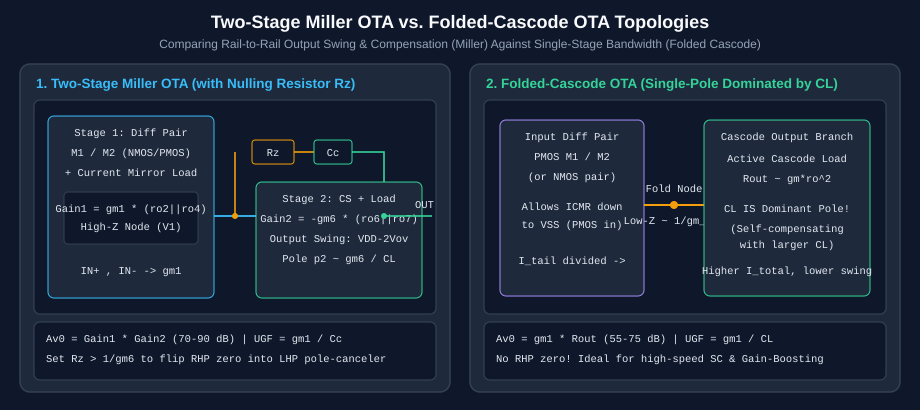
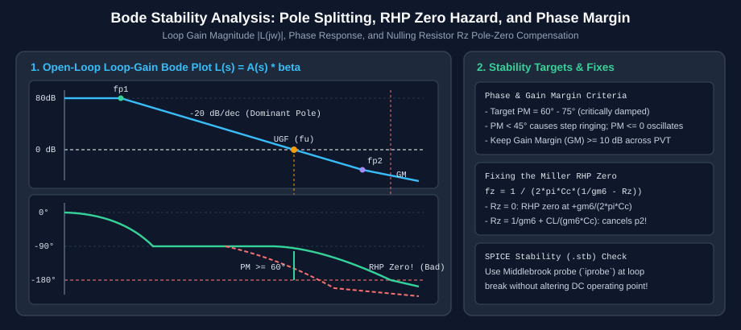

# Amplifiers, Operational Transconductance Amplifiers, and Stability

Operational Transconductance Amplifiers (OTAs) form the closed-loop workhorses behind switched-capacitor integrators, bandgap loops, LDO error amplifiers, continuous-time equalizers, and precision buffers. Designing an OTA in CMOS requires balancing **DC open-loop gain ($A_{v0}$)**, **unity-gain frequency ($\text{UGF}$)**, **input/output swing**, **thermal/$1/f$ noise**, and **closed-loop phase margin ($\text{PM}$)** across all PVT and load variations.

---

## Learning Goals

- Contrast **single-ended vs. fully differential OTAs** and understand why differential circuits need **Common-Mode Feedback (CMFB)** loops.
- Compare **Telescopic Cascode**, **Folded Cascode**, **Two-Stage Miller**, and **Current-Mirror OTAs** across gain, swing, speed, and headroom.
- Analyze feedback loop stability using **Bode magnitude/phase plots**, **dominant/non-dominant poles**, and **nulling-resistor ($R_z$) compensation** of the right-half-plane (RHP) zero.
- Distinguish **small-signal settling ($\text{UGF}$)** from **large-signal slew-rate settling ($I_{\text{tail}}/C_c$)** in pulsed switched-capacitor or buffer steps.
- Run accurate `.stb` (Middlebrook loop-stability) checks in SPICE across both differential-mode and CMFB loops without disturbing DC operating points.

---

## Single-Ended vs Differential Signalling and Common-Mode Feedback

In nanoscale mixed-signal SoCs where noisy digital clocks bounce shared rails and substrates by tens of millivolts, **fully differential OTAs** ($V_{\text{out,diff}} = V_{\text{out+}} - V_{\text{out-}}$) provide three decisive advantages over single-ended amplifiers:
1. **Even-Order Harmonic Cancellation**: Symmetric distortion terms ($a_2 v_{\text{in}}^2$) create identical common-mode shifts on $V_{\text{out+}}$ and $V_{\text{out-}}$, canceling completely in $V_{\text{out,diff}}$!
2. **2x Peak-to-Peak Swing**: Under a low `0.9 V` supply, differential swing reaches up to $\pm 0.7\text{ V} = 1.4\text{ V}_{\text{pp}}$ instead of `0.7 V` single-ended (+6 dB dynamic range).
3. **Supply &amp; Substrate Rejection ($\text{PSRR}/\text{CMRR}$)**: Common-mode bounces couple nearly equally into both symmetric paths.

### The Necessity of CMFB Loops

While differential feedback fixes the *difference* $(V_{\text{out+}} - V_{\text{out-}})$, high-impedance cascode outputs have undefined average DC level $\frac{V_{\text{out+}} + V_{\text{out-}}}{2}$. Tiny PMOS-vs-NMOS current mismatch ($\pm 1\text{ }\mu\text{A}$) drives both outputs toward $V_{DD}$ or $V_{SS}$, crushing transistors into triode! A **Common-Mode Feedback (CMFB)** circuit therefore:
- Senses $V_{\text{CM,out}} = \frac{V_{\text{out+}} + V_{\text{out-}}}{2}$ (via resistive averaging or switched-capacitor sensing).
- Compares $V_{\text{CM,out}}$ against target $V_{\text{CM,ref}}$ (`VDD/2`).
- Adjusts the current-source load bias so $V_{\text{CM,out}} = V_{\text{CM,ref}}$ cleanly.

> [!IMPORTANT]
> **Verify CMFB Stability Separately!** Many silicon bugs come not from the main differential loop, but from an under-damped CMFB loop whose UGF sits too close to parasitic nodes or whose phase margin falls below 45°, causing common-mode ringing or full rail oscillation!

---

## Classic OTA Topologies Telescopic, Folded-Cascode, and Two-Stage Miller

Selecting an OTA topology starts from three system constraints: supply voltage (`VDD`), output swing, and load (`C_L` vs resistive `R_L`):



| Topology | DC Gain (`Av0`) | Dominant Pole &amp; Compensation | Output Swing | Best Application |
| :--- | :--- | :--- | :--- | :--- |
| **Telescopic Cascode** | High (`60–80 dB`) | $C_L$ at output (self-compensated!) | Restricted (5 stacked FETs!) | High-speed, lowest power, limited swing SC stages |
| **Folded Cascode** | High (`55–75 dB`) | $C_L$ at output (no RHP zero!) | Moderate (`VDD - 4*Vov`) | Wide ICMR, fast single-stage pipelined ADC MDACs |
| **Gain-Boosted Folded Cascode** | Very High (`85–105 dB`) | $C_L$ (+ guard doublet poles in aux amps!) | Moderate (`VDD - 4*Vov`) | High-precision 14–16 bit SC integrators &amp; MDACs |
| **Two-Stage Miller OTA** | High (`70–90 dB`) | Internal Miller cap $C_c$ (pole splitting!) | Near Rail-to-Rail (`VDD - 2*Vov`) | Large output swing, low-VDD (`0.8 V`) buffers, LDO error amps |

Notice the fundamental contrast:
- In a **Folded-Cascode OTA**, the load capacitor $C_L$ *creates* the dominant pole ($\omega_{p1} = \frac{1}{R_{\text{out}} C_L}$), so adding larger $C_L$ actually *increases* stability! Non-dominant poles sit at the low-impedance folding node ($\omega_{p2} \approx g_{m,\text{cas}} / C_{\text{fold}}$).
- In a **Two-Stage Miller OTA**, Stage 2 drives a full common-source output (allowing `VDD - 2*Vov` near-rail-to-rail swing!). However, two high-impedance gain nodes in cascade would oscillate without **Miller Compensation ($C_c$)**, which splits Stage 1's pole down cleanly while pushing Stage 2's pole out—yet unfortunately introduces an annoying **Right-Half-Plane (RHP) zero** unless fixed!

---

## Feedback, Bode Analysis, Pole Splitting, and RHP Zero Cancellation

Consider negative feedback around an open-loop amplifier $A(s)$ with resistive or capacitive feedback factor $\beta$:

$$H_{\text{CL}}(s) = \frac{A(s)}{1 + \beta A(s)} = \frac{A(s)}{1 + L(s)}$$

where $L(s) = \beta A(s)$ is the **Loop Gain**. Stability is governed strictly by where $|L(j\omega)| = 1$ ($0\text{ dB}$, the Unity-Gain Frequency $f_u$):



### Stability Margins

- **Phase Margin ($\text{PM}$)**: $\text{PM} = 180^\circ + \angle L(j 2\pi f_u)$. Target **$\ge 60^\circ$ across all PVT corners** ($\text{PM} \approx 65^\circ$ yields ~5% step overshoot; $\text{PM} \approx 45^\circ$ rings noticeably; $\text{PM} \le 0^\circ$ oscillates).
- **Gain Margin ($\text{GM}$)**: $-20\log_{10}|L(j\omega_{-180^\circ})|$ at the frequency where phase crosses $-180^\circ$. Target **$\ge 10\text{ dB}$**.

### Pole Splitting &amp; Fixing the RHP Zero in Miller OTAs

Connecting compensation capacitor $C_c$ across Stage 2 (gain $-g_{m6} R_2$) creates Miller multiplication $(1 + g_{m6}R_2)C_c$ at Stage 1's output, shifting poles to:

$$\omega_{p1} \approx \frac{1}{g_{m6} R_1 R_2 C_c}, \qquad \omega_{p2} \approx \frac{g_{m6}}{C_L}$$

Meanwhile, direct feedforward through $C_c$ bypasses Stage 2's inversion at high frequencies, creating a **Right-Half-Plane (RHP) zero**:

$$\omega_{z,\text{RHP}} = +\frac{g_{m6}}{C_c}$$

Why is an **RHP zero deadly**? Unlike an LHP zero, an RHP zero *boosts magnitude* (+20 dB/dec, pushing UGF outward!) while simultaneously *subtracting phase* (-90°, just like a pole!), collapsing phase margin!

### Adding Nulling Resistor `Rz`

Inserting a series **nulling resistor $R_z$** with $C_c$ shifts the zero to:

$$\omega_z = \frac{1}{C_c\left(\frac{1}{g_{m6}} - R_z\right)}$$

Three design regimes emerge:
1. $R_z = \frac{1}{g_{m6}}$: Places $\omega_z \to \infty$ (completely eliminates the RHP zero).
2. $R_z = \frac{1}{g_{m6}}\left(1 + \frac{C_L + C_c}{C_c}\right) \approx \frac{1}{g_{m6}} + \frac{C_L}{g_{m6} C_c}$: Flips the zero into the **Left Half-Plane** right on top of $\omega_{p2}$, achieving exact pole-zero cancellation ($\text{PM} \to 90^\circ$)!
3. **Ahuja (Indirect / Cascode) Compensation**: Connects $C_c$ back to a *low-impedance cascode source* inside Stage 1 instead of Stage 1's high-impedance output—blocking feedforward completely, removing the RHP zero intrinsically, and boosting PSRR!

> [!CAUTION]
> **Matching `Rz` Across Process Corners**: Using a poly resistor for $R_z$ while $1/g_{m6}$ varies independently across process/temperature can misplace the pole-zero cancellation across corners! Instead, implement $R_z$ as a **triode-biased MOSFET** tracked dynamically by the Stage 2 bias mirror so $R_z \propto 1/g_{m6}$ tracks across all PVT corners!

---

## Large-Signal Settling, Slew Rate, and Noise-Power Trade-Offs

In pulsed circuits (switched-capacitor MDACs, DAC buffers), step settling happens in two phases:

1. **Slew-Rate Limited Phase (Large-Signal)**: A large input step switches the entire tail current $I_{\text{tail}}$ to one side, charging $C_c$ (or $C_L$) linearly:
   $$\text{SR} = \frac{I_{\text{tail}}}{C_c}\text{ [V/}\mu\text{s]}$$
   (Note: in two-stage Miller OTAs, Stage 2 output current must also exceed $\text{SR} \cdot C_L$ so Stage 2 doesn't slew separately!)
2. **Exponential Linear Settling Phase (Small-Signal)**: Once differential error shrinks within linear range ($\lesssim \sqrt{2}V_{ov}$), output settles exponentially with time constant $\tau = \frac{1}{2\pi \beta \cdot \text{UGF}}$:
   $$t_{\text{lin}} = \tau \ln\!\left(\frac{1}{\epsilon}\right)$$
   For $N$-bit settling accuracy ($\epsilon < \frac{1}{2} \text{LSB} = 2^{-(N+1)}$), achieving **12-bit settling** requires $\ln(2^{13}) \approx \mathbf{9.01\,\tau}$, and **16-bit settling** requires **11.78 time constants**!

### Middlebrook `.stb` Verification Setup

Never check loop stability in SPICE by breaking the loop in `.ac` manually with an ideal `1 F` inductor—doing so alters loading capacitance and shifts bias! Use the simulator's built-in **Middlebrook / Tian Stability Probe (`iprobe` / `.stb`)** which injects dual current/voltage perturbations without breaking the DC or AC impedance of the closed loop!

```spice
* Spectre / HSPICE Middlebrook Stability (.stb) Example for Unity-Gain Buffer
Xota vin_p vfb vdd vss two_stage_ota
Iprob (vout vfb) iprobe
Cload (vout vss) 2.0p
Vdd_src (vdd 0) dc=1.2
Vcm_in  (vin_p 0) dc=0.6
* Evaluate both Differential Loop Gain and Phase Margin across PVT:
.stb start=1 stop=10G dec=20 probe=Iprob
```

---

## Best Practices and Common Pitfalls

1. **Always Simulate Both Differential `.stb` and CMFB `.stb`**: A differential OTA can show 72° phase margin differentially while its CMFB loop oscillates at 400 MHz! Place an `iprobe` directly inside the CMFB loop too.
2. **Check Worst-Case Gain &amp; Bandwidth Across All Loading Scenarios**: Unity-gain ($\beta = 1$) gives maximum loop bandwidth and is almost always the **worst-case stability corner**! Gain-of-10 ($\beta = 0.1$) gives lower bandwidth and tests whether DC gain is high enough to keep closed-loop gain error tiny.
3. **Avoid Gain-Boosted Doublets Inside Fast Settling Loops**: A gain-boosting auxiliary op-amp creates a closely spaced pole-zero pair ("doublet") near the auxiliary UGF. Although Bode PM looks clean, a doublet adds a **slow exponential settling tail** (`e^{-t/\tau_d}`) that ruins 14-bit fast ADC settling unless $\text{UGF}_{\text{aux}}$ stays between $\omega_{u,\text{main}}$ and $\omega_{p2}$!
4. **Account for Closed-Loop Slew + Settling Together**: Increasing bias current only in Stage 2 without checking Stage 1's slew rate $I_{\text{tail}}/C_c$ wastes power; balance $I_{\text{tail}}$ and $g_{m1}$ together via `gm/ID`.

---

## Practical Exercises with Solutions

### Exercise 1 Designing Miller Compensation + Nulling Resistor

A Two-Stage Miller OTA has $g_{m1} = 1.0\text{ mS}$, Stage 2 transconductance $g_{m6} = 4.0\text{ mS}$, output resistances $R_1 = 80\text{ k}\Omega$, $R_2 = 25\text{ k}\Omega$, and load capacitance $C_L = 4.0\text{ pF}$ (used in unity-gain feedback $\beta = 1$).

1. Calculate the overall DC open-loop gain $A_{v0}$ in dB.
2. Size compensation capacitor $C_c$ to set non-dominant pole $f_{p2} \approx 2.2 \times f_u$ (targeting ~65° phase margin cleanly after nulling the RHP zero).
3. Compute the exact nulling resistor $R_z$ needed to cancel the RHP zero ($\omega_z \to \infty$), AND the alternative $R_z$ value to cancel $\omega_{p2}$ directly!

#### Solution

1. **DC Gain**:
   $$A_{v0} = (g_{m1} R_1)(g_{m6} R_2) = (1\text{ mS} \times 80\text{ k}\Omega)(4\text{ mS} \times 25\text{ k}\Omega) = 80 \times 100 = 8000\text{ V/V} \approx 78.1\text{ dB}$$
2. **Size $C_c$**:
   - Unity-gain frequency: $\omega_u \approx \frac{g_{m1}}{C_c}$.
   - Non-dominant pole (assuming $C_c \ll C_L$ or full $\omega_{p2} \approx \frac{g_{m6}}{C_L}$): $\omega_{p2} \approx \frac{4\text{ mS}}{4.0\text{ pF}} = 1.0 \times 10^9\text{ rad/s}$ ($f_{p2} \approx 159.2\text{ MHz}$).
   - Setting $\omega_{p2} = 2.2\,\omega_u = 2.2 \frac{g_{m1}}{C_c}$ gives:
     $$C_c = 2.2 \frac{g_{m1}}{\omega_{p2}} = 2.2 \frac{1.0\text{ mS}}{1.0 \times 10^9} = 2.2\text{ pF}$$
     (Exact UGF $f_u = \frac{1.0\text{ mS}}{2\pi \cdot 2.2\text{ pF}} \approx 72.3\text{ MHz}$.)
3. **Nulling Resistor $R_z$**:
   - To send zero to infinity ($\omega_z \to \infty$): $R_z = \frac{1}{g_{m6}} = \frac{1}{4.0\text{ mS}} = 250\,\Omega$.
   - To flip zero to LHP pole-canceler ($\omega_z = -\omega_{p2}$):
     $$R_z \approx \frac{1}{g_{m6}}\left(1 + \frac{C_L}{C_c}\right) = 250\,\Omega \left(1 + \frac{4.0}{2.2}\right) \approx 705\,\Omega$$

---

### Exercise 2 Auditing Slew Rate + Linear Settling Budget

A unity-gain OTA buffer ($\beta = 1$, UGF = $120\text{ MHz}$) with $C_c = 1.5\text{ pF}$ and tail current $I_{\text{tail}} = 120\text{ }\mu\text{A}$ must settle a $0.8\text{ V}$ step to **12-bit accuracy** ($\le 0.5\text{ LSB}$, i.e., error $< 2^{-13}$) inside one `20 ns` clock phase. Does it meet timing?

#### Solution

1. **Slew Rate**: $\text{SR} = \frac{I_{\text{tail}}}{C_c} = \frac{120\text{ }\mu\text{A}}{1.5\text{ pF}} = 80\text{ V/}\mu\text{s} = 0.08\text{ V/ns}$.
2. Assuming linear mode enters once residual error drops around $0.2\text{ V}$ (first `0.6 V` slewed):
   $$t_{\text{slew}} \approx \frac{0.6\text{ V}}{0.08\text{ V/ns}} = 7.50\text{ ns}$$
3. **Linear Settling**: Small-signal time constant $\tau = \frac{1}{2\pi \cdot 120\text{ MHz}} = 1.326\text{ ns}$. Settling from $0.2\text{ V}$ to $0.8\text{ V} \times 2^{-13} \approx 97.7\text{ }\mu\text{V}$ requires $\ln(0.2 / 9.77 \times 10^{-5}) = 7.62$ time constants:
   $$t_{\text{lin}} = 7.62 \times 1.326\text{ ns} = 10.10\text{ ns}$$
4. **Total Time**: $t_{\text{tot}} = 7.50 + 10.10 = 17.60\text{ ns} < 20\text{ ns}$ (passes nominally with `2.4 ns` margin, though slow corner `SS` UGF drop of `-25%` should be checked explicitly!).

---

### Exercise 3 Why Phase Margin Collapses Without `Rz`

In Exercise 1 ($C_c = 2.2\text{ pF}$, $g_{m6} = 4.0\text{ mS}$, $f_u = 72.3\text{ MHz}$, $f_{p2} = 159.2\text{ MHz}$), calculate the phase margin **with $R_z = 250\,\Omega$** vs. **with $R_z = 0\,\Omega$**.

#### Solution

1. **With $R_z = 250\,\Omega$ (RHP zero eliminated)**:
   $$\text{PM} \approx 90^\circ - \arctan\!\left(\frac{f_u}{f_{p2}}\right) = 90^\circ - \arctan\!\left(\frac{72.3}{159.2}\right) = 90^\circ - 24.4^\circ = 65.6^\circ$$
2. **With $R_z = 0\,\Omega$**: An RHP zero appears at $f_z = \frac{g_{m6}}{2\pi C_c} = \frac{4.0\text{ mS}}{2\pi \cdot 2.2\text{ pF}} = 289.4\text{ MHz}$, subtracting additional phase $-\arctan(72.3 / 289.4) = -14.0^\circ$:
   $$\text{PM} \approx 65.6^\circ - 14.0^\circ = 51.6^\circ$$
   (And at a larger Stage-2 $C_L$ or smaller $g_{m6}$, an uncompensated RHP zero easily drags PM below $30^\circ$!)

---

##### Copyright (c) 2026 squared-studio
