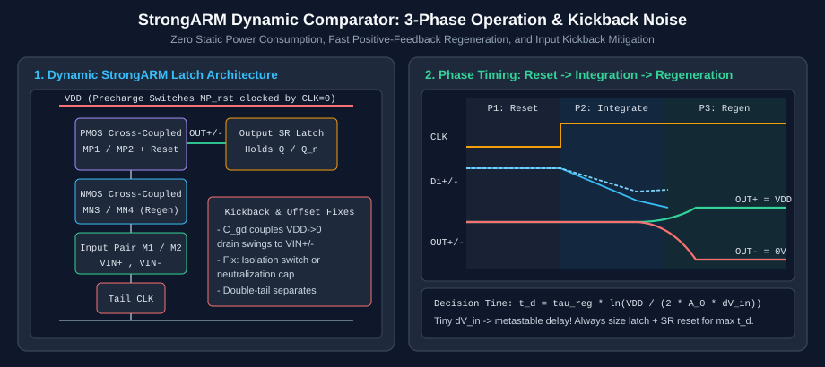
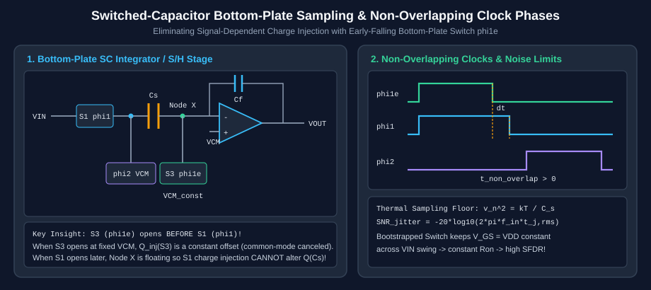

# Comparators, Switched-Capacitor Circuits, and Sampling Fundamentals

Comparators and switched-capacitor (SC) sampling networks sit at the physical heart of almost every analog-to-digital converter, PLL phase detector, LDO fault monitor, and switched-cap filter. Unlike continuous-time amplifiers that draw steady bias current, **dynamic comparators** consume zero static power while delivering rail-to-rail digital regeneration in tens of picoseconds—yet suffer from input offset, capacitive kickback, and metastability. Simultaneously, **bottom-plate switched-capacitor circuits** allow precision gain ratios set by capacitor matching (`~0.05%`) rather than absolute resistor tolerance (`~15%`).

---

## Learning Goals

- Trace the three operational phases of a **StrongARM dynamic latched comparator** (`Reset`, `Integration/Amplification`, `Regeneration`).
- Quantify comparator **input-referred offset**, **kickback noise onto sampling nodes**, and **metastable regeneration time constant ($\tau_{\text{reg}}$)**.
- Derive **charge injection** ($\Delta q$) and **clock feedthrough** errors in MOS switches and prove why **early-falling bottom-plate sampling ($\phi_{1e}$)** cancels signal-dependent distortion.
- Design **bootstrapped MOS switches** maintaining constant $V_{GS} = V_{DD}$ across full input rail swings and generate non-overlapping multi-phase clocks cleanly.

---

## Dynamic Latched Comparators and the StrongARM Architecture

A static open-loop preamplifier burns continuous DC current and still needs a latch at the back end. The **StrongARM Latch** merges clocked differential amplification and back-to-back cross-coupled positive feedback into a single dynamic stack:

### Three-Phase Sequence

1. **Reset Phase (`CLK = 0`)**:
   - Tail NMOS is OFF (`0 uA` static current!).
   - Four PMOS precharge switches pull all internal drain/output nodes (`Di+`, `Di-`, `OUT+`, `OUT-`) solidly to `VDD`, erasing previous bit memory ("hysteresis").
2. **Sampling / Integration Phase (`CLK` rises, drains start falling)**:
   - Tail NMOS turns ON, pulling differential current through input pair $M_1/M_2$.
   - The voltage imbalance $\Delta V_{\text{in}} = V_{\text{IN+}} - V_{\text{IN-}}$ integrates onto the internal drain capacitances $C_p$, opening a growing differential voltage $\Delta V_{\text{di}} \propto \frac{g_{m1}}{I_{\text{tail}}} \Delta V_{\text{in}} V_{th}$ until the NMOS cross-coupled latch ($M_{N3}/M_{N4}$) turns ON.
3. **Regeneration Phase (Positive Feedback Latching)**:
   - Cross-coupled NMOS + PMOS inverters form negative resistance, multiplying $\Delta V_{\text{di}}$ exponentially until `OUT+` and `OUT-` hit full `VDD` and `0 V`, captured cleanly by a downstream NAND/NOR **SR Latch** (so `CLK = 0` reset pulses don't destroy the valid digital decision during the second half-cycle!).

> [!NOTE]
> **Double-Tail Dynamic Comparators**: In low-supply FinFET designs (`0.75 V–0.9 V`), stacking tail + input + NMOS latch + PMOS latch inside a single StrongARM leaves tight headroom. Separating the integration preamplifier stage from the cross-coupled regeneration latch (**Double-Tail Comparator**) gives faster decision speed at low `VDD` and cuts kickback noise!

---

## Comparator Offset, Kickback Noise, and Metastability

Three practical hazards break dynamic comparators inside high-speed ADCs and SerDes slicers:

1. **Random &amp; Dynamic Offset ($\sigma_{os}$)**:
   - $V_{th}$ mismatch in $M_1/M_2$ dominates static offset (`5–20 mV` uncalibrated). Mismatch scales inversely with $\sqrt{W L}$, so precision comparators size $M_1/M_2$ larger—AND add capacitive trim DAC arrays or background offset-calibration latches at the drains!
   - Also check **parasitic layout capacitance mismatch** on `Di+/Di-`: a tiny `0.5 fF` difference between left and right drain metal wires acts like a large `5–10 mV` dynamic input offset!
2. **Kickback Noise**:
   - During regeneration, `Di+` and `Di-` plunge rapidly from `VDD` toward `0 V`, pumping charge back through $C_{gd}$ of input pair $M_1/M_2$ right into the high-impedance `VIN+`/`VIN-` nodes (e.g., an SAR capacitive DAC top plate!).
   - Mitigation: Add **source-follower pre-isolation**, **cross-coupled neutralization dummy FETs** driven out-of-phase, or **double-tail stage isolation**.
3. **Metastability**:
   - When $|\Delta V_{\text{in}}|$ happens to land near zero ($\mu\text{V}$ range), regeneration takes arbitrarily long:
     $$t_d = \tau_{\text{reg}} \ln\!\left(\frac{V_{DD}}{2 A_0 |\Delta V_{\text{in}}|}\right), \qquad \tau_{\text{reg}} \approx \frac{C_{\text{out}}}{g_{m,\text{latch}}}$$
   - In asynchronous SAR ADCs, a metastability timeout forces a deterministic bit fallback or error flag so downstream RTL state machines never lock up waiting for `comp_done`!

---

## Bottom-Plate Sampling, Charge Injection, and Clock Feedthrough

When a MOS switch of area $W \cdot L$ turns OFF, two unavoidable charge errors dump onto sampling capacitor $C_s$:

1. **Channel Charge Injection**: Inversion charge $Q_{\text{ch}} = -W L C_{\text{ox}} (V_{DD} - V_{\text{in}} - V_{th})$ splits between source and drain, creating a **signal-dependent** voltage error $\Delta V_{\text{inj}} \propto \frac{Q_{\text{ch}}(V_{\text{in}})}{C_s}$ that produces **harmonic distortion ($HD_2, HD_3$)**!
2. **Clock Feedthrough**: Overlap capacitance $C_{\text{ov}} = W C_{gd0}$ couples a clock swing $\Delta V_{\text{clk}}$ directly onto $C_s$: $\Delta V_{\text{ft}} = -\Delta V_{\text{clk}} \frac{C_{\text{ov}}}{C_{\text{ov}} + C_s}$.

### How Bottom-Plate Sampling Kills Signal-Dependent Distortion

Look carefully at the switch turn-off sequence (`phi1e` vs. `phi1`):
- During **Track (`phi1e = 1, phi1 = 1`)**: Input $V_{\text{in}}$ drives the left plate of $C_s$, while early switch $S_3$ (`phi1e`) anchors the right ("bottom") plate firmly at a constant quiet potential $V_{\text{CM}}$.
- At the **Sampling Instant (`phi1e` falls BEFORE `phi1`)**:
  - Switch $S_3$ opens first while sitting at **fixed voltage $V_{\text{CM}}$**! Therefore, $S_3$'s injected charge $Q_{\text{inj}}(S_3)$ is **strictly constant** regardless of $V_{\text{in}}$—producing zero harmonic distortion (only a pure DC offset that cancels completely in differential circuits)!
  - A short delay $\Delta t$ later, `phi1` falls and opens input switch $S_1$. Because the right plate of $C_s$ is now **high-impedance floating**, total charge on the right plate cannot change—so $S_1$'s signal-dependent charge injection dumps harmlessly into the low-impedance input driver, leaving the sampled charge on $C_s$ untouched!

---

## Bootstrapped Switches, kT/C Noise, and Non-Overlapping Clock Generators

In low-voltage processes (`0.8 V–1.0 V`), a simple transmission gate suffers huge non-linear on-resistance $R_{\text{on}}(V_{\text{in}})$ near mid-supply (`VDD/2`), where neither NMOS nor PMOS has strong $V_{ov}$—clipping high-frequency linearity!

### Bootstrapped Switch

A **bootstrapped switch** precharges an internal flying capacitor $C_{\text{boot}}$ to $V_{DD}$ during the OFF phase (`phi=0`), then connects $C_{\text{boot}}$ directly between the main NMOS switch **Source (`VIN`)** and **Gate** during the ON phase (`phi=1`):
- Gate voltage rides dynamically at **$V_G = V_{\text{IN}} + V_{DD}$**!
- Keeping **$V_{GS} = V_{DD}$ strictly constant** across the entire rail-to-rail input swing keeps $R_{\text{on}}$ flat and pushes sampling linearity above **80–95 dB SFDR**!
- Crucial reliability check: verify during transient SPICE that no transistor node inside the bootstrap pump ever exceeds oxide breakdown ($V_{GS}$ or $V_{DS} \le V_{DD,\max}$)!

### Non-Overlapping Clock Generator

To guarantee `phi1` and `phi2` never turn ON simultaneously (which would short stored charge across stages!), generate them using a cross-coupled **NOR-gate latch with even-numbered delay chains** inside the reset loop—plus tap an early edge upstream of two inverter buffers for **`phi1e`**!

---

## Best Practices and Common Pitfalls

1. **Always Add Balanced Differential Dummy Routing on `Di+/Di-` and Sampling Nodes**: Extract parasitic RC (`PEX`) on dynamic comparators early—even sub-femtofarad layout asymmetry ruins comparator offset far more than transistor area mismatch!
2. **Keep `S_1` (`phi1`) Closed Until *After* `S_3` (`phi1e`) Has Fully Opened**: Simulate your non-overlapping clock generator across fast/slow corners (`SS`, `FF`, low-VDD) to ensure $\Delta t = t(\phi_1\downarrow) - t(\phi_{1e}\downarrow) > 200\text{ ps}$ even with RC interconnect skew.
3. **Budget Comparator Metastability Timeout in Digital RTL**: Never write `always @(posedge comp_valid)` without a deterministic fallback clock timeout; otherwise a rare microvolt input hangs your ADC conversion FSM!
4. **Watch Body Effect &amp; Gate-Oxide Overvoltage in Bootstrapped Switches**: Check `max(V_G)` and `V_GD` in SPICE `.measure` across corners so bootstrapping `VIN + VDD` onto a core-oxide device doesn't fail foundry reliability rules.

---

## Practical Exercises with Solutions

### Exercise 1 Computing Dynamic Comparator Metastability Probability

A StrongARM comparator clocked at $f_s = 1.0\text{ GHz}$ ($T_{\text{clk}} = 1.0\text{ ns}$) allocates $T_{\text{eval}} = 400\text{ ps}$ for regeneration after reset/integration. Its small-signal gain prior to regeneration is $A_0 = 2.0$, $V_{DD} = 1.0\text{ V}$, and regeneration time constant is $\tau_{\text{reg}} = 12\text{ ps}$.

1. What is the **minimum differential input voltage** $|\Delta V_{\text{in},\min}|$ that resolves within `400 ps`?
2. If input signals are uniformly distributed across $\pm 0.5\text{ V}$ ($V_{\text{FS}} = 1.0\text{ V}$), estimate the raw probability $P_{\text{meta}}$ per comparison that the latch fails to resolve inside `400 ps`!

#### Solution

1. **Minimum Resolvable Input**:
   $$T_{\text{eval}} = \tau_{\text{reg}} \ln\!\left(\frac{V_{DD}}{2 A_0 |\Delta V_{\text{in},\min}|}\right) \implies 400 = 12 \ln\!\left(\frac{1.0}{4.0\,|\Delta V_{\text{in},\min}|}\right)$$
   $$\ln\!\left(\frac{0.25}{|\Delta V_{\text{in},\min}|}\right) = \frac{400}{12} = 33.33 \implies |\Delta V_{\text{in},\min}| = \frac{0.25}{e^{33.33}} \approx 8.33 \times 10^{-16}\text{ V}$$
2. **Metastability Probability**:
   - The unsafe window width is $2 \times |\Delta V_{\text{in},\min}| \approx 1.67 \times 10^{-15}\text{ V}$ inside a $1.0\text{ V}$ range:
     $$P_{\text{meta}} \approx 1.67 \times 10^{-15}$$
   - Wait: what happens if the process runs at Slow-Slow cold corner where $\tau_{\text{reg}}$ degrades from `12 ps` to `24 ps`? Then $\frac{400}{24} = 16.67$, pushing $P_{\text{meta}} \approx 2 \times 0.25 / e^{16.67} \approx 2.89 \times 10^{-8}$—failing ~29 times per second at 1 GSPS! Always verify metastability at **Slow-Corner $\tau_{\text{reg}}$**!

---

### Exercise 2 Analyzing Signal-Dependent Charge Injection vs. Bottom-Plate Sampling

A single NMOS switch ($W = 5\text{ }\mu\text{m}$, $L = 100\text{ nm}$, $C_{\text{ox}} = 12\text{ fF}/\mu\text{m}^2$, $V_{th} = 0.35\text{ V}$, $V_{DD} = 1.2\text{ V}$) samples onto $C_s = 1.0\text{ pF}$, splitting its channel charge 50%/50% between left and right nodes when turned OFF directly at the top plate (no bottom-plate early switching).

1. Compute the voltage error $\Delta V$ when sampling $V_{\text{in}} = 0.2\text{ V}$ vs. $V_{\text{in}} = 0.8\text{ V}$.
2. Explain how using bottom-plate sampling at fixed $V_{\text{CM}} = 0.6\text{ V}$ eliminates the nonlinearity between those two samples!

#### Solution

1. Total gate capacitance $C_g = W L C_{\text{ox}} = (5\text{ }\mu\text{m})(0.1\text{ }\mu\text{m})(12\text{ fF}/\mu\text{m}^2) = 6.0\text{ fF}$.
   - With 50% channel split: $\Delta V(V_{\text{in}}) = -\frac{0.5\,C_g (V_{DD} - V_{th} - V_{\text{in}})}{C_s}$.
   - At $V_{\text{in}} = 0.2\text{ V}$: $\Delta V = -\frac{3.0\text{ fF} \times (1.2 - 0.35 - 0.2)}{1.0\text{ pF}} = -1.95\text{ mV}$.
   - At $V_{\text{in}} = 0.8\text{ V}$: $\Delta V = -\frac{3.0\text{ fF} \times (1.2 - 0.35 - 0.8)}{1.0\text{ pF}} = -0.15\text{ mV}$.
   - Notice the signal-dependent gain/linearity error of $1.80\text{ mV}$ across a `0.6 V` input range (killing SFDR beyond ~50 dB!).
2. **With Bottom-Plate Sampling (`phi1e` on $S_3$ at fixed $V_{\text{CM}} = 0.6\text{ V}$)**: When $S_3$ turns OFF first, its $V_{\text{source}} = V_{\text{CM}} = 0.6\text{ V}$ is identical for *every* input sample, injecting a fixed constant $-0.75\text{ mV}$ offset regardless of whether $V_{\text{in}}$ is `0.2 V` or `0.8 V`—resulting in **zero signal-dependent distortion**!

---

### Exercise 3 Bootstrapped Switch Oxide Overvoltage Audit

A bootstrapped switch operates in a core `0.9 V` process (maximum safe gate-to-source/drain stress $|V_{GS}|, |V_{GD}| \le 1.05\text{ V}$). Input swings $0\text{ V} \le V_{\text{in}} \le 0.9\text{ V}$.

1. During the ON phase (`V_in = 0.9 V`), what node voltage does the bootstrapped gate reach, and why does the main switch NMOS *still* stay safe from oxide breakdown?
2. Which auxiliary transistor inside a naive bootstrap circuit violates breakdown if its bulk/gate clamping is miswired?

#### Solution

1. **Main Switch Gate &amp; Breakdown**:
   - When $V_{\text{in}} = 0.9\text{ V}$, $V_G = V_{\text{in}} + V_{DD} = 0.9 + 0.9 = \mathbf{1.8\text{ V}}$!
   - Wait: although `1.8 V` sits high above substrate ground, both **Source ($0.9\text{ V}$)** and **Drain ($0.9\text{ V}$)** of the main tracking switch follow $V_{\text{in}}$, so across the thin gate oxide itself, $V_{GS} = V_{GD} = 1.8 - 0.9 = \mathbf{0.9\text{ V}} \le 1.05\text{ V}$—completely safe! (Wait: check $V_{GB}$ to substrate if NMOS sits in grounded P-sub—place main switch inside an isolated Deep N-Well P-well tied to `V_in` or check foundry P-well breakdown!)
2. **Auxiliary Switch Hazard**: Any switch connecting $V_G$ (`1.8 V`) back to `0 V` pull-down ground when turning OFF sees $V_{DS} = 1.8\text{ V}$ unless shielded by a **cascode discharge NMOS** (or tied cleanly to $V_{DD}$ during OFF). Always run a `.measure` SPICE check verifying $\max(|V_{GS}|, |V_{GD}|, |V_{DS}|)$ across every transistor inside the bootstrap cell!

---

##### Copyright (c) 2026 squared-studio
