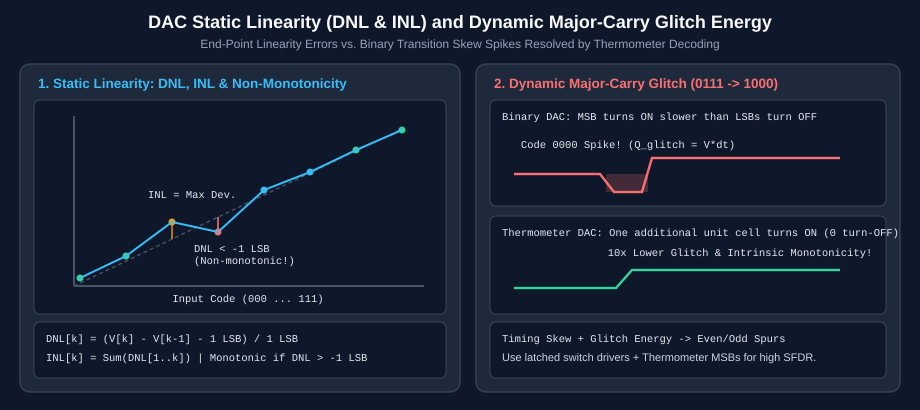
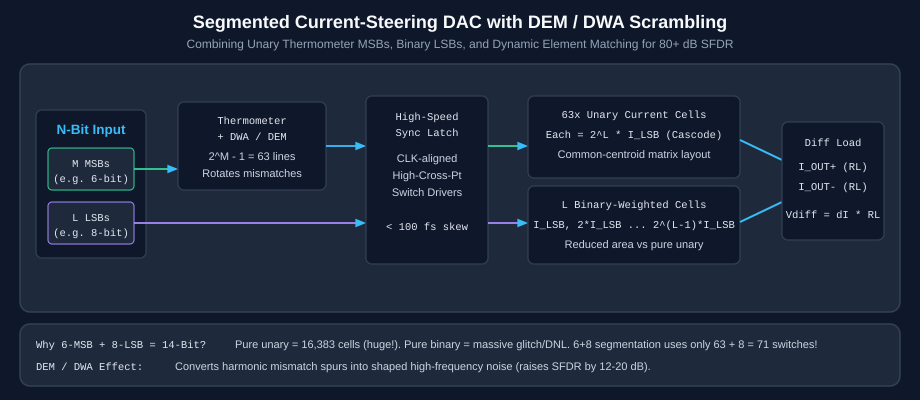

# Digital-to-Analog Converters (DAC) Architectures and Calibration

A Digital-to-Analog Converter (DAC) translates discrete digital codes into continuous analog voltages or currents for wireless transmitters, video drivers, bias/trim engines, and internal ADC feedback loops. While ideal static conversion seems trivial, physical device mismatch, switch timing skew, and finite output impedance quickly create missing monotonicity, harmonic spurs, and **major-carry transition glitches** unless segmented architectures and digital randomization techniques are applied cleanly.

---

## Learning Goals

- Interpret static DAC specifications (**Offset, Gain Error, DNL, INL, Monotonicity**) and calculate worst-case yield requirements using Pelgrom mismatch variance.
- Quantify dynamic DAC imperfections—specifically **major-carry glitch impulse energy** and **code-dependent switching timing skew**.
- Compare **Resistor-String**, **R-2R Ladder**, **Capacitive Charge-Redistribution**, and **Current-Steering** DAC architectures across area, speed, and load drive.
- Design **Segmented Current-Steering DACs** (e.g., 6-bit Unary Thermometer MSBs + 8-bit Binary LSBs) with high-crossing switch drivers.
- Apply **Dynamic Element Matching (DEM)** and **Data-Weighted Averaging (DWA)** RTL blocks to convert static element mismatches into high-frequency shaped noise.

---

## Static vs Dynamic DAC Metrics Offset, Gain, DNL, INL, and Glitch Energy

Evaluating a DAC requires checking both slow DC code sweeps (**Static Linearity**) and high-speed sine/pulse waveforms (**Dynamic SFDR & Glitch**):



### Static Linearity Definitions

Given ideal LSB step $\Delta = V_{\text{FS}} / 2^N$ (after calibrating away global endpoint offset and gain scale error):
- **Differential Nonlinearity ($\text{DNL}_k$)**: Deviation of an individual adjacent code step $(V[k] - V[k-1])$ from `1 LSB`:
  $$\text{DNL}[k] = \frac{V[k] - V[k-1] - \Delta}{\Delta}\text{ [LSB]}$$
  - If **$\text{DNL}[k] < -1\text{ LSB}$**, $V[k] < V[k-1]$—the DAC output drops when the digital code increases! This violates **monotonicity**, which can destabilize closed-loop control (PLL/LDO feedback!).
- **Integral Nonlinearity ($\text{INL}_k$)**: Cumulative deviation from the ideal endpoint straight line:
  $$\text{INL}[k] = \sum_{i=1}^{k} \text{DNL}[i] = \frac{V[k] - k\Delta}{\Delta}\text{ [LSB]}$$
  - Achieving $|\text{INL}| \le 0.5\text{ LSB}$ guarantees high linearity without missing codes.

### Why Binary Weighting Fails at the Major-Carry Transition (`0111 -> 1000`)

Consider a 10-bit binary-weighted current DAC stepping by just **1 LSB** from code `01_1111_1111` (`511`) to `10_0000_0000` (`512`):
- **All 9 LSB current sources (`511 * I_LSB`) must turn OFF simultaneously while 1 MSB source (`512 * I_LSB`) turns ON!**
- **Static Mismatch Hazard**: If the 512x MSB source has just $-0.3\%$ mismatch relative to the sum of the 511x LSBs, the step error equals $-0.003 \times 512 \approx -1.54\text{ LSB} \implies \mathbf{\text{DNL} = -1.54\text{ LSB}}$ (**non-monotonic jump!**).
- **Dynamic Glitch Hazard**: If the 9 LSB switches turn OFF `20 ps` *before* the MSB switch turns ON, the DAC output plunges briefly all the way toward **`0000_0000`** (`511 LSB` spike!) before recovering—dumping huge **glitch impulse area ($Q_{\text{glitch}}$ [pV$\cdot$s])** into harmonic distortion!

> [!IMPORTANT]
> **Unary Thermometer Decoding Cure**: In a pure **Thermometer-Coded DAC** ($2^N - 1$ identical unit cells), stepping from code `k` to `k+1` simply turns **ONE additional unit cell ON** while leaving all previously active cells untouched! Thus, **DNL cannot go negative below $-1\text{ LSB}$** (guaranteed intrinsic monotonicity!) and major-carry glitches vanish!

---

## Resistor-String, R-2R Ladder, and Charge-Redistribution DACs

Depending on required bandwidth (`Hz` vs `GHz`) and silicon area, DACs divide into four foundational voltage/charge/current families:

| DAC Topology | Principle &amp; Element Type | Speed / Bandwidth | Resolution Sweet Spot | Key Strengths &amp; Limitations |
| :--- | :--- | :--- | :--- | :--- |
| **Resistor-String (Kelvin)** | Series chain of $2^N$ equal resistors tapped via MUX switches | Low–Medium (`< 5 MHz`) | `6 – 10 bit` | **Guaranteed monotonic!** Too big (`2^N` area) above 10 bits; needs output unity buffer for resistive loads. |
| **R-2R Ladder** | Binary resistor network (`R` &amp; `2R`) with current or voltage switching | Medium (`10–50 MHz`) | `8 – 12 bit` | Compact ($2N$ resistors vs $2^N$); requires switch `Ron` scaled accurately across legs; laser/trim needed above 10 bits. |
| **Capacitive Charge Redistribution** | Binary/segmented MIM/MOM capacitor array ($C, 2C, 4C \dots$) | Medium (`10–200 MSPS`) | `10 – 14 bit` | Zero static DC current; core engine inside every SAR/Pipeline ADC; needs bottom-plate shielding. |
| **Current-Steering (Segmented)** | Switched current sources summed into low-$Z$ `50 ohm` load | **Ultra-High (`100 MSPS – 100+ GSPS`)** | `10 – 16 bit` | No output op-amp needed! Drives 50-ohm RF/SerDes lines directly; needs DEM &amp; output impedance budgeting. |

---

## Segmented Current-Steering DACs for High-Speed Communications

Pure thermometer coding becomes impossibly large above ~7 bits ($2^{14}-1 = 16{,}383$ cells!). Modern high-speed DACs (5G RF transmitters, wireline TX drivers) combine **Unary MSBs + Binary LSBs** in a **Segmented Current-Steering Architecture**:



### Sizing Segmentation &amp; Mismatch Yield

Suppose you design a **14-bit DAC** segmented into **$M = 6$ Thermometer MSBs** (`63` unary cells of $256\,I_{\text{LSB}}$ each) + **$L = 8$ Binary LSBs**:
- Total unit switch cells drops from `16,383` down to **`63 + 8 = 71` cells**!
- Maximum transition step involves flipping at most one unary cell (`256 LSB`) against 8 binary cells (`255 LSB`), cutting major-carry glitch energy by **64x** vs. pure binary!
- **Monte Carlo Yield Requirement**: For 14-bit INL ($\sigma_{\text{INL}} < 0.25\text{ LSB}$ at 99.7% 3-sigma yield), unit current source mismatch $\sigma(\Delta I_u / I_u)$ must satisfy:
  $$\sigma_{\text{INL}} \approx \frac{1}{2}\sqrt{2^N}\left(\frac{\sigma_{I_u}}{I_u}\right) \text{ LSB} \implies \text{for } N=14,\; \frac{\sigma_{I_u}}{I_u} \le \frac{0.5}{64} \approx 0.1\%\text{–}0.2\%$$
  To hit $0.1\%$ matching, unit current source FETs require **large gate area ($W \cdot L$)**, **low $g_m/I_D$ (`6–8 V^-1`, large $V_{ov}$)**, and **2D common-centroid placement**!

### High-Speed Differential Switch Driver Design Rules

Inside each current cell (`M_tail + M_cas + M_sw+/M_sw-`):
1. **High-Crossing Switch Control**: Use cross-coupled asymmetric latches or high-crossing inverters so neither `M_sw+` nor `M_sw-` ever turns OFF simultaneously! Having both switches momentarily OFF collapses the tail drain node down toward $V_{SS}$, injecting huge recovery glitches onto `I_OUT+`/`I_OUT-`.
2. **Finite Output Impedance Modulation ($Z_{\text{out}}$)**: As digital code $k$ turns more cells onto `I_OUT+` vs `I_OUT-`, total node admittance changes with code ($k/r_{o,\text{cell}}$), generating **code-dependent $HD_3$ distortion**! Adding cascode isolation + **bleeder constant-loading cells** pins output impedance constant across frequency.

---

## Dynamic Element Matching, Data-Weighted Averaging, and Trim

Even after careful common-centroid layout, random threshold variance and residual oxide gradients cap raw uncalibrated CMOS current-cell matching at ~10–11 bits INL across silicon wafers. **Dynamic Element Matching (DEM)** pushes linearity cleanly to **14–16+ bits without analog area penalties**:

- **Random Scrambling (Pure DEM)**: Randomly permutes which physical unary cells activate each clock cycle via a barrel shifter or PRBS butterfly network—converting harmonic mismatch distortion ($HD_2, HD_3$) into broadband **white noise** (raising SFDR dramatically, though slightly raising in-band noise floor!).
- **Data-Weighted Averaging (DWA)**: Designed specifically for oversampled **Sigma-Delta DACs**. Instead of picking elements randomly, DWA walks cyclically around the unary array using a modulo pointer:
  $$\text{ptr}_{\text{next}} = (\text{ptr}_{\text{curr}} + D[n]) \bmod M_{\text{cells}}$$
  By rotating usage sequentially across *every* cell equally, DWA **first-order high-pass shapes ($1 - z^{-1}$) the element mismatch error out of the baseband**, boosting both SFDR *and* in-band SNDR!

```systemverilog
// Synthesis-Ready 3-Bit Data-Weighted Averaging (DWA) RTL Scrambler for 7-Element DAC
module dwa_scrambler_3b (
    input  logic       clk,
    input  logic       rst_n,
    input  logic [2:0] din,          // Code 0..7
    output logic [6:0] therm_elem    // 7 physical unary DAC current cells
);
    logic [2:0] ptr_q;
    logic [6:0] elem_comb;

    always_comb begin
        elem_comb = 7'b0;
        for (int i = 0; i < 7; i++) begin
            // Activate din elements modulo 7 starting from ptr_q
            if (i < din) begin
                int idx;
                idx = (ptr_q + i) % 7;
                elem_comb[idx] = 1'b1;
            end
        end
    end

    always_ff @(posedge clk or negedge rst_n) begin
        if (!rst_n) begin
            ptr_q      <= 3'd0;
            therm_elem <= 7'd0;
        end else begin
            ptr_q      <= (ptr_q + din) % 7;
            therm_elem <= elem_comb; // Registered cleanly before high-speed DAC latches!
        end
    end
endmodule
```

---

## Best Practices and Common Pitfalls

1. **Always Check Switch Synchronization Skew in Post-Layout PEX**: Even a `1 ps` clock-tree skew across 63 unary current-cell retiming latches creates systematic SFDR degradation at GHz Nyquist signals! Balance the clock H-tree to the DAC latch bank symmetrically.
2. **Avoid Mixing DWA Without Dither on Periodic Signals**: Because DWA is deterministic, periodic DC or tone inputs can occasionally produce annoying **DWA idle tones** inside the audio/baseband window—inject a 1-LSB pseudo-random pointer jump (Bi-directional DWA or small dither) to break idle-tone cycles cleanly.
3. **Budget Output Compliance Swing Against Load Termination**: In a `1.0 V` core FinFET process, driving 20 mA differentially into dual $50\,\Omega$ load resistors develops `1.0 V` swing across `RL`—leaving zero drain-source headroom for the current cell and cascode! Use AC-coupled external supply pull-ups or dedicated `1.8 V` thick-oxide output current switches!
4. **Never Share the Analog Reference Supply With Thermometer Digital Decoders**: Thermometer decoding & DWA barrel shifters switch rapidly with `din`; power them strictly on isolated quiet `DVDD_DAC` rails so decoder `dI/dt` does not couple onto analog current-source gate biases!

---

## Practical Exercises with Solutions

### Exercise 1 Computing Current-Cell Matching Variance for 12-Bit Yield

A 12-bit current-steering DAC uses unit current cells ($I_u = 10\text{ }\mu\text{A}$ for unary units after binary-to-unary normalization, wait: assume normalized unary unit mismatch $\sigma_u / I_u$).

1. Estimate the required single-unit relative mismatch $\sigma(\Delta I_u / I_u)$ so that worst-case mid-scale **INL standard deviation satisfies $\sigma_{\text{INL}} \le 0.167\text{ LSB}$** (ensuring $3\sigma_{\text{INL}} \le 0.5\text{ LSB}$ for >99.7% wafer yield).
2. If Pelgrom threshold mismatch is $A_{V_{th}} = 3.0\text{ mV}\cdot\mu\text{m}$ and unit FETs are biased at $g_m/I_D = 6\text{ V}^{-1}$, find the minimum gate area $W \cdot L$ per unit current source! (Neglect $\beta$ mismatch.)

#### Solution

1. **Mismatch Budget**:
   - Mid-scale INL variance accumulates across $2^{N-1}$ unit sources (bounded by $0.5 \sqrt{2^N} (\sigma_u / I_u)$ for standard endpoint-referenced INL):
     $$\sigma_{\text{INL}} = \frac{1}{2} \sqrt{2^{12}} \left(\frac{\sigma_u}{I_u}\right) = 32 \left(\frac{\sigma_u}{I_u}\right) \le 0.167\text{ LSB} \implies \frac{\sigma_u}{I_u} \le \frac{0.167}{32} = 0.00522 = 0.522\%$$
2. **Minimum Transistor Area ($W \cdot L$)**:
   - Random threshold mismatch gives: $\frac{\sigma_u}{I_u} = \left(\frac{g_m}{I_D}\right) \frac{A_{V_{th}}}{\sqrt{W L}}$.
   - Substituting $\sigma_u/I_u \le 0.00522$ and $g_m/I_D = 6\text{ V}^{-1}$:
     $$\sqrt{W L} \ge \frac{6 \times 3.0\text{ mV}\cdot\mu\text{m}}{0.00522} = \frac{18\text{ mV}\cdot\mu\text{m}}{5.22 \times 10^{-3}} \approx 3.448\text{ }\mu\text{m}$$
     $$W \cdot L \ge (3.448)^2 \approx 11.9\text{ }\mu\text{m}^2$$
   - Choosing e.g. $W = 4\text{ }\mu\text{m}, L = 3\text{ }\mu\text{m}$ provides `12 um^2` per unit element!

---

### Exercise 2 Trading Off Segmentation Ratio (`M` Unary vs `L` Binary)

You are architecting a 12-bit DAC (`4096` levels). Compare three segmentation options—**Option A (`0 MSB + 12 LSB` pure binary)**, **Option B (`5 MSB + 7 LSB`)**, and **Option C (`12 MSB + 0 LSB` pure unary)**:

1. How many switched current-cell legs + decoder wires does each option require?
2. Compare worst-case normalized switching glitch amplitude (relative to `1 LSB` change at mid-scale) across Options A, B, and C!

#### Solution

1. **Cell &amp; Wiring Count**:
   - **Option A (`0+12`)**: `12` binary switches (`1 + 2 + ... + 2048`). Very small digital decoder!
   - **Option B (`5+7`)**: $(2^5 - 1) = 31$ unary switches (`128 LSB` each) + `7` binary switches (`1, 2, ..., 64 LSB`) = **`38` switches total**!
   - **Option C (`12+0`)**: $2^{12} - 1 = \mathbf{4095}$ unary switches + `4095` wires routed to the array!
2. **Worst-Case Mid-Scale Switching Transition**:
   - **Option A**: Code `2047 -> 2048` switches `2047` LSBs OFF vs `2048` MSB ON -> **Glitch potential = `2048 LSB`**.
   - **Option B (`5+7`)**: Worst step flips one `128 LSB` unary cell vs `127 LSB` binary bank -> **Glitch potential = `128 LSB`** (**16x better than binary!** with only `38` cells!).
   - **Option C**: Steps only `1 LSB` cell -> **Glitch potential = `1 LSB`** (ideal, but routing `4095` matched wires adds massive RC skew!). Hence **`5+7` or `6+6` segmentation** is the sweet spot.

---

### Exercise 3 Simulating a DWA Pointer Sequence by Hand

Using the 3-bit DWA scrambler (`7` unary elements `E0..E6`, starting at `ptr = 0`), trace which exact physical elements turn ON over four consecutive oversampled input samples: `D = [3, 5, 2, 4]`. Confirm every element experiences near-equal cumulative usage!

#### Solution

1. **Sample 1 (`D = 3`, `ptr = 0`)**: Activates `{E0, E1, E2}`. Next `ptr = (0 + 3) mod 7 = 3`.
2. **Sample 2 (`D = 5`, `ptr = 3`)**: Activates `{E3, E4, E5, E6, E0}`. Next `ptr = (3 + 5) mod 7 = 1`.
3. **Sample 3 (`D = 2`, `ptr = 1`)**: Activates `{E1, E2}`. Next `ptr = (1 + 2) mod 7 = 3`.
4. **Sample 4 (`D = 4`, `ptr = 3`)**: Activates `{E3, E4, E5, E6}`. Next `ptr = (3 + 4) mod 7 = 0`.
- **Cumulative Activations per Element**: `E0:2, E1:2, E2:2, E3:2, E4:2, E5:2, E6:2`—**perfectly balanced (`2` uses each)!** Over 4 samples, the sum of static element errors equals **exact zero** (perfect first-order noise shaping)!

---

##### Copyright (c) 2026 squared-studio
