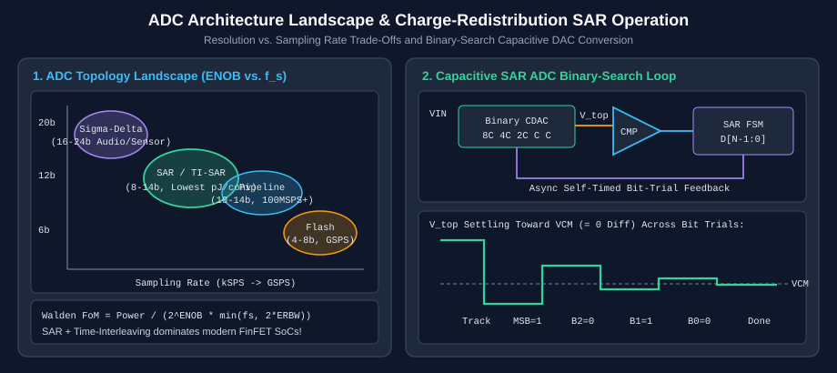
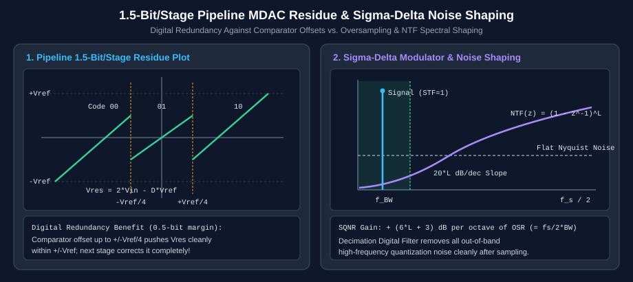

# Analog-to-Digital Converters (ADC) SAR, Pipeline, Flash, and Sigma-Delta

Analog-to-Digital Converters (ADCs) form the gateway between continuous physical sensing and digital signal processing. No single converter topology wins across all regimes: audio/precision instrumentation demands 20+ bits at kHz bandwidth, automotive MCUs and IoT nodes demand micro-watt 12-bit SARs, wireless base stations require 100+ MSPS pipelined ADCs, and high-speed SerDes receivers embed 56+ GSPS time-interleaved SAR arrays. Choosing, modeling, and verifying ADCs requires mastering each architecture's core loop, error sources, and digital calibration assists.

---

## Learning Goals

- Select optimal ADC architectures (**Flash**, **SAR**, **Pipeline**, **Sigma-Delta**, **Time-Interleaved**) across speed, resolution, area, and **Walden/Schreier Figures of Merit (FoM)**.
- Analyze charge-redistribution **Capacitive SAR ADCs**, including **Vcm-based / monotonic switching**, **binary-scaled capacitor mismatch**, and **asynchronous self-timed SAR logic**.
- Derive **1.5-bit/stage Pipeline MDAC** residue equations and prove how **digital redundancy** tolerates massive comparator offsets without missing codes.
- Explain **Sigma-Delta ($\Sigma\Delta$) Modulation** ($L$-th order NTF noise shaping, OSR trade-off, single-bit vs multi-bit feedback, and digital CIC/FIR decimation filters).
- Diagnose **Time-Interleaved ADC (TI-ADC)** spurs caused by channel **offset, gain, and timing skew mismatches** and fix them via digital calibration.

---

## Selecting an ADC Architecture Speed, Resolution, and Walden FoM

ADC architectures map cleanly across the **Resolution (ENOB) vs Sampling Frequency (`fs`)** trade-off space:

To compare efficiency fairly across technologies, designers compute two industry-standard **Figures of Merit (FoM)**:

1. **Walden FoM** (best for low-to-medium thermal-free or quantization-limited converters, units `fJ/conv-step`):
   $$\text{FoM}_W = \frac{P}{2^{\text{ENOB}} \cdot \min(f_s,\, 2\cdot \text{ERBW})}$$
   State-of-the-art SAR ADCs reach **1–5 fJ/conv-step**!
2. **Schreier FoM** (best for thermal-noise-limited high-resolution >12-bit converters, units `dB`):
   $$\text{FoM}_S = \text{SNDR} + 10 \log_{10}\!\left(\frac{\text{BW}}{P}\right)$$
   Top precision Sigma-Delta and Pipelined-SAR ADCs hit **175–185 dB**.

| Architecture | Conversion Steps / Cycle | Speed Range | Effective Resolution | Ideal Sweet Spot |
| :--- | :--- | :--- | :--- | :--- |
| **Flash** | Parallel ($2^N - 1$ comparators, 1 cycle) | `1 – 20 GSPS` | `4 – 7 bits` | High-speed SerDes slices, sub-ADCs inside Pipelines |
| **SAR** | Sequential Binary Search ($N$ cycles) | `100 kSPS – 200 MSPS` (per slice) | `8 – 14 bits` | **FinFET SoCs** (mostly switches + caps, zero high-gain op-amp!) |
| **Pipeline** | Pipelined Stage Latency ($K$ stages in parallel) | `50 MSPS – 1+ GSPS` | `10 – 14 bits` | Wireless IF/RF, imaging, radar, Ultrasound |
| **Sigma-Delta ($\Sigma\Delta$)** | Oversampled Feedback + Digital Filter ($\text{OSR} = 16\text{–}512$) | `1 kHz – 50 MHz BW` | `14 – 24 bits` | Audio codecs, precision sensors, battery gas gauges, medical |
| **Time-Interleaved (TI)** | $M$ parallel sub-ADCs phase-shifted by $T_s/M$ | `1 – 120 GSPS` | `6 – 12 bits` | Direct-RF sampling, 56G/112G PAM4 DSP receivers |

---

## Flash and Successive Approximation Register (SAR) ADCs

### Flash ADC

A **Flash ADC** evaluates all $2^N - 1$ reference taps simultaneously via a resistor ladder and $2^N - 1$ comparators in one clock edge, followed by a thermometer-to-binary encoder (incorporating **bubble-error correction** so a slow metastable comparator doesn't flip the MSB catastrophically!). Because power and input capacitance scale exponentially ($2^N$), pure Flash stops around 6 bits—instead powering sub-ADCs inside Pipeline or Folding converters.

### Capacitive SAR ADC

Because a **SAR ADC** uses passive **switched capacitors** and one **dynamic comparator** without power-hungry linear op-amps, it scales seamlessly down to `0.75 V` FinFET nodes:

1. **Sample (`Track`)**: Top plate holds common-mode `VCM` (or bottom plate samples `VIN`), capturing charge proportional to `VIN`.
2. **Hold**: Disconnect `VIN`, float top plate (total charge conserved!).
3. **Binary Search (`N` Bit Trials)**:
   - Compare top-plate voltage against reference (`VCM` or `0 V` differential).
   - Flip MSB capacitor ($C_{\text{MSB}} = C_{\text{tot}}/2$) to `VREF` or `GND` based on comparator decision (`V_top` steps by $\pm V_{\text{REF}}/2$).
   - Repeat down through `B[N-2] ... B[0]`!

Two critical upgrades power high-speed SARs:
- **`Vcm`-Based / Monotonic Switching**: Switching bottom plates directly from `VCM -> VDD/VSS` (or switching only one side per cycle) cuts DAC switching energy by **75–81%** and avoids an explicit MSB reset trial!
- **Self-Timed Asynchronous SAR Logic**: Rather than forcing a fixed slow GHz clock at `1/N * T_s` (wasteful when $N-1$ easy decisions resolve in `15 ps` while 1 close decision needs `60 ps`!), an asynchronous loop starts the next bit trial *immediately* upon comparator `done` (`OUT+ ^ OUT-`)—averaging settling margins across all $N$ trials!

> [!TIP]
> **Redundant Radices (< 2.0) in SAR CDACs**: Adding one extra redundant bit-trial (radix $\approx 1.85$, e.g., weights `[32, 18, 10, 6, 3, 2, 1, 1]`) allows early incomplete DAC settling or comparator kickback errors on the MSB trials to be **100% corrected cleanly in LSB cycles**!

---

## Pipeline ADCs, 1.5-Bit/Stage MDACs, and Digital Redundancy

When sample rates exceed a single SAR's speed (`100 MSPS–1 GSPS` at `12 bits`), a **Pipeline ADC** splits conversion across $K$ consecutive stages running concurrently on different samples (one stage per clock phase, trading latency for throughput!):

Each **1.5-bit/stage** resolves a coarse 3-level decision (`D = -1, 0, +1`, i.e., `00`, `01`, `10`) via two thresholds at **$-V_{\text{REF}}/4$** and **$+V_{\text{REF}}/4$**, then subtracts that coarse DAC value and amplifies the remaining **residue** by **$2\times$** using a **Multiplying DAC (MDAC)**:

$$V_{\text{res}} = 2 V_{\text{in}} - D \cdot V_{\text{REF}}$$

### Why Does `1.5-Bit/Stage` Tolerate Huge Comparator Offsets?

Look at the residue sawtooth plot above:
- Even if a tiny low-power comparator has up to **$\pm V_{\text{REF}}/4$ (`250 mV` on a `1 V` reference!)** of random offset, shifting the threshold shifts the jump point, yet $V_{\text{res}} = 2 V_{\text{in}} - D V_{\text{REF}}$ STILL lands strictly inside $[-V_{\text{REF}}, +V_{\text{REF}}]$!
- Downstream stages accurately digitize that residue, and simple digital **Shift-and-Add Redundancy Logic** aligns overlapping bit weights (`D_out = 2^(N-1)*d_1 + 2^(N-2)*d_2 + ...`), canceling Stage 1's comparator offset to exact zero!
- Wait: **what is NOT tolerated?** Stage 1's **MDAC Gain Error** (from finite op-amp DC gain $A_0$ or capacitor mismatch between $C_s$ and $C_f$) directly corrupts the `2x` slope and *does* create missing codes unless calibrated or solved with high-gain OTAs!

---

## Sigma-Delta Modulators Oversampling, Noise Shaping, and Decimation

Rather than fighting device matching inside 16-bit capacitor arrays, a **Sigma-Delta ($\Sigma\Delta$) ADC** trades raw digital speed (**Oversampling Ratio** $\text{OSR} = \frac{f_s}{2 \cdot \text{BW}}$) for extreme precision using just a **1-bit (or 3–4-bit)** internal quantizer wrapped inside an integrating feedback loop!

### Signal vs. Noise Transfer Functions (`STF` & `NTF`)

For a $L$-th order loop filter (`1/(z - 1)` integrators):

$$Y(z) = \underbrace{\text{STF}(z)}_{z^{-1}\text{ (or } 1\text{)}} X(z) + \underbrace{\text{NTF}(z)}_{(1 - z^{-1})^L} E_q(z)$$

Because $|1 - e^{-j\omega T_s}| = 2\sin(\omega T_s / 2) \approx \omega T_s$ at low baseband frequencies ($f \ll f_s$), $\text{NTF}(f)$ heavily attenuates quantization error $E_q$ inside `[0, BW]` and pushes it out to `[BW, f_s/2]`, achieving maximum ideal SQNR:

$$\text{SQNR}_{\text{peak}} \approx 6.02\,N + 1.76 - 5.17\cdot L + (20 L + 10)\log_{10}(\text{OSR})\text{ [dB]}$$

- **0th Order (Pure Oversampling)**: $+3\text{ dB}$ per doubling of OSR (`+0.5 bits/octave`).
- **1st Order ($L=1$)**: $+9\text{ dB}$ per doubling of OSR (`+1.5 bits/octave`).
- **2nd Order ($L=2$)**: $+15\text{ dB}$ per doubling of OSR (`+2.5 bits/octave`)—sweet spot! Higher orders ($L \ge 3$) require careful loop scaling to prevent internal integrator **overload oscillation**.
- **Digital Decimation Filter**: A multi-stage **CIC (Cascaded Integrator-Comb) + Half-Band FIR Filter** removes all high-frequency shaped quantization noise and decimates the 1-bit high-rate bitstream down cleanly to parallel 20–24-bit words at $2 \cdot \text{BW}$!

> [!CAUTION]
> **Sigma-Delta Input Overload Limit**: Unlike a Nyquist ADC that hard-clips cleanly at `VREF`, pushing a high-order ($L \ge 2$) 1-bit $\Sigma\Delta$ modulator above ~`-3 dBFS` (`~70% VREF`) can saturate integrators and drive the loop permanently unstable until reset! Always test overload recovery (`-0.5 dBFS` -> `-6 dBFS`) in mixed-signal simulation!

---

## Time-Interleaved ADCs and Digital Background Calibration

To push past single-channel SAR speed limits (`100 MSPS -> 56 GSPS`), $M$ parallel sub-ADCs sample sequentially spaced by $T_s/M$. Unfortunately, tiny mismatches across the $M$ parallel slices modulate the signal into distinct **interleaving spurs** across the FFT:

| Channel Mismatch Mechanism | Spectral Spur Location | Primary Mitigation / Calibration |
| :--- | :--- | :--- |
| **Offset Mismatch ($\Delta V_{os,m}$)** | Fixed tones at $k \cdot f_s / M$ (independent of $f_{\text{in}}$!) | Chopper / auto-zeroing + Digital mean subtraction per slice |
| **Gain Mismatch ($\Delta G_m$)** | Sidebands at $\pm f_{\text{in}} + k \cdot f_s / M$ | Digital multiplier trim scaling each channel's output variance |
| **Sampling Skew ($\Delta t_m$)** | Signal-dependent spurs at $\pm f_{\text{in}} + k \cdot f_s / M$ (grows +20 dB/dec with $f_{\text{in}}$!) | **Single front-end master rank-1 sampler** or digitally controlled delay lines (DCDL) calibrated via LMS correlation |

---

## Best Practices and Common Pitfalls

1. **Always Run End-to-End Coherent FFT on RTL + Analog Together**: Do not verify a SAR or Sigma-Delta analog core in isolation with an ideal Verilog behavioral state machine—verify with the **real synthesized RTL decimation filter / SAR FSM / calibration block**, as bit-truncation bugs or wrong polarity switches inside RTL frequently masquerade as analog nonlinearity!
2. **Guard Asynchronous SAR Loops Against Metastability Hang**: Simulate extreme slow corners with near-zero differential `V_top` steps (`10 uV`) to prove your watchdog / forced-bit timeout exits cleanly before the next sample clock arrives!
3. **Account for Reference (`VREF`) Settling Droop**: During a high-speed SAR conversion, switching the CDAC pulls transient charge bursts out of `VREF`! Unless `VREF` has an adequate on-die decoupling cap or fast reference buffer, bit `N-1` transient droop causes deterministic **missing codes** across mid-scale!
4. **Never Test Sigma-Delta FFT Below 4096–16384 Points**: Because OSR spreads the signal band over a tiny fraction of `fs` (e.g., `OSR = 64` puts `f_BW` inside the lowest 1.5% of FFT bins!), short 512-point FFTs have almost zero in-band frequency bins—use 8192+ points and discard initial filter warm-up samples!

---

## Practical Exercises with Solutions

### Exercise 1 Calculating 2nd-Order Sigma-Delta OSR & Bandwidth

A 2nd-order ($L = 2$), 1-bit ($N = 1$) audio Sigma-Delta ADC targets peak $\text{SQNR} \ge 105\text{ dB}$ across a `20 kHz` audio signal bandwidth (leaving margin for thermal `kT/C` noise so total SNR stays ~98 dB).

1. Calculate the minimum Oversampling Ratio (**OSR**) required using the theoretical peak $\text{SQNR}$ formula (assume `-5.17*L` factor applies: $\text{SQNR} = 6.02(1) + 1.76 - 10.34 + 50\log_{10}(\text{OSR})$).
2. What oversampled modulator clock frequency $f_s$ corresponds to this OSR?

#### Solution

1. **Minimum OSR**:
   $$\text{SQNR} = -2.56 + 50\log_{10}(\text{OSR}) \ge 105\text{ dB}$$
   $$50\log_{10}(\text{OSR}) \ge 107.56 \implies \log_{10}(\text{OSR}) \ge 2.151 \implies \text{OSR} \ge 141.6$$
   - Selecting clean power-of-2 $\text{OSR} = 128$ yields $\text{SQNR} = -2.56 + 50(2.1072) = 102.8\text{ dB}$ (slightly tight); selecting **$\text{OSR} = 256$** yields $-2.56 + 50(2.4082) = \mathbf{117.8\text{ dB}}$ (plenty of headroom, or use a 3-bit quantizer at `OSR = 64` which adds +12 dB!).
2. **Modulator Clock $f_s$**:
   - At $\text{OSR} = 256$ and $\text{BW} = 20\text{ kHz}$:
     $$f_s = 2 \cdot \text{OSR} \cdot \text{BW} = 2 \times 256 \times 20\text{ kHz} = 10.24\text{ MHz}$$

---

### Exercise 2 Auditing 1.5-Bit/Stage Pipeline Digital Redundancy

Suppose Stage 1 of a 1.5-bit/stage Pipeline ADC ($V_{\text{REF}} = 1.0\text{ V}$, differential span $[-1.0\text{ V}, +1.0\text{ V}]$) receives input $V_{\text{in}} = +0.20\text{ V}$. Ideally, since $+0.20\text{ V} \in [-0.25\text{ V}, +0.25\text{ V}]$, Stage 1 outputs code `D1 = 0` (`01`) and $V_{\text{res}} = 2(0.20) - 0 = +0.40\text{ V}$.
Now suppose the lower comparator (`+VREF/4`) suffers a massive **`-150 mV` offset** (tripping early at $+0.10\text{ V}$ instead of $+0.25\text{ V}$), so Stage 1 mistakenly decides **`D1 = +1` (`10`)**!

1. Calculate Stage 1's actual output residue $V_{\text{res}}$ under that wrong decision `D1 = +1`.
2. Assuming Stage 2 and backend ideal ADC digitize $V_{\text{res}}$ perfectly as $D_{\text{rest}} = V_{\text{res}}$ (normalized in V) and combine via $V_{\text{rec}} = 0.5\,(D_1 \cdot V_{\text{REF}} + D_{\text{rest}})$, show the exact final reconstructed output $V_{\text{rec}}$!

#### Solution

1. **Actual Residue Under Wrong Comparator Decision**:
   $$V_{\text{res}} = 2 V_{\text{in}} - D_1 V_{\text{REF}} = 2(+0.20\text{ V}) - (+1)(1.0\text{ V}) = +0.40 - 1.00 = \mathbf{-0.60\text{ V}}$$
   Notice `-0.60 V` is **STILL strictly inside $[-1.0\text{ V}, +1.0\text{ V}]$**, so the backend stages do NOT saturate!
2. **Final Reconstructed Digital Value**:
   $$V_{\text{rec}} = \frac{1}{2}\left[(+1)(1.0\text{ V}) + (-0.60\text{ V})\right] = \frac{+0.40\text{ V}}{2} = \mathbf{+0.20\text{ V}}$$
   **Exact zero error!** Stage 1's massive `-150 mV` comparator offset vanishes completely through digital redundancy!

---

### Exercise 3 Predicting Time-Interleaved Spur Locations

A 4-way Time-Interleaved SAR ADC operates at aggregate rate $f_s = 4.0\text{ GSPS}$ (each sub-ADC runs at $1.0\text{ GSPS}$), digitizing a single tone at $f_{\text{in}} = 650\text{ MHz}$. Where in the `[0, 2.0 GHz]` Nyquist zone do spurs appear due to:
1. Sub-ADC **DC Offset Mismatch**?
2. Sub-ADC **Gain &amp; Timing Skew Mismatch**?

#### Solution

1. **Offset Mismatch Spurs** occur at DC and $k \cdot f_s / M = k \cdot (4.0\text{ GHz} / 4) = k \cdot 1.0\text{ GHz}$:
   - Inside `[0, 2.0 GHz]`: **`1.0 GHz`** and **`2.0 GHz`** (`f_s / 4` and `f_s / 2`).
2. **Gain &amp; Timing Skew Spurs** appear at $\pm f_{\text{in}} + k \cdot (f_s / M)$ folded into `[0, 2.0 GHz]`:
   - For $k = 1$ ($1.0\text{ GHz}$): $1.0\text{ GHz} - 0.65\text{ GHz} = \mathbf{350\text{ MHz}}$ and $1.0\text{ GHz} + 0.65\text{ GHz} = \mathbf{1.65\text{ GHz}}$.
   - For $k = 2$ ($2.0\text{ GHz}$): $2.0\text{ GHz} - 0.65\text{ GHz} = \mathbf{1.35\text{ GHz}}$!
   - Thus three distinct spurious tones (`350 MHz`, `1.35 GHz`, `1.65 GHz`) corrupt the spectrum alongside the `650 MHz` fundamental unless calibrated!

---

##### Copyright (c) 2026 squared-studio
