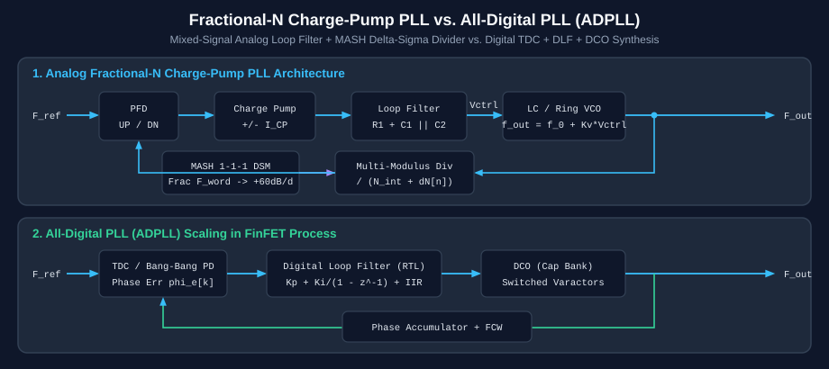
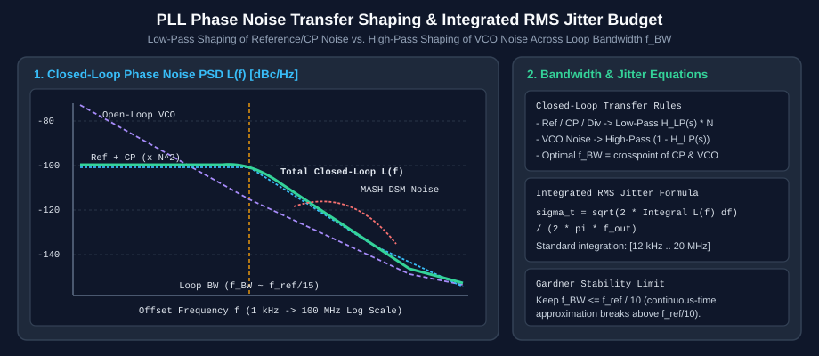

# Phase-Locked Loops (PLL), Clock Generation, and Jitter Analysis

Every CPU core, DDR controller, and multi-gigabit SerDes link runs off clocks multiplied up from a quiet external crystal (`24–50 MHz`) by on-die **Phase-Locked Loops (PLLs)**. Because PLLs operate natively across the analog-digital boundary—pairing digital phase/frequency detectors and multi-modulus dividers with continuous analog charge pumps, loop filters, and gigahertz VCOs—modeling loop stability, **phase noise shaping**, **fractional spurs**, and **RMS jitter** is central to mixed-signal verification.

---

## Learning Goals

- Derive the linearized continuous-time **Type-II 3rd-Order Charge-Pump PLL** loop equations (`natural frequency` $\omega_n$, `damping factor` $\zeta$, and zero/pole stability constraints).
- Distinguish **Integer-N** from **Fractional-N PLLs** driven by **MASH 1-1-1 Delta-Sigma Modulators** for fine kHz/Hz frequency resolution and Spread-Spectrum Clocking (SSC).
- Explain how closed-loop PLL dynamics shape **Reference/PFD/Charge-Pump noise (low-pass)** versus **VCO phase noise (high-pass)** and integrate PSD into **RMS jitter**.
- Contrast **Ring VCOs** vs **LC Tank VCOs** and understand how **All-Digital PLLs (ADPLLs)** replace analog charge pumps with **TDCs + Digital Loop Filters + DCOs**.
- Write fast behavioral **Verilog-A / SystemVerilog RNM PLL models** capturing VCO gain, loop filter dynamics, phase jitter, and lock detection for full-SoC simulations.

---

## Integer-N Charge-Pump PLL Dynamics PFD, CP, Loop Filter, and VCO

A classical **Type-II Charge-Pump PLL** contains five tightly coupled blocks:



1. **Phase-Frequency Detector (PFD)**: Dual DFF state machine producing `UP` and `DN` pulses proportional to phase/frequency difference between `F_ref` and `F_fb` (eliminates harmonic false locking seen in XOR phase detectors!). Inserts a small reset pulse (`anti-backlash` dead-zone elimination) on both `UP` and `DN` every cycle!
2. **Charge Pump (CP)**: Converts `UP/DN` pulse widths into $\pm I_{\text{CP}}$ current bursts (`Gain K_PD = I_CP / 2*pi` [A/rad]). Notice mismatch between $I_{\text{UP}}$ and $I_{\text{DN}}$ creates static phase offset and **reference spurs at $f_{\text{ref}}$**!
3. **2nd-Order Passive Loop Filter (`R1, C1, C2`)**:
   - Main integrating capacitor $C_1$ creates an integrator pole at DC (`Type-II` -> zero steady-state phase error!).
   - Series resistor $R_1$ inserts a **stabilizing LHP zero** $\omega_z = \frac{1}{R_1 C_1}$ so the double-integrator loop ($C_1$ + VCO $K_{\text{VCO}}/s$) doesn't sit permanently at $-180^\circ$ phase and oscillate!
   - Small shunt capacitor $C_2 \approx C_1 / 10$ adds a third pole $\omega_{p3} \approx \frac{C_1 + C_2}{R_1 C_1 C_2}$ to suppress charge-pump current ripple on `Vctrl` (which otherwise modulates VCO frequency into $f_{\text{ref}}$ spurs).
4. **VCO**: Outputs $f_{\text{out}} = f_0 + K_{\text{VCO}} V_{\text{ctrl}}$, acting mathematically as a perfect **phase integrator** $\frac{2\pi K_{\text{VCO}}}{s}$ (since $\phi(t) = \int \omega(t)\,dt$).
5. **Feedback Divider (`/N`)**: Scales VCO down by $N$ so steady-state lock hits $f_{\text{out}} = N \cdot f_{\text{ref}}$.

### Linearized Open-Loop Gain & Stability Rule

$$L(s) = \frac{I_{\text{CP}}}{2\pi} \cdot Z_{\text{LF}}(s) \cdot \frac{2\pi K_{\text{VCO}}}{s} \cdot \frac{1}{N} = \frac{I_{\text{CP}} K_{\text{VCO}}}{N} \cdot \frac{1 + s R_1 C_1}{s^2 (C_1 + C_2)\left(1 + s R_1 \frac{C_1 C_2}{C_1 + C_2}\right)}$$

Two fundamental rules prevent oscillation:
- **Logarithmic Zero-Pole Sandwich**: Place loop unity-gain bandwidth $\omega_u$ cleanly in the geometric middle: **$\omega_z \approx \omega_u / 4$** and **$\omega_{p3} \approx 4\,\omega_u$** (`Phase Margin ~ 55–65°`).
- **Gardner's Stability Limit**: Because PFD updates discretely every $T_{\text{ref}}$, continuous-time $L(s)$ breaks down if $\omega_u$ gets too fast—keep loop bandwidth **$\text{BW} \le f_{\text{ref}} / 10$** (typically $f_{\text{ref}}/15$ to $f_{\text{ref}}/20$)!

---

## Fractional-N PLLs and MASH Delta-Sigma Modulators

Integer-N PLLs force output frequency steps equal to $f_{\text{ref}}$ (e.g., `25 MHz` steps!). Hitting exact `156.25 MHz` Ethernet or `1.4835 GHz` video frequencies requires dividing by a **non-integer $N + \alpha$** (e.g., $N = 62.5$).

A **Fractional-N PLL** keeps a high $f_{\text{ref}}$ (pushing loop bandwidth wide to suppress VCO noise!) while toggling a **Multi-Modulus Divider (MMD)** rapidly across integers $(N-3 \dots N+4)$ driven by a **3rd-order MASH 1-1-1 Digital Delta-Sigma Modulator**:
- Time-average division equals exact **$N + \frac{\text{FCW}}{2^K}$** (sub-Hz resolution with a 24–32 bit `FCW`!).
- The MASH 1-1-1 quantizer shapes division quantization noise upward by **+60 dB/decade (`(1 - z^-1)^3`)**, which the analog loop filter's $\omega_{p3}$ pole attenuates sharply above $f_{\text{BW}}$!
- **Crucial Charge-Pump Linearity Rule**: Any mismatch between `UP` and `DN` charge pump currents *folds* high-frequency MASH quantization noise down right into the baseband (`noise folding`!), wiping out fractional-N noise gains unless CP current mismatch is calibrated or biased with a small static offset!

---

## Phase Noise Shaping, Reference Spurs, and Integrated RMS Jitter

In the frequency domain, random timing jitter manifests as skirts around the carrier in **Phase Noise Power Spectral Density $\mathcal{L}(f)$** (`dBc/Hz` at offset $\Delta f$ from $f_{\text{out}}$):



Look at the two opposite filtering behaviors around loop bandwidth $f_{\text{BW}}$:
1. **Reference, PFD, Charge Pump &amp; Divider Noise**: Passes **Low-Pass** ($H_{\text{LP}}(s)$), AND gets **multiplied by $20\log_{10}(N)$** inside $f_{\text{BW}}$! (Doubling $N$ raises in-band phase noise by +6 dB!).
2. **Free-Running VCO Noise ($1/f^3$ &amp; $1/f^2$)**: Passes **High-Pass** ($1 - H_{\text{LP}}(s)$)! Below $f_{\text{BW}}$, the fast PLL feedback loop continuously corrects VCO phase drift—suppressing ugly close-in $1/f^3$ VCO wander!

Therefore, **optimal loop bandwidth $f_{\text{BW}}$ sits right where the upscaled in-band Reference/CP noise intersects the free-running VCO noise curve!**

### Converting Phase Noise to Integrated RMS Jitter

Integrating single-sideband phase noise across application band $[f_1, f_2]$ (e.g., `12 kHz – 20 MHz` for SerDes/PCIe):

$$\sigma_{t,\text{rms}} = \frac{\sqrt{2 \int_{f_1}^{f_2} 10^{\mathcal{L}(f)/10}\,df}}{2\pi f_{\text{out}}}$$

---

## Ring vs LC VCOs and All-Digital PLL (ADPLL) Architectures

| VCO / PLL Style | Phase Noise (`@1 MHz`) | Tuning Range | Die Area | Primary SoC Usage |
| :--- | :--- | :--- | :--- | :--- |
| **CMOS Ring VCO** | Moderate (`-95 to -110 dBc/Hz`) | Very Wide (`2x–4x`, octave+) | **Tiny** (pure inverters/delay cells) | General digital SoC CPU/GPU clocks, DDR/Display PLLs |
| **LC Tank VCO (Spiral Inductor)** | **Ultra-Low (`-125 to -140 dBc/Hz`)** | Narrow (`10–25%` + cap bank) | **Large** (spiral inductor $L$ + MOM cap bank) | **High-speed SerDes (`28G–112G`)**, 5G/WiFi RF transceivers |
| **All-Digital PLL (ADPLL)** | Good–High | Wide (digital cap array) | Very Compact (scales directly to 3 nm!) | Replaces leaky analog CP + huge $C_1$ cap with **TDC + DLF + DCO**! |

Note why **LC VCOs** also inject **magnetic inductor coupling** across neighbors—never place two identical-frequency LC VCOs next to each other without large keep-out rings (`injection pulling`), and run EM (`HFSS`/`EMX`) extraction on spiral inductors before tape-out!

---

## Lock Detection, Reference Loss, and Behavioral Modeling

In full-chip mixed-signal simulations, running a transistor-level `4 GHz` LC PLL for `50 us` of lock acquisition can take days in SPICE (`50 us * 4 GHz = 200,000` cycles!). Fast **SystemVerilog Real-Number / Verilog-A Behavioral PLL Models** capture frequency locking, phase noise, and lock flags in **seconds**:

```systemverilog
// Fast Discrete-Time SystemVerilog Behavioral PLL Model (for SoC Co-Sim & Digital FSM Verification)
module pll_behavioral_sv #(
    parameter real FREF_NOM_HZ = 25.0e6,
    parameter real KVCO_HZ_V   = 400.0e6,
    parameter real BW_HZ       = 1.5e6
) (
    input  logic        clk_ref,
    input  logic        en,
    input  logic [7:0]  div_n,
    output logic        clk_out,
    output logic        locked
);
    real f_vco_hz = 1.0e9;
    real t_last_ref = 0.0;
    real period_vco_ns = 1.0;
    bit  lock_state = 0;

    // Track lock frequency acquisition with simple first-order bandwidth response
    always @(posedge clk_ref or negedge en) begin
        if (!en) begin
            f_vco_hz   <= 100.0e6;
            lock_state <= 1'b0;
        end else begin
            real f_target_hz, f_ref_meas, alpha;
            real t_now;
            t_now = $realtime;
            f_ref_meas  = (t_last_ref > 0.0) ? (1.0e9 / (t_now - t_last_ref)) : FREF_NOM_HZ;
            t_last_ref  = t_now;
            f_target_hz = f_ref_meas * (div_n == 0 ? 1 : div_n);
            alpha       = 1.0 - $exp(-2.0 * 3.14159265 * BW_HZ / f_ref_meas);
            f_vco_hz   <= f_vco_hz + alpha * (f_target_hz - f_vco_hz);
            period_vco_ns = (f_vco_hz > 1.0e6) ? (1.0e9 / f_vco_hz) : 1000.0;
            lock_state <= ($abs(f_vco_hz - f_target_hz) / f_target_hz < 0.005);
        end
    end

    // VCO clock oscillation loop
    initial clk_out = 1'b0;
    always begin
        if (en) begin
            #(period_vco_ns * 0.5ns) clk_out = ~clk_out;
        end else begin
            clk_out = 1'b0;
            @(posedge en);
        end
    end

    assign locked = en && lock_state;
endmodule
```

> [!WARNING]
> Ensure your `timescale` precision is fine enough (`1ps/1fs`!) whenever generating GHz clocks via `#(half_period)` in Verilog! Using `1ns/1ns` or `1ns/1ps` truncates sub-picosecond fractional-N edges, creating massive artificial quantization spurs inside behavioral SoC runs!

---

## Best Practices and Common Pitfalls

1. **Always Initialize VCO Oscillation Reliably in SPICE**: Symmetric cross-coupled LC or odd-stage ring VCOs can sit dead at symmetric `VDD/2` DC equilibrium inside a `.tran` run without numerical noise! Kick VCO startup reliably using an initial small current pulse or slight asymmetry check, while verifying real startup in transient!
2. **Simulate `.pss` + `.pnoise` (Periodic Steady-State) Instead of Long Transient FFTs for Phase Noise**: Determining `-135 dBc/Hz` VCO phase noise from a raw transient FFT hits numerical solver floor (`-90 dBc`) quickly; Harmonic Balance / Shooting **PSS + PNOISE** computes exact cyclostationary linear-time-varying (LTV) phase noise down to `-160 dBc/Hz` accurately!
3. **Never Neglect Leakage Inside Analog Loop Filters**: In advanced FinFET processes with thin gate oxide, implementing huge `C1 = 100 pF` loop filter caps using thin-oxide NMOS varactors leaks `nA–uA` onto `Vctrl`, producing big PFD phase errors and huge **`f_ref` reference spurs**! Use thick-oxide MOS caps or MIM/MOM metal caps!
4. **Verify Loss-of-Lock (`LOL`) &amp; Reference-Drop Handling**: Confirm digital clock-gating FSMs switch safely back to backup RC oscillators if external `XTAL` vanishes without causing clock glitches onto downstream CPU/memory logic.

---

## Practical Exercises with Solutions

### Exercise 1 Designing a Type-II 3rd-Order PLL Loop Filter

You need a `2.4 GHz` Integer-N PLL fed by a `40 MHz` crystal (`N = 60`). Parameters: $I_{\text{CP}} = 200\text{ }\mu\text{A}$, $K_{\text{VCO}} = 300\text{ MHz/V}$, target loop bandwidth $f_u = 2.0\text{ MHz}$ ($\le f_{\text{ref}}/10$). Using the zero/pole sandwich $\omega_z = \omega_u / 4$ and $\omega_{p3} = 4\,\omega_u$ (approximate $R_1$ set from $\omega_u \approx \frac{I_{\text{CP}} K_{\text{VCO}} R_1}{N}$ when $C_2 \ll C_1$):

1. Verify Gardner's stability limit.
2. Solve for series stabilizing resistor $R_1$, main capacitor $C_1$, and ripple filter capacitor $C_2$.

#### Solution

1. **Gardner Limit Check**: $\frac{f_{\text{ref}}}{10} = \frac{40\text{ MHz}}{10} = 4.0\text{ MHz}$. Our target $f_u = 2.0\text{ MHz} = f_{\text{ref}}/20 \le 4.0\text{ MHz}$—safely within continuous-time bounds!
2. **Loop Components**:
   - Note $\omega_u = 2\pi(2.0\text{ MHz}) = 1.257 \times 10^7\text{ rad/s}$. Using gain formula $\omega_u \approx \frac{I_{\text{CP}} (2\pi K_{\text{VCO}}) R_1}{2\pi N} = \frac{I_{\text{CP}} K_{\text{VCO}} R_1}{N}$ (with $K_{\text{VCO}}$ in Hz/V!):
     $$R_1 = \frac{N \cdot \omega_u}{I_{\text{CP}} K_{\text{VCO}}} = \frac{60 \times 1.257 \times 10^7}{(200 \times 10^{-6})(300 \times 10^6)} = \frac{7.542 \times 10^8}{60{,}000} \approx \mathbf{12.57\text{ k}\Omega}$$
   - Set zero $\omega_z = \omega_u / 4 = 3.142 \times 10^6\text{ rad/s}$:
     $$C_1 = \frac{1}{R_1 \omega_z} = \frac{1}{12.57\text{ k}\Omega \times 3.142 \times 10^6} \approx \mathbf{25.3\text{ pF}}$$
   - Set third pole $\omega_{p3} = 4\,\omega_u = 5.027 \times 10^7\text{ rad/s} \approx \frac{1}{R_1 C_2}$ (for $C_2 \ll C_1$):
     $$C_2 \approx \frac{1}{12.57\text{ k}\Omega \times 5.027 \times 10^7} \approx \mathbf{1.58\text{ pF}} \quad \left(\approx \frac{C_1}{16}\right)$$

---

### Exercise 2 Computing Integrated RMS Jitter from a Phase Noise Mask

A `2.5 GHz` (`\omega_out = 2*pi*2.5e9`) PLL exhibits a simplified flat in-band phase noise floor $\mathcal{L}(f) = -100\text{ dBc/Hz}$ from `10 kHz` up to its `2.0 MHz` loop bandwidth, then drops off steeply enough that energy above `2.0 MHz` is negligible (actually compute just the `[10 kHz .. 2.0 MHz]` brick-wall contribution as an estimate). Compute the resulting **RMS Jitter** in femtoseconds (`fs`)!

#### Solution

1. Convert $-100\text{ dBc/Hz}$ to linear single-sideband power density: $S_\phi(f) = 10^{-100/10} = 10^{-10}\text{ Hz}^{-1}$.
2. Integrate across bandwidth $\Delta f = 2.0\text{ MHz} - 10\text{ kHz} = 1.99 \times 10^6\text{ Hz}$:
   $$\sigma_{\phi,\text{rms}}^2 = 2 \int S_\phi(f)\,df = 2 \times 10^{-10} \times 1.99 \times 10^6 = 3.98 \times 10^{-4}\text{ rad}^2$$
   $$\sigma_{\phi,\text{rms}} = \sqrt{3.98 \times 10^{-4}} = 0.01995\text{ rad}$$
3. Divide by $\omega_{\text{out}} = 2\pi(2.5 \times 10^9) = 1.571 \times 10^{10}\text{ rad/s}$:
   $$\sigma_{t,\text{rms}} = \frac{0.01995}{1.571 \times 10^{10}} = 1.270 \times 10^{-12}\text{ s} = \mathbf{1.27\text{ ps}_{\text{rms}}}\; (1270\text{ fs})$$
   (To reach `< 200 fs` for 28G SerDes, in-band phase noise must drop down near `-115` to `-120 dBc/Hz`!)

---

### Exercise 3 Fractional-N Frequency Resolution with MASH DSM

A Fractional-N PLL uses a `48 MHz` crystal reference, integer divider `N_int = 50`, and a **20-bit** MASH 1-1-1 accumulator (`FCW_frac[19:0]`).
1. What is the **frequency resolution** ($\Delta f_{\min}$) of the PLL output?
2. What exact `FCW_frac` decimal integer yields an output of exactly **`2.442 GHz`** (`2442.0 MHz`)?

#### Solution

1. **Frequency Resolution**:
   $$\Delta f_{\min} = \frac{f_{\text{ref}}}{2^{20}} = \frac{48 \times 10^6}{1{,}048{,}576} \approx \mathbf{45.78\text{ Hz}}$$
2. **Required `FCW_frac`**:
   - Target ratio: $N_{\text{total}} = \frac{2442\text{ MHz}}{48\text{ MHz}} = 50.875$.
   - Since `N_int = 50`, fractional part $\alpha = 0.875 = \frac{7}{8}$.
   - $\text{FCW}_{\text{frac}} = 0.875 \times 2^{20} = 0.875 \times 1{,}048{,}576 = \mathbf{917{,}504}$ (`20'hE0000`). Notice exact binary fraction `7/8` produces zero quantization remainder!

---

##### Copyright (c) 2026 squared-studio
