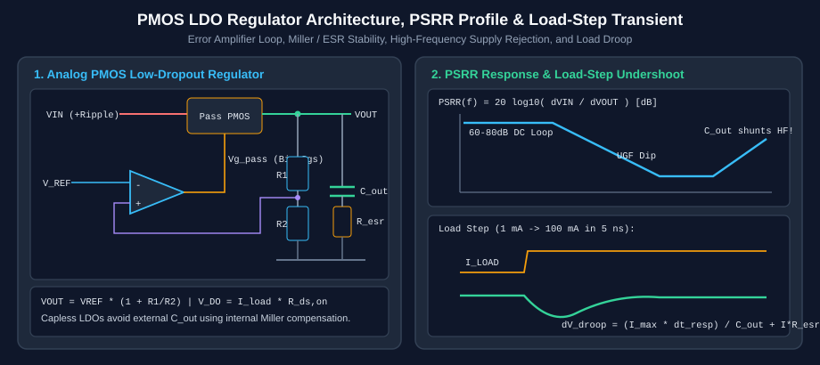
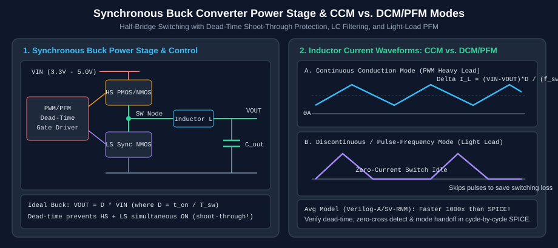

# Power Management ICs (PMIC), LDOs, and Switching Regulators

Clean, ripple-free power delivery is the bedrock of both high-speed digital computing and ultra-sensitive RF/analog circuitry. A modern Power Management Unit (PMU/PMIC) balances two competing goals: **high conversion efficiency (>90%)** across battery voltages using inductive switching Buck/Boost converters, and **ultra-low noise, fast local transient regulation** using on-die **Low-Dropout (LDO) linear regulators**. Mixed-signal PMIC verification bridges power electronics (inductor currents, ESR zeros, dead-time shoot-through) with digital DVFS sequencing, brownout detectors, and soft-start FSMs.

---

## Learning Goals

- Analyze **PMOS and NMOS LDO regulators** across dropout voltage ($V_{\text{DO}}$), power efficiency ($\eta = V_{\text{OUT}}/V_{\text{IN}}$), and loop compensation (off-chip $C_{\text{out}} + R_{\text{esr}}$ vs. capless internal Miller).
- Interpret **Power-Supply Rejection Ratio (PSRR)** vs. frequency curves and minimize **load-step transient droop ($\Delta V_{\text{droop}}$)**.
- Compare **Synchronous Buck Switching Converters** in **Continuous Conduction Mode (CCM / PWM)** vs **Discontinuous Conduction Mode (DCM / PFM)** light-load efficiency optimization.
- Prevent fatal **shoot-through conduction** via non-overlapping **dead-time gate drivers** and implement **zero-current switching (ZCS)** detectors.
- Build fast **switched-averaged vs cycle-by-cycle behavioral models** to verify digital **DVFS (Dynamic Voltage & Frequency Scaling)**, soft-start ramps, and over-current limits in SoC co-simulation.

---

## Low-Dropout (LDO) Regulators Pass Devices, Compensation, and PSRR

An LDO maintains a constant clean `VOUT` (`e.g., 0.85 V`) from a slightly higher noisy input supply `VIN` (`e.g., 1.1 V` from a Buck converter) by modulating the resistive channel of a giant **Pass FET**:

### Pass Device Comparison & Power Efficiency

- **PMOS Pass FET**: Needs zero charge pump; gate pulls down near `0 V` for strong drive, reaching very low dropout $V_{\text{DO}} = I_{\text{load}} \cdot R_{\text{ds,on}}$ (`50–150 mV`). Slightly weaker high-frequency PSRR because supply noise on `VIN` sees the source-follower path unless `Vg` tracks `VIN` cleanly via $C_{gs}$!
- **NMOS Pass FET (Source Follower)**: Offers low output impedance (`~1/gm_pass`), awesome natural load regulation, and inherent wide stability—yet requires an on-die **charge pump** (`V_boot > VIN + Vth`) to push the NMOS gate above `VIN`!
- **LDO Efficiency Limit**: Regardless of architecture, linear regulation wastes excess drop as heat:
  $$\eta \approx \frac{I_{\text{load}} V_{\text{out}}}{(I_{\text{load}} + I_q) V_{\text{in}}} \le \frac{V_{\text{out}}}{V_{\text{in}}}$$
  Dropping `3.3 V` to `0.85 V` with an LDO burns **74% of power as silicon heat**! Use Buck converters for wide voltage ratios and LDOs strictly for post-Buck noise scrubbing (`0.2–0.3 V` drop)!

### Understanding the PSRR U-Shape Curve

- **Low Frequency (`< f_p1`)**: Error amplifier DC loop gain ($A_{\text{loop}}$) actively fights `VIN` ripple, yielding **60–80 dB PSRR**.
- **Mid Band (near Error-Amp UGF)**: Loop gain rolls off (`-20 dB/dec`) *before* external capacitor $C_{\text{out}}$ takes over, causing a classic **PSRR dip** (`~20–30 dB`).
- **High Frequency (`> 1 MHz`)**: External low-ESR ceramic cap $C_{\text{out}}$ shunts residual ripple cleanly straight to ground (until package ESL inductance degrades filtering above `50–100 MHz`).

---

## Capless On-Chip LDOs and Load-Step Transient Recovery

External `1–10 uF` decoupling capacitors cost precious PCB area and BGA pins. For localized digital/analog domains (e.g., powering one SerDes RX lane or PLL VCO), SoCs integrate **Output-Capacitor-Less ("Capless") LDOs** using on-die `50–200 pF` decoupling:

### The Capless Compensation Trap

- **Traditional Off-Chip LDO**: Huge `4.7 uF` $C_{\text{out}}$ sets the **dominant pole** cleanly at the output ($\sim\text{kHz}$), while its **ESR zero ($f_{z,\text{esr}} = \frac{1}{2\pi R_{\text{esr}} C_{\text{out}}}$)** cancels the error-amp's internal gate pole (`Vg_pass`)!
- **Capless On-Die LDO**: Removing the external `uF` capacitor flips the poles! Because the giant Pass FET has huge $C_{gs}$ (`5–20 pF`) at `Vg_pass`, the internal error-amp output becomes the slow pole while `VOUT` becomes high-frequency unless **Miller Compensation + Dynamic Slew-Boost (Transient Enhancement)** wraps from `VOUT` back inside the error amplifier!

### Minimizing Load-Step Transient Droop

When a CPU core wakes up (`1 mA -> 200 mA` in `5 ns`), the LDO error amplifier cannot react inside `5 ns`! Output capacitor $C_{\text{out}}$ supplies 100% of current initially during the loop response delay $\Delta t_{\text{resp}} \approx \frac{1}{2\pi \cdot \text{UGF}} + t_{\text{slew}}$:

$$\Delta V_{\text{droop}} \approx \frac{\Delta I_{\text{load}} \cdot \Delta t_{\text{resp}}}{C_{\text{out}}} + \Delta I_{\text{load}} \cdot R_{\text{esr}}$$

**Digital LDO (DLDO)** architectures replace the analog op-amp with clocked comparators driving binary/thermometer parallel PMOS arrays—scaling down below `0.5 V` supplies in FinFETs while avoiding analog compensation headaches (at the expense of clock-rate quantization ripple!).

---

## Synchronous Buck Switching Converters, Dead-Time, and CCM vs DCM

To step `3.6 V` Li-Ion batteries or `5.0 V` USB rails down to `0.85 V` SoC cores at **92–96% efficiency**, **Synchronous Buck Converters** switch an external power inductor $L$ at $f_{\text{sw}} \approx 1\text{–}4\text{ MHz}$ (or `20–100 MHz` integrated IVRs with on-package micro-inductors):

### Duty Cycle, Inductor Ripple, and Efficiency Losses

- In **Continuous Conduction Mode (CCM)**, steady-state output sets duty ratio cleanly independent of load current:
  $$D = \frac{t_{\text{on}}}{T_{\text{sw}}} = \frac{V_{\text{OUT}}}{V_{\text{IN}}}, \qquad \Delta I_{L,\text{pp}} = \frac{(V_{\text{IN}} - V_{\text{OUT}})\,D}{f_{\text{sw}}\,L}$$
- **Dead-Time (`t_dead`) Control**: If the High-Side (`HS`) FET turns ON even `500 ps` before the Low-Side (`LS`) FET turns OFF, `VIN` shorts directly through both power FETs to `GND` (**shoot-through current**!), scorching silicon and destroying efficiency. Always design **non-overlapping adaptive gate drivers** enforcing `1–5 ns` dead-time while minimizing body-diode conduction losses!

### PWM (Heavy Load) vs. PFM / DCM (Light Load)

At heavy load (`500 mA`), fixed-frequency **Pulse-Width Modulation (PWM)** runs cleanly in CCM. However, when the chip enters sleep (`5 mA`), switching giant gate capacitances (`C_g,HS + C_g,LS`) at `2 MHz` burns tens of milliwatts continuously—dropping efficiency below 20%!
- Solution: Switch automatically into **Discontinuous Conduction Mode (DCM)** with **Zero-Current Detection (ZCD)** (turning OFF the LS sync FET right when $I_L$ hits `0 A` so $C_{\text{out}}$ never discharges backwards into `GND`!), combined with **Pulse-Frequency Modulation (PFM)** that emits pulses only when `VOUT` sags past a hysteretic threshold!

---

## Digital Power Control, DVFS Slew Sequencing, and Soft-Start

Modern SoCs dynamically scale core voltage up and down (**DVFS**) via SPI/I2C/SVI commands to PMIC controllers:

1. **Soft-Start Ramp**: At power-on (`t = 0`), $C_{\text{out}}$ sits at `0 V`. Letting the error loop instantly slam `D -> 100%` draws catastrophic **inrush current** exceeding inductor saturation limits! A digital counter ramps `V_ref` linearly over `100 us–1 ms` so $I_{\text{inrush}} = C_{\text{out}} \frac{dV}{dt}$ stays safely bounded.
2. **Smooth DVFS Up/Down Steps**: Stepping `0.65 V -> 1.05 V` before raising CPU PLL clock frequency requires deterministic `dV/dt` slew tracking + `PWR_GOOD` handshake back to RTL!
3. **Fast Behavioral PMIC Modeling Strategy**: Simulating `2 ms` of `2 MHz` switching edges (`4,000` Buck cycles) with full `100,000`-gate RTL takes hours in SPICE! Instead:
   - Verify **cycle-by-cycle switching, dead-time, ZCD, and short-circuit current limit** inside block-level **SPICE/FastSPICE** (~`50 us`).
   - Run full-chip SoC DVFS firmware boot tests using a **cycle-averaged State-Space or discrete SV-RNM Buck model** (`V_out += (V_target - V_out) * dt / tau`) running **10,000x faster**!

> [!CAUTION]
> **Dead-Time Corner Verification**: Never tune dead-time only at Nominal (`TT / 25C`). Gate-driver delay mismatches widen dramatically at `SS / -40C` and shrink dangerously at `FF / +125C`, while parasitic `C_gd` Miller coupling on the switching `SW` node can spuriously bounce an OFF FET gate back above $V_{th}$ (**false `dV/dt` turn-on shoot-through**)!

---

## Best Practices and Common Pitfalls

1. **Always Include Package Parasitic Bondwire Inductance (`L_pkg`) & Board ESR**: An LDO or Buck simulated with ideal `0 nH` supplies looks stable in SPICE, then oscillates violently in silicon when `1–2 nH` of bondwire inductance rings with on-die decoupling capacitance!
2. **Verify Zero-Current Crossing (`ZCD`) Offset**: If your Buck ZCD comparator has `+20 mV` offset, it turns OFF the Low-Side FET too late—allowing reverse current to drain efficiency in sleep mode! Include Monte Carlo mismatch on ZCD comparators.
3. **Guard Against PWM-to-PFM Handoff Glitch**: Transitioning between heavy-load PWM and light-load PFM can create a `50–100 mV` output voltage bump unless hysteresis thresholds and integrator state pre-loading match smoothly.
4. **Add Current-Limit Hiccup / Thermal Shutdown Monitoring**: Verify fault loops recover cleanly once over-temperature or short-circuit clears without latching dead.

---

## Practical Exercises with Solutions

### Exercise 1 Calculating LDO Efficiency & Load-Step Droop

An analog PMOS LDO regulates `VIN = 1.20 V` down to `VOUT = 0.90 V` with quiescent current $I_q = 150\text{ }\mu\text{A}$ and decoupling capacitor $C_{\text{out}} = 2.2\text{ }\mu\text{F}$ ($R_{\text{esr}} = 10\text{ m}\Omega$).

1. Calculate power efficiency $\eta$ at heavy load ($I_{\text{load}} = 150\text{ mA}$) vs. light load ($I_{\text{load}} = 300\text{ }\mu\text{A}$).
2. If the load jumps cleanly from `1 mA` to `151 mA` ($\Delta I = 150\text{ mA}$) while the LDO error loop takes $\Delta t_{\text{resp}} = 1.2\text{ }\mu\text{s}$ to respond, estimate total output undershoot droop $\Delta V_{\text{droop}}$!

#### Solution

1. **Power Efficiency**:
   - At $I_{\text{load}} = 150\text{ mA}$:
     $$\eta_{\text{heavy}} = \frac{0.90 \times 0.150}{1.20 \times (0.150 + 0.00015)} = \frac{0.135}{0.18018} \approx \mathbf{74.9\%}$$
     (Heat dissipated in Pass FET = $(1.20 - 0.90) \times 0.150 = 45\text{ mW}$.)
   - At $I_{\text{load}} = 300\text{ }\mu\text{A}$:
     $$\eta_{\text{light}} = \frac{0.90 \times 300\text{ }\mu\text{A}}{1.20 \times (300 + 150)\text{ }\mu\text{A}} = \frac{270}{540} = \mathbf{50.0\%}$$
2. **Load-Step Droop**:
   $$\Delta V_{\text{droop}} \approx \frac{150\text{ mA} \times 1.2\text{ }\mu\text{s}}{2.2\text{ }\mu\text{F}} + (150\text{ mA})(10\text{ m}\Omega) = 81.8\text{ mV} + 1.5\text{ mV} = \mathbf{83.3\text{ mV}}$$
   (Around `9.3%` dip on a `0.90 V` core rail—tight! Widening LDO UGF to shrink $\Delta t_{\text{resp}}$ from `1.2 us` down to `400 ns` cuts droop cleanly below `30 mV`!)

---

### Exercise 2 Sizing a Synchronous Buck Inductor & CCM/DCM Boundary

A synchronous Buck converter converts $V_{\text{IN}} = 3.6\text{ V}$ to $V_{\text{OUT}} = 0.90\text{ V}$ switching at $f_{\text{sw}} = 2.5\text{ MHz}$ ($T_{\text{sw}} = 400\text{ ns}$).

1. Calculate steady-state duty cycle $D$ and high-side ON-time $t_{\text{on}}$.
2. Size inductor $L$ so peak-to-peak inductor ripple current equals $\Delta I_{L,\text{pp}} = 300\text{ mA}$.
3. Below what DC load current $I_{\text{load,crit}}$ does the converter enter **Discontinuous Conduction Mode (DCM)**?

#### Solution

1. **Duty Cycle &amp; ON-Time**:
   $$D = \frac{V_{\text{OUT}}}{V_{\text{IN}}} = \frac{0.90}{3.60} = \mathbf{0.25}\; (25\%), \qquad t_{\text{on}} = D \cdot T_{\text{sw}} = 0.25 \times 400\text{ ns} = \mathbf{100\text{ ns}}$$
2. **Inductor Value**:
   $$L = \frac{(V_{\text{IN}} - V_{\text{OUT}})\,t_{\text{on}}}{\Delta I_{L,\text{pp}}} = \frac{(3.60 - 0.90)\text{ V} \times 100\text{ ns}}{0.30\text{ A}} = \frac{2.70 \times 10^{-7}}{0.30} = 9.0 \times 10^{-7}\text{ H} = \mathbf{0.90\text{ }\mu\text{H}}$$
   (Standard `1.0 uH` inductor yields `270 mA` peak-to-peak ripple.)
3. **CCM/DCM Boundary Load Current**:
   - The minimum valley of the triangle current waveform hits `0 A` cleanly when average load current equals half of peak-to-peak ripple:
     $$I_{\text{load,crit}} = \frac{\Delta I_{L,\text{pp}}}{2} = \frac{300\text{ mA}}{2} = \mathbf{150\text{ mA}}$$
   - For $I_{\text{load}} < 150\text{ mA}$, the Buck should enable ZCD + PFM pulse skipping!

---

### Exercise 3 Auditing Digital Soft-Start Inrush Current

A PMIC drives a large SoC power domain with total decoupling $C_{\text{tot}} = 20\text{ }\mu\text{F}$ from `0 V` up to `0.90 V` using an 8-bit linear digital soft-start DAC stepped by an internal clock. If maximum allowable capacitor charging inrush current is strictly $I_{\text{cap},\max} = 50\text{ mA}$, calculate the **minimum soft-start ramp time** $t_{\text{ss},\min}$ required!

#### Solution

Capacitor charging current satisfies $I_{\text{cap}} = C_{\text{tot}} \frac{\Delta V}{\Delta t}$. Bounding $I_{\text{cap}} \le 50\text{ mA}$ requires:

$$t_{\text{ss},\min} = \frac{C_{\text{tot}} \cdot \Delta V}{I_{\text{cap},\max}} = \frac{20\text{ }\mu\text{F} \times 0.90\text{ V}}{50\text{ mA}} = \frac{18\text{ }\mu\text{C}}{50 \times 10^{-3}\text{ A}} = 3.6 \times 10^{-4}\text{ s} = \mathbf{360\text{ }\mu\text{s}}$$

Programming the digital soft-start FSM counter to ramp over `>= 500 us` keeps inrush current well under `50 mA` across process variations!

---

##### Copyright (c) 2026 squared-studio
