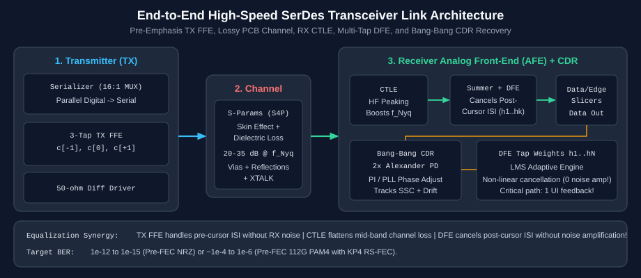
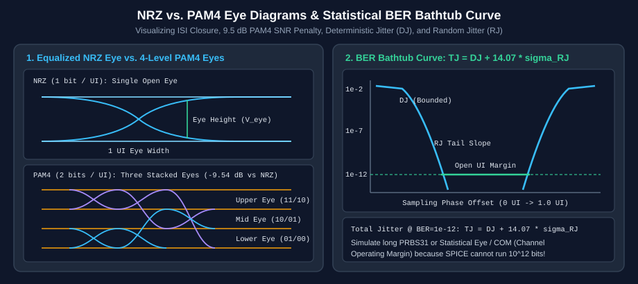

# High-Speed SerDes, Equalizers, CDR, and Signal Integrity

Modern PCIe Gen5/Gen6, 100G–800G Ethernet, UCIe, and DDR/HBM PHYs transmit `16–112 Gbps` per lane over severely lossy copper PCB traces, vias, and connectors. At `28 GHz` Nyquist frequency, a copper backplane attenuates signals by **25–35 dB**—completely closing an unequalized eye diagram into pure inter-symbol interference (ISI) mush. Recovering clean bits at bit error rates (BER) down to $10^{-12}\text{–}10^{-15}$ requires co-designing **TX Feed-Forward Equalizers (FFE)**, **RX Continuous-Time Linear Equalizers (CTLE)**, **Decision Feedback Equalizers (DFE)**, **Clock and Data Recovery (CDR)** loops, and **IBIS-AMI / Statistical BER** verification.

---

## Learning Goals

- Diagnose high-frequency channel impairments: **skin effect**, **dielectric loss ($\tan\delta$)**, **impedance reflections**, **crosstalk (NEXT/FEXT)**, and **Inter-Symbol Interference (ISI)**.
- Contrast **NRZ (2-level, 1 bit/UI)** vs **PAM4 (4-level, 2 bits/UI)** signaling and explain PAM4's **9.54 dB SNR penalty** and linearity requirements.
- Design and balance three complementary equalization stages (**TX FFE**, **RX CTLE**, **RX DFE**), tracing noise amplification vs 1-UI critical feedback timing.
- Analyze **Bang-Bang (Alexander) Phase Detectors** and Phase Interpolator (PI) CDR loops tracking frequency drift ($\pm 300\text{ ppm}$) and Spread-Spectrum Clocking (SSC).
- Decompose **Eye Diagrams** and **BER Bathtub Curves** into **Deterministic Jitter (DJ)** and **Random Jitter (RJ)** for statistical channel sign-off.

---

## Channel Loss, Inter-Symbol Interference, and NRZ vs PAM4

When a single rectangular `1 UI` pulse (`UI = 1 / baud_rate`) travels through a bandwidth-limited PCB channel ($S_{21}(f)$ extracted as Touchstone `.s4p` S-parameters), sharp edges smear out in time across preceding (**pre-cursor**, $h_{-1}$) and trailing (**post-cursor**, $h_{+1}, h_{+2}, \dots$) Unit Intervals—directly colliding with neighboring symbols!

### Why Links Move From NRZ to PAM4 Above 28–50 Gbps

- **NRZ (Non-Return-to-Zero)**: Transmits `1 bit/UI` (`{0, 1}`). Doubling data rate from 28G to 56G pushes Nyquist frequency $f_{\text{Nyq}} = f_{\text{baud}}/2$ from `14 GHz` to `28 GHz`, where PCB loss explodes steeply.
- **PAM4 (4-Level Pulse Amplitude Modulation)**: Encodes `2 bits/UI` (`00, 01, 11, 10` Gray-coded!) onto 4 voltage levels (`-3, -1, +1, +3`). For `112 Gbps` PAM4, the baud rate stays at **`56 Gbaud`** ($f_{\text{Nyq}} = 28\text{ GHz}$ instead of `56 GHz`!).
- **The 9.54 dB Price Tag**: Dividing the same peak swing into **three stacked eyes** instead of one cuts eye vertical height by $3\times$ ($\mathbf{-9.54\text{ dB}}$ SNR hit!), AND makes PAM4 ultra-sensitive to DAC/ADC nonlinearity (**RLM** Ratio of Level Separation Mismatch) and reflection bursts—making **KP4 RS-FEC (Forward Error Correction)** mandatory at 100G+!

---

## Transmit Equalization (TX FFE) and Receiver Front-End (CTLE)

A SerDes link splits channel equalization between the Transmitter and Receiver because each stage attacks a different distortion mechanism:

### 1. Transmitter Feed-Forward Equalizer (TX FFE)

Implemented as an FIR filter directly inside the output current-mode/voltage-mode segmented driver (`y[n] = c_{-1} x[n+1] + c_0 x[n] + c_{+1} x[n-1]`):
- **Pre-Emphasis / De-Emphasis**: Attenuates low-frequency DC runs while letting single-bit transitions hit full amplitude, effectively flattening the channel transfer function *before* signals enter the cable!
- **Unique Strength**: Can cancel **pre-cursor ISI ($h_{-1}$)** without amplifying thermal noise at the RX input!
- **Physical Trade-Off**: Fixed total peak driver swing enforces $\sum |c_k| = 1$, so strong de-emphasis reduces overall DC signal amplitude seen by the receiver.

### 2. Receiver Continuous-Time Linear Equalizer (CTLE)

A high-frequency differential amplifier using capacitive source degeneration (`R_s || C_s`) to inject a zero $\omega_z = 1/(R_s C_s)$ below Nyquist and peak high-frequency gain (`+6 to +15 dB` boost at $f_{\text{Nyq}}$):
- Attenuates low-frequency ISI tails smoothly before the ADC/DFE slicers.
- **Noise Amplification Penalty**: Being a *linear* high-pass filter, CTLE amplifies **high-frequency RX thermal noise and crosstalk (NEXT/FEXT)** equally alongside the weak high-frequency signal!

---

## Decision Feedback Equalization (DFE) and Adaptive LMS Loops

Unlike CTLE, a **Decision Feedback Equalizer (DFE)** cancels post-cursor ISI ($h_1, h_2, \dots, h_N$) **non-linearly** using *already-sliced clean digital past decisions*:

$$y_{\text{eq}}[n] = y_{\text{ctle}}[n] - \sum_{k=1}^{N} h_k \hat{d}[n - k]$$

### Why DFE Is Magical — and Hard to Close Timing!

- **Zero Noise Amplification**: Because $\hat{d}[n-k] \in \{-1, +1\}$ are clean noiseless digital bits, DFE subtracts channel post-cursor reflections completely **without boosting input thermal noise or crosstalk**!
- **The Brutal `1 UI` Critical Loop**: At `56 Gbps` NRZ (`1 UI = 17.85 ps`!), Tap 1 (`h_1`) must:
  1. Slice data in Comparator `n-1`,
  2. Multiply by tap weight `h_1`, and
  3. Settle on the analog summing node **BEFORE** Slicer `n` samples the very next bit `17.85 ps` later!
- **Loop-Unrolling (Speculative DFE) Solution**: Compute *both* speculative outcomes (`y + h1` assuming previous bit was `-1`, AND `y - h1` assuming `+1`) simultaneously via parallel comparators, then pick the right answer using a tiny high-speed `2:1 MUX`! That breaks the analog summer out of the `1 UI` bottleneck!
- **Adaptive LMS Training**: An on-die digital **Least-Mean-Squares (LMS)** RTL engine correlates error slicers against data streams (`d[n-k] * err[n]`) to tune FFE, CTLE gain, and DFE taps automatically across cables and temperature drift during link training!

---

## Clock and Data Recovery (CDR) Bang-Bang Phase Detectors and Tracking

Since high-speed SerDes sends no separate forward clock wire, the receiver extracts sampling clock timing directly from incoming data transitions using a **CDR loop**:

- **2x Oversampled Alexander (Bang-Bang) Phase Detector**: Takes 3 samples across adjacent UIs (`Data_prev`, `Edge`, `Data_curr`). Comparing `Edge` vs neighbors emits binary **`Early (-1)`** or **`Late (+1)`** pulses (`Zero` when no data transition occurred!).
- **Phase Interpolator (PI) Tracking**: An all-digital 2nd-order filter integrates `Early/Late` votes to step a multi-phase Phase Interpolator smoothly across `0..360°`, tracking:
  - Frequency offsets up to **$\pm 300\text{ ppm}$** (`100 ppm` TX crystal vs RX crystal)
  - Triangular **Spread-Spectrum Clocking (SSC)** modulation (`-5000 ppm @ 33 kHz` in PCIe/SATA).
- **Encoding Dependency (`8b/10b`, `64b/66b` Scrambling)**: Without guaranteed transition density and DC balance, long runs of identical `1`s or `0`s cause CDR phase wander and AC-coupling capacitor droop! **Always test SerDes RTL + AFE together with realistic PRBS31 and scrambled protocol traffic!**

---

## Eye Diagrams, Jitter Decomposition, and Statistical BER Analysis

At $10^{-12}$ BER (`1 error in 1,000,000,000,000` bits!), direct SPICE simulation running even `1,000` bits takes hours—so SPICE can **never** directly measure `1e-12` eye closure! Engineers instead combine **Statistical / IBIS-AMI Simulation** with **Dual-Dirac Jitter Decomposition**:

$$\text{TJ}(\text{BER} = 10^{-12}) = \text{DJ} + 14.069 \cdot \sigma_{\text{RJ}}$$

- **Deterministic Jitter ($\text{DJ}$)**: **Bounded** non-Gaussian timing closure caused by channel ISI (**Data-Dependent Jitter, DDJ**), asymmetric rise/fall (**Duty-Cycle Distortion, DCD**), and periodic supply ripple (**PJ**).
- **Random Jitter ($\text{RJ}$)**: **Unbounded Gaussian** noise ($\sigma_{\text{RJ}}$ from PLL/VCO phase noise and RX thermal noise). Reaching $10^{-12}$ BER spans $\pm 7.034\,\sigma_{\text{RJ}}$ on *each* side of the eye (`14.07 * sigma_RJ` total width loss!).
- **IBIS-AMI Verification Standard**: Foundry analog designers extract step/impulse responses and deliver compiled C++ behavioral **IBIS-AMI models** of TX/RX CTLE, DFE, and CDR algorithms so system architects simulate **millions of bits in seconds** across full motherboard `.s4p` S-parameter channels!

---

## Best Practices and Common Pitfalls

1. **Ensure Passivity &amp; Causality on Touchstone S-Parameter Channels**: Non-passive S-parameter extractions (`|S| > 1` at un-terminated frequency points due to poor VNA calibration or rational fitting) cause transient SPICE/AMS solvers to **blow up exponentially**! Always run a passivity/causality checker (`S-param scrub`) before simulating `.s4p` channels!
2. **Test Loop-Unrolled DFE + LMS Convergence Against Both `PRBS7` and `PRBS31`**: `PRBS7` repeats every 127 bits and hides low-frequency baseline wander through AC-coupling caps (`100 nF`); always verify worst-case continuous consecutive-identical-digits (**CID / `802.3` stress patterns**) and `PRBS31`!
3. **Budget ADC-Based DSP SerDes Latency vs Power**: Beyond `56G–112G PAM4`, analog 3-tap DFE loops struggle against comparator metastability and reflection length; modern PHYs use a **6–7 bit TI-SAR ADC + Digital FFE/DFE/MLSE DSP**, shifting verification heavily into RTL/C++ fixed-point modeling + TI-SAR mismatch calibration!
4. **Co-Verify Digital PCS Link-Training FSMs with Behavioral AFE**: Verify PCIe/Ethernet link-training coefficient handshakes (TX FFE `pre/main/post` cursor requests) cleanly across SV-RNM SerDes link loops!

---

## Practical Exercises with Solutions

### Exercise 1 Computing Total Jitter & Remaining Eye Opening at `1e-12` BER

A `25 Gbps` NRZ SerDes lane (`1 UI = 40.0 ps`) measures at the RX slicer input after CTLE + DFE equalization:
- Total Bounded Deterministic Jitter: $\text{DJ} = 9.5\text{ ps}$
- Unbounded Gaussian Random Jitter: $\sigma_{\text{RJ}} = 0.85\text{ ps}_{\text{rms}}$

1. Calculate Total Jitter ($\text{TJ}$) at $\text{BER} = 10^{-12}$ ($Q = 7.0345 \implies 2Q = 14.069$).
2. Determine the **remaining open horizontal eye margin** in `ps` and `% UI`. Will it pass a target spec requiring $\ge 0.35\text{ UI}$ minimum eye opening?

#### Solution

1. **Total Jitter at `1e-12` BER**:
   $$\text{TJ}_{10^{-12}} = \text{DJ} + 14.069\,\sigma_{\text{RJ}} = 9.5\text{ ps} + 14.069 \times 0.85\text{ ps} = 9.5 + 11.96 = \mathbf{21.46\text{ ps}}$$
2. **Remaining Open Eye Margin**:
   $$\text{Eye Width} = 1\text{ UI} - \text{TJ} = 40.0\text{ ps} - 21.46\text{ ps} = \mathbf{18.54\text{ ps}}$$
   $$\text{Fraction of UI} = \frac{18.54\text{ ps}}{40.0\text{ ps}} = \mathbf{0.4635\text{ UI}}\; (46.4\%)$$
   - Passes the `>= 0.35 UI` (`14.0 ps`) target cleanly with `4.54 ps` horizontal margin!

---

### Exercise 2 Comparing PAM4 vs. NRZ Eye Height & Nyquist Frequency

A `112 Gbps` wireline link limits differential peak-to-peak launch swing to $800\text{ mV}_{\text{pp,diff}}$ (`400 mV` single-ended peak) and compares transmitting with **112G NRZ** vs **112G PAM4**:

1. Calculate the **baud rate (symbols/s)**, **1 UI duration**, and **Nyquist frequency $f_{\text{Nyq}}$** for both formats.
2. Ignoring channel loss for a moment, compute the ideal **vertical eye height per eye** for 112G NRZ vs. 112G PAM4 (`800 mVpp` divided equally across 4 levels: `-400, -133.3, +133.3, +400 mV`) and verify the exact dB penalty!

#### Solution

1. **Speed & Nyquist Frequency**:
   - **112G NRZ (`1 bit/UI`)**: Baud = `112 Gbaud`, `1 UI = 8.93 ps`, $f_{\text{Nyq}} = \mathbf{56.0\text{ GHz}}$ (channel loss massive, e.g., > 45 dB!).
   - **112G PAM4 (`2 bits/UI`)**: Baud = `56 Gbaud`, `1 UI = 17.86 ps`, $f_{\text{Nyq}} = \mathbf{28.0\text{ GHz}}$ (2x wider UI & half Nyquist frequency!).
2. **Vertical Eye Height & SNR Penalty**:
   - **NRZ Eye Height**: `800 mV` total step height (`+400 mV` to `-400 mV`).
   - **PAM4 Eye Height**: Three identical stacked eyes spanning `800 mV` -> **$V_{\text{eye,PAM4}} = \frac{800\text{ mV}}{3} = 266.7\text{ mV}$**.
   - **Voltage / SNR Penalty**: $20 \log_{10}(1/3) = \mathbf{-9.54\text{ dB}}$ vertical margin loss (worth paying at 112G only because cutting $f_{\text{Nyq}}$ from 56 GHz to 28 GHz saves **15–20+ dB** of PCB channel attenuation!).

---

### Exercise 3 Designing TX FFE Tap Weights for Pre- and Post-Cursor Cancellation

Suppose an unequalized PCB channel sampled at 1-UI baud intervals produces discrete pulse response `[h_-1, h_0, h_+1] = [0.15, 0.75, 0.25]` (normalized).
You configure a normalized 3-tap TX FFE filter `[c_-1, c_0, c_+1]` constrained by peak swing limit $|c_{-1}| + |c_0| + |c_{+1}| = 1$.

Check qualitatively what **sign (`+` or `-`)** taps `c_-1` and `c_+1` must take relative to main cursor `c_0 > 0` to cancel `[h_-1, h_+1]`, and evaluate the approximate residual `[y_-1, y_0, y_+1]` for candidate weights `c = [-0.15, +0.65, -0.20]` convolved with `h = [0.15, 0.75, 0.25]`!

#### Solution

1. **Sign Selection**: Because both $h_{-1} = +0.15 > 0$ and $h_{+1} = +0.25 > 0$ have the *same* positive polarity as $h_0$, canceling them requires **negative side taps ($c_{-1} < 0, c_{+1} < 0$)**! (Verifying peak limit: $|-0.15| + |0.65| + |-0.20| = 1.00$.)
2. **Convolution $y[k] = (c * h)[k]$ around main cursor ($k = 0$)**:
   - $y_{-1} = c_{-1} h_0 + c_0 h_{-1} = (-0.15)(0.75) + (0.65)(0.15) = -0.1125 + 0.0975 = \mathbf{-0.015}$ (down `10x` from `+0.15`!)
   - $y_0 = c_{-1} h_{+1} + c_0 h_0 + c_{+1} h_{-1} = (-0.15)(0.25) + (0.65)(0.75) + (-0.20)(0.15) = -0.0375 + 0.4875 - 0.030 = \mathbf{+0.420}$
   - $y_{+1} = c_0 h_{+1} + c_{+1} h_0 = (0.65)(0.25) + (-0.20)(0.75) = 0.1625 - 0.150 = \mathbf{+0.0125}$ (down `20x` from `+0.25`!)
   - Notice: ratio $y_0 / (|y_{-1}| + |y_{+1}|)$ jumped from $\frac{0.75}{0.40} = 1.88$ up to $\frac{0.420}{0.0275} = \mathbf{15.3\times}$—opening a completely closed eye cleanly at the cost of reduced `y0` amplitude!

---

##### Copyright (c) 2026 squared-studio
