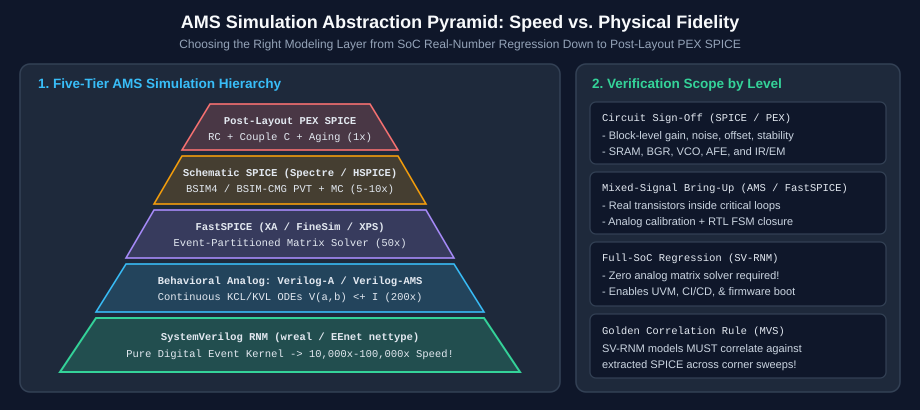
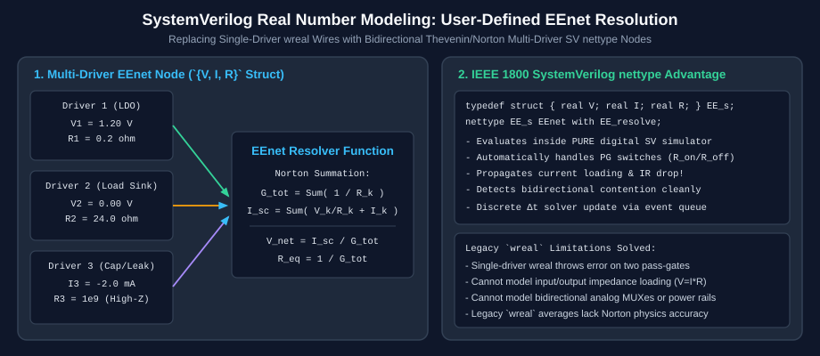

# SPICE Simulation, Verilog-A, Verilog-AMS, and Real Number Modeling

Verifying an AMS SoC requires spanning **six orders of magnitude in simulation speed and physical fidelity**. You cannot run 10-millisecond UVM firmware boot sequences on a transistor-level SPICE netlist (`10,000+` FinFETs with extracted `RC` parasitics), yet pure digital RTL fails to capture analog poles, offset voltage, PSRR, or resistive loading. Bridging this divide means mastering every tier of the **AMS Modeling Abstraction Pyramid**: SPICE, FastSPICE, Verilog-A, Verilog-AMS, and IEEE 1800 **SystemVerilog Real Number Modeling (SV-RNM / `EEnet`)**.

---

## Learning Goals

- Explain how SPICE solvers (**Spectre**, **HSPICE**, **ngspice**) formulate circuit equations using **Modified Nodal Analysis (MNA)**, **Newton-Raphson iterations**, and **adaptive timesteps** across `.dc`, `.ac`, `.tran`, `.stb`, and `.pss/.pnoise` analyses.
- Author clean, **convergence-friendly Verilog-A** continuous analog modules (`analog begin ... V() <+ ...`, `ddt`, `idt`, `@(cross)`) avoiding discontinuities that break SPICE timesteps.
- Contrast **Verilog-AMS** (mixed analog/digital language needing an analog solver) with pure-digital **SystemVerilog Real Number Modeling (`wreal` vs custom `nettype` `EEnet`)**.
- Implement bidirectional multi-driver **`EEnet` (`{V, I, R}`)** Norton/Thevenin resolution functions in IEEE 1800 SystemVerilog so analog impedance loading runs at full RTL simulation speeds.
- Select the exact modeling abstraction tier for block sign-off, interface bring-up, and full-chip regressions.

---

## Inside the SPICE Solver KCL, Newton-Raphson, and Analyses

At the bottom of the accuracy pyramid sits **True SPICE** (Cadence Spectre, Synopsys PrimeSim HSPICE/SPICE, open-source ngspice/Xyce):



### How SPICE Solves a Circuit at Every Timestep

1. **Modified Nodal Analysis (MNA)**: Stamps Kirchhoff's Current Law (KCL) into matrix form $G\mathbf{v} + C\dot{\mathbf{v}} = \mathbf{i}(t)$ across every node voltage and inductor/voltage-source branch current.
2. **Newton-Raphson Iteration**: Because MOSFET equations (`BSIM4` / `BSIM-CMG` FinFET) are fiercely non-linear, SPICE linearizes every transistor around an operating point $(g_m, g_{ds}, C_{gs}, C_{gd})$ and iterates repeatedly until residual KCL mismatch drops below strict tolerances (`reltol` $\sim 10^{-3}$, `vabstol` $\sim 1\text{ }\mu\text{V}$, `iabstol` $\sim 1\text{ pA}$).
3. **Adaptive Timestepping**: Integrates differential capacitors/inductors (`trap` or `gear` integration), automatically shrinking $\Delta t$ down to femtoseconds during sharp switching transitions and rejecting steps (**timestep too small!**) whenever discontinuous currents prevent Newton-Raphson convergence!

### Essential SPICE Analyses Beyond Basic `.tran`

| SPICE Analysis | What It Computes | Typical AMS Target Usage |
| :--- | :--- | :--- |
| **`.dc` / `.op`** | Static DC bias point, region (`sat`/`triode`/`cutoff`), parameter sweeps | Sizing $g_m/I_D$, checking $V_{\min}$ headroom, BGR temperature curves |
| **`.ac`** | Small-signal linearized frequency response around DC point | Open-loop OTA gain/UGF, PSRR, filter frequency masks |
| **`.stb`** | Middlebrook/Tian closed-loop Gain/Phase Margin (`iprobe`) | **Mandatory** for LDOs, CMFB loops, regulated cascodes, OTAs |
| **`.noise` / `.tran noise`** | Integrated thermal + $1/f$ noise PSD at output | Amplifier input-referred noise, ADC `kT/C` verification |
| **`.pss` + `.pnoise` / `.pac`** | Periodic steady-state + cyclostationary LTV noise/gain | **LC/Ring VCO Phase Noise**, SC filter frequency folding, Mixer NF |
| **`Monte Carlo` (`.mc`)** | Random process + local mismatch draws across `200–1000` seeds | Comparator offset $\sigma_{os}$, BGR spread, DAC INL/DNL yield |

---

## Continuous Behavioral Analog Modeling with Verilog-A and Verilog-AMS

Before transistor schematics finish—or when verifying top-level PLL lock alongside real transistor VCOs—engineers replace heavy SPICE subcircuits with compiled **Verilog-A** (pure continuous analog) or **Verilog-AMS** (mixed digital `always` + `analog begin`) behavioral equations.

### Rules for Writing Convergence-Safe Verilog-A

Never write sharp discontinuous `if (V(in) > Vth) I_out = 1m; else I_out = 0;` statements in Verilog-A! Instantaneous slope jumps cause Newton-Raphson solvers to diverge or crash with `timestep too small`. Instead:
- **Smooth Thresholds (`tanh`)**: Shape switches smoothly with `0.5 * (1.0 + tanh((V(in) - vth) / v_smooth))`.
- **Smooth Ramp Transitions (`transition()`)**: Filter discrete control bits (`en`, `code`) using `transition(expr, delay, trise, tfall)` so step changes get finite rise/fall times.
- **Explicit Threshold Detection (`@(cross)`)**: Force the analog solver to place a tiny timestep right on threshold crossings cleanly (`@(cross(V(clk) - vth, +1))`).
- **Continuous Conservation Branches**: Declare `electrical` ports (`V(p, n) <+ ...`, `I(p, n) <+ ...`) obeying KCL/KVL strictly (`ddt()` for capacitors `I <+ C*ddt(V)`).

```verilog
// Clean, Convergence-Safe Verilog-A Behavioral Low-Pass RC Filter & Comparator Core
`include "disciplines.vams"

module va_rc_lpf_comp #(
    parameter real R_OHM   = 1.0e3,
    parameter real C_F     = 10.0e-12,
    parameter real V_TH    = 0.6,
    parameter real V_VDD   = 1.2,
    parameter real TR_S    = 50.0e-12
) (
    input  electrical vin,
    input  electrical vref,
    output electrical vfilt,
    output electrical dout
);
    integer comp_bit;

    analog begin
        // 1. Continuous Physical KCL at filtered node (never breaks MNA!):
        I(vin, vfilt) <+ V(vin, vfilt) / R_OHM;
        I(vfilt)      <+ C_F * ddt(V(vfilt));

        // 2. Tell analog solver EXACT time to evaluate zero crossing cleanly:
        @(initial_step or cross(V(vfilt) - V(vref), 0, 1.0e-12)) begin
            comp_bit = (V(vfilt) >= V(vref)) ? 1 : 0;
        end

        // 3. Smooth finite rise/fall edge preventing infinite dV/dt spikes:
        V(dout) <+ transition(comp_bit ? V_VDD : 0.0, 0.0, TR_S, TR_S);
    end
endmodule
```

> [!IMPORTANT]
> Notice why **`transition()`** AND **`@(cross)`** appear together above: `@(cross(...))` instructs Spectre/SPICE to place an exact numerical timepoint within `1 ps` of the threshold crossing instead of interpolating blindly across a wide timestep, while `transition(..., 50p, 50p)` keeps output edges differentiable (`< infinity` slope)!

---

## High-Speed SystemVerilog Real Number Modeling (wreal and EEnet)

Even compiled Verilog-A invokes the continuous analog SPICE matrix solver at every step, limiting speed to ~200x over SPICE—still too slow for overnight 10,000-seed UVM SoC firmware boot regressions!

The breakthrough solution is **SystemVerilog Real Number Modeling (SV-RNM)**: computing real voltages, currents, and RC time constants **100% inside the pure digital SystemVerilog event scheduler** (`0 analog matrix solver`, **10,000x–100,000x faster than SPICE!**).



### Legacy `wreal` vs IEEE 1800 `nettype` (`EEnet`)

- **Legacy `wreal` (Verilog-AMS)**: Carries only a *single scalar real voltage*. Two `wreal` drivers connecting to the same bus either conflict fatally or average blindly (`avg`) without knowing output impedance (`1 ohm` vs `1 Mohm`!).
- **Modern SV `nettype` (`EEnet = {V, I, R}` struct)**: Standardized natively in **IEEE 1800 SystemVerilog**! Every driver deposits a Norton/Thevenin equivalent `(V_drv, I_drv, R_drv)`, and a **user-defined resolution function** (`EE_resolve`) computes the exact physical circuit node equation in pure digital SV!

```systemverilog
// Synthesis-Compatible Testbench Package for IEEE 1800 EEnet Multi-Driver Resolution
package ee_rnm_pkg;
    typedef struct {
        real V;   // Open-circuit / Thevenin voltage (Volts)
        real I;   // Parallel Norton current source (Amps)
        real R;   // Series output impedance (Ohms; >= 1e9 approximates Hi-Z)
    } EE_s;

    // Exact Norton nodal solver across N arbitrary parallel drivers on one net!
    function automatic EE_s EE_resolve(input EE_s drivers[]);
        real g_tot = 0.0;
        real i_sc  = 0.0;
        EE_s res;

        foreach (drivers[k]) begin
            real rk = (drivers[k].R > 1.0e-6) ? drivers[k].R : 1.0e-6;
            real gk = (drivers[k].R >= 1.0e12) ? 0.0 : (1.0 / rk);
            g_tot += gk;
            i_sc  += (drivers[k].V * gk) + drivers[k].I;
        end

        if (g_tot > 1.0e-12) begin
            res.V = i_sc / g_tot;
            res.R = 1.0 / g_tot;
        end else begin
            res.V = 0.0;
            res.R = 1.0e12; // Floating / High-Z node!
        end
        res.I = i_sc;
        return res;
    endfunction

    nettype EE_s EEnet with EE_resolve;
endpackage
```

Look at what that 25-line package unlocks natively in VCS, Xcelium, and Questa **without any AMS analog license**:
- Power-switch contention and `IR` drop (`LDO` at `R=0.5 ohm, V=1.2 V` driving a heavy `10 ohm` load drops cleanly to $1.2 \times \frac{10}{10.5} = 1.143\text{ V}$ automatically!).
- Bidirectional analog MUX pass-gates, pull-up/pull-down I2C resistors, ESD clamp paths, and bandgap trim arrays!

---

## Choosing the Right Abstraction Speed vs Physical Fidelity

| Task / Verification Question | Best Engine | Why This Engine Wins |
| :--- | :--- | :--- |
| OTA Phase Margin (`PM`), Noise PSD, `gm/ID` sizing | **Spectre / HSPICE (`.stb`, `.noise`)** | Exact BSIM-CMG small-signal derivatives & parasitic capacitances |
| VCO Phase Noise (`-130 dBc/Hz`), Switched-Cap `NTF` noise folding | **Spectre `.pss` + `.pnoise`** | Periodic LTV noise folding cannot be computed by simple `.ac`/SV-RNM |
| Full-chip SRAM timing, Large Buck converter switching cycles | **FastSPICE** (`XA`/`FineSim`/`XPS`) | Exploits spatial/temporal partitioning across inactive subcircuits (20–50x speedup) |
| PLL acquisition + RTL Calib FSM mixed-signal debug | **Verilog-AMS / Co-Sim** | Links real SPICE critical analog core with RTL state machines |
| Overnight 5,000-seed UVM SoC boot, DVFS, Multi-Lane SerDes PCS | **SystemVerilog RNM (`EEnet`)** | Zero SPICE convergence headaches; full RTL speeds (`10,000x+`)! |

---

## Best Practices and Common Pitfalls

1. **Always Guard Against Floating Nodes & Division-by-Zero in `EEnet` Resolvers**: Clamp zero-resistance voltage sources (`R = 0`) cleanly to a tiny finite floor (`1e-6 ohm`) and handle all-`HighZ` (`g_tot == 0`) branches cleanly so `NaN` (`0.0 / 0.0`) never infects downstream comparators!
2. **Never Use Continuous Infinite Loops Inside SV-RNM Without Explicit Step Size**: Unlike SPICE which auto-adjusts timesteps, a discrete SV-RNM RC integrator (`always #(dt_ns) v <= v + ...`) runs at fixed sample step `dt`—ensure `dt <= tau_RC / 10` (or trigger event updates *only* when input drivers actually change!) so you don't burn 100% CPU oversampling idle analog rails!
3. **Beware Unrealistic `R_on = 0` or Infinite-Gain Loops in Verilog-A**: Always include realistic finite series resistance, bounded supply rails (`VDD`/`VSS` clamping!), and finite slew limits in behavioral Verilog-A models—otherwise downstream blocks see impossible `1000 V` spikes!
4. **Match `wreal`/`EEnet` Disciplines Cleanly at Port Boundaries**: Standardize project-wide RNM packages (`ee_rnm_pkg`) across all analog modeling engineers so IP integration never fails due to incompatible `nettype` structs.

---

## Practical Exercises with Solutions

### Exercise 1 Solving an `EEnet` Multi-Driver Node Calculation

Three `EEnet` drivers attach to analog pad `vout` resolved by `EE_resolve`:
- **Driver A (LDO Output Stage)**: `V = 1.80 V`, `I = 0 A`, `R = 2.0 ohm`
- **Driver B (Resistive Load to Ground)**: `V = 0.00 V`, `I = 0 A`, `R = 18.0 ohm`
- **Driver C (Constant Current Sink Pull-Down)**: `V = 0.00 V`, `I = -10.0 mA` (`-0.01 A`), `R = 1.0e12` (`Hi-Z`)

Calculate the resolved struct `{V, I, R}` on net `vout` computed by `EE_resolve`.

#### Solution

1. **Compute Conductances $G_k$ &amp; Norton Contributions**:
   - Driver A: $G_A = 1 / 2.0 = 0.50\text{ S}$, contribution $V_A G_A + I_A = 1.80 \times 0.50 + 0 = +0.90\text{ A}$.
   - Driver B: $G_B = 1 / 18.0 = 0.05556\text{ S}$, contribution $0 \times 0.05556 + 0 = 0\text{ A}$.
   - Driver C (`R = 1e12` -> $G_C = 0\text{ S}$): ideal current sink contributes $I_C = -0.010\text{ A}$.
2. **Sum Totals &amp; Solve**:
   - $G_{\text{tot}} = 0.50 + 0.05556 + 0 = \mathbf{0.5556\text{ S}} \implies R_{\text{eq}} = \frac{1}{0.5556} = \mathbf{1.80\,\Omega}$ (exact parallel $2\,\Omega \parallel 18\,\Omega$!).
   - $I_{\text{sc}} = 0.90 + 0 - 0.010 = \mathbf{0.890\text{ A}}$.
   - $V_{\text{net}} = \frac{I_{\text{sc}}}{G_{\text{tot}}} = \frac{0.890\text{ A}}{0.5556\text{ S}} = \mathbf{1.602\text{ V}}$.
   - Check physically: Open-circuit unloaded divider would be $1.80 \times \frac{18}{2+18} = 1.620\text{ V}$, and `10 mA` sink drops across $R_{\text{eq}} = 1.8\,\Omega$ by $0.01 \times 1.8 = 18\text{ mV} \implies 1.620 - 0.018 = 1.602\text{ V}$! **Exact physical KCL accuracy in pure RTL simulation!**

---

### Exercise 2 Fixing a SPICE Convergence Failure in a Verilog-A Block

A team adds this Verilog-A threshold detector to a FastSPICE mixed-signal run, causing Spectre/XA to abort repeatedly with `Error: Time step too small` right at `t = 4.23 us`:

```verilog
analog begin
    if (V(in) > 0.60)
        V(out) <+ 1.2;
    else
        V(out) <+ 0.0;
end
```

Identify **two fundamental Verilog-A modeling errors** in that 6-line snippet and rewrite it cleanly!

#### Solution

1. **Two Modeling Errors**:
   - **Discontinuous Step Jump (`0 -> 1.2 V` in `0 s`)**: Whenever `V(in)` crosses `0.60 V`, `V(out)` jumps instantaneously, making $\frac{dV}{dt} \to \infty$ (blowing up capacitive load currents $I = C \frac{dV}{dt} \to \infty$!) and failing Newton-Raphson convergence!
   - **Hidden Crossing Event (No `@(cross)`)**: Without `@(cross(V(in) - 0.60, 0))`, the solver can step blindly right past a narrow pulse or chatter violently around `0.60 V`!
2. **Corrected Convergence-Safe Verilog-A**:
```verilog
analog begin
    @(initial_step or cross(V(in) - 0.60, 0, 1.0e-12)) begin
        state = (V(in) >= 0.60) ? 1 : 0;
    end
    V(out) <+ transition(state ? 1.2 : 0.0, 0.0, 20.0e-12, 20.0e-12);
end
```

---

### Exercise 3 Selecting Simulation Tier & Estimating Speedup

A `12-bit SAR ADC` has an `analog core` (`100 ns` conversion time per sample at `10 MSPS`) calibrated by an `RTL Digital Background Calibration FSM` requiring `50,000` conversion cycles (`5 ms` of chip time) to converge its capacitor weight lookup table.
- Transistor-level **SPICE** simulates `1 conversion` (`100 ns`) in **`2 seconds`** of wall-clock time.
- **SV-RNM (`EEnet`)** simulates `1 conversion` (`100 ns`) in **`5 microseconds`** of wall-clock time.

Compute the wall-clock runtime to verify full `50,000`-cycle FSM convergence in **SPICE Co-Sim vs. SV-RNM**, and describe the recommended hybrid verification split!

#### Solution

1. **Runtime Comparison**:
   - **SPICE Co-Sim (`50,000` cycles)**: $50{,}000 \times 2\text{ s} = 100{,}000\text{ s} \approx \mathbf{27.8\text{ hours}}$ per single seed! Running a 50-seed UVM calibration regression would take ~58 days!
   - **SV-RNM (`50,000` cycles)**: $50{,}000 \times 5\text{ }\mu\text{s} = \mathbf{0.25\text{ seconds}}$ per seed!
2. **Recommended Hybrid Verification Split**:
   - Run **all 50,000-cycle RTL calibration convergence regressions, corner error-injection, and full-SoC UVM tests** in **SV-RNM (`0.25 s` each)**, using an SV-RNM CDAC model parameterized to inject realistic extracted capacitor mismatches (`+/- 0.5%`).
   - Then run **targeted 200–500 cycle Co-Simulations (`SPICE/FastSPICE analog + RTL FSM`)** starting from mid-calibrated preload states (taking `7–15 minutes`) to prove electrical boundary timing, kickback, and supply-level connect rules match cleanly!

---

##### Copyright (c) 2026 squared-studio
