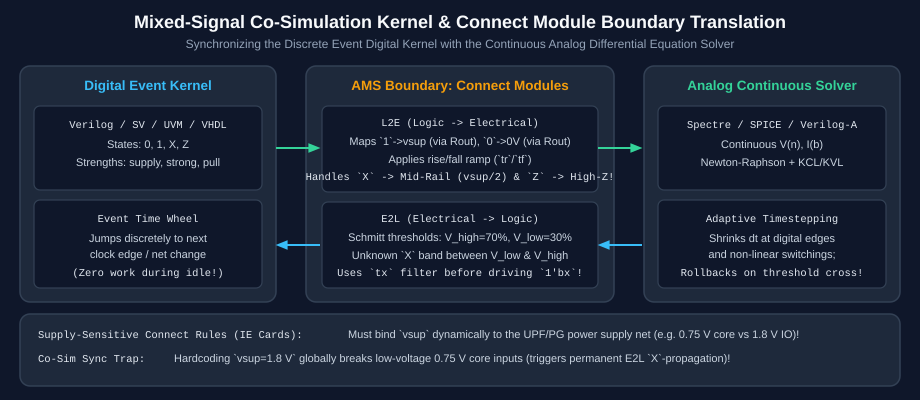
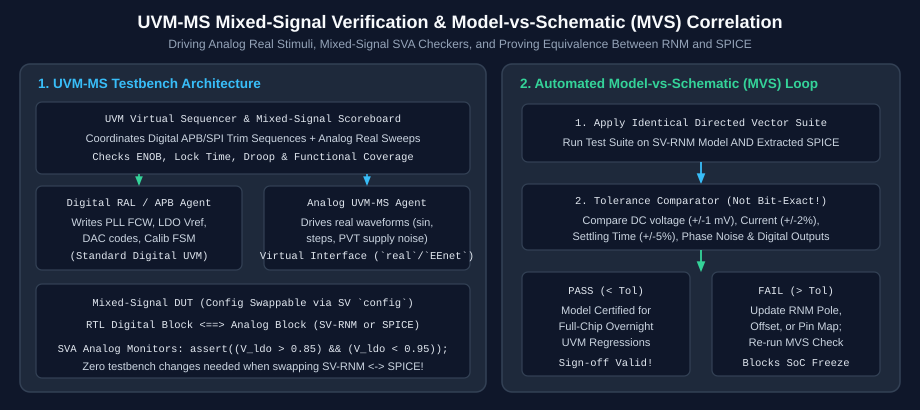

# Mixed-Signal Co-Simulation, Connect Modules, and UVM-MS Verification

Even when a digital RTL block passes 100% UVM verification cleanly and an analog macro passes 100% SPICE Monte Carlo corners cleanly, **half of all first-silicon mixed-signal failures occur right at the analog–digital interface**! Typical culprits include inverted control polarities, wrong `VDD/AVDD` supply-voltage handshakes, un-synchronized comparator glitches hitting digital flops, and behavioral RNM models drifting out of spec relative to extracted transistor schematics. **Mixed-Signal Co-Simulation (`DMS`/`AMS`)**, **Supply-Aware Connect Modules (`IE cards`)**, **UVM-MS**, and **Model-vs-Schematic (MVS) Correlation** close this gap systematically.

---

## Learning Goals

- Trace how mixed-signal co-simulation engines (`Xcelium-Spectre`, `VCS-XA/PrimeSim`, `Questa-AFS`) synchronize the discrete event kernel with the continuous analog solver.
- Configure **Discipline Resolution** and **Connect Modules (`L2E`, `E2L`, `Bidirect`)** safely, including dynamic **power-supply-sensitive Interface Element (IE) rules** for multi-voltage UPF SoCs.
- Debug common co-simulation boundary pitfalls: **`X`-to-midrail contamination**, **`Z` high-impedance leakage**, and **excessive analog timestep rollback throttling**.
- Architect a reusable **UVM-MS testbench** featuring real-valued UVM agents, mixed-signal SVA assertions, and dynamic SystemVerilog `config` view swapping (`SV-RNM <-> SPICE`).
- Execute automated **Model-vs-Schematic (MVS)** correlation flows certifying that fast RNM models stay accurate across corners.

---

## How Digital Event Kernels Synchronize with Analog SPICE Solvers

Running Verilog/SystemVerilog alongside transistor-level SPICE fuses two completely incompatible numerical worlds inside one unified simulation kernel:



1. **Digital Kernel Advances Discretely (`t_d`)**: Jumps instantly across clock periods (`#5ns`) with zero effort while nodes stay flat.
2. **Analog Solver Advances Continuously (`t_a + dt`)**: Steps forward solving nonlinear ODEs up toward the next scheduled digital event (`t_d`)—or halts early if an analog threshold crossing (`E2L`) fires a digital event!
3. **Synchronization Overhead Hazard**: Every single time *any* digital node toggles that drives a Connect Module (`L2E`), the analog SPICE solver is forced to **shrink `dt` to picoseconds** and solve Newton-Raphson across the entire analog subcircuit! Feeding an un-gated `2 GHz` clock or `32-bit` wide digital bus directly into a SPICE block without minimizing `L2E` transitions slows co-simulation down by `10x–50x`!

---

## Discipline Resolution, Connect Rules, and L2E/E2L Converters

Whenever a digital `logic` wire meets an analog `electrical` terminal (`v(a)`), the elaborator automatically inserts a **Connect Module** controlled by an **Interface Element (IE) / Connect Rule (`connectrules`)**:

### `L2E` (Logic-to-Electrical Driver)

Translates discrete 4-state logic (`0, 1, X, Z`) into physical voltage with realistic output resistance (`Rout`) and edge transition ramp (`tr`/`tf`):
- `1'b1` -> ramps cleanly to **`vsup`** (e.g., `1.2 V` or `0.85 V`) through series resistance `rout`.
- `1'b0` -> ramps cleanly to **`0.0 V`** through `rout`.
- `1'bz` -> switches to high impedance `roff = 1 Gohm` (crucial for tri-state IOs!).
- `1'bx` -> drives **`vsup / 2`** (mid-rail crowbar voltage!).

> [!CAUTION]
> **Mid-Rail `1'bx` Hazard**: In co-simulation, if an uninitialized digital register feeds `1'bx` into an analog SPICE inverter or SAR switch (`L2E`), `vsup / 2` sits directly in the active linear gain region—turning BOTH PMOS and NMOS ON simultaneously, burning huge short-circuit DC current and corrupting bias generators cleanly at $t = 0$! Always trace `X` sources at analog boundaries immediately!

### `E2L` (Electrical-to-Logic Receiver)

Translates continuous analog voltage into discrete 4-state `logic`:
- `V >= vsup * 0.70` -> drives `1'b1`.
- `V <= vsup * 0.30` -> drives `1'b0`.
- `0.30*vsup < V < 0.70*vsup` -> enters the indeterminate **threshold band**, outputting `1'bx` if it lingers longer than a small transition tolerance filter (`tx`)!

---

## Supply-Aware Co-Simulation with UPF and PG Netlists

A classic SoC bug happens when a single global Connect Rule sets **`vsup = 1.8 V`** across the entire chip:
- Inside a **`0.75 V` Core Power Domain (`VDD_CORE`)**, digital core signals toggle `0 <-> 0.75 V`. Wait: if an `L2E` still uses `vsup = 1.8 V`, an RTL signal `1'b1` drives **1.8 V straight onto fragile `0.75 V` FinFET thin-oxide gates**—creating fake over-drive speeds and hiding level-shifter bugs!
- Worse, in an `E2L` sensing a `0.75 V` analog output against a `1.8 V` rule (`V_high = 0.7 * 1.8 = 1.26 V`), `0.75 V` sits *permanently* inside `[0.54 V, 1.26 V]` (`1'bx`!), turning every single analog-to-digital status bit (`pll_lock`, `adc_done`) into **`1'bx`**!

### Solution Dynamic Supply-Sensitive Connect Modules (IE Rules)

Always bind **`vsup` dynamically** in connect rules (`-iereport`, `ie vsup=1.8 cell=...`, or **Power-Smart Connect Modules** linked directly to IEEE 1801 UPF supply nets):

```systemverilog
// Conceptual Connect Rule Specification separating Core (0.75V) vs IO/Analog (1.8V) Domains
connectrules soc_multi_supply_cr;
    // 1. Default Core Digital Domain (0.75V)
    connect L2E_2 #( .vsup(0.75), .tr(40e-12), .tf(40e-12), .rout(200.0) );
    connect E2L_2 #( .vsup(0.75), .vthi(0.525), .vtlo(0.225), .tx(100e-12) );

    // 2. Override for Thick-Oxide 1.8V Analog & I/O Blocks (by module / instance path!)
    connect L2E_2 #( .vsup(1.80), .rout(100.0) )
        resolve electrical for tb_top.u_dut.u_pmic_1v8.*;
    connect E2L_2 #( .vsup(1.80), .vthi(1.26), .vtlo(0.54) )
        resolve electrical for tb_top.u_dut.u_pmic_1v8.*;
endconnectrules
```

---

## UVM-MS Architecture Real-Value Agents, DMS Assertions, and MVS Correlation

To reuse the exact same UVM verification infrastructure across fast overnight SV-RNM runs AND deep SPICE co-simulations, organize your testbench with **UVM-MS (Universal Verification Methodology for Mixed-Signal)**:



### 1. View Swapping via IEEE 1800 SystemVerilog `config`

Never duplicate testbench files for SPICE vs. RNM runs! Use SystemVerilog `config` declarations (`use spice_lib.u_pll;` vs `use rnm_lib.u_pll;`) so one single UVM testbench runs identically against:
- **Fast Regression View**: Pure digital RTL + `SV-RNM (EEnet)` for all AMS blocks (`10,000x` speed).
- **Co-Sim Spot-Check View**: Critical block (e.g., `u_sar_adc`) switched to **SPICE/FastSPICE**, while neighboring PLL & PMIC stay `SV-RNM`!

### 2. Mixed-Signal Assertions (DMS SVA)

Write real-valued SystemVerilog Assertions directly inside `bind` interfaces checking analog rails, lock settling windows, and reset thresholds continuously:

```systemverilog
// Mixed-Signal SVA Monitor bound to LDO / Power-OK boundary
module ldo_ms_sva (
    input logic clk_ref,
    input logic ldo_en,
    input logic pwr_good,
    input real  vout_ldo,      // Real voltage sampled cleanly from EEnet/E2L probe!
    input real  vref_target
);
    // 1. VOUT must settle within +/-3% of target within 500 cycles of enable!
    property p_ldo_settle_on_enable;
        @(posedge clk_ref)
        $rose(ldo_en) |-> ##[1:500] ($abs(vout_ldo - vref_target) <= 0.03 * vref_target);
    endproperty
    assert property (p_ldo_settle_on_enable)
        else $error("MS_ERR: LDO failed to settle to %.3fV (actual=%.3fV)", vref_target, vout_ldo);

    // 2. pwr_good flag MUST never assert while physical voltage is still below 90%!
    property p_pg_accurate;
        @(posedge clk_ref)
        pwr_good |-> (vout_ldo >= 0.90 * vref_target);
    endproperty
    assert property (p_pg_accurate)
        else $error("MS_ERR: Digital pwr_good asserted early while VOUT=%.3fV!", vout_ldo);
endmodule
```

### 3. Model-vs-Schematic (MVS) Correlation

Fast SV-RNM models are worthless if an engineer forgets to model a startup latency, voltage droop, or inverted enable bit—allowing full-chip UVM to pass while real silicon fails! **MVS Verification** automatically executes the **exact same verification tests** on both the **`SV-RNM` model** and the **`Transistor SPICE` schematic/PEX**, checking that analog waveforms and digital handshakes match within defined numerical tolerances (`+/- 2 mV DC`, `+/- 5% rise/settle time`, `0` digital cycle divergences) before promoting an RNM model to SoC sign-off!

---

## Best Practices and Common Pitfalls

1. **Audit `iereport` / Connect Module Logs on Every Co-Sim Build**: Always print and inspect the auto-inserted connect module summary (`-iereport` in Xcelium / VCS-XA). Catching one wrongly bound `0.75 V` vs `1.8 V` boundary rule saves days of phantom X debugging!
2. **Minimize Digital Signals Crossing Directly into SPICE (`Port Pruning`)**: Do not pass a `100-bit` slow configuration register bus inside the SPICE schematic if only 4 analog trim switches use it—decode/latch static registers in RTL outside the SPICE partition to minimize `L2E` elements and matrix size.
3. **Remember SPICE Case Sensitivity & Bus Indexing Differences**: SPICE netlists are traditionally case-insensitive (`IN` == `in`) and use angle brackets `bus<3:0>` or flattened names (`bus_3_`), whereas SystemVerilog is case-sensitive and uses square brackets `bus[3:0]`. Use automated wrapper generators (`-spice_top` / `AMS netlist wrapper`) rather than hand-wiring top SPICE subcircuits!
4. **Correlate MVS Across Corners (Not Only `TT / 25C`)**: Parameterize your SV-RNM models with corner coefficients (`k_gain`, `t_lock`, `v_os`) and validate MVS across `SS / -40C`, `TT / 25C`, and `FF / 125C`!

---

## Practical Exercises with Solutions

### Exercise 1 Diagnosing an Unexpected `1'bx` at a Mixed-Signal Boundary

In an SoC co-simulation, the `0.80 V` digital CPU receives `pll_lock` from a `1.8 V`-IO / `0.80 V`-Core PLL macro. Even after the internal analog charge pump stabilizes and the PLL schematic output `pll_lock_ana` rises cleanly to `0.80 V`, digital RTL sees `pll_lock === 1'bx` permanently! Checking the connect log reveals a single global connect rule `E2L_2 #( .vsup(1.80), .vthi(1.26), .vtlo(0.54) )` was applied to every boundary.

1. Explain mathematically why `pll_lock` evaluated to `1'bx`.
2. Show the exact Connect Rule update required to resolve the bug cleanly without changing the PLL schematic!

#### Solution

1. **Root Cause**: The PLL core digital output buffer operates on `0.80 V` core logic (`0 V` to `0.80 V`), so valid `HIGH` output equals `0.80 V`. However, the global `1.80 V` `E2L` rule checks `vthi = 0.70 * 1.80 = 1.26 V` and `vtlo = 0.30 * 1.80 = 0.54 V`. Because `0.54 V < 0.80 V < 1.26 V`, `0.80 V` falls permanently inside the forbidden hysteresis/`X` region, driving `1'bx` into RTL forever!
2. **Fix**: Apply a scoped instance/port connect rule setting `.vsup(0.80)` (or bind directly to the `VDD_CORE` UPF supply net!) for the core-voltage digital signals of the PLL:
```systemverilog
connect E2L_2 #( .vsup(0.80), .vthi(0.56), .vtlo(0.24), .tx(100e-12) )
    resolve electrical for tb_top.u_dut.u_pll.pll_lock_ana;
```

---

### Exercise 2 Detecting an MVS Correlation Failure on Bandgap Startup

An automated **MVS** check tests a Bandgap Reference across `SV-RNM` vs. `Extracted SPICE` with `enable` going `0 -> 1` at `t = 0`:
- **SV-RNM Model**: `vbg_out` ramps cleanly to `1.200 V` in `2.0 us`, and `bg_ready` asserts at `t = 2.0 us`.
- **SPICE Schematic (`SS / -40C`)**: `vbg_out` lags at `0.15 V` until `t = 4.5 us`, then jumps rapidly and settles at `1.198 V` at `t = 7.2 us`, while `bg_ready` (driven by an internal analog comparator) asserts at `t = 6.8 us`.

1. Identify two real risks exposed if the SoC digital power-up FSM relied on the optimistic `2.0 us` SV-RNM behavior.
2. How should the SV-RNM model and digital RTL handshake be updated before sign-off?

#### Solution

1. **Exposed Risks**:
   - **Premature ADC/PLL Calibration Enable**: Any digital sequencer using fixed timers calibrated off SV-RNM (`wait 3 us after bg_en`) would start the PLL or ADC while $V_{\text{BG}}$ is still `0.15 V` in real silicon!
   - **Early `bg_ready` Glitches**: Notice in SPICE `bg_ready` asserted at `6.8 us` *before* `vbg_out` completely settled (`7.2 us`), creating initial trim inaccuracy unless debounced cleanly!
2. **Fixes**:
   - Update the SV-RNM model to inject corner-accurate worst-case (`SS/-40C`) startup latency (`~7.5 us`) so SoC tests stress slow wake-up times.
   - Ensure RTL always polls the **de-glitched `bg_ready` handshake** (with a brief debounce timer after `bg_ready` rises) rather than trusting fixed cycle counts!

---

### Exercise 3 Speeding Up a Slow Co-Simulation Caused by Unnecessary `L2E` Toggling

A mixed-signal co-simulation runs at only `5 us/hour` (`10x` slower than expected) even though the analog SAR ADC itself has only `5` switches. Inspection of the simulator profile shows 85% of CPU time goes inside analog Newton-Raphson iterations triggered every `0.5 ns` by an unrelated `2 GHz` SPI debug clock and a `16-bit` idle bus connected into the analog macro wrapper boundary!

Why did those unrelated digital inputs throttle the analog SPICE engine, and what two structural cleanups restore full speed?

#### Solution

1. **Why Speed Collapsed**: Even when a digital wire inside a SPICE wrapper connects nowhere active (or only drives tiny switch parasitics/buffers), every digital edge on an `L2E` Connect Module injects a continuous `transition()` ramp event directly into the SPICE matrix solver—forcing the analog solver out of wide timesteps down into femtosecond/picosecond steps every `0.5 ns`!
2. **Two Cleanups**:
   - **Move Static / Digital Glue Out of SPICE Partition**: Place scan muxes, APB/SPI register banks, and test wrappers *outside* the SPICE boundary in pure RTL (`u_sar_dig_wrap`), exposing strictly the `5` minimal low-rate analog control wires across the `L2E` interface.
   - **Mask Unused Test/Debug Clocks (`gate` at RTL)**: Gate off test/debug clocks feeding analog blocks cleanly in functional mode so `L2E` transitions happen only on active conversion edges!

---

##### Copyright (c) 2026 squared-studio
