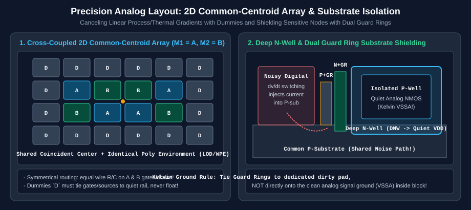
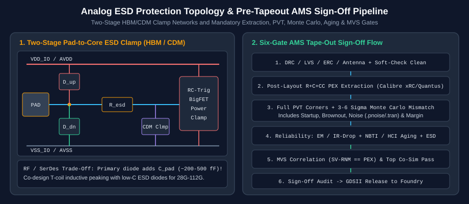

# Analog Layout, Matching, Parasitics, ESD, and AMS Tape-Out Sign-Off

An analog schematic that achieves 85 dB SFDR and 70° phase margin in nominal SPICE can fail completely on silicon if laid out carelessly. In deep sub-micron and FinFET nodes, **device mismatch gradients**, **layout-dependent stress effects (LOD, WPE)**, **metal interconnect R/C parasitics**, **digital substrate noise injection**, **electromigration (EM)**, **transistor aging (BTI/HCI)**, and **ESD clamp capacitance** dictate real wafer performance. This capstone chapter ties physical analog layout mastery together with a comprehensive pre-tapeout AMS Sign-Off Checklist.

---

## Learning Goals

- Apply precision analog layout matching techniques: **unit-cell arrays**, **1D interdigitation**, **2D common-centroid placement**, **dummy perimeter structures**, and **symmetric routing**.
- Account for nanoscale **Layout-Dependent Effects (LDE)**—specifically **Well Proximity Effect (WPE)** and **Length of Diffusion (LOD / STI stress)**—using post-layout extracted checks early.
- Shield sensitive analog nodes from digital switching noise using **Deep N-Well (DNW) isolation pockets**, **dual concentric guard rings**, and **Kelvin star ground routing**.
- Verify post-layout reliability: **R+C+CC Parasitic Extraction (PEX)**, **IR drop**, **Electromigration (EM)**, **NBTI/HCI aging**, and **HBM/CDM ESD protection** without starving high-speed RF/SerDes bandwidth.
- Audit AMS IP readiness prior to GDSII tape-out using a structured **Pre-Tapeout Sign-Off Matrix**.

---

## Layout-Dependent Effects and Transistor Matching Techniques

Matched pairs (differential amplifier inputs, current mirrors, capacitor DAC banks, resistor ladders) face two mismatch mechanisms:
1. **Random Microscopic Fluctuations** (discrete dopant atoms, line-edge roughness): Governed by Pelgrom's Law ($\sigma_{\Delta V_{th}} = A_{V_{th}} / \sqrt{W \cdot L}$). Fixed strictly by increasing active gate area $W \cdot L$.
2. **Deterministic Spatial Gradients &amp; Edge Effects**: Linear wafer-scale oxide thickness, temperature drops across a nearby power FET (`self-heating`), etch loading, and foundry **Layout-Dependent Effects (LDE)**:
   - **Length of Diffusion (LOD / STI Stress)**: Shallow Trench Isolation oxide squeezes adjacent silicon crystal lattices, altering carrier mobility and $V_{th}$ strongly for transistors sitting close to STI boundaries!
   - **Well Proximity Effect (WPE)**: Ion implants scatter off tall photoresist N-well mask walls, raising $V_{th}$ for devices sitting within `1–2 um` of any well edge!

### Common-Centroid + Dummy Layout Rules

Follow these five rules on every precision analog pair (`A` and `B`):
1. **Identical Unit Finger Size &amp; Orientation**: Never flip transistor `B` vertically/horizontally relative to `A` (`rotate 90°` swaps mobility crystal orientation cleanly into massive systematic mismatch!). Always keep **identical poly orientation**!
2. **Interdigitation &amp; 2D Common-Centroid**: Arrange fingers symmetrically around one shared center point (e.g., `A B B A` in 1D, or `A B B A` / `B A A B` cross-quad in 2D) so *any* linear temperature, stress, or oxide gradient affects `A` and `B` equally!
3. **Full Dummy Ring Surrounding Active Array**: Place dummy fingers (`D`) around all four sides—and tie dummy **Gates, Sources, and Drains cleanly to a quiet power/ground rail** (NEVER leave dummy gates floating!). Dummies absorb LOD stress and poly-etch microloading so every active device sees identical neighbors!
4. **Equal WPE Well Spacing**: Extend N-well boundaries symmetrically by `>= 2 um` beyond the outer dummies on all sides.
5. **Symmetric Interconnect &amp; Cross-Coupled Shielding**: Balance metal length, via count, and neighbor coupling capacitance on differential pairs (`IN+`/`IN-` and `OUT+`/`OUT-`) so parasitic RC matches down to sub-femtofarad resolution!

---

## Substrate Noise Coupling, Guard Rings, and Kelvin Shielding

Because digital CMOS blocks inject huge switching current spikes (`dI/dt`) directly into the shared conductive P-type silicon substrate, sensitive analog blocks sitting millimeters away pick up synchronous clock spurs unless physically isolated:

- **Deep N-Well (DNW) Pocket Isolation**: Encloses the analog NMOS P-well inside a buried reverse-biased N-well floor + N-well sidewall ring (`DNW` tied to quiet `AVDD`), blocking low- and mid-frequency substrate noise currents directly!
- **Dual Concentric Guard Rings**: Surround noisy digital blocks (with `P+` substrate ring tied to noisy `DVSS`) AND surround quiet analog blocks (outer `N+` ring to quiet `AVDD`, inner `P+` ring to quiet **dirty guard ring pin**, NOT mixed directly into clean `VSSA` signal reference!).
- **Kelvin (Star) Ground &amp; Supply Routing**: Separate **High-Current Switching Return (`PGND`)** from **Quiet Analog Reference (`AGND / VSSA`)** all the way out to dedicated package bumps/pins—so large transient currents never develop noisy `I*R` offsets across sensitive differential reference points!

> [!WARNING]
> **Check LVS "Soft-Connect" Substrate Rules!** Accidentally dropping a standard digital substrate tap onto clean `VSSA` right next to a noisy `VSS` guard ring shorts clean and dirty grounds directly through the low-resistivity P-substrate (`soft connection`)! Always run foundry **ERC / LVS Soft-Check** to verify clean `VSSA` vs `VSSD` separation.

---

## Parasitic Extraction (PEX), Electromigration, and Aging Sign-Off

Schematic SPICE shows idealized zero-resistance wires; post-layout silicon lives or dies on extracted **`R + C + CC` (Resistance + Capacitance + Cross-Coupling)** netlists (`Calibre xRC` / `Quantus`):

1. **Parasitic Capacitance (`C` &amp; `CC`) Kills Bandwidth &amp; Gain**: Metal routing adds huge parasitic `C_p` onto OTA internal folding nodes (degrading Phase Margin!) and couples noisy clocks directly across unshielded SAR/VCO lines (**shield sensitive differential traces with `VSS` flanking lines and top/bottom metal plates!**).
2. **Parasitic Resistance (`R`) Ruins Matching &amp; Settling**: A `2 ohm` narrow `M1` trace carrying `10 mA` drops `20 mV`, breaking bandgap accuracy and mirror headroom! Size analog current buses generously with redundant multi-via arrays!
3. **Electromigration (EM) &amp; IR Drop**: Unidirectional DC currents in high-current Pass FETs, bias trunks, and output drivers physically migrate metal atoms over years, creating open circuits or shorts. Run EM/IR sign-off (`Voltus-Fi` / `Totem`) across maximum RMS and peak transient currents at `125 C`!
4. **Device Aging (NBTI / PBTI / HCI)**: Over a 10-year product lifetime, negative-bias temperature instability (NBTI) shifts PMOS $|V_{th}|$ upward by `20–50 mV`, while hot-carrier injection (HCI) degrades high-$V_{DS}$ NMOS switches (`charge pumps`, `drivers`). Simulate foundry **RelXpert / MOSRA aging models** on precision Bandgaps, Comparators, and LDOs!

---

## Analog IO ESD Protection Networks and RF Capacitance Trade-Offs

Every external chip pin faces catastrophic electrostatic discharge (**HBM** Human Body Model `2 kV`, **CDM** Charged Device Model `500 V`) during handling and PCB assembly:

### Two-Stage Pad Protection

- **Primary Clamp (`D_up` to `AVDD` + `D_dn` to `AVSS`)**: Shunts massive amperes of HBM ESD current straight onto power rails, where an **RC-Triggered BigFET Power Clamp** turns ON momentarily during nanosecond ESD edges (`>1 V/ns`) yet stays OFF (`nA` leakage) during normal DC power-up!
- **Secondary Clamp + Series `R_esd` (`100–300 ohm`)**: Isolates delicate thin-oxide core receiver gates against ultrafast `~1 ns` **CDM** self-discharge spikes before `D_up`/`D_dn` fully clamp!
- **High-Speed RF / SerDes Dilemma**: Placing standard `300 fF` primary ESD diodes on a `28 GHz` (`112G PAM4`) pad acts like a low-pass dead short! Co-design compact low-capacitance diodes alongside **on-die T-Coil inductive peaking networks** to absorb ESD capacitance into clean `50-ohm` broadband matching (`S11 < -15 dB`)!

---

## Pre-Tapeout AMS Verification Checklist and Foundry Release

Before releasing GDSII masks for fabrication, every AMS IP macro passes through six non-negotiable sign-off gates:

| Sign-Off Gate | Verification Criterion | Primary Proof Artifacts |
| :--- | :--- | :--- |
| **1. Physical Cleanliness** | Zero waivers-unapproved DRC, LVS, ERC, Antenna, Density, and Substrate Soft-Checks | Signed-off `Calibre` / `Pegasus` DRC/LVS reports |
| **2. Post-Layout PEX Coverage** | All critical specs (Gain, PM, Bandwidth, ENOB, Jitter, Settling) re-verified on `R+C+CC` extracted netlist | PEX vs Schematic regression delta table |
| **3. Extreme PVT &amp; Startup** | Full `FF/SS/TT/SF/FS` x Voltage (`+/-10%`) x Temp (`-40C..+125C`) + slow/fast ramp startup &amp; brownout sweeps pass | Multi-corner `.tran` &amp; `.stb` pass summary (`PM >= 60°`) |
| **4. Monte Carlo Mismatch** | `>= 200–1000` MC seeds proving 3-sigma / 6-sigma specs (BGR `mV`, ADC INL/DNL, Comp offset + calibration range) | MC histogram plots + calibration margin coverage |
| **5. Reliability &amp; Safety** | EM/IR drop clean (`<= 100% EM limit`), Aging (`10 yr` EOL) within spec, Oxide overvoltage `.measure` clean, HBM/CDM ESD verified | `Voltus-Fi`/`Totem` EM reports + Aging/ESD sign-off |
| **6. MVS &amp; SoC Integration** | Automated MVS (`SV-RNM == PEX`) passes tolerance bounds; top-level Co-Sim (`UPF`/`Connect Rules`) verifies all digital-analog handshakes | MVS correlation suite + SoC mixed-signal sign-off report |

---

## Best Practices and Common Pitfalls

1. **Run Critical Block PEX Early ("Early-Extract Habit")**: Never wait until layout is 100% polished before extracting parasites—run quick C-only / RC extraction right after core placement (`OTA diff-pair`, `VCO tank`, `StrongARM latch`) so routing surprises are caught while moving blocks is cheap!
2. **Do Not Use Minimum-Width Analog Wires Inside Current Mirrors or References**: Minimum `M1` width exhibits huge metal variation (`+/- 15%`) and tight EM current limits! Route precision bias currents and output rails on wider upper metals (`M3/M4`) with double/triple redundant vias.
3. **Never Connect ESD BigFET Clamps Directly to Ultra-Quiet Bandgap Outputs Without Checking Leakage**: BigFET clamps leak significantly at `+125 C` (`uA` range!), which can collapse high-impedance bandgap nodes or bias trunks unless kept strictly on `AVDD`/`AVSS` power rails!
4. **Keep Calibration Trim Headroom Above `3x` Worst-Case MC Drift**: If Monte Carlo predicts $3\sigma$ comparator offset or RC cutoff spread of `+/- 25 mV` (`+/- 20%`), size your digital calibration DAC range to **`+/- 60 mV` (`+/- 40%`)** so aging (`+10 yr`) and unexpected wafer shifts never saturate trim pins at the rail!

---

## Practical Exercises with Solutions

### Exercise 1 Designing a 1D & 2D Common-Centroid Pattern for a Matched Mirror

A precision `1:2` current mirror uses unit-finger devices where transistor `M1` has **2 unit fingers (`A`)** and `M2` has **4 unit fingers (`B`)**, surrounded by dummy edges (`D`).

1. Propose a **1D symmetric common-centroid interdigitated row** (`A`, `B`, `D`). Confirm both the geometric centroids of `A` and `B` coincide identically!
2. Why does adding explicit **`D` dummies** at both ends matter in nanoscale FinFET/planar processes?

#### Solution

1. **1D Common-Centroid Row (`8` total cells including outer dummies)**:
   $$\text{D} \;\; \text{B} \;\; \text{A} \;\; \text{B} \;\; \text{B} \;\; \text{A} \;\; \text{B} \;\; \text{D}$$
   - Let unit cell centers sit at positions $x = 1, 2, 3, 4, 5, 6, 7, 8$:
   - **Centroid of `A`** (positions `3` and `6`): $\bar{x}_A = \frac{3 + 6}{2} = \mathbf{4.5}$.
   - **Centroid of `B`** (positions `2, 4, 5, 7`): $\bar{x}_B = \frac{2 + 4 + 5 + 7}{4} = \frac{18}{4} = \mathbf{4.5}$.
   - Both centroids coincide identically at `x = 4.5` (`perfect linear gradient cancellation`!), and even **quadratic gradients** are strongly balanced!
2. **Role of Outer Dummies (`D`)**: Without `D` at ends (`1` and `8`), outer `B` fingers sit directly adjacent to STI oxide trenches (absorbing asymmetric **LOD compressive stress** and different photolithography/etch spacing), shifting their $V_{th}$ and mobility compared to inner `A` fingers! Dummies equalize the physical edge environment around every active `A` and `B` finger.

---

### Exercise 2 Fixing a Substrate Coupling Spur in a High-Resolution ADC

During lab bring-up (and replicated later in 3D substrate extraction), a 14-bit SAR ADC exhibits a sharp deterministic `-58 dBc` spur at `f_clk = 200 MHz` whenever an adjacent digital DSP tile runs, even though the ADC uses a clean separate external `AVDD` bondpad! Layout review finds both the digital DSP standard cells and the SAR comparator NMOS devices sit directly in the same P-substrate, AND the analog guard ring connects directly onto clean `VSSA` right inside the SAR block.

Identify **two physical layout flaws** causing the spur and fix both cleanly!

#### Solution

1. **Flaw 1 (No DNW + Unisolated Shared P-Substrate)**: Even with separate `AVDD` pads, fast `dv/dt` digital NMOS switching pumps AC currents through the shared P-substrate directly into the bulk terminals of the SAR comparator and CDAC switches (**body effect modulation!**).
   - **Fix**: Wrap the analog SAR core (especially dynamic comparators and sensitive switches) inside a **Deep N-Well (DNW)** pocket biased to quiet `AVDD`, isolating its local P-well from global P-substrate bounce!
2. **Flaw 2 (Guard Ring Polluting Clean `VSSA`)**: Tying the substrate guard ring directly onto clean `VSSA` inside the SAR routed all captured digital substrate currents right onto the SAR's precision `0 V` sampling/DAC reference ground (`I*R` bounce)!
   - **Fix**: Route the outer guard ring (`P+` collector) to a **separate dedicated noisy guard/shield bondpad (`VSSA_SHIELD` or `VSS_DIG`)** rather than contaminating precision `VSSA`!

---

### Exercise 3 Auditing an Incomplete Pre-Tapeout Sign-Off Package

During pre-tapeout review for a `4 GHz` Fractional-N PLL macro, the designer shows you passing results for:
- Schematic SPICE `.tran` lock acquisition at `TT / 25 C`
- DRC & LVS clean
- Schematic `.pss` phase noise at `TT / 25 C`

List **five critical missing AMS sign-off checks** you must demand before approving GDSII release!

#### Solution

1. **Post-Layout Extracted PEX (`R+C+CC`) Re-Verification**: Parasitic `VCO` routing capacitance shifts center frequency `f_0`, cuts tuning range, and adds loop-filter/divider skew—all stability (`PM`), lock time, and tuning range corners must pass on extracted **PEX**!
2. **Full PVT Corners + Startup Sweeps**: Test all slow/fast corners (`SS/-40 C` worst tuning/startup vs `FF/+125 C` highest charge-pump leakage and VCO gain!) to confirm VCO covers `4.0 GHz` cleanly with frequency-band margin (`>= 15%`).
3. **Closed-Loop `.stb` Phase Margin & Reference Spur Verification**: Check loop stability (`PM >= 55–65°`) across PVT and verify CP current mismatch + leakage don't create excessive reference/fractional spurs!
4. **EM / IR Drop + Aging (`10-Year` Reliability)**: Verify VCO tank spiral inductor + charge-pump power buses pass electromigration limits at `125 C`, and check NBTI/HCI $V_{th}$ drift doesn't stall lock after 10 years.
5. **MVS Correlation & Supply-Aware SoC Co-Simulation**: Prove the behavioral `SV-RNM` model matches extracted PEX timing/lock flags and pass top-level mixed-signal co-sim verifying digital `div_n` / `FCW`, reset, lock-detect handshake, and `vsup` connect rules!

---

##### Copyright (c) 2026 squared-studio
