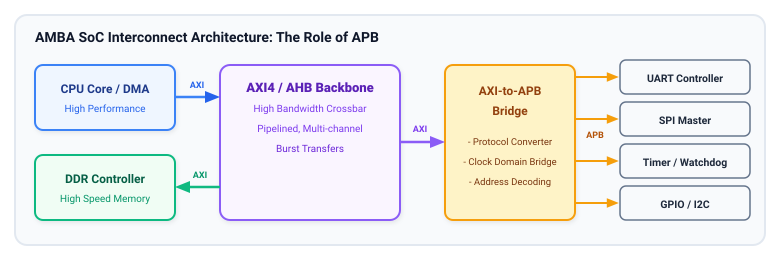
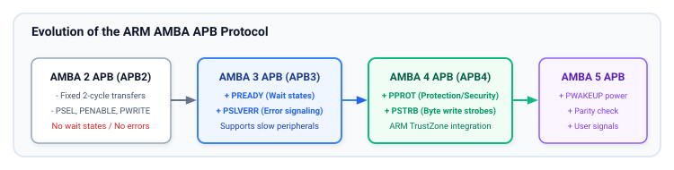

# Chapter 1: Introduction to the APB Protocol and AMBA Ecosystem

The **Advanced Peripheral Bus (APB)** is a foundational component of the **ARM Advanced Microcontroller Bus Architecture (AMBA)** family. Designed specifically for energy-efficient, low-bandwidth, and low-complexity peripheral connectivity, APB provides an unpipelined, synchronous protocol tailored to configure control registers, monitor status flags, and interface with slow system peripherals.

Unlike high-performance interconnects such as AXI or AHB, which feature multi-channel split transactions, burst transfers, and complex out-of-order execution, APB focuses on **minimal gate count**, **predictable latency**, and **ease of peripheral integration**.

---

## 1. The AMBA Interconnect Hierarchy

Modern System-on-Chip (SoC) architectures divide bus communication into hierarchical layers to balance throughput, memory bandwidth, latency, and power consumption.



### System Tiers and Bus Roles

| Bus Protocol | Throughput / Bandwidth | Latency | Complexity / Gate Count | Primary System Function |
| :--- | :--- | :--- | :--- | :--- |
| **AXI4 / AXI5** | Very High (Multiple GB/s, 5 independent channels) | Low (Out-of-order, split transactions) | High (~30k+ gates per interconnect node) | Multi-core processors, DDR memory controllers, DMA engines, high-speed PCIe/Ethernet MACs |
| **AHB-Lite / AHB5** | Medium-High (Single shared bus, pipelined) | Low (Single-cycle pipelined address/data) | Moderate (~5k–10k gates) | On-chip SRAM controllers, flash controllers, cryptographic accelerators |
| **APB3 / APB4 / APB5** | Low-Moderate (Word-by-word register access) | Fixed/Wait-state (2+ cycles per transfer) | Minimal (~500–1,500 gates per peripheral interface) | Control/Status Registers (CSRs), UART, SPI, I2C, Timers, Watchdogs, GPIO, Interrupt Controllers |

In this hierarchy, APB never serves as a primary memory bus. Instead, an **AXI-to-APB** or **AHB-to-APB bridge** translates bursty, high-speed system transactions into simple, serialized register accesses across the peripheral subsystem.

---

## 2. Evolution of the APB Specification

ARM introduced APB in the late 1990s as part of AMBA 2.0. Over successive AMBA releases, APB has evolved to accommodate deeper wait states, standardized error reporting, sub-word memory access, hardware virtualization, and TrustZone security.



### Historical Progression Across Generations

#### APB2 (AMBA 2.0 Specification)
The original APB definition established the fundamental 2-cycle protocol:
- **Setup Phase:** The bridge asserts the slave select line (`PSELx`) and drives address (`PADDR`) and direction (`PWRITE`).
- **Enable Phase:** The bridge asserts `PENABLE`. The transfer completes unconditionally at the end of this cycle.
- **Limitation:** Every transfer takes strictly two clock cycles. Peripherals cannot stall the bus if they require internal processing cycles, and there is no mechanism to signal a hardware error.

#### APB3 (AMBA 3.0 Specification)
To overcome the fixed-latency limitations of APB2 without introducing complex multi-beat pipelining, AMBA 3 introduced two critical signals:
1. **`PREADY` (Slave Ready):** Allows the peripheral to introduce wait states by extending the Enable (Access) phase until internal operations complete.
2. **`PSLVERR` (Slave Error):** Enables the peripheral to notify the bus master of access faults (e.g., unmapped register accesses, parity errors, or write-protection violations).

#### APB4 (AMBA 4.0 Specification)
As SoCs integrated 64-bit interconnects and ARM TrustZone security extensions, APB4 bridged the architectural gap by adding:
1. **`PSTRB` (Write Byte Strobes):** Dedicated lane strobes allowing sparse byte, half-word, and unaligned writes over a 32-bit or 64-bit data bus.
2. **`PPROT` (Protection Signals):** A 3-bit attribute vector indicating whether an access is Privileged vs. Normal, Secure vs. Non-Secure, and Data vs. Instruction.

#### APB5 (AMBA 5.0 Extensions)
Modern AMBA 5 APB introduces enterprise and automotive safety extensions:
- **Parity / Checksum Signals:** Bus-level transient fault detection (`PCHK`, `PDCHK`) for ISO 26262 ASIL-D functional safety compliance.
- **User Sideband Signals (`PAUSER`, `PWUSER`, `PRUSER`, `PBUSER`):** Proprietary metadata routing across complex SoC topologies.
- **Low-Power Wakeup (`PWAKEUP`):** Asynchronous wake indication permitting power domain gating of the peripheral subsystem during system sleep.

---

## 3. Fundamental Design Principles of APB

APB achieves its low silicon overhead and low dynamic power consumption through deliberate protocol constraints:

```
+--------------------------------------------------------------------------------+
|                             CORE DESIGN ATTRIBUTES                             |
+--------------------------------------------------------------------------------+
|  1. Non-Pipelined Operation  : Only one active transfer exists at any time.    |
|                                Address and Data phases are strictly linked.    |
|  2. Single Master Topology   : Only the APB Bridge initiates transfers.        |
|                                No arbitration logic is required on the bus.    |
|  3. Simple Slave Interface   : Peripherals decode static signals without       |
|                                complex FIFO buffering or tracking queues.      |
|  4. Low Switching Activity   : Address and control buses toggle only during    |
|                                valid transfers, minimizing dynamic power.      |
+--------------------------------------------------------------------------------+
```

### Why APB Remains Dominant in Modern SoCs
Despite advances in multi-gigahertz interconnect fabrics, APB remains the industry standard for peripheral control because:
1. **Verification Simplicity:** With only three protocol states (`IDLE`, `SETUP`, `ACCESS`), exhaustive verification and formal property coverage can be completed rapidly.
2. **Timing Closure:** Because transactions are unpipelined and peripheral frequencies are often decoupled from CPU frequencies via the APB bridge, timing closure is straightforward even in advanced silicon nodes.
3. **Silicon Area:** An APB slave register decoder requires a fraction of the flip-flops and combinatorial logic needed for an AXI slave interface, saving valuable die area across dozens of low-speed peripherals.

---

## 4. Key Takeaways and Chapter Summary

- **Role:** APB is AMBA's lightweight, non-pipelined peripheral bus designed for configuration registers and low-throughput interfaces.
- **Bridge-Driven:** In modern SoCs, an AXI-to-APB or AHB-to-APB bridge acts as the single master, translating high-speed multi-beat bursts into serialized APB register cycles.
- **Generational Milestones:** 
  - **APB2** provided fixed 2-cycle transfers.
  - **APB3** added variable wait states (`PREADY`) and fault reporting (`PSLVERR`).
  - **APB4** introduced byte enables (`PSTRB`) and security attributes (`PPROT`).
  - **APB5** brought automotive safety check bits and low-power wake control.

---

## 5. Review Questions

1. Why is an unpipelined protocol like APB preferable for peripheral control registers compared to a high-performance pipelined protocol like AXI4?
2. Which signal was added in APB3 to allow slow peripherals to delay the completion of a transaction, and what are its operational constraints?
3. How does the APB bridge eliminate the need for multi-master arbitration logic on the peripheral bus?
4. What architectural feature did APB4 introduce to support ARM TrustZone security enforcement at the peripheral register level?

##### Copyright (c) 2026 squared-studio

