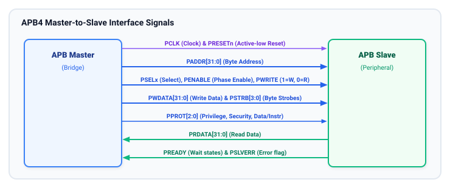
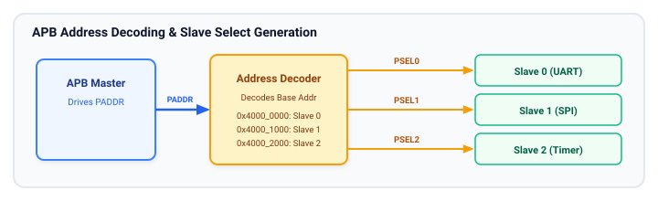

# APB Interface Signals and Architecture

The APB protocol defines a compact, synchronous interface between a single bus requester (the **APB Bridge**) and one or more completers (the **APB Slaves**). This chapter details the complete signal dictionary across APB3 and APB4 specifications, signal polarity, clocking and reset requirements, and the multi-slave address decoding architecture.

---

## APB Signal Dictionary

The APB interface relies on dedicated unidirectional signals for clocking, reset, address distribution, transfer control, data exchange, and status signaling.



### Comprehensive Signal Specification

| Signal Name   | Source           | Destination    | Protocol Version | Width (Bits)     | Description                                                                                          |
| :------------ | :--------------- | :------------- | :--------------- | :--------------- | :--------------------------------------------------------------------------------------------------- |
| **`PCLK`**    | Clock Source     | Master & Slave | APB2+            | 1                | **Peripheral Clock.** All bus transitions occur relative to the rising edge of `PCLK`.               |
| **`PRESETn`** | Reset Controller | Master & Slave | APB2+            | 1                | **Active-LOW Asynchronous Reset.** Resets all bus interface flip-flops to known initial states.      |
| **`PADDR`**   | Master           | Slave          | APB2+            | Up to 32 (or 64) | **Peripheral Address Bus.** Carries the byte address driven by the master during transfers.          |
| **`PSELx`**   | Master / Decoder | Slave `x`      | APB2+            | 1 per slave      | **Peripheral Select.** Dedicated chip-select asserted by the bridge when slave `x` is targeted.      |
| **`PENABLE`** | Master           | All Slaves     | APB2+            | 1                | **Peripheral Enable.** Strobe indicating the second (and subsequent) cycle of an active transfer.    |
| **`PWRITE`**  | Master           | All Slaves     | APB2+            | 1                | **Transfer Direction.** HIGH indicates a write operation; LOW indicates a read operation.            |
| **`PWDATA`**  | Master           | All Slaves     | APB2+            | 8, 16, 32, or 64 | **Write Data Bus.** Driven by the master during write transfers. Typically 32 bits wide.             |
| **`PRDATA`**  | Slave            | Master         | APB2+            | 8, 16, 32, or 64 | **Read Data Bus.** Driven by the selected slave during read transfers.                               |
| **`PREADY`**  | Slave            | Master         | APB3+            | 1                | **Peripheral Ready.** Driven by the selected slave to indicate readiness to complete the transfer.   |
| **`PSLVERR`** | Slave            | Master         | APB3+            | 1                | **Peripheral Slave Error.** Driven by the slave during the final cycle to flag an error condition.   |
| **`PSTRB`**   | Master           | All Slaves     | APB4+            | `DATA_WIDTH / 8` | **Write Byte Strobes.** Indicates which byte lanes contain valid write data during write transfers.  |
| **`PPROT`**   | Master           | All Slaves     | APB4+            | 3                | **Protection Vector.** Identifies access privilege level, security level, and instruction/data type. |

---

## Clock and Reset Semantics

### Clocking Discipline (`PCLK`)

All APB transfers are synchronous to the **rising edge** of `PCLK`.

- In a typical SoC, `PCLK` runs at an integer divisor of the main system clock (e.g., `HCLK/2`, `HCLK/4`, or `ACLK/8`) to conserve dynamic power.
- Internal slave sequential logic must sample all input control and data signals exclusively on the rising edge of `PCLK`.

### Reset State Rules (`PRESETn`)

The reset signal `PRESETn` is active-LOW. When `PRESETn` is asserted (LOW):

1. The bridge **MUST** deassert all `PSELx` lines to `0`.
2. The bridge **MUST** deassert `PENABLE` to `0`.
3. The bridge may drive `PADDR`, `PWRITE`, and `PWDATA` to unknown (`X`) or benign default values.
4. All slaves must initialize their state machines to the `IDLE` state.
5. Slaves must deassert `PREADY` and `PSLVERR` or leave them in their defined quiescent reset state.

```
PCLK      : ___/---\___/---\___/---\___/---\___/---\___/---\___/---\___
PRESETn   : --------\_______________________/---------------------------
                      <--- Reset Active --->
PSELx     : --------------------------------\___________________________ (Driven LOW)
PENABLE   : --------------------------------\___________________________ (Driven LOW)
```

---

## Multi-Slave Address Decoding Architecture

In an APB subsystem, there is only **one** APB master (the bridge), but there can be dozens of peripheral slaves (e.g., UART0, UART1, SPI0, I2C0, Timer0).



### Central Address Decoder

The APB bridge contains or drives a **Central Address Decoder**:

- The decoder receives the high-order bits of the transaction address (`PADDR[31:N]`).
- Based on the memory map configured in the SoC, the decoder asserts exactly **one** `PSELx` line corresponding to the targeted peripheral.
- If an access targets an unmapped region in the peripheral memory space, the decoder can either withhold all `PSELx` lines or assert a dummy default slave that responds with `PSLVERR = 1`.

### Address Bus Fanout

Unlike multi-master buses requiring distributed arbitration, APB uses a shared broadcast bus:

- The address bus (`PADDR`), direction (`PWRITE`), byte strobes (`PSTRB`), and protection attributes (`PPROT`) fan out to **all** connected peripherals in parallel.
- A peripheral ignores all broadcast signals unless its dedicated `PSELx` input is asserted.

### Read Data Multiplexing

Because on-chip tri-state buses are strictly prohibited in modern deep-submicron CMOS ASIC design (due to floating bus floating states, power consumption, and DFT/testability issues), APB uses a **Central Multiplexer**:

- Each slave drives its own local `PRDATA` and `PREADY` / `PSLVERR` signals back to the central bridge.
- The central multiplexer uses the active `PSELx` selection to route the selected slave's `PRDATA`, `PREADY`, and `PSLVERR` back to the bridge logic.
- Unselected slaves may drive their read outputs to zero to minimize dynamic wire switching.

---

## Signal Timing Constraints and Invariants

To guarantee interoperability across diverse IP vendors, the APB specification defines rigid protocol invariants:

### Address and Control Stability

During any active transfer (from the start of the `SETUP` phase through the final completion cycle of the `ACCESS` phase), the following signals **must remain completely static**:

- `PADDR` (Address)
- `PWRITE` (Direction)
- `PSELx` (Slave Select)
- `PPROT` (Protection attributes)
- `PSTRB` (Write strobes)
- `PWDATA` (Write data)

If a slave asserts wait states by keeping `PREADY = 0`, the master **must never change** any of these signals until the cycle after `PREADY` is driven HIGH.

### Enable Assertion Invariant

- `PENABLE` **must never** be asserted in the same cycle that `PSELx` transitions from LOW to HIGH.
- `PENABLE` must be asserted exactly **one clock cycle** after `PSELx` is asserted.
- Once asserted, `PENABLE` must remain HIGH continuously until `PREADY` is sampled HIGH.

### Read Data Sampling Window

For read operations (`PWRITE = 0`):

- The slave is not required to provide valid `PRDATA` during the `SETUP` phase.
- Valid `PRDATA` is required **only** on the rising edge of `PCLK` where both `PENABLE = 1` and `PREADY = 1`.

---

## Key Takeaways and Chapter Summary

- **Point-to-Multipoint:** A single master controls a shared broadcast bus (`PADDR`, `PWDATA`, `PWRITE`, `PENABLE`, `PSTRB`, `PPROT`) fanned out to all slaves.
- **Dedicated Selection:** Individual `PSELx` lines are generated by a central address decoder based on the high-order address bits.
- **Multiplexed Return:** Slaves return `PRDATA`, `PREADY`, and `PSLVERR` through a central multiplexer back to the bridge.
- **Stability Rule:** Master signals must remain completely static while a transfer is active and awaiting `PREADY = 1`.

---

## Review Questions

1. Why are tri-state bidirectional buses avoided in modern APB peripheral interconnects, and what design topology is used instead?
2. What are the mandatory reset values for `PSELx` and `PENABLE` when `PRESETn` is asserted LOW?
3. Which signals must remain completely stable if a slave holds `PREADY = 0` for four clock cycles during an `ACCESS` phase?
4. If an APB master drives `PENABLE = 1` simultaneously with the assertion of `PSELx = 1`, is this compliant with the AMBA APB specification? Why or why not?

##### Copyright (c) 2026 squared-studio
