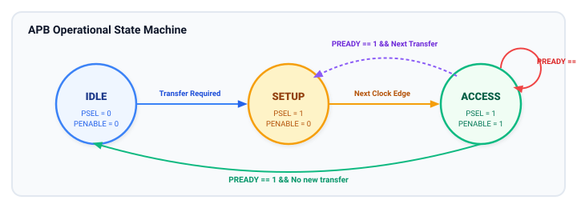
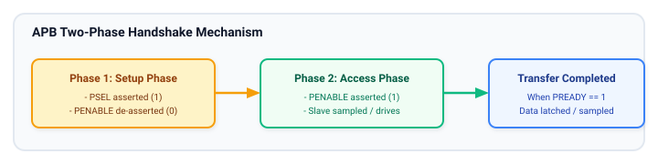

# Operational State Machine and Handshake Mechanism

The operation of the APB protocol is governed by an elegant, deterministic **three-state finite state machine (FSM)**. Every bus transaction—whether a single-word read, a control register write, or a stalled wait-state operation—moves through these three standardized phases.

Understanding the state machine transitions and the exact handshake completion conditions is the key to designing compliant, bug-free APB bridges and peripheral slaves.

---

## The APB Three-State Finite State Machine

The AMBA APB specification defines three mutually exclusive states: **`IDLE`**, **`SETUP`**, and **`ACCESS`**.



### Detailed State Descriptions

#### `IDLE` (Default Dormant State)
- **Definition:** The bus is inactive; no transfer is in progress.
- **Signal Conditions:** 
  - `PSELx = 0` (for all slaves)
  - `PENABLE = 0`
- **Behavior:** The bridge logic does not drive valid peripheral requests. The address and data buses are don't-care (often parked at previous values to prevent unnecessary wire charging and power dissipation).
- **Exit Condition:** When the bridge receives a transfer request from the upstream system bus (e.g., AXI/AHB), it transitions to `SETUP` on the next rising clock edge.

#### `SETUP` (Address & Control Strobe Phase)
- **Definition:** The start of an active bus transfer.
- **Duration:** Strictly **one clock cycle**.
- **Signal Conditions:** 
  - Target `PSELx` is asserted (`1`).
  - `PENABLE` is deasserted (`0`).
  - `PADDR`, `PWRITE`, `PPROT`, and `PSTRB` are driven to valid values.
  - If it is a write transfer, `PWDATA` is also driven.
- **Behavior:** The selected slave detects its `PSELx` going HIGH with `PENABLE = 0` and registers the incoming address and direction.
- **Exit Condition:** The FSM **unconditionally transitions** from `SETUP` to `ACCESS` on the next rising edge of `PCLK`. It can never remain in `SETUP` for more than one clock cycle.

#### `ACCESS` (Enable & Handshake Phase)
- **Definition:** The execution and data transfer phase.
- **Duration:** **One or more clock cycles** (governed by `PREADY`).
- **Signal Conditions:** 
  - Target `PSELx` remains asserted (`1`).
  - `PENABLE` is asserted (`1`).
  - All address and control lines remain stable.
- **Behavior:** 
  - If writing, the slave captures `PWDATA` into internal registers.
  - If reading, the slave drives read data onto `PRDATA`.
  - The slave samples its internal ready status and drives `PREADY`.
- **Exit Condition:**
  - If `PREADY = 0`, the FSM **must remain in `ACCESS`** for additional wait states.
  - If `PREADY = 1`, the transfer completes on the rising edge of `PCLK`.
    - If another transfer is queued immediately, the FSM transitions directly to `SETUP` for the next transaction.
    - If no transfer is pending, the FSM transitions back to `IDLE`.

---

## State Transition Logic Table

The table below summarizes the exact formal transition conditions for the APB master state machine:

| Current State | Condition / Inputs | Next State | Master Signal Output Assertions |
| :--- | :--- | :--- | :--- |
| **`IDLE`** | No transfer requested (`Transfer_Req = 0`) | `IDLE` | `PSELx = 0`, `PENABLE = 0` |
| **`IDLE`** | New transfer requested (`Transfer_Req = 1`) | `SETUP` | Assert target `PSELx = 1`, drive `PADDR`, `PWRITE`, `PWDATA` (if write); `PENABLE = 0` |
| **`SETUP`** | Unconditional (always after 1 cycle) | `ACCESS` | Keep `PSELx = 1`, keep address/data stable; assert `PENABLE = 1` |
| **`ACCESS`** | Slave not ready (`PREADY = 0`) | `ACCESS` | Keep `PSELx = 1`, `PENABLE = 1`, address/data completely static |
| **`ACCESS`** | Slave ready (`PREADY = 1`) AND pending transfer | `SETUP` | Deassert `PENABLE = 0`, assert target `PSELx = 1` (same or new slave), drive new `PADDR`/data |
| **`ACCESS`** | Slave ready (`PREADY = 1`) AND no transfer | `IDLE` | Deassert `PSELx = 0`, deassert `PENABLE = 0` |

---

## The Handshake Mechanism: `PSEL`, `PENABLE`, and `PREADY`

The completion of any APB transfer requires a 3-way logical intersection:

$$\text{Transfer Complete} = (\text{PSELx} == 1) \ \land \ (\text{PENABLE} == 1) \ \land \ (\text{PREADY} == 1)$$



### Phase-by-Phase Responsibilities

```
    Cycle T1 (SETUP)         Cycle T2 (ACCESS - Wait)   Cycle T3 (ACCESS - Complete)
PCLK       : __/--\__/--\__/--\__/--\__/--\__/--\__/--\__/--\__/--\__
State      : [  IDLE  ] [  SETUP  ] [      ACCESS      ] [  IDLE  ]
PSELx      : ___________/--------------------------------\___________
PENABLE    : _______________________/--------------------\___________
PADDR/DATA : -----------<====== Valid ======>------------<===========
PREADY     : --------------------------------/-----------\___________
Handshake  : (None)        (None)           (Stalled)    (Completed!)
```

#### Requester (Bridge) Responsibilities:
1. **At T1 (Entry to `SETUP`):**
   - Decode target address from system bus.
   - Assert `PSELx` for the specific slave.
   - Drive valid address `PADDR`, direction `PWRITE`, write strobes `PSTRB`, and protection `PPROT`.
   - If `PWRITE = 1`, drive valid `PWDATA`.
   - Maintain `PENABLE = 0`.
2. **At T2 (Entry to `ACCESS`):**
   - Assert `PENABLE = 1`.
   - Hold all other signals static.
3. **During `ACCESS`:**
   - Sample `PREADY` on every rising edge of `PCLK`.
   - If `PREADY = 0`, hold all outputs static. Do not alter `PADDR`, `PWDATA`, `PSELx`, or `PENABLE`.
4. **At Handshake Completion:**
   - On the rising edge where `PREADY = 1`:
     - If reading (`PWRITE = 0`), sample `PRDATA` and `PSLVERR`.
     - If writing (`PWRITE = 1`), sample `PSLVERR`.
   - In the subsequent cycle, either drop `PENABLE` and `PSELx` to `0` (return to `IDLE`) or immediately enter `SETUP` for the next access.

#### Completer (Slave) Responsibilities:
1. **During `SETUP` (`PSELx = 1`, `PENABLE = 0`):**
   - Decode internal register offset from `PADDR`.
   - Begin internal address decoding or memory array precharge.
   - Do not commit state modifications to internal registers.
2. **During `ACCESS` (`PSELx = 1`, `PENABLE = 1`):**
   - If the peripheral requires internal wait states, drive `PREADY = 0`.
   - If reading, drive valid data onto `PRDATA` as soon as ready, and drive `PREADY = 1`.
   - If writing, write `PWDATA` into internal storage on the rising edge where `PREADY = 1`.
   - If an error occurred (e.g. invalid address or parity fault), assert `PSLVERR = 1` concurrently with `PREADY = 1`.

---

## Key Protocol Invariants and Edge Cases

### Can a Master Deassert `PSELx` or `PENABLE` Before `PREADY = 1`?
**No.** AMBA APB strictly forbids aborting a transfer once initiated. A master cannot revoke a transfer midway. It must wait until the slave asserts `PREADY = 1`. If a slave hangs permanently with `PREADY = 0`, the entire APB bus is stalled (a hardware watchdog or bus timeout mechanism in the bridge is typically required in safety-critical SoCs to break deadlocks).

### Can `PENABLE` Be Asserted in `SETUP`?
**No.** `PENABLE` must strictly be LOW in `SETUP` and HIGH in `ACCESS`. If `PENABLE` is asserted simultaneously with `PSELx`, slaves designed to latch address on the `SETUP` phase will fail.

### Can `PREADY` Be Permanently Tied High?
**Yes.** For simple, zero-wait-state register blocks (such as a standard configuration register or GPIO bank), `PREADY` can be tied statically to logic `1`. In that case, every transfer lasts exactly two clock cycles (`SETUP` followed by a single-cycle `ACCESS`), perfectly matching legacy APB2 behavior.

---

## Key Takeaways and Chapter Summary

- **Three Protocol States:** `IDLE` (no transfer), `SETUP` (1-cycle address strobe), and `ACCESS` (data phase with wait states).
- **Handshake Condition:** Completion occurs strictly when `PSELx = 1`, `PENABLE = 1`, and `PREADY = 1` simultaneously on the rising clock edge.
- **No Abort:** Once `SETUP` is entered, the master cannot abort the transfer; it must remain in `ACCESS` until the slave drives `PREADY = 1`.
- **Zero-Wait Slaves:** Peripherals that do not need wait states can tie `PREADY = 1`, resulting in fixed 2-cycle transfers.

---

## Review Questions

1. Describe the exact signal values of `PSELx` and `PENABLE` in each of the three APB states (`IDLE`, `SETUP`, `ACCESS`).
2. Why is the `SETUP` state strictly limited to exactly one clock cycle?
3. What occurs if an APB master attempts to change `PADDR` or `PWDATA` while in the `ACCESS` state with `PREADY = 0`? Which protocol rule is violated?
4. Under what exact conditions can the APB state machine transition directly from `ACCESS` to `SETUP` without passing through `IDLE`?

##### Copyright (c) 2026 squared-studio

