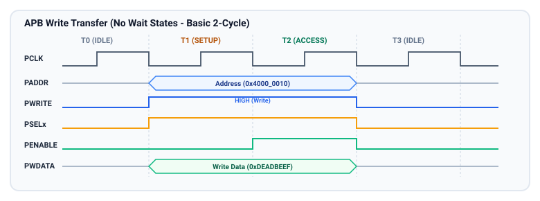
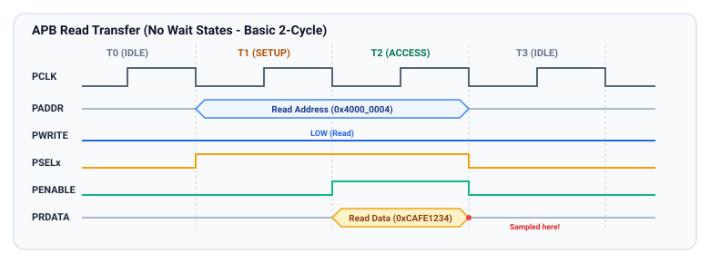

# Basic Transfers: Write and Read without Wait States

In the baseline APB protocol (and in APB3/APB4 systems when `PREADY` is driven HIGH), every transaction completes in **strictly two clock cycles**:
1. The **`SETUP` Phase** (Cycle 1): The bridge drives address, control, and (if writing) data.
2. The **`ACCESS` Phase** (Cycle 2): The bridge asserts `PENABLE`, and the data is transferred.

This chapter walks through cycle-by-cycle operational mechanics of basic write and read transfers without wait states, as well as back-to-back continuous transfers.

---

## APB Basic Write Transfer (Without Wait States)

A basic write transfer transfers write data (`PWDATA`) from the master (bridge) to the targeted peripheral register.



### Cycle-by-Cycle Breakdown: Write Transfer

| Time Mark / Clock Edge | Bus Phase | Master Action | Slave Action | Signal Values |
| :--- | :--- | :--- | :--- | :--- |
| **Before T1** | `IDLE` | No active transfer. Bus in quiescent state. | Inactive. Outputs quiescent. | `PSEL = 0`, `PENABLE = 0` |
| **At T1 (Rising Edge)** | `SETUP` Starts | Drives address onto `PADDR`. Sets `PWRITE = 1`. Asserts target `PSEL = 1`. Drives write data onto `PWDATA`. Keeps `PENABLE = 0`. | Observes `PSEL = 1` and `PENABLE = 0`. Decodes internal register address from `PADDR`. | `PSEL = 1`, `PENABLE = 0`, `PWRITE = 1`, `PADDR = A1`, `PWDATA = D1` |
| **At T2 (Rising Edge)** | `ACCESS` Starts | Asserts `PENABLE = 1`. Maintains `PADDR`, `PWRITE`, `PSEL`, and `PWDATA` static. | Detects `PENABLE = 1`. Prepares to latch write data. Slave drives `PREADY = 1`. | `PSEL = 1`, `PENABLE = 1`, `PREADY = 1`, `PWDATA = D1` |
| **At T3 (Rising Edge)** | Transfer Finishes | Samples `PREADY = 1`. Deasserts `PSEL = 0` and `PENABLE = 0` (returning to `IDLE`). | Latches `PWDATA` into targeted register on the rising edge of T3. Deasserts `PREADY`. | Transition to `IDLE` (`PSEL = 0`, `PENABLE = 0`) |

### Key Signal Invariants During Write:
- **`PWDATA` Setup Time:** The master **must drive `PWDATA` concurrently with `PADDR` at the start of the `SETUP` phase (T1)**. It is invalid under the APB specification to delay driving `PWDATA` until the `ACCESS` phase (T2).
- **Static Hold:** Between T1 and T3, `PADDR`, `PWRITE`, `PSEL`, and `PWDATA` must not glitch or change value.
- **Data Capture:** The slave reliably latches `PWDATA` on the rising clock edge of T3 because `PSEL`, `PENABLE`, and `PREADY` are all verified HIGH.

---

## APB Basic Read Transfer (Without Wait States)

A basic read transfer requests data from a peripheral register and returns it to the master via `PRDATA`.



### Cycle-by-Cycle Breakdown: Read Transfer

| Time Mark / Clock Edge | Bus Phase | Master Action | Slave Action | Signal Values |
| :--- | :--- | :--- | :--- | :--- |
| **Before T1** | `IDLE` | Bus dormant. `PSEL = 0`, `PENABLE = 0`. | Quiescent state. `PRDATA` don't-care. | `PSEL = 0`, `PENABLE = 0` |
| **At T1 (Rising Edge)** | `SETUP` Starts | Drives address onto `PADDR`. Sets `PWRITE = 0`. Asserts target `PSEL = 1`. Keeps `PENABLE = 0`. | Observes `PSEL = 1` and `PENABLE = 0`. Decodes target register address. | `PSEL = 1`, `PENABLE = 0`, `PWRITE = 0`, `PADDR = A1` |
| **At T2 (Rising Edge)** | `ACCESS` Starts | Asserts `PENABLE = 1`. Keeps `PADDR`, `PWRITE`, and `PSEL` static. | Reads internal register. Drives valid read data onto `PRDATA`. Drives `PREADY = 1`. | `PSEL = 1`, `PENABLE = 1`, `PREADY = 1`, `PRDATA = D1` |
| **At T3 (Rising Edge)** | Transfer Finishes | Samples `PRDATA` on the rising edge of T3. Deasserts `PSEL = 0` and `PENABLE = 0`. | Completes read. Relinquishes `PRDATA` drive or returns to default value. | Transition to `IDLE` (`PSEL = 0`, `PENABLE = 0`) |

### Key Signal Invariants During Read:
- **`PRDATA` Timing:** The slave does not need to provide valid data during `SETUP` (T1 to T2). It must drive valid, stable `PRDATA` during the `ACCESS` phase (prior to the rising edge of T3).
- **Master Sampling:** The master latches `PRDATA` strictly on the rising edge of T3, where `PENABLE = 1` and `PREADY = 1`.
- **Tri-State Avoidance:** When not selected, the slave must drive `PRDATA` to `0` or keep it driven; floating high-impedance (`Z`) lines are prohibited on-chip.

---

## Back-to-Back (Pipelined) Transfers

When a master has consecutive transfers queued (for example, reading multiple status registers or filling a peripheral FIFO), it does **not** need to return to the `IDLE` state between transfers.

Instead, the master transitions directly from the `ACCESS` phase of the first transfer to the `SETUP` phase of the second transfer:

```
Clock Edge : T1           T2           T3           T4           T5
State      : [  SETUP 1 ] [ ACCESS 1 ] [  SETUP 2 ] [ ACCESS 2 ] [   IDLE   ]
Transfer   : <--- Transfer 1 -------> <--- Transfer 2 ------->
PCLK       : __/---\_____/---\_____/---\_____/---\_____/---\_____/---\_____
PSEL       : ____________/---------------------------------------\_________
PENABLE    : __________________________/-------------\___________/---------
PADDR      : ------------<  Addr 1    ><  Addr 2     ><--------- Don't care
PWRITE     : ------------<  Write (1) ><  Read (0)   ><--------- Don't care
PWDATA     : ------------<  Data 1    ><------------------------ Don't care
PREADY     : --------------------------/-------------\___________/---------
PRDATA     : ----------------------------------------<  Data 2   >---------
```

### Transition Analysis at Boundary T3:
1. **At T3 (Rising Edge):**
   - Transfer 1 finishes its `ACCESS` phase (`PENABLE = 1`, `PREADY = 1`). Write data `Data 1` is latched by Slave 1.
   - Concurrently, the master immediately drives `Addr 2`, sets `PWRITE = 0` (for read), and toggles `PSEL` (if targeting a different slave).
   - The master **deasserts `PENABLE = 0`** to signify the `SETUP` phase of Transfer 2.
2. **At T4 (Rising Edge):**
   - Transfer 2 transitions from `SETUP` to `ACCESS`.
   - The master re-asserts `PENABLE = 1`.
3. **Throughput Comparison:**
   - Isolated transfers with intermediate `IDLE` cycles: 3 cycles per transfer (33% bus utilization).
   - Back-to-back transfers: 2 cycles per transfer (50% bus utilization). Every other cycle is an active `ACCESS` data phase.

---

## Master and Slave Timing Comparison Matrix

| Parameter | Write Transfer (No Wait) | Read Transfer (No Wait) | Back-to-Back Write-to-Read |
| :--- | :--- | :--- | :--- |
| **Total Transfer Latency** | 2 clock cycles | 2 clock cycles | 4 clock cycles total (2 cycles each) |
| **`PADDR` Valid Window** | T1 through T3 | T1 through T3 | T1..T3 (Transfer 1), T3..T5 (Transfer 2) |
| **`PWDATA` Valid Window** | T1 through T3 | Not used (Don't care) | T1..T3 (Write only) |
| **`PRDATA` Required Window** | Not used | Valid before rising edge of T3 | Valid before rising edge of T5 |
| **`PENABLE` Active Cycles** | T2 to T3 (1 cycle) | T2 to T3 (1 cycle) | T2..T3 (Transfer 1), T4..T5 (Transfer 2) |
| **Bus State at Completion** | Returns to `IDLE` or `SETUP` | Returns to `IDLE` or `SETUP` | Returns to `IDLE` |

---

## Key Takeaways and Chapter Summary

- **2-Cycle Baseline:** A standard APB transfer without wait states requires exactly one `SETUP` cycle and one `ACCESS` cycle.
- **Write Data Timing:** `PWDATA` must be presented during `SETUP` along with `PADDR`; waiting until `ACCESS` is a specification violation.
- **Read Data Timing:** `PRDATA` is driven by the slave during `ACCESS` and sampled by the master on the terminal clock edge where `PENABLE = 1` and `PREADY = 1`.
- **Continuous Back-to-Back:** Transfers can execute seamlessly in 2 cycles each by dropping `PENABLE` to `0` and updating `PADDR` at the completion edge of the preceding transfer.

---

## Review Questions

1. At which clock edge is `PWDATA` first placed on the bus during a basic write transfer?
2. At which exact clock edge does the APB master latch read data from `PRDATA` during a basic read transfer?
3. How many clock cycles are saved by chaining three consecutive APB transfers back-to-back compared to returning to `IDLE` between each one?
4. What happens to `PENABLE` on the boundary clock edge between two back-to-back transfers? Why can it not remain HIGH continuously across both transfers?

##### Copyright (c) 2026 squared-studio

