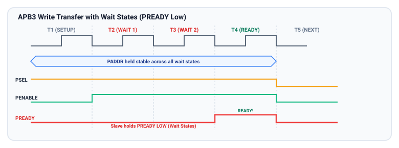
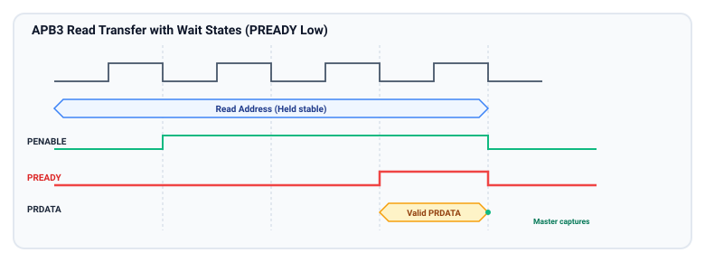
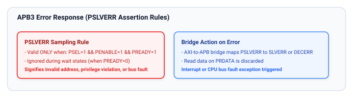

# Wait States and Error Responses (APB3)

The AMBA 3 APB specification introduced two pivotal signals that transformed APB from a rigid, fixed-timing bus into a versatile peripheral interface:
1. **`PREADY` (Wait State Control):** Enables peripherals to stall bus transfers until internal operations or data synchronization complete.
2. **`PSLVERR` (Slave Error Signaling):** Standardizes hardware fault reporting, enabling secure and robust system-level error handling.

This chapter analyzes the cycle-by-cycle mechanics of wait states during write and read transactions, stability requirements under stalls, and the exact sampling rules for error reporting.

---

## Motivation for Wait States in Peripheral Subsystems

In modern SoCs, peripherals frequently operate under clocking and physical constraints that preclude single-cycle register access:
- **Asynchronous Clock Domains:** Peripherals like UARTs, I2C controllers, or RTC timers often run on slow auxiliary clocks (e.g., 32.768 kHz or 24 MHz) while the APB bus operates at 100+ MHz. Synchronizing write strobes across clock domains requires multiple APB clock cycles.
- **Shared Internal Memories:** Peripherals with internal SRAM buffers (e.g., USB endpoints, CAN message RAM) may experience read/write port contention, forcing the APB interface to wait for an available memory cycle.
- **Mixed-Signal and Analog Interfaces:** Configuration of on-chip PLLs, temperature sensors, or ADCs often requires multi-cycle charge/settling times before valid digital readings can be delivered.

---

## Write Transfers with Wait States

When an APB slave cannot accept write data within the baseline 2-cycle window, it pulls **`PREADY = 0`** upon entering the `ACCESS` phase.



### Cycle-by-Cycle Breakdown: Write with Wait States

| Cycle / Edge | Protocol Phase | Master Behavior | Slave Behavior | Signal States |
| :--- | :--- | :--- | :--- | :--- |
| **T1 (Rising)** | `SETUP` | Drives `PADDR`, `PWRITE = 1`, `PWDATA`, and asserts `PSEL = 1`. `PENABLE = 0`. | Observes `PSEL = 1`. Latches address. | `PSEL = 1`, `PENABLE = 0`, `PREADY` ignored |
| **T2 (Rising)** | `ACCESS` (Cycle 1 - Stall) | Asserts `PENABLE = 1`. Holds all address, control, and `PWDATA` lines static. | Slave not ready to complete write. Drives `PREADY = 0`. | `PSEL = 1`, `PENABLE = 1`, `PREADY = 0` |
| **T2 to T3** | `ACCESS` (Stall Extended) | Samples `PREADY = 0` at T2. Must maintain all signals static. | Internal logic continues synchronization. Slave keeps `PREADY = 0`. | `PSEL = 1`, `PENABLE = 1`, `PREADY = 0` |
| **T3 (Rising)** | `ACCESS` (Ready Phase) | Samples `PREADY = 0` at T3. Maintains `PENABLE = 1` and all signals static. | Slave finishes internal operation. Drives `PREADY = 1`. | `PSEL = 1`, `PENABLE = 1`, `PREADY = 1` |
| **T4 (Rising)** | Handshake Complete | Samples `PREADY = 1`. Deasserts `PSEL = 0` and `PENABLE = 0` (returning to `IDLE`). | Latches `PWDATA` into internal storage. Deasserts `PREADY`. | Transition to `IDLE` |

### Critical Protocol Invariant During Wait States:
> **RULE:** When `PENABLE` is asserted and `PREADY` is LOW, the master **MUST NOT alter** any of the following signals:
> - `PADDR`
> - `PWRITE`
> - `PWDATA`
> - `PSTRB`
> - `PPROT`
> - `PSELx`
> - `PENABLE`
>
> Any change to these signals while stalled constitutes a fatal protocol violation and will corrupt slave state.

---

## Read Transfers with Wait States

During read operations from slow peripherals, the slave drives `PREADY = 0` until valid data is available to place on `PRDATA`.



### Cycle-by-Cycle Breakdown: Read with Wait States

| Cycle / Edge | Protocol Phase | Master Behavior | Slave Behavior | Signal States |
| :--- | :--- | :--- | :--- | :--- |
| **T1 (Rising)** | `SETUP` | Drives `PADDR`, sets `PWRITE = 0`, asserts `PSEL = 1`. `PENABLE = 0`. | Detects `PSEL = 1`. Decodes address. | `PSEL = 1`, `PENABLE = 0`, `PWRITE = 0` |
| **T2 (Rising)** | `ACCESS` (Cycle 1 - Stall) | Asserts `PENABLE = 1`. Holds `PADDR`, `PWRITE`, and `PSEL` static. | Read data not yet ready. Drives `PREADY = 0`. `PRDATA` is invalid. | `PSEL = 1`, `PENABLE = 1`, `PREADY = 0` |
| **T3 (Rising)** | `ACCESS` (Cycle 2 - Stall) | Samples `PREADY = 0`. Bus remains frozen in `ACCESS` phase. | Peripheral fetches data from internal core. Holds `PREADY = 0`. | `PSEL = 1`, `PENABLE = 1`, `PREADY = 0` |
| **T4 (Rising)** | `ACCESS` (Ready Phase) | Samples `PREADY = 0` at T3. Continues holding `PENABLE = 1`. | Drives valid data onto `PRDATA`. Asserts `PREADY = 1`. | `PSEL = 1`, `PENABLE = 1`, `PREADY = 1`, `PRDATA = D1` |
| **T5 (Rising)** | Handshake Complete | Samples `PRDATA` and `PREADY = 1` on rising edge of T5. Completes transfer. | Completes read transaction. Drops `PREADY` to quiescent state. | Returns to `IDLE` (`PSEL = 0`, `PENABLE = 0`) |

### Key Observations:
- **`PRDATA` Validity Window:** The slave does not need to drive valid data onto `PRDATA` while `PREADY = 0`. The data must be valid and stable **only during the cycle when `PREADY` is driven to `1`**.
- **Power Conservation:** To minimize toggling power on the read data bus, slaves should hold `PRDATA` static at previous values until valid data is ready.

---

## Slave Error Reporting (`PSLVERR`)

In AMBA 3, the `PSLVERR` signal provides an in-band method for an APB slave to inform the bridge that a transfer failed.



### Exact Sampling Conditions for `PSLVERR`
The master samples `PSLVERR` **strictly and exclusively** when:
$$\text{Sample PSLVERR} \iff (\text{PSELx} == 1) \ \land \ (\text{PENABLE} == 1) \ \land \ (\text{PREADY} == 1)$$

- **Ignored Cycles:** The value of `PSLVERR` is completely ignored by the master during:
  - The `IDLE` state
  - The `SETUP` phase
  - Any wait cycle where `PREADY = 0`
- **Error Assertion Rule:** If a slave encounters an error, it must drive `PSLVERR = 1` concurrently with `PREADY = 1`.
- **Successful Transfer:** For a successful, fault-free transfer, the slave must drive `PSLVERR = 0` when `PREADY = 1`.

### Common Causes of `PSLVERR` Assertion
1. **Unmapped Address Offset:** A software driver attempts to read or write a register address that does not exist within the peripheral's address aperture.
2. **Write to Read-Only Register:** Attempting to write to a status-only register (e.g., a hardware revision or interrupt flag register) when the design enforces strict write protection.
3. **Privilege or Security Violation:** A non-secure transaction attempts to access a secure register, or an unprivileged user-mode access attempts to modify supervisor-only configuration.
4. **Hardware Parity / ECC Fault:** The peripheral encounters uncorrectable memory corruption when reading its internal FIFO or SRAM storage.
5. **Peripheral Busy / FIFO Full:** An attempt to push data into a full transmit FIFO when non-blocking drop semantics are disabled.

---

## System Bridge Handling of `PSLVERR`

Because APB is connected to high-performance system interconnects via a bridge, the bridge must translate `PSLVERR` into the upstream protocol's fault reporting mechanism:

```
+--------------------------------------------------------------------------------+
|                         SYSTEM ERROR TRANSLATION                               |
+--------------------------------------------------------------------------------+
| Upstream Interconnect | Upstream Bus Response | System Reaction                |
| :-------------------- | :-------------------- | :----------------------------- |
| **AXI4 / AXI5**       | `RRESP = SLVERR (0b10)`| Bus Error Exception / Abort   |
|                       | `BRESP = SLVERR (0b10)`| Data Abort / BusFault in CPU   |
| **AHB-Lite / AHB5**   | `HRESP = ERROR (1)`   | Two-cycle error response       |
| **Dedicated Core**    | Interrupt / NMI       | Peripheral Bus Error ISR fired |
+--------------------------------------------------------------------------------+
```

When `PSLVERR` is asserted, the bridge receives the fault and propagates it back to the originating CPU or DMA channel, preventing silent data corruption in mission-critical applications.

---

## Key Takeaways and Chapter Summary

- **Wait States via `PREADY`:** Driving `PREADY = 0` during the `ACCESS` phase pauses the APB transfer indefinitely until the peripheral is ready.
- **Frozen Bus:** Master control, address, and write data lines must remain perfectly stable during all stall cycles.
- **Error Reporting via `PSLVERR`:** `PSLVERR` is valid and sampled only on the terminal cycle where `PSEL = 1`, `PENABLE = 1`, and `PREADY = 1`.
- **Bridge Translation:** The APB bridge translates `PSLVERR` into AXI `SLVERR` or AHB `ERROR` responses, enabling the host processor to trap invalid accesses.

---

## Review Questions

1. If an APB slave asserts `PSLVERR = 1` while `PREADY` is still LOW (`0`), will the master register a bus error in that cycle? Why or why not?
2. Why is dynamic power dissipation reduced when an APB slave keeps `PRDATA` static until `PREADY` transitions to HIGH?
3. List three common hardware conditions that justify asserting `PSLVERR = 1`.
4. What happens to the system if an APB slave has a bug in its state machine and never asserts `PREADY = 1`? How do system architects protect against this?

##### Copyright (c) 2026 squared-studio

