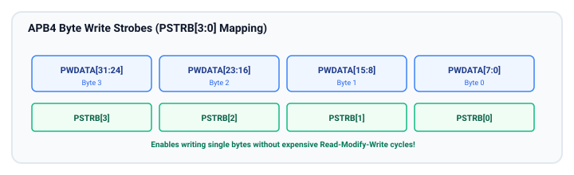
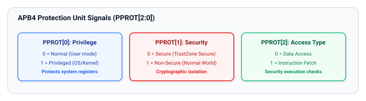

# Chapter 6: Byte Strobes (PSTRB) and Protection (PPROT) in APB4

As System-on-Chip (SoC) architectures grew to support 64-bit multi-core processors, complex operating systems, and hardware-enforced security architectures like **ARM TrustZone**, the baseline APB3 specification revealed two critical architectural limitations:
1. **Lack of Byte-Granularity Writes:** APB3 lacked native byte-enable strobes, forcing bridges to perform non-atomic read-modify-write sequences or corrupt adjacent register fields when handling sub-word (8-bit or 16-bit) processor stores.
2. **Absence of Security Attributes:** APB3 could not communicate transaction privilege levels or secure vs. non-secure states, preventing peripherals from enforcing hardware security firewalls.

The **AMBA 4 APB (APB4)** specification solved both problems by introducing **`PSTRB`** and **`PPROT`**.

---

## 1. Write Byte Strobes (`PSTRB`)

The `PSTRB` signal is a multi-bit write strobe bus where each individual bit controls the write validity of one byte lane on the write data bus (`PWDATA`).



### Bit-to-Byte Lane Mapping

For a 32-bit APB4 data bus, `PSTRB` has a width of 4 bits:

$$\text{PSTRB}[n] \iff \text{PWDATA}[(8 \times n) + 7 : 8 \times n]$$

| Strobe Bit | Controlled Byte Lane | Data Bus Bit Slice | Target Address Offset |
| :--- | :--- | :--- | :--- |
| **`PSTRB[0]`** | Byte Lane 0 | `PWDATA[7:0]` | Base Address + `0x0` |
| **`PSTRB[1]`** | Byte Lane 1 | `PWDATA[15:8]` | Base Address + `0x1` |
| **`PSTRB[2]`** | Byte Lane 2 | `PWDATA[23:16]` | Base Address + `0x2` |
| **`PSTRB[3]`** | Byte Lane 3 | `PWDATA[31:24]` | Base Address + `0x3` |

For a 64-bit APB4 data bus, `PSTRB` is 8 bits wide (`PSTRB[7:0]`), covering `PWDATA[63:0]`.

### Protocol Rules for `PSTRB`:
1. **Write Transfers (`PWRITE = 1`):**
   - The master sets each bit of `PSTRB` to `1` if that corresponding byte lane contains valid write data.
   - The master sets a bit of `PSTRB` to `0` if that byte lane is invalid and must not modify peripheral register contents.
   - Slaves must only update internal storage bits belonging to byte lanes where `PSTRB[n] == 1`.
2. **Read Transfers (`PWRITE = 0`):**
   - The specification mandates that the master **must drive all bits of `PSTRB` to `0`** during read operations.
3. **Sparse and Unaligned Writes:**
   - Any combination of strobe bits is permitted during a write transfer (e.g., `PSTRB = 4'b0011` for a 16-bit half-word write, or `4'b0001` for an 8-bit byte write).
   - This directly maps to AXI `WSTRB` without requiring read-modify-write overhead.

### Sub-Word Write Example (8-bit Byte Store)
Suppose a CPU executes an 8-bit store instruction (`STRB`) to a register at address `0x4000_0002`:
- Address driven: `PADDR = 0x4000_0002` (or aligned word address `0x4000_0000`).
- Data placed: Byte value driven on `PWDATA[23:16]`.
- Strobe driven: `PSTRB = 4'b0100`.
- Slave Action: Only bits `[23:16]` of the target 32-bit register are overwritten; bytes 0, 1, and 3 remain untouched.

---

## 2. Protection Attributes (`PPROT`)

The `PPROT` signal is a 3-bit sideband vector that classifies the security, privilege, and access nature of each APB transaction.



### Bit Definitions and Semantic Encoding

| Bit | Name | Logic '0' Semantic | Logic '1' Semantic | Architectural Purpose |
| :--- | :--- | :--- | :--- | :--- |
| **`PPROT[0]`** | **Privilege Level** | **Normal (User) Access** | **Privileged Access** | Prevents unprivileged user applications from tampering with OS-level peripheral configurations. |
| **`PPROT[1]`** | **Security Level** | **Secure Access** | **Non-Secure (Normal) Access** | Integrates with ARM TrustZone to block untrusted Rich OS environments from accessing secure peripherals. |
| **`PPROT[2]`** | **Access Type** | **Data Access** | **Instruction Access** | Differentiates data read/writes from processor instruction fetches (preventing execution from register space). |

> [!IMPORTANT]
> Note the active-polarity convention of `PPROT[1]`:
> - `PPROT[1] = 0` denotes a **Secure** transaction.
> - `PPROT[1] = 1` denotes a **Non-Secure** transaction.
> This inverted convention matches the upstream AXI `ARPROT[1]` / `AWPROT[1]` definitions.

---

## 3. Peripheral Hardware Firewall Architecture

With `PPROT`, an APB peripheral (or an APB bus firewall bridge) can implement granular access control policies in hardware:

```
+--------------------------------------------------------------------------------+
|                        FIREWALL PERMISSION CHECK MATRIX                        |
+--------------------------------------------------------------------------------+
| Register Type         | Required PPROT[0] | Required PPROT[1] | Action on Violation |
| :-------------------- | :---------------- | :---------------- | :------------------ |
| **Public Status Reg** | Any (0 or 1)      | Any (0 or 1)      | Read Allowed        |
| **OS Control Reg**    | Privileged (`1`)  | Any (0 or 1)      | Assert `PSLVERR = 1`|
| **Crypto Key Store**  | Privileged (`1`)  | Secure (`0`)      | Assert `PSLVERR = 1`|
| **Secure Boot ROM**   | Any (0 or 1)      | Secure (`0`)      | Assert `PSLVERR = 1`|
+--------------------------------------------------------------------------------+
```

### Hardware Enforcement Mechanism
When a transaction arrives at the peripheral:
1. The slave checks the incoming `PPROT` against its internal configuration registers.
2. If `PPROT[1] == 1` (Non-Secure access) targeting a Secure-only register:
   - The write is **discarded** (internal registers are not modified).
   - If reading, `PRDATA` returns zeros or a dummy fault pattern.
   - The slave drives **`PSLVERR = 1`** concurrently with `PREADY = 1`.
3. The APB bridge translates the `PSLVERR` into an upstream bus error (e.g. AXI `DECERR` or `SLVERR`), generating a hardware exception in the CPU.

---

## 4. APB3 vs. APB4 Compatibility Matrix

| Feature | APB3 (AMBA 3.0) | APB4 (AMBA 4.0) | Backward Compatibility Strategy |
| :--- | :--- | :--- | :--- |
| **Write Byte Strobes** | Not available | Supported via `PSTRB` | An APB3 slave connecting to an APB4 bridge ignores `PSTRB` (assumes all bytes valid). |
| **Protection Attributes** | Not available | Supported via `PPROT` | An APB3 slave connecting to an APB4 bridge leaves `PPROT` unconnected. |
| **Data Bus Widths** | Typically 32 bits | 32 or 64 bits | 64-bit APB4 systems use 8-bit `PSTRB[7:0]`. |
| **Wait State Control** | Supported (`PREADY`) | Supported (`PREADY`) | Identical handshake behavior across APB3 and APB4. |
| **Error Signaling** | Supported (`PSLVERR`) | Supported (`PSLVERR`) | Identical error sampling rules. |

---

## 5. Key Takeaways and Chapter Summary

- **`PSTRB` Eliminates Read-Modify-Write:** Write byte strobes allow single-byte and half-word writes to peripheral registers without corrupting neighboring fields.
- **`PSTRB` Invariant:** `PSTRB` must be all zeros during read operations (`PWRITE = 0`).
- **`PPROT` Secures the Subsystem:** The 3-bit protection vector conveys privilege (`PPROT[0]`), TrustZone security (`PPROT[1]`), and instruction/data classification (`PPROT[2]`).
- **Hardware Firewalls:** Peripherals evaluate `PPROT` to drop unauthorized requests and assert `PSLVERR` to flag security breaches to the system interrupt controller.

---

## 6. Review Questions

1. In a 32-bit APB4 system, what value should the master drive on `PSTRB[3:0]` when performing a 16-bit half-word write to an address ending in `0x2`?
2. What value must `PSTRB` take during any APB read transaction (`PWRITE = 0`)?
3. Which bit of `PPROT` indicates ARM TrustZone security status, and which logic value represents a Secure access?
4. How does an APB peripheral hardware firewall respond when an unprivileged Non-Secure user program attempts to write to a Secure Privileged AES encryption key register?

##### Copyright (c) 2026 squared-studio

