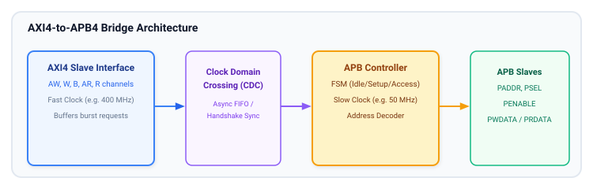
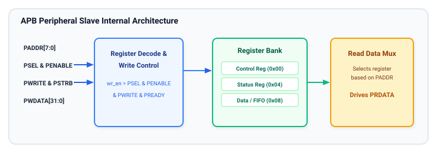

# Chapter 7: System Integration, Bridging, and Slave Design

In modern System-on-Chip (SoC) architectures, APB never operates in isolation. It forms the final leaf tier of the AMBA interconnect hierarchy, connected to high-performance system buses through dedicated protocol bridges.

This chapter examines the internal microarchitecture of **AXI-to-APB bridges**, protocol conversion mechanics, clock domain crossing (CDC), and the structural design of **APB peripheral slaves**.

---

## 1. The AXI-to-APB Bridge Architecture

An **AXI-to-APB Bridge** acts as an AXI Slave (completer) on its upstream interface and an APB Master (requester) on its downstream interface.

### Core Bridge Responsibilities

1. **Protocol Conversion (Burst Serialization):**
   - High-performance AXI transactions support multi-beat bursts (up to 256 beats in AXI4).
   - Because APB does not support bursts or pipelining, the bridge serializes each beat of an AXI burst into an individual 2-state (`SETUP` $\rightarrow$ `ACCESS`) APB transfer.
2. **Channel Decoupling and Split Transactions:**
   - AXI separates write address (`AW`), write data (`W`), and write response (`B`) into independent channels.
   - The bridge captures `AWADDR` and `WDATA` into internal holding registers before initiating the APB `SETUP` phase.
   - Once the APB transfer finishes (`PREADY = 1`), the bridge drives the AXI `BVALID` response channel.
3. **Clock Domain Crossing (CDC):**
   - The AXI system fabric typically runs at a high clock rate (e.g., `ACLK = 800 MHz` to `1.2 GHz`).
   - The peripheral bus runs at a much lower frequency (e.g., `PCLK = 50 MHz` to `100 MHz`) to minimize dynamic switching power.
   - The bridge integrates asynchronous FIFOs or multi-flop handshaking synchronizers to transfer address, control, and data across clock boundaries safely.
4. **Error Response Translation:**
   - If an APB slave asserts `PSLVERR = 1`, the bridge maps this to an AXI `SLVERR` response on `BRESP` (for writes) or `RRESP` (for reads).
   - If an address falls outside all defined peripheral address windows, the bridge asserts `DECERR` (Decode Error) upstream without driving any downstream APB signals.

---

## 2. AXI-to-APB Protocol Translation Mapping

The following table details the direct signal mappings performed by the bridge during write and read transactions:

| AXI Channel & Signal | APB Destination Signal | Conversion Logic / Notes |
| :--- | :--- | :--- |
| **`AWADDR`** (Write Address) | **`PADDR`** | Forwarded to APB during the `SETUP` phase of each burst beat. |
| **`AWPROT`** (Write Protection) | **`PPROT`** | Directly mapped to preserve security and privilege level. |
| **`WDATA`** (Write Data) | **`PWDATA`** | Latched from AXI `W` channel and driven during APB `SETUP`. |
| **`WSTRB`** (Write Strobes) | **`PSTRB`** | Directly mapped (available in APB4). |
| **`BREADY` / `BVALID`** | Internal FSM | `BVALID` asserted only after APB `ACCESS` completes with `PREADY = 1`. |
| **`BRESP`** (Write Response) | Driven by **`PSLVERR`** | `PSLVERR = 0` $\rightarrow$ `OKAY (0b00)`; `PSLVERR = 1` $\rightarrow$ `SLVERR (0b10)`. |
| **`ARADDR`** (Read Address) | **`PADDR`** | Forwarded to APB with `PWRITE = 0` during `SETUP`. |
| **`ARPROT`** (Read Protection) | **`PPROT`** | Directly mapped. |
| **`RDATA`** (Read Data) | Captured from **`PRDATA`** | Sampled on APB `PREADY = 1` and forwarded to AXI `R` channel. |
| **`RRESP`** (Read Response) | Driven by **`PSLVERR`** | `PSLVERR = 0` $\rightarrow$ `OKAY (0b00)`; `PSLVERR = 1` $\rightarrow$ `SLVERR (0b10)`. |

---

## 3. Peripheral Slave Internal Hardware Architecture

An APB completer (slave) consists of an address decoder, register control logic, internal storage registers, read multiplexing, and status logic.

### Structural Sub-Blocks of an APB Slave

#### 1. Interface Strobe Generator
The slave monitors `PSELx` and `PENABLE` to generate internal, single-cycle qualified strobes:
- **Write Strobe (`reg_wr_en`):**
  $$\text{reg\_wr\_en} = \text{PSELx} \ \land \ \text{PENABLE} \ \land \ \text{PREADY} \ \land \ \text{PWRITE}$$
  Registers sample `PWDATA` exclusively when this qualified strobe is active.
- **Read Strobe (`reg_rd_en`):**
  $$\text{reg\_rd\_en} = \text{PSELx} \ \land \ \text{PENABLE} \ \land \ (\lnot \text{PWRITE})$$
  Controls the internal read multiplexer and triggers side-effect reads.

#### 2. Address Offset Decoder
The peripheral takes the lower address bits (`PADDR[11:0]`, depending on register aperture size) and decodes them into one-hot select signals for each individual configuration and status register:
- Base + `0x00`: Control Register (`CTRL_REG`)
- Base + `0x04`: Status Register (`STATUS_REG`)
- Base + `0x08`: Interrupt Enable Register (`IER_REG`)
- Base + `0x0C`: Transmit/Receive FIFO Data Register (`FIFO_REG`)

#### 3. Standard Peripheral Register Access Semantics

Modern hardware registers exhibit diverse read/write behaviors:
- **Read-Write (RW):** Standard configuration register. Software writes update internal flip-flops; software reads return current register values.
- **Read-Only (RO):** Hardware status flags (e.g., peripheral busy, FIFO empty, external pin states). Writes to RO registers are ignored or trigger `PSLVERR`.
- **Write-1-to-Clear (W1C):** Used for interrupt status flags. Writing a `1` clears the specific flag bit to `0`; writing a `0` has no effect. This prevents race conditions where an OS clearing one interrupt inadvertently clears another newly arrived interrupt.
- **Read-on-Clear (ROC):** Reading the register clears its contents automatically (often used for hardware counters or latching event monitors).

---

## 4. Power Optimization: Clock Gating with `PSEL`

In battery-powered and mobile SoCs, peripheral registers can consume substantial dynamic power if their internal flip-flops clock continuously.

APB provides an inherent low-power advantage through **Architectural Clock Gating**:
- The peripheral clock can be gated at the top level whenever `PSELx = 0`.
- Sequential register logic toggles only during cycles when the peripheral is addressed.
- When the peripheral is idle, clock trees to its register file remain completely dark, reducing dynamic power consumption to near zero.

---

## 5. Comprehensive Summary of the APB Protocol Series

Across this 7-chapter study of the APB protocol, we have covered:
1. **AMBA Hierarchy & Evolution:** Positioning APB as the energy-efficient, low-complexity peripheral backbone across APB2, APB3, APB4, and APB5.
2. **Signal Architecture:** Complete signal dictionary, clock and reset constraints, central decoding, and read data multiplexing.
3. **State Machine & Handshakes:** The 3-state FSM (`IDLE`, `SETUP`, `ACCESS`) and the fundamental three-way completion condition (`PSEL && PENABLE && PREADY`).
4. **Basic Transfers:** Deterministic 2-cycle transfers and continuous back-to-back streaming without wait states.
5. **Wait States & Error Handling:** Extending transfers with `PREADY`, static bus holding rules, and in-band fault reporting via `PSLVERR`.
6. **APB4 Enhancements:** Byte-accurate writes via `PSTRB` and TrustZone security partitioning via `PPROT`.
7. **System Bridging & Slave Design:** Translating high-speed AXI bursts to APB, clock domain crossing, register semantics (RW, RO, W1C), and clock gating.

---

## 6. Review Questions

1. Why must an AXI-to-APB bridge serialize an AXI burst of length 8 into eight separate APB transfers?
2. What is the fundamental race condition that Write-1-to-Clear (W1C) register semantics prevent during interrupt handling?
3. What is the Boolean expression for the qualified internal write strobe (`reg_wr_en`) within an APB slave?
4. How does an APB bridge translate an asserted `PSLVERR = 1` back to an upstream AXI master?

##### Copyright (c) 2026 squared-studio

