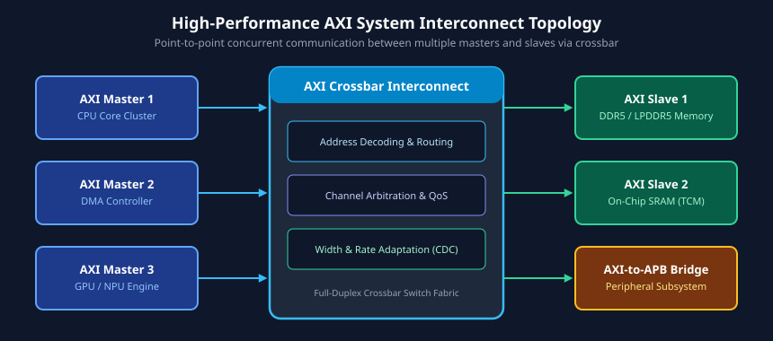

# Introduction to AMBA AXI Protocol and Architecture

### Learning Objectives

- Understand the role of the Advanced eXtensible Interface (AXI) in modern high-performance System-on-Chip (SoC) platforms.
- Compare and contrast the three core AMBA protocols: AXI, AHB, and APB.
- Trace the historical evolution of the AXI specification from AXI3 to AXI4, AXI4-Lite, and AXI4-Stream.
- Master the fundamental architectural innovations that allow AXI to achieve ultra-high bandwidth, low latency, and concurrent data transfers.
- Calculate bus throughput, efficiency, and bandwidth limits across various bus widths and clock frequencies.

---

## The Role of AXI in High-Performance SoC Design

Modern System-on-Chip (SoC) architectures integrate multi-core central processing units (CPUs), high-end graphics processing units (GPUs), neural network processing units (NPUs), hardware video accelerators, high-speed Direct Memory Access (DMA) engines, and multi-channel DDR memory controllers on a single silicon die. These heterogenous compute engines demand:

1. **Ultra-High Bandwidth:** Multi-gigabyte-per-second throughput to sustain graphics, deep learning inference, and streaming compute workloads.
2. **Low Latency:** Fast access paths for latency-critical CPU cache refills.
3. **Decoupled Concurrency:** Simultaneous bidirectional data movement without read/write bus turnaround bubbles.
4. **Frequency Decoupling:** Ability to insert register slices (pipeline stages) between masters, interconnects, and slaves without violating protocol timing or deadlocking.

The **AMBA (Advanced Microcontroller Bus Architecture) AXI** protocol, developed by Arm, is the industry standard created specifically to meet these demanding requirements.

As illustrated in the system topology above, AXI serves as the high-throughput backbone (the "system fabric") connecting processing cores and high-speed memory subsystems. Slower peripherals (such as UART, SPI, I2C, and configuration registers) connect via an **AXI-to-APB bridge**, insulating the high-speed interconnect from low-speed bus stalls.

---

## The AMBA Protocol Hierarchy: AXI vs. AHB vs. APB

The AMBA family defines a tiered hierarchy of on-chip interconnect protocols, each tailored for specific performance, area, and power budgets:

| Protocol Feature                 | APB (Advanced Peripheral Bus)                | AHB (Advanced High-performance Bus)                 | AXI (Advanced eXtensible Interface)                       |
| -------------------------------- | -------------------------------------------- | --------------------------------------------------- | --------------------------------------------------------- |
| **Primary Domain**               | Low-bandwidth peripherals, control registers | Moderate-performance on-chip memories, legacy DMA   | High-performance cores, DDR controllers, GPUs, PCIe       |
| **Channel Structure**            | Single multiplexed address/data bus          | Pipelined address and data phases                   | **Five independent, decoupled channels**                  |
| **Read/Write Concurrency**       | Half-duplex (sequential)                     | Pipelined half-duplex                               | **Full-duplex simultaneous read and write**               |
| **Burst Support**                | None (single transfers only)                 | Fixed bursts (INCR4, WRAP8, etc.), address per beat | **Up to 256 beats (AXI4); address issued once per burst** |
| **Out-of-Order Execution**       | No                                           | No                                                  | **Yes (via Transaction ID tags)**                         |
| **Pipelining / Register Slices** | No                                           | Difficult (timing tight on address/data phases)     | **Trivial (register slices insertable on any channel)**   |
| **Hardware Complexity**          | Minimal (very few gates)                     | Moderate                                            | High (requires crossbars, FIFOs, and reorder buffers)     |

---

## Evolution of the AXI Specification

The AXI specification has undergone several major iterations to adapt to growing chip complexity and varying peripheral requirements:

### AXI3 (2003)

Introduced in the AMBA 3 specification, AXI3 established the foundational 5-channel architecture:

- Maximum burst length of **16 beats** (`AxLEN[3:0]`).
- Write interleaving supported via the Write Data ID tag (`WID`).
- Atomic locked transfers (`AxLOCK[1:0]`) alongside exclusive accesses.

### AXI4 (2010)

Introduced in AMBA 4, AXI4 optimized the protocol for modern memory subsystems:

- Extended maximum burst length to **256 beats** for `INCR` bursts (`AxLEN[7:0]`), dramatically improving DMA efficiency.
- **Removed the `WID` signal** (write data interleaving), mandating that write data must strictly match write address order. This drastically simplified interconnect crossbar FIFOs.
- Added Quality of Service (`AxQOS`) and Region (`AxREGION`) identifier signals.
- Removed locked transfers (`AxLOCK[1:0]`), retaining only exclusive accesses for multicore synchronization.

### AXI4-Lite

A lightweight subset of AXI4 tailored for simple memory-mapped control and status registers (CSRs):

- Fixed burst length of **1 beat** (`AxLEN = 0`).
- Fixed data bus width of 32-bit or 64-bit.
- All transfers are unbuffered and uncacheable (`AxCACHE` omitted).
- Zero support for exclusive accesses or out-of-order execution (IDs omitted).

### AXI4-Stream

A point-to-point streaming protocol without address channels, designed for unbounded packet streams such as camera sensors, video pipelines, network packets, and DSP blocks.

---

## Fundamental Architectural Innovations of AXI

Why has AXI dominated high-performance SoC design for over two decades? Four key architectural concepts set AXI apart:

### Decoupled Five-Channel Architecture

Instead of sharing a single bidirectional bus between address, read data, and write data, AXI separates them into five unidirectional channels:

1. **Read Address (AR)**
2. **Read Data (R)**
3. **Write Address (AW)**
4. **Write Data (W)**
5. **Write Response (B)**

Because each channel is completely independent and possesses its own forward (`VALID`) and reverse (`READY`) flow-control signals, transfers can execute concurrently. A master can issue five read addresses while transmitting write data for a previous command, all while receiving read data from an earlier read burst.

### Address Issued Once per Burst

In legacy protocols like AHB, an address is computed and presented on the bus for every single beat of a burst. In AXI, the master issues the start address **once** on the Address channel along with the burst length (`AxLEN`), burst size (`AxSIZE`), and burst type (`AxBURST`). The slave or interconnect internally increments the address for all subsequent beats, saving massive address bus bandwidth and switching power.

### Out-of-Order and Interleaved Transactions

Fast peripherals (such as on-chip SRAM) should not be blocked behind slow peripherals (such as external DDR memory with variable refresh and precharge latencies). AXI tags every transaction with an **ID**. Slaves may return responses out-of-order with respect to other IDs, allowing high-performance reordering inside the master or crossbar.

### Direct Support for Pipeline Register Slices

Every signal across all five channels moves in only one direction (either Master-to-Slave or Slave-to-Master). There are no multi-driver tri-state buses, and handshake flow control is strictly point-to-point. Consequently, a designer can place register slices (pipeline registers) directly across any channel boundary to break long timing paths in deep submicron silicon without changing transaction semantics.

---

## Bandwidth and Bus Utilization Calculations

The maximum theoretical bandwidth of an AXI interface is governed by its clock frequency, data bus width, and handshake efficiency.

### Theoretical Maximum Bandwidth

The peak theoretical bandwidth (\(BW\_{peak}\)) for either read or write transfers is given by:

$$BW_{peak} = f_{CLK} \times W_{bytes}$$

Where:

- \(f\_{CLK}\) is the interface clock frequency in Hertz (Hz).
- \(W\_{bytes} = \frac{\text{Data Bus Width in Bits}}{8}\).

Because AXI supports **simultaneous full-duplex operation** (independent Read and Write data channels), the combined peak aggregate bandwidth is:

$$BW_{aggregate\_peak} = 2 \times \left( f_{CLK} \times W_{bytes} \right)$$

### Example Calculation

Consider a high-performance 256-bit AXI4 bus operating at an internal clock frequency of 800 MHz:

- Data bus width = 256 bits = 32 bytes.
- Peak Read Bandwidth:
  $$BW_{read} = 800 \times 10^6 \times 32 = 25.6\text{ GB/s}$$
- Peak Write Bandwidth:
  $$BW_{write} = 800 \times 10^6 \times 32 = 25.6\text{ GB/s}$$
- Aggregate Peak Bandwidth:
  $$BW_{total} = 25.6\text{ GB/s} + 25.6\text{ GB/s} = 51.2\text{ GB/s}$$

### Protocol Efficiency

In real-world systems, the effective bandwidth (\(BW\_{eff}\)) is reduced by address handshake latency, slave wait states, burst boundaries, and response phases:

$$\text{Efficiency } (\eta) = \frac{\text{Active Data Handshake Cycles}}{\text{Total Elapsed Cycles}} \times 100\%$$

Longer burst lengths (such as AXI4's 256-beat bursts) amortize the single-cycle address phase across many data cycles, pushing protocol efficiency toward 98-99%.

---

## Chapter Summary

- **AXI** is the highest-performance member of the AMBA family, engineered for high-bandwidth, low-latency multi-master SoC interconnects.
- While **APB** is unpipelined and half-duplex for low-speed peripherals, and **AHB** features pipelined single-burst transactions, **AXI** features five decoupled, concurrent channels with out-of-order execution support.
- **AXI4** enhanced AXI3 by expanding burst lengths from 16 to 256 beats, removing write data interleaving (`WID`) to simplify hardware, and introducing QoS and memory regions.
- **AXI4-Lite** serves register access needs with 1-beat bursts, while **AXI4-Stream** handles addressless, continuous data streams.
- The decoupled channel architecture enables register slicing for physical timing closure without degrading logical throughput.

---

## Review Questions

### Question 1

Explain why AXI is able to achieve significantly higher bus utilization than AHB during simultaneous read and write traffic.

<b>View Answer</b>

AHB utilizes a shared, multiplexed address bus and shared data phase that operates in half-duplex mode; reading and writing cannot occur at the exact same physical clock cycle on the same bus segment. AXI features physically separate, independent Read Data (R) and Write Data (W) channels, along with independent Read Address (AR) and Write Address (AW) channels. This enables full-duplex simultaneous read and write transfers without bus turnaround cycles.

### Question 2

Why did the AXI4 specification remove the `WID` (Write Data ID) signal that was present in AXI3?

<b>View Answer</b>

In AXI3, `WID` allowed write data beats from different transactions to be interleaved on the Write Data channel. In practice, almost no masters took advantage of write interleaving, but supporting it forced slave devices and interconnect crossbars to implement large reassembly buffers and complex tracking logic. Removing `WID` in AXI4 mandates that write data must be sent in the exact order of the issued write addresses, significantly reducing area and routing congestion in crossbar switches.

### Question 3

An AXI4 interface has a 128-bit data bus operating at 500 MHz. What is its peak unidirectional bandwidth in Gigabytes per second (GB/s)?

<b>View Answer</b>

A 128-bit bus carries 16 bytes per beat (128 / 8 = 16 bytes).  
Peak bandwidth = $500 \times 10^6 \text{ cycles/sec} \times 16 \text{ bytes/cycle} = 8.0 \times 10^9 \text{ bytes/sec} = 8.0\text{ GB/s}$.

### Question 4

Why are register slices uniquely easy to implement in an AXI system compared to earlier shared-bus architectures?

<b>View Answer</b>

All AXI signals are unidirectional point-to-point connections with dedicated forward (`VALID`) and reverse (`READY`) handshakes. There are no tri-state buses, no combinatorial multi-drop feedback loops, and no timing dependencies requiring zero-cycle slave responses. A register slice can be inserted into any of the five channels by capturing the payload and handling the ready/valid handshake across flip-flop registers, seamlessly breaking critical timing paths.

---

##### Copyright (c) 2026 squared-studio
