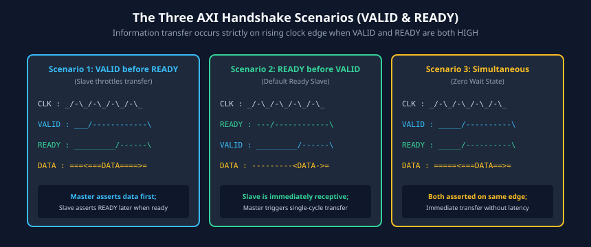

# Handshake Protocol: VALID and READY Mechanics

### Learning Objectives
- Master the fundamental two-way handshake mechanism (`VALID` and `READY`) shared across all five AXI channels.
- Distinguish the three timing relationships between `VALID` and `READY`.
- Understand the strict invariants governing handshake signaling: the **VALID Persistence Rule** and the **READY Independence Rule**.
- Identify legal vs. illegal cross-channel handshake dependencies in AXI3 and AXI4.
- Prevent catastrophic protocol deadlocks when designing master, slave, and interconnect arbiters.

---

## Two-Way Handshake Fundamental Mechanics

Every transfer across any of the five AXI channels occurs via a synchronized, point-to-point two-way handshake. The interface consists of two handshake wires:
1. **`VALID` (Source to Destination):** Driven HIGH by the transmitter to signal that valid control, address, or payload data is currently driven onto the bus.
2. **`READY` (Destination to Source):** Driven HIGH by the receiver to signal that it has available buffer space or hardware readiness to accept the transfer.

### The Handshake Event
A transfer occurs **if and only if** both `VALID` and `READY` are observed HIGH on the active rising edge of `ACLK`:

$$\text{Transfer Triggered} \iff (\text{VALID} = 1) \land (\text{READY} = 1) \text{ at posedge ACLK}$$

Once both signals are HIGH on the clock edge, the payload is committed into the destination's registers or FIFOs.

---

## The Three Handshake Timing Scenarios

The AXI specification grants complete timing flexibility to both the transmitting source and receiving destination. A transfer can occur under three distinct scenarios:



### Scenario A: VALID Before READY (Source Leads)
1. The source prepares the payload and asserts `VALID` HIGH (Cycle 2).
2. The destination is not yet ready (`READY = 0`), perhaps due to full internal buffers.
3. The source **must keep `VALID` HIGH and hold the payload completely stable**.
4. At Cycle 3, the destination asserts `READY` HIGH.
5. On the rising edge of Cycle 4, both `VALID` and `READY` are HIGH: the transfer is successfully sampled.
6. `VALID` drops LOW on Cycle 5 (unless another transfer is immediately ready).

### Scenario B: READY Before VALID (Destination Leads)
1. The destination has idle buffer space and asserts `READY` HIGH proactively (Cycle 2).
2. The source has not yet prepared data (`VALID = 0`).
3. At Cycle 3, the source asserts `VALID` HIGH with valid payload.
4. On the rising edge of Cycle 4, both `VALID` and `READY` are HIGH: the transfer completes without wait states.

### Scenario C: VALID with READY (Simultaneous Handshake)
1. Both source and destination assert their handshake signals in the same clock period (Cycle 3).
2. On the rising edge of Cycle 4, both `VALID` and `READY` are HIGH: instantaneous single-cycle zero-wait-state transfer.

---

## The Core Protocol Invariants

To avoid data corruption and race conditions, the AXI specification defines two unyielding handshake rules:

### Rule 1: The VALID Persistence Rule
> **Once asserted, a source must NOT deassert `VALID` until a successful handshake has occurred (`VALID = 1` and `READY = 1` on a rising clock edge). Furthermore, once `VALID` is asserted, all associated payload and control signals must remain completely unchanged (stable) until the handshake completes.**

- **Why?** If a source could pull `VALID` LOW without a handshake, the destination might sample corrupt or half-formed data if it asserted `READY` just as `VALID` fell.
- **Payload Stability:** Address, data, strobes, and burst controls cannot glitch or switch while waiting for `READY`.

### Rule 2: The READY Independence Rule
> **A destination is fully permitted to wait for `VALID` to be asserted before it asserts its `READY` signal. However, a source must NEVER wait for `READY` to be asserted before it asserts `VALID`.**

- `VALID` generation **must not depend combinatorially on `READY`**.
- If a source waited for `READY` before asserting `VALID`, and the destination waited for `VALID` before asserting `READY`, both devices would wait forever—causing a **combinatorial deadlock loop**!

```
    [Destination] --- READY depends on VALID? ---> OK (Legal)
          ^                                              |
          |                                              |
          X--- (DEADLOCK LOOP IF VALID DEPENDS ON READY) v
    [Source]      <--- VALID waits for READY? --- ILLEGAL!
```

---

## Cross-Channel Handshake Dependencies

Because AXI divides transactions into five channels, rules must govern whether a handshake on one channel may wait for a handshake on another channel.


### AXI Read Transaction Handshake Dependencies:
1. `ARREADY` can wait for `ARVALID`.
2. `ARVALID` must **not** wait for `ARREADY`.
3. The slave **must wait** for the read address handshake (`ARVALID` and `ARREADY`) before it can assert `RVALID` for the read data. (A slave cannot return data for an address it has not yet received!)
4. `RREADY` can wait for `RVALID`.
5. `RVALID` must **not** wait for `RREADY`.

### AXI Write Transaction Handshake Dependencies:
1. `AWREADY` can wait for `AWVALID`.
2. `AWVALID` must **not** wait for `AWREADY`.
3. `WREADY` can wait for `WVALID`.
4. `WVALID` must **not** wait for `WREADY`.
5. In **AXI4**, the write address and write data handshakes are independent:
   - A master can assert `WVALID` before, after, or concurrently with `AWVALID`.
   - A slave can assert `AWREADY` before, after, or concurrently with `WREADY`.
6. The slave **must wait** for both the write address handshake (`AWVALID` & `AWREADY`) **and** the final write data beat handshake (`WVALID`, `WREADY`, and `WLAST = 1`) before asserting `BVALID` on the Write Response channel!
7. `BREADY` can wait for `BVALID`.
8. `BVALID` must **not** wait for `BREADY`.

---

## Handshake Dependency Comparison Table

| Channel Handshake | Can Source wait for READY before asserting VALID? | Can Destination wait for VALID before asserting READY? | Permitted Preceding Channel Handshake Dependency |
|---|---|---|---|
| **Write Address (AW)** | **NO** (Strictly Forbidden) | YES | None |
| **Write Data (W)** | **NO** (Strictly Forbidden) | YES | None (Master can transmit data before address) |
| **Write Response (B)** | **NO** (Strictly Forbidden) | YES | **Must wait for AW handshake and final W beat (`WLAST`)** |
| **Read Address (AR)** | **NO** (Strictly Forbidden) | YES | None |
| **Read Data (R)** | **NO** (Strictly Forbidden) | YES | **Must wait for AR handshake** |

---

## Deadlock Scenarios in Interconnect Design

A common source of system-level hangs in complex SoCs stems from subtle handshake dependency cycles introduced inside interconnect arbiters or slave FIFOs:

### Scenario 1: Combinatorial Dependency Deadlock
If an interconnect routing module creates a combinatorial logic path from `AWREADY` to `WVALID` (e.g., `assign WVALID = AWREADY & internal_has_data;`), and the downstream slave creates a combinatorial path from `WVALID` to `AWREADY` (e.g., waiting for data before accepting address), a hardware feedback loop is created. 

**Architectural Prevention:** Always register outgoing `VALID` signals or isolate them using skid buffers or forward/reverse register slices.

### Scenario 2: Response Channel Buffer Depletion
If a master issues dozens of write bursts but stops asserting `BREADY` because its internal completion queue is full, the slave's write response FIFO fills up. If the slave refuses to accept new `WDATA` beats because its `B` channel FIFO cannot accept new response entries, the entire write pipeline freezes permanently.

**Architectural Prevention:** Slaves and masters must maintain sufficient queue depth or enforce flow control limits at the transaction initiation stage.

---

## Chapter Summary

- All five AXI channels use an identical two-way handshake governed by `VALID` (from source) and `READY` (from destination).
- A transfer commits on any rising clock edge where `VALID = 1` and `READY = 1`.
- **VALID Persistence:** Once `VALID` is asserted, it cannot be pulled LOW, and the payload cannot change until a transfer occurs.
- **READY Independence:** `VALID` must never depend on `READY`, eliminating combinatorial circular deadlocks.
- The slave cannot assert `RVALID` until `AR` handshake completes; similarly, the slave cannot assert `BVALID` until `AW` handshake and the final `W` beat (`WLAST`) complete.

---

## Review Questions

### Question 1
Can an AXI master deassert `AWVALID` if the slave keeps `AWREADY` LOW for 100 clock cycles?
<details>
<summary><b>View Answer</b></summary>
No. Under the AXI VALID Persistence Rule, once a source asserts `VALID`, it must keep `VALID` asserted and maintain all payload and control signals completely stable until the destination asserts `READY` and a successful handshake occurs on a rising clock edge. Deasserting `VALID` early is a severe protocol violation.
</details>

### Question 2
Explain why a slave is allowed to wait for `ARVALID` before asserting `ARREADY`, but a master cannot wait for `ARREADY` before asserting `ARVALID`.
<details>
<summary><b>View Answer</b></summary>
If a master waited for `ARREADY` before asserting `ARVALID`, and the slave simultaneously waited for `ARVALID` before asserting `ARREADY`, neither device would ever assert their handshake signal. Both would wait indefinitely, resulting in a permanent protocol deadlock. By forbidding `VALID` from depending on `READY`, the protocol ensures that the transaction source always initiates the interaction unconditionally.
</details>

### Question 3
In a write transaction, what specific conditions must be fulfilled before the slave is permitted to assert `BVALID` on the Write Response channel?
<details>
<summary><b>View Answer</b></summary>
The slave must have completed:
1. The Write Address handshake (`AWVALID = 1` and `AWREADY = 1`).
2. All Write Data beat handshakes up to and including the last beat (`WVALID = 1`, `WREADY = 1`, and `WLAST = 1`).
Only after both the address and the final data beat have been accepted can the slave assert `BVALID` to report transaction status.
</details>

### Question 4
What is the state of a channel when `VALID = 1` and `READY = 0`?
<details>
<summary><b>View Answer</b></summary>
This represents a wait state where the source has valid data ready to transfer, but the destination is temporarily unable to accept it (e.g., due to full internal FIFO buffers or pipeline stalls). The source must hold `VALID` HIGH and keep all data and address signals constant until `READY` goes HIGH.
</details>

---

##### Copyright (c) 2026 squared-studio

