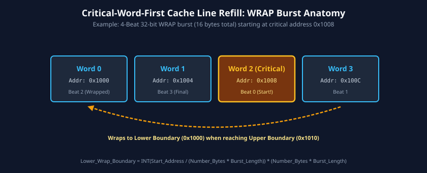
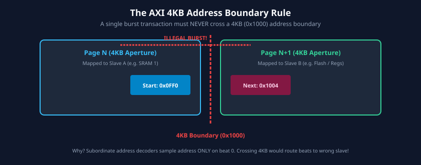

# Burst Transactions and Address Calculation

### Learning Objectives

- Decode the fundamental burst parameters: Burst Length (`AxLEN`), Burst Size (`AxSIZE`), and Burst Type (`AxBURST`).
- Compare and contrast the three standard burst types: `FIXED`, `INCR`, and `WRAP`.
- Master the mathematical formulas governing address calculation across successive burst beats.
- Understand the mechanics of wrapping bursts for cache line fills and critical-word-first servicing.
- Analyze the critical **4KB Address Boundary Rule** and its vital role in preventing slave address decode overflow.
- Handle unaligned transfers and byte-lane positioning using write strobes (`WSTRB`).

---

## Burst Parameters and Encoding

In AXI, an address is transmitted only once at the beginning of a burst. The target slave or interconnect autonomously computes the target memory address for every subsequent data beat based on three address channel signals:

| Signal    | Bits                           | Description                                                      | Standard Values / Equations                                                                                            |
| --------- | ------------------------------ | ---------------------------------------------------------------- | ---------------------------------------------------------------------------------------------------------------------- |
| `AxLEN`   | 8 bits (AXI4) 4 bits (AXI3) | **Burst Length:** Number of data transfers (beats) in the burst. | $\text{Number of Transfers} = \text{AxLEN} + 1$ Range: 1 to 256 beats (AXI4 `INCR`), 1 to 16 beats (AXI3 / `WRAP`). |
| `AxSIZE`  | 3 bits                         | **Burst Size:** Number of bytes transferred in each data beat.   | $\text{Bytes per Beat} = 2^{\text{AxSIZE}}$ Range: 1 to 128 bytes (cannot exceed bus data width).                   |
| `AxBURST` | 2 bits                         | **Burst Type:** Address update progression rule.                 | `2'b00` = FIXED `2'b01` = INCR `2'b10` = WRAP `2'b11` = Reserved                                              |

### Burst Size Table

| `AxSIZE[2:0]` | Bytes per Beat | Data Width Equivalent |
| :-----------: | :------------: | :-------------------: |
|   `3'b000`    |     1 Byte     |         8-bit         |
|   `3'b001`    |    2 Bytes     |        16-bit         |
|   `3'b010`    |    4 Bytes     | 32-bit (Single Word)  |
|   `3'b011`    |    8 Bytes     | 64-bit (Double Word)  |
|   `3'b100`    |    16 Bytes    |  128-bit (Quad Word)  |
|   `3'b101`    |    32 Bytes    |        256-bit        |
|   `3'b110`    |    64 Bytes    |        512-bit        |
|   `3'b111`    |   128 Bytes    |       1024-bit        |

---

## The Three AXI Burst Types

### FIXED Burst (`AxBURST = 2'b00`)

- **Address Behavior:** The address remains completely constant for all beats in the burst:
  $$\text{Address}_N = \text{Start\_Address}$$
- **Primary Use Case:** Interfacing to memory-mapped FIFO queues, hardware cryptographic accelerators, or audio codecs where continuous reads or writes target the same register address.
- **Restrictions:** In AXI4, burst length is limited to 1 to 16 beats.

### INCR Burst (`AxBURST = 2'b01`)

- **Address Behavior:** The address of each beat is the address of the preceding beat incremented by the transfer size:
  $$\text{Address}_N = \text{Address}_{N-1} + \text{Number\_Bytes}$$
- **Primary Use Case:** General memory reads and writes, sequential DMA buffer transfers, and continuous program code fetching.
- **Burst Length:** 1 to 256 beats in AXI4 (1 to 16 beats in AXI3).

### WRAP Burst (`AxBURST = 2'b10`)

- **Address Behavior:** Similar to `INCR`, but when the incremented address reaches an upper address boundary, it wraps back around to a lower boundary address.
- **Primary Use Case:** Microprocessor cache line fills with **Critical Word First** (early branch restart).
- **Restrictions:**
  - Burst length must be strictly **2, 4, 8, or 16 beats** (`AxLEN` = 1, 3, 7, or 15).
  - The start address must be aligned to the transfer size (`AxSIZE`).

---

## Mathematical Derivation of WRAP Bursts

When a processor suffers a cache miss, it needs the specific word that caused the miss immediately. It requests that word first (the critical word), while fetching the remainder of the cache line seamlessly.

### Formulas for WRAP Address Calculation:

1. **Total Burst Bytes:**
   $$\text{Total\_Bytes} = \text{Number\_Bytes} \times \text{Burst\_Length} = 2^{\text{AxSIZE}} \times (\text{AxLEN} + 1)$$

2. **Wrap Lower Boundary:**
   $$\text{Wrap\_Boundary\_Lower} = \left\lfloor \frac{\text{Start\_Address}}{\text{Total\_Bytes}} \right\rfloor \times \text{Total\_Bytes}$$

3. **Wrap Upper Boundary:**
   $$\text{Wrap\_Boundary\_Upper} = \text{Wrap\_Boundary\_Lower} + \text{Total\_Bytes}$$

4. **Subsequent Beat Addresses:**
   $$
   \text{Address}_N = \begin{cases}
   \text{Address}_{N-1} + \text{Number\_Bytes}, & \text{if } \text{Address}_{N-1} + \text{Number\_Bytes} < \text{Wrap\_Boundary\_Upper} \\
   \text{Wrap\_Boundary\_Lower}, & \text{if } \text{Address}_{N-1} + \text{Number\_Bytes} = \text{Wrap\_Boundary\_Upper}
   \end{cases}
   $$

### Step-by-Step WRAP Calculation Example:

- Start Address (`AxADDR`) = `0x0004`
- Burst Size (`AxSIZE`) = `3'b010` (4 bytes per beat)
- Burst Length (`AxLEN`) = `3` (4 beats total)

**Step 1:** Calculate total byte capacity:
$$\text{Total\_Bytes} = 4 \times 4 = 16\text{ bytes} \implies 0x10$$

**Step 2:** Calculate lower and upper boundaries:
$$\text{Wrap\_Boundary\_Lower} = \left\lfloor \frac{0x04}{0x10} \right\rfloor \times 0x10 = 0x00$$
$$\text{Wrap\_Boundary\_Upper} = 0x00 + 0x10 = 0x10$$

**Step 3:** Calculate address for each beat:

- **Beat 0:** `0x0004` (Critical word fetched first!)
- **Beat 1:** `0x0004 + 4 = 0x0008`
- **Beat 2:** `0x0008 + 4 = 0x000C`
- **Beat 3:** Next address would be `0x0010` (matches Upper Boundary), so it **wraps** to Lower Boundary: `0x0000`!

Resulting sequence: `0x04` $\rightarrow$ `0x08` $\rightarrow$ `0x0C` $\rightarrow$ `0x00`. All 16 bytes of the cache line are loaded with zero redundant fetches.

---

## The Critical 4KB Address Boundary Rule

> **AXI Specification Invariant:**
> **A burst transaction MUST NEVER cross a 4 Kilobyte (4KB, 4096-byte) address boundary.**

### Why Does This Rule Exist?

In modern computer architectures:

1. **Memory Protection & MMUs:** Virtual memory paging uses a minimum page size of 4KB (`0x1000` bytes). Different 4KB physical pages may have distinct security attributes, MMU translations, or reside in completely different memories.
2. **Interconnect Address Decoding:** Interconnect address routers decode target slaves using coarse address decoding with a minimum granularity of 4KB.
3. If an INCR burst were allowed to cross a 4KB boundary, it could begin in **Slave A's** memory region (e.g., DDR RAM) and inadvertently overflow into **Slave B's** memory region (e.g., a hardware PCIe register)!
4. Because the interconnect decodes the target slave only once during the address handshake, an overflow across the 4KB boundary would corrupt memory in an unintended peripheral without the slave or master knowing.

### How to Guarantee 4KB Compliance:

Hardware masters or DMA engines must verify that:
$$\text{Start\_Address} + (\text{Number\_Bytes} \times \text{Burst\_Length}) \le (\text{Start\_Address} \ \& \ \sim 0xFFF) + 0x1000$$

If a transfer crosses a 4KB boundary, the master **must split the transaction into two distinct bursts**:

- **Burst 1:** From `Start_Address` up to `0x...FFF`.
- **Burst 2:** From `0x...000` to the remaining byte target.

---

## Unaligned Transfers and Write Strobes (`WSTRB`)

When the start address of a transaction is not naturally aligned to the data bus width (for instance, reading a 4-byte word starting at address `0x0003` on a 32-bit bus):

- **First Beat Alignment:** For the very first beat of an unaligned burst, the master sets `AxADDR` to the unaligned byte address.
- **Subsequent Beats:** For all subsequent beats in an `INCR` burst, the address automatically increments to naturally aligned boundaries:
  $$\text{Aligned\_Address} = \left\lfloor \frac{\text{Start\_Address}}{\text{Number\_Bytes}} \right\rfloor \times \text{Number\_Bytes}$$

### Write Byte Strobes (`WSTRB`):

To enable partial writes and unaligned transfers, the Write Data channel includes one strobe line per byte of the data bus:
$$\text{Number of WSTRB bits} = \frac{\text{Data Bus Width in Bits}}{8}$$

- `WSTRB[n] = 1`: Byte lane `n` (`WDATA[8n+7 : 8n]`) contains valid data to be written to memory.
- `WSTRB[n] = 0`: Byte lane `n` must be masked (memory must leave this byte untouched).

---

## Chapter Summary

- Burst characteristics are dictated by `AxLEN` (length = `AxLEN + 1`), `AxSIZE` (bytes per beat = $2^{\text{AxSIZE}}$), and `AxBURST` (type).
- **`FIXED` bursts** target FIFO registers at constant addresses.
- **`INCR` bursts** increment sequentially for general memory accesses (up to 256 beats in AXI4).
- **`WRAP` bursts** wrap at power-of-two boundaries (2, 4, 8, 16 beats) for cache line refills.
- **The 4KB Boundary Rule:** No burst may ever cross a 4096-byte address boundary, protecting system MMUs and interconnect routing from multi-slave memory overflow.
- **`WSTRB`** enables sparse byte masking and unaligned transfers.

---

## Review Questions

### Question 1

Calculate the maximum number of bytes that can be transferred in a single AXI4 `INCR` burst on a 512-bit data bus.

<b>View Answer</b>

- A 512-bit bus transfers 64 bytes per beat (`AxSIZE = 3'b110`).
- The maximum burst length in AXI4 for an `INCR` burst is 256 beats (`AxLEN = 8'hFF`).
- Maximum byte count = $256 \times 64\text{ bytes} = 16,384\text{ bytes} = 16\text{ KB}$.
*(Note: A single burst cannot actually be 16KB if it crosses 4KB boundaries; it must be aligned and split to respect the 4KB boundary rule).*

### Question 2

A master initiates a WRAP burst with `AxADDR = 0x38`, `AxSIZE = 3'b011` (8 bytes), and `AxLEN = 3` (4 beats). Determine the sequence of addresses generated.

<b>View Answer</b>

1. Total bytes = $8 \times 4 = 32\text{ bytes} = 0x20$.
2. Lower boundary = $\lfloor 0x38 / 0x20 \rfloor \times 0x20 = 0x20$.
3. Upper boundary = $0x20 + 0x20 = 0x40$.
4. Address sequence:
   - Beat 0: `0x38`
   - Beat 1: `0x38 + 8 = 0x40` $\rightarrow$ Reaches Upper Boundary, wraps to Lower Boundary: **`0x20`**
   - Beat 2: `0x20 + 8 = 0x28`
   - Beat 3: `0x28 + 8 = 0x30`
Sequence: `0x38` $\rightarrow$ `0x20` $\rightarrow$ `0x28` $\rightarrow$ `0x30`.

### Question 3

An AXI master wants to transfer 8 beats of 4-byte data starting at address `0x0FF0`. Is this transfer legal in a single burst? Why or why not?

<b>View Answer</b>

Total bytes = $8 \times 4 = 32\text{ bytes}$.  
The transfer starts at `0x0FF0` and would span through `0x100F` (`0x0FF0 + 0x20 = 0x1010`).  
Address `0x1000` is a 4KB boundary!  
Because the transfer crosses `0x1000`, this single burst is **illegal**. The master must split this into two bursts:
- Burst 1: 4 beats from `0x0FF0` to `0x0FFF`.
- Burst 2: 4 beats from `0x1000` to `0x100F`.

### Question 4

What happens to memory bytes whose corresponding `WSTRB` bit is deasserted (`0`) during a write handshake?

<b>View Answer</b>

The slave memory controller must preserve the existing contents of that byte in storage without modification. Only byte lanes with `WSTRB = 1` are written.

---

##### Copyright (c) 2026 squared-studio
