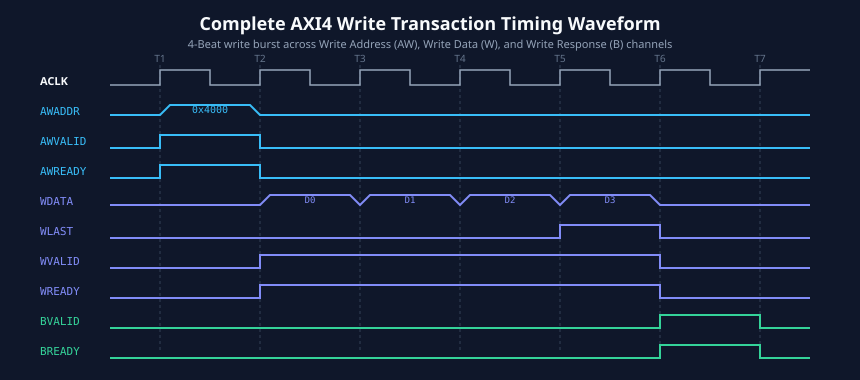
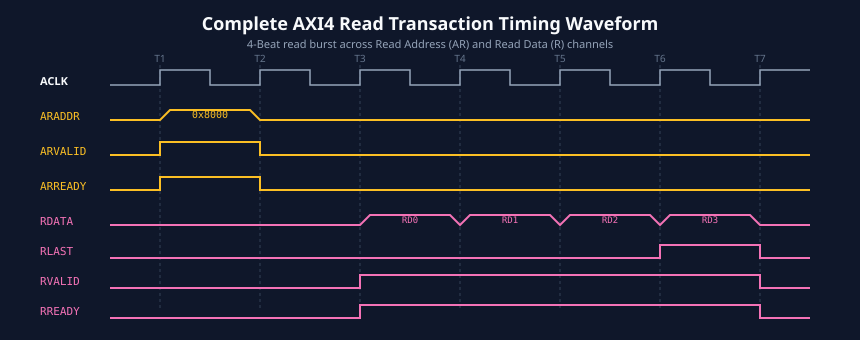

# Basic Write and Read Transactions

### Learning Objectives
- Step through the complete cycle-by-cycle anatomy of an AXI write transaction across the AW, W, and B channels.
- Step through the complete cycle-by-cycle anatomy of an AXI read transaction across the AR and R channels.
- Understand the role of `WLAST` and `RLAST` burst demarcation flags.
- Analyze full-duplex operation, where simultaneous read and write bursts execute concurrently without bus turnaround latency.
- Explore pipelined address issuing (address overlap) to maximize throughput and hide slave memory latency.

---

## Complete Anatomy of an AXI Write Transaction

An AXI write transaction requires three sequential phases across three separate channels:
1. **Address Phase:** The master delivers the start address and control attributes on the **AW** channel.
2. **Data Phase:** The master streams one or more data beats along with byte strobes on the **W** channel, asserting `WLAST` on the final beat.
3. **Response Phase:** The slave acknowledges whether the entire burst succeeded or failed on the **B** channel.



### Cycle-by-Cycle Breakdown of a 2-Beat Write Burst:
- **Cycle 1 (Reset/Idle):** The bus is idle. `AWVALID`, `WVALID`, and `BVALID` are all LOW.
- **Cycle 2 (Address Phase):** 
  - Master asserts `AWVALID = 1` and places `AWADDR = 0x1000` and `AWLEN = 1` (denoting 2 beats) on the bus.
  - The slave is not yet ready (`AWREADY = 0`), forcing a wait state.
- **Cycle 3 (Address Handshake):** 
  - Slave asserts `AWREADY = 1`.
  - On the rising clock edge of Cycle 3, both `AWVALID` and `AWREADY` are HIGH: **Address handshake completes**.
- **Cycle 4 (First Data Beat):**
  - Master asserts `WVALID = 1`, driving `WDATA = D0`, `WSTRB = 0xF`, and `WLAST = 0`.
  - Slave proactively asserts `WREADY = 1`.
  - On the rising clock edge, both `WVALID` and `WREADY` are HIGH: **Beat 0 transferred**.
- **Cycle 5 (Second Data Beat & WLAST):**
  - Master drives `WDATA = D1`, `WSTRB = 0xF`, and asserts `WLAST = 1` to signal the final beat.
  - Slave maintains `WREADY = 1`.
  - On the rising clock edge: **Final beat transferred**.
- **Cycle 6 (Write Processing):**
  - The slave internal memory controller commits the received data to physical memory. `BVALID = 0`. Master asserts `BREADY = 1` to show readiness for status.
- **Cycle 7 (Response Handshake):**
  - Slave asserts `BVALID = 1` with `BRESP = 2'b00` (`OKAY`).
  - Both `BVALID` and `BREADY` are HIGH: **Transaction successfully completed**.

---

## Complete Anatomy of an AXI Read Transaction

An AXI read transaction utilizes two channels:
1. **Read Address Phase:** Master requests a read burst on the **AR** channel.
2. **Read Data Phase:** Slave returns requested data beats and status on the **R** channel, asserting `RLAST` on the final beat.



### Cycle-by-Cycle Breakdown of a 2-Beat Read Burst:
- **Cycle 1 (Idle):** Bus is idle.
- **Cycle 2 (Read Address Request):** 
  - Master asserts `ARVALID = 1`, driving `ARADDR = 0x2000` and `ARLEN = 1` (2 beats).
  - Slave asserts `ARREADY = 1` concurrently.
  - Both signals are HIGH on the rising edge: **Address accepted immediately in one cycle**.
- **Cycle 3 (Memory Latency):** 
  - The slave internal memory controller accesses storage array. `RVALID` remains LOW.
  - Master proactively asserts `RREADY = 1` to indicate it is ready to receive data instantly.
- **Cycle 4 (First Read Data Beat):**
  - Slave drives `RDATA = R0`, `RRESP = 2'b00` (`OKAY`), and asserts `RVALID = 1`. `RLAST = 0`.
  - Master samples `R0` on the rising clock edge: **Beat 0 received**.
- **Cycle 5 (Second Read Data Beat & RLAST):**
  - Slave drives `RDATA = R1`, `RRESP = 2'b00`, `RLAST = 1`, and maintains `RVALID = 1`.
  - Master samples `R1` and detects `RLAST = 1`: **Final beat received; read transaction completed**.

---

## Full-Duplex Simultaneous Read and Write Operation

In half-duplex protocols (like APB or AHB), a read must completely finish before a write can begin, creating dead cycles on the physical data pins during direction switching (bus turnaround).

In contrast, AXI features completely independent Read (`AR`, `R`) and Write (`AW`, `W`, `B`) channels. A master can execute read and write transactions **at the exact same time**.


### Timing Analysis of Concurrency:
As illustrated in the timing diagram above:
- During **Cycles 2-3**, the master sends a Write Address (`AWADDR`) while simultaneously presenting a Read Address (`ARADDR`).
- During **Cycles 4-5**, the master transmits write data (`WDATA`) over the Write Data channel while simultaneously receiving read data (`RDATA`) from the Read Data channel.
- The physical interconnect achieves **200% utilization** relative to a half-duplex bus, delivering peak bidirectional bandwidth.

---

## Address Pipelining and Outstanding Transactions

To hide the memory access latency of slow external slaves (like DDR DRAM or Flash memory), an AXI master can issue multiple read or write addresses **before** the data for the first address has returned.

```
Cycle:      1    2    3    4    5    6    7    8    9    10   11   12
          +----+----+----+----+----+----+----+----+----+----+----+----+
AR Channel: [Req A] [Req B] [Req C]  (Master issues 3 requests rapidly)
          +----+----+----+----+----+----+----+----+----+----+----+----+
R Channel :                [Dat A0][Dat A1] [Dat B0][Dat B1] [Dat C0]...
                           (DDR returns pipelined data continuously)
```

### Why Pipelining Matters:
- If a DRAM controller has a 6-cycle read latency, a non-pipelined master would issue an address, wait 6 cycles, read the data, and only then issue the next address. The bus would be idle 75% of the time!
- By pipelining, the master issues `Req A`, `Req B`, and `Req C` on consecutive cycles. Once the initial 6-cycle latency passes, the slave delivers data beats on every consecutive cycle without gaps.
- The number of pending requests a device can track is known as its **outstanding transaction capability**. High-performance DMA controllers routinely support 8, 16, or 32 outstanding transactions.

---

## Comparison of Write and Read Timing Characteristics

| Parameter | Write Transaction | Read Transaction |
|---|---|---|
| **Channels Involved** | 3 (`AW`, `W`, `B`) | 2 (`AR`, `R`) |
| **Burst Termination** | Master asserts `WLAST = 1` on final data beat | Slave asserts `RLAST = 1` on final data beat |
| **Status Indication** | Single response per burst (`BRESP`) on `B` channel | Per-beat response (`RRESP`) embedded in `R` channel |
| **Data Flow Direction** | Master $\rightarrow$ Slave | Slave $\rightarrow$ Master |
| **Address/Data Phase Order** | Data can arrive before, with, or after address | Data can only arrive after address handshake |

---

## Chapter Summary

- Write transactions require three phases across three channels: `AW` (address), `W` (data), and `B` (completion response).
- Read transactions require two phases across two channels: `AR` (address) and `R` (data and per-beat response).
- The final transfer of any burst is explicitly flagged: the master asserts `WLAST` on the final write beat, and the slave asserts `RLAST` on the final read beat.
- Independent physical channels enable **full-duplex simultaneous read and write**, doubling peak theoretical throughput.
- **Address pipelining** allows masters to issue multiple outstanding requests, completely hiding memory access latency.

---

## Review Questions

### Question 1
Can an AXI slave return `BRESP` before the master has transmitted all data beats of a write burst?
<details>
<summary><b>View Answer</b></summary>
No. The AXI protocol strictly prohibits a slave from asserting `BVALID` until all write data beats have been transferred (i.e., until the handshake for the beat with `WLAST = 1` has completed). The slave cannot report completion of an operation that has not finished.
</details>

### Question 2
What is the purpose of `WLAST` and `RLAST`, and which device is responsible for asserting each signal?
<details>
<summary><b>View Answer</b></summary>
`WLAST` and `RLAST` indicate the final data beat of a burst transaction.  
- `WLAST` is driven by the **Master** during the final write data beat.  
- `RLAST` is driven by the **Slave** during the final read data beat.  
These signals allow the receiver to verify burst integrity and cleanly terminate address generation without tracking counters.
</details>

### Question 3
How does per-beat read response (`RRESP`) differ fundamentally from write response (`BRESP`)?
<details>
<summary><b>View Answer</b></summary>
In a read transaction, each individual beat returns its own 2-bit `RRESP` status on the R channel alongside `RDATA`. This allows a slave to return an error on a specific beat of a burst if only that particular address failed. In a write transaction, only one single `BRESP` is returned on the B channel for the entire burst after all data beats have been received.
</details>

### Question 4
Explain how address pipelining improves memory throughput when interfacing with a high-latency DDR controller.
<details>
<summary><b>View Answer</b></summary>
DDR memory involves substantial initial latency (row activation, column addressing, precharge). If a master waited for the complete data return before issuing the next address, this latency would be incurred on every burst. With address pipelining, the master issues multiple requests ahead of time. The DDR controller schedules and pipelines internal operations (bank interleaving), allowing data to stream out continuously without idle cycles between bursts.
</details>

---

##### Copyright (c) 2026 squared-studio

