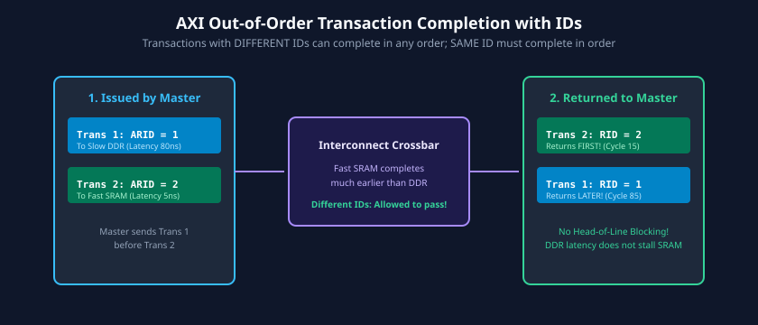
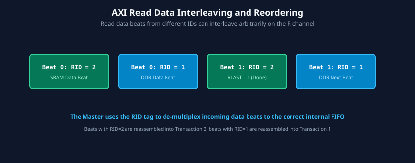

# Transaction Ordering, Multi-Threading, and Out-of-Order Completion

### Learning Objectives
- Understand the performance motivation for out-of-order transaction processing in multi-master, multi-slave SoCs.
- Master the role and structure of AXI Transaction ID tags: `AWID`, `WID` (AXI3), `BID`, `ARID`, and `RID`.
- Contrast strict **Intra-ID Ordering** (same ID) with flexible **Inter-ID Reordering** (different IDs).
- Analyze out-of-order read data returns and beat-level reassembly inside master buffers.
- Trace the architectural rationale behind removing `WID` in AXI4 and understand its impact on interconnect crossbar complexity.
- Examine **ID Widening** (ID prepend) in multi-master interconnect routing fabrics.

---

## Motivation for Out-of-Order Execution

In a modern SoC, a high-performance CPU core or GPU issues memory requests to vastly different target peripherals:
1. **On-Chip SRAM:** Responds in 2-3 clock cycles.
2. **External DDR5 DRAM:** Incurs variable latencies of 50 to 150 clock cycles depending on page hits, row precharge, and refresh cycles.
3. **Off-Chip Flash / PCIe:** Incurs hundreds of clock cycles of latency.

```
Without Out-of-Order (In-Order Bus):
Time ---->
[Req 1 to DDR (Slow)] ------------> [DDR Data Returns]
                                                      [Req 2 to SRAM (Fast)] -> [SRAM Data]
*(Fast SRAM access is completely stalled waiting for slow DDR to finish!)*

With AXI Out-of-Order Execution:
[Req 1 to DDR (ID=1)] -----------------------------------> [DDR Data Returns (ID=1)]
[Req 2 to SRAM (ID=2)] -> [SRAM Data Returns (ID=2)]
*(Fast SRAM access overtakes slow DDR access seamlessly!)*
```

If the bus forced all transactions to complete in the strict order they were issued (in-order), a fast access to on-chip SRAM would sit idle waiting behind a slow DDR memory access. AXI prevents this through **Transaction Identifiers (IDs)** and **out-of-order execution**.



---

## AXI Identification Tags (ID Signals)

Every transaction is tagged with an ID on its address channel:
- **`AWID` (Write Address ID):** Tag assigned by the master to identify a write transaction.
- **`BID` (Write Response ID):** Returned by the slave on the B channel. Must match the `AWID` of the transaction being acknowledged.
- **`ARID` (Read Address ID):** Tag assigned by the master to identify a read transaction.
- **`RID` (Read Data ID):** Returned by the slave on the R channel. Must match the `ARID` of the read request.
- **`WID` (Write Data ID):** Used **only in AXI3** to identify which write address the data beat belonged to. **Eliminated in AXI4**.

---

## The Fundamental AXI Ordering Rules

AXI enforces precise rules regarding when transactions must be kept in order and when they may be reordered:

### Rule 1: Same ID $\implies$ Strict In-Order Execution (Intra-ID)
Transactions that share the same ID value **must be processed and completed in the exact order they were issued**:
- If a master issues Read Address A (`ARID = 1`) and then Read Address B (`ARID = 1`), the slave must return all data beats for Read A before returning any data beats for Read B.
- This guarantees sequential consistency for dependent memory accesses from the same software execution thread.

### Rule 2: Different IDs $\implies$ Arbitrary Reordering Permitted (Inter-ID)
Transactions with different ID values have **no ordering restrictions**:
- If a master issues Read A (`ARID = 1`, targeting slow DDR) and then Read B (`ARID = 2`, targeting fast SRAM), the slave or interconnect can return all data for Read B before returning data for Read A.
- Slaves can service requests in whatever sequence maximizes internal throughput (such as DRAM bank interleaving).

### Rule 3: Read and Write Ordering Independence
There is **no implicit ordering relationship between read transactions and write transactions**, even if they share the same ID! If software requires a read to observe data from an earlier write, it must wait for the write response (`B` channel handshake) before issuing the read address (`AR` channel).

---

## Out-of-Order Read Data Interleaving

In systems with multiple slaves, read data beats from different transactions may not only return out of order, but may even be **interleaved beat-by-beat**:



### Analysis of Read Interleaving:
In the timing diagram above:
1. Master issues Read Burst A (`ARID = 0x1`, 2 beats) and Read Burst B (`ARID = 0x2`, 2 beats).
2. The interconnect routes Burst B to a fast cache, returning Beat B0 (`RID = 2`) first.
3. Then DDR memory returns Beat A0 (`RID = 1`).
4. Next comes Beat B1 (`RID = 2, RLAST = 1`), completing Burst B.
5. Finally comes Beat A1 (`RID = 1, RLAST = 1`), completing Burst A.
6. The master uses the `RID` tag to demultiplex incoming beats into their respective destination registers.

---

## Write Interleaving: AXI3 vs. AXI4 (`WID` Removal)

One of the most consequential architectural changes between AXI3 and AXI4 was the handling of write data ordering:


### The AXI3 Mechanism:
In AXI3, the Write Data channel included a `WID` signal. This permitted a master to issue write address `AWID = 1` and `AWID = 2`, and then interleave write data beats on the W channel:
`WDATA(WID=1)` $\rightarrow$ `WDATA(WID=2)` $\rightarrow$ `WDATA(WID=1)`.

### Why AXI4 Removed `WID`:
1. **Excessive Crossbar Buffering:** In order to support interleaved write data, every slave and intermediate interconnect switch had to incorporate large multi-entry reassembly buffers to hold partial beats from multiple masters.
2. **Lack of Master Support:** In practice, almost no hardware masters (CPUs, DMAs) ever interleaved write data beats from different transactions; they naturally produced data sequentially.
3. **Silicon Area Savings:** Removing `WID` in AXI4 mandates that **write data must be transmitted in the strict sequential order that the write addresses were issued**. This eliminated thousands of gates and routing wires in interconnect crossbars.

---

## Interconnect ID Widening (ID Prepending)

When multiple masters connect to a shared AXI crossbar, each master independently assigns its own IDs (e.g., Master 0 uses IDs `0` through `3`, and Master 1 also uses IDs `0` through `3`).

How does the slave or interconnect distinguish between Master 0's ID `1` and Master 1's ID `1`?

```
Master 0 (4-bit ID: 0001) ---\
                              ---> [ AXI Crossbar ] ---> Slave Interface (6-bit ID)
Master 1 (4-bit ID: 0001) ---/     Prepends Master#
                                   Master 0 -> 2'b00 + 4'b0001 = 6'b000001
                                   Master 1 -> 2'b01 + 4'b0001 = 6'b010001
```

### The ID Extension Mechanism:
1. The interconnect crossbar **widens the ID bus** by prepending an additional master port identifier.
2. For an interconnect with 4 masters, the crossbar appends a 2-bit prefix:
   $$\text{Slave\_ID} = \{\text{Master\_Port\_Number[1:0]}, \ \text{Master\_ID}\}$$
3. When the slave returns read data (`RID`) or write response (`BID`), the interconnect strips the prefix and routes the response back to the originating master port.

---

## Chapter Summary

- **Out-of-order execution** prevents slow peripherals (e.g., DDR memory) from blocking fast peripherals (e.g., on-chip SRAM).
- Transactions with the **same ID** must execute and return in strict sequential order (Intra-ID).
- Transactions with **different IDs** can be completed and reordered arbitrarily (Inter-ID).
- In AXI3, write data interleaving was supported via `WID`. In **AXI4, `WID` was eliminated**; write data must strictly follow the order of issued write addresses.
- Interconnect crossbars implement **ID Widening** by prepending master port indices to preserve transaction origin across shared slaves.

---

## Review Questions

### Question 1
A master issues two read transactions: Read X with `ARID = 4'h1`, followed by Read Y with `ARID = 4'h2`. Can the slave return the data for Read Y before Read X?
<details>
<summary><b>View Answer</b></summary>
Yes. Because Read X and Read Y have different transaction IDs (`ARID = 1` and `ARID = 2`), the AXI specification permits the slave or interconnect to execute, reorder, and complete them in any sequence.
</details>

### Question 2
A master issues Read A with `ARID = 4'h5`, followed by Read B with `ARID = 4'h5`. Can the slave return the data for Read B before Read A?
<details>
<summary><b>View Answer</b></summary>
No. Transactions sharing the same ID tag are subject to strict Intra-ID ordering rules. The slave must return all data beats for Read A (including `RLAST = 1`) before returning any data beats for Read B.
</details>

### Question 3
Why did the removal of `WID` in AXI4 significantly reduce the silicon gate count of interconnect crossbars?
<details>
<summary><b>View Answer</b></summary>
In AXI3, supporting `WID` required slaves and crossbars to implement large reassembly FIFO buffers capable of storing fragmented, interleaved data beats from multiple concurrent write bursts until each burst finished. In AXI4, write data must be transmitted strictly in the order of the write addresses. This allows crossbars to use simple, shallow stream FIFOs without reassembly logic.
</details>

### Question 4
How does an AXI crossbar prevent ID collisions when two distinct masters simultaneously issue transactions using the identical ID value `4'h3`?
<details>
<summary><b>View Answer</b></summary>
The crossbar performs ID Widening (ID prepending). It appends unique master identifier bits to the incoming ID (e.g., tagging Master 0 as `2'b00_0011` and Master 1 as `2'b01_0011`). When the slave responds with the widened ID, the interconnect decodes the prefix to route the response to the correct master port and strips the prefix before delivering it.
</details>

---

##### Copyright (c) 2026 squared-studio

