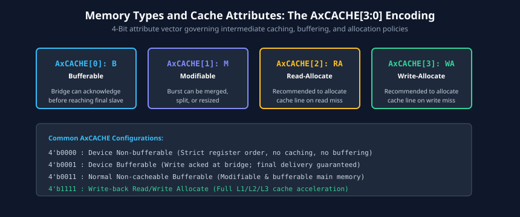
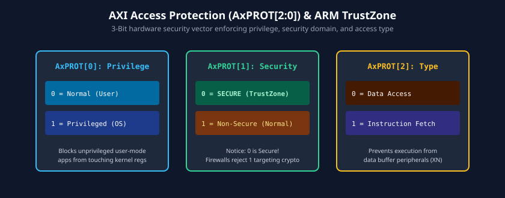
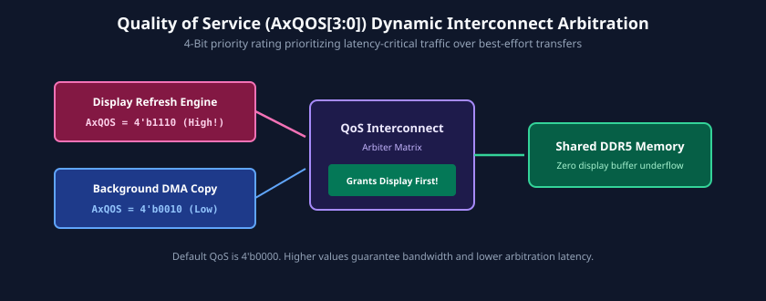

# Advanced Attributes: Cache, Protection, QoS, and Regions

### Learning Objectives
- Master the 4-bit `AxCACHE` memory attribute encoding and understand the exact architectural meaning of Bufferable, Modifiable, and Allocation attributes.
- Distinguish between Device Memory, Strongly-Ordered Memory, and Normal Cacheable Memory in SoC fabrics.
- Decode the 3-bit `AxPROT` protection signal and analyze hardware security firewalls (e.g., Arm TrustZone).
- Apply Quality of Service (`AxQOS`) signaling to resolve interconnect bandwidth starvation for real-time engines.
- Use `AxREGION` to simplify address decoding across multi-region memory-mapped slaves.

---

## Memory Attributes and `AxCACHE` Signaling

In modern SoCs, not all memory locations behave like ordinary RAM. Writing to a hardware control register in a network card must not be delayed, merged, or cached; conversely, fetching instructions from main memory should be aggressively cached and buffered.

AXI conveys these memory characteristics via the 4-bit `AWCACHE` and `ARCACHE` signals.

### Bit Definitions of `AxCACHE[3:0]`:
| Bit | Name | Logic 0 Meaning | Logic 1 Meaning |
|:---:|---|---|---|
| `[0]` | **Bufferable (B)** | The transaction must reach the final destination slave before response acknowledgment is returned. | An intermediate interconnect or bridge can acknowledge the transaction early before it reaches the final destination. |
| `[1]` | **Modifiable (M)** | The transaction attributes cannot be modified. Cannot split or merge bursts. | The transaction can be modified (e.g., split into smaller bursts, merged with adjacent writes, or resized). |
| `[2]` | **Other / Read Allocate (RA)** | Do not allocate this transaction in cache on a miss. | Recommendation to allocate in cache on a read miss. |
| `[3]` | **Other / Write Allocate (WA)** | Do not allocate this transaction in cache on a miss. | Recommendation to allocate in cache on a write miss. |

---

## Standard `AxCACHE` Memory Encodings

The AXI specification establishes standardized interpretations for common 4-bit combinations:

| `AxCACHE[3:0]` | Memory Type Designation | Modifiable? | Bufferable? | Cache Allocate? | Typical Use Case |
|:---:|---|:---:|:---:|:---:|---|
| `4'b0000` | **Device Non-bufferable** | No | No | None | Peripheral control registers, interrupts |
| `4'b0001` | **Device Bufferable** | No | Yes | None | Hardware write-only FIFOs, UART TX |
| `4'b0010` | **Normal Non-cacheable Non-bufferable** | Yes | No | None | Shared non-cached memory, DMA descriptors |
| `4'b0011` | **Normal Non-cacheable Bufferable** | Yes | Yes | None | Framebuffers, bulk uncached video buffers |
| `4'b0110` | **Write-Through No-Allocate** | Yes | Yes | None | Cached data where lines are not allocated on miss |
| `4'b0111` | **Write-Through Read-Allocate** | Yes | Yes | Read only | Read-intensive code/data |
| `4'b1111` | **Write-Back Read and Write-Allocate** | Yes | Yes | Read & Write | Standard CPU stack and application data |

---

## Protection Levels and `AxPROT` (Hardware Firewalls)

To safeguard sensitive system resources and enforce OS/kernel privilege boundaries, AXI includes a 3-bit protection signal: `AWPROT` and `ARPROT`.

### Bit Definitions of `AxPROT[2:0]`:

#### Bit 0: Privilege Level (`AxPROT[0]`)
- `0` = **Normal (User Mode):** Issued by unprivileged user-space applications.
- `1` = **Privileged (Kernel / Supervisor Mode):** Issued by operating system kernels or hypervisors.
- *Application:* Slaves can reject accesses from unprivileged user software targeting sensitive system control registers with `SLVERR`.

#### Bit 1: Security Domain (`AxPROT[1]`)
- `0` = **Secure Access:** Issued by a Secure World entity (e.g., Arm TrustZone Secure state).
- `1` = **Non-Secure Access:** Issued by the standard operating system (e.g., Linux, Android).
- *Application:* Hardware security firewalls intercept accesses where `AxPROT[1] = 1` targeting secure RAM, crypto keys, or biometric sensors, returning `DECERR` or `SLVERR`.

#### Bit 2: Access Type (`AxPROT[2]`)
- `0` = **Data Access:** Load or store instruction execution.
- `1` = **Instruction Access:** CPU program counter instruction fetch.
- *Application:* Memory controllers can implement **Execute-Never (XN)** policies by rejecting instruction fetches from data-only buffer regions to block buffer-overflow exploits.

---

## Quality of Service (`AxQOS`) Signaling

In complex SoCs, multiple masters compete for limited memory bandwidth at the main DDR memory controller. If a high-throughput CPU cache refill floods the interconnect, a real-time display controller (e.g., HDMI / 4K Display Engine) could starve, causing visible screen flicker or dropped camera frames.

To prevent starvation, AXI4 introduces a 4-bit **Quality of Service** signal: `AWQOS` and `ARQOS`.

### QoS Mechanics:
- `4'b0000` indicates default, lowest priority (best-effort traffic).
- `4'b1111` indicates the highest priority.
- Interconnect crossbars and DDR schedulers evaluate `AxQOS` dynamically on every arbitration cycle.
- **Priority Escalation:** If a display FIFO drops below a critical watermark, the display master dynamically raises its `ARQOS` value from `4'h4` to `4'hE`. The interconnect arbiter immediately prioritizes the display controller ahead of background CPU and GPU memory requests.

---

## Multiple Region Signaling (`AxREGION`)

In traditional interconnects, if an on-chip peripheral occupies multiple non-contiguous memory spaces, the interconnect address decoder must implement multiple slave select decode logic blocks.

AXI4 introduces `AWREGION` and `ARREGION` (4-bit signals) to optimize decoder silicon area:
- The interconnect decodes only the top-level base address of the slave.
- The interconnect outputs `AxREGION[3:0]` to indicate which of up to 16 distinct sub-regions inside that slave is being targeted.
- This dramatically shrinks interconnect routing and decoding logic in large memory-mapped multi-bank accelerators.

---

## Chapter Summary

- **`AxCACHE`** dictates memory caching policies: Bufferability (early response), Modifiability (burst merging/splitting), and Cache Allocation hints.
- Peripheral control registers must be marked **Device Non-bufferable** (`4'b0000`) to prevent data corruption and unexpected response timing.
- **`AxPROT`** encodes Privileged vs. User, Secure (TrustZone) vs. Non-Secure, and Instruction vs. Data access levels for hardware-enforced isolation.
- **`AxQOS`** enables dynamic priority arbitration at interconnect crossbars, guaranteeing latency bounds for real-time multimedia engines.
- **`AxREGION`** enables compact address decoding across multi-bank slave subsystems.

---

## Review Questions

### Question 1
What does `AxCACHE[0]` (Bufferable bit) indicate to an intermediate bus bridge or interconnect?

<b>View Answer</b>

The Bufferable bit indicates whether an intermediate component (such as a bus bridge or interconnect buffer) is permitted to return a write response (`BRESP = OKAY`) before the data has reached the final physical destination slave. If `Bufferable = 0`, the transaction must travel all the way to the final target slave before acknowledgment.

### Question 2
Why is it dangerous to set `AxCACHE` to Modifiable (`4'b0011` or higher) when accessing memory-mapped peripheral control registers?

<b>View Answer</b>

When a transaction is marked Modifiable, the interconnect is permitted to merge multiple write transactions, optimize away read accesses, resize data transfers, or split bursts. For hardware registers (such as interrupt status flags or FIFO read pointers), merging or dropping accesses will corrupt hardware state machines and cause device driver malfunctions. Peripheral registers must always be accessed as Device Non-modifiable (`4'b0000` or `4'b0001`).

### Question 3
How does Arm TrustZone utilize `AxPROT[1]` to prevent unauthorized software from accessing cryptographic keys stored in secure on-chip SRAM?

<b>View Answer</b>

When non-secure software (such as an untrusted rich OS) runs, the processor core forces `AxPROT[1] = 1` (Non-Secure). Hardware security firewalls at the input of the secure SRAM monitor `AxPROT[1]`. If an access arrives with `AxPROT[1] = 1`, the firewall immediately blocks the request and asserts `DECERR` or `SLVERR`, preventing the non-secure operating system from reading or writing cryptographic secrets.

### Question 4
A camera subsystem is dropping video frames due to memory bus congestion from a 3D graphics rendering job. How can `AxQOS` be configured to resolve this issue?

<b>View Answer</b>

The system architect can assign a higher Quality of Service value (e.g., `ARQOS = 4'hC`) to the camera DMA controller and a lower QoS value (e.g., `ARQOS = 4'h2`) to the GPU. The interconnect and DDR memory scheduler will dynamically prioritize camera read and write requests ahead of GPU requests during bus contention, ensuring video frames are captured without dropping.

---

##### Copyright (c) 2026 squared-studio

