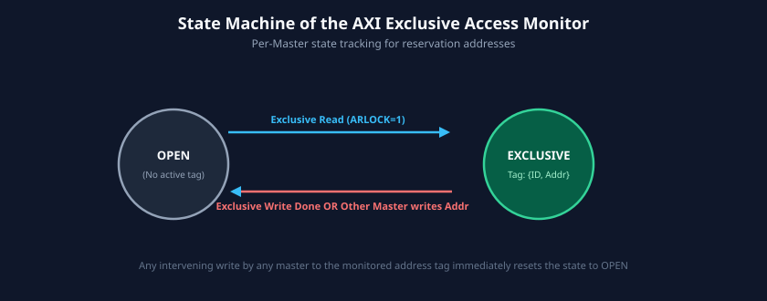

# Atomic and Exclusive Accesses

### Learning Objectives
- Understand the need for atomic primitives (semaphores, mutexes, spinlocks) in shared-memory multi-core SoCs.
- Contrast legacy **Locked Accesses** (AXI3) with scalable **Exclusive Accesses** (AXI4).
- Master the step-by-step transaction flow of an Exclusive Read / Exclusive Write sequence.
- Analyze the state machine of the **Exclusive Monitor** (Open State vs. Exclusive State).
- Distinguish between **Internal Monitors** (inside CPU cores) and **External Monitors** (inside interconnects/slaves).
- Interpret `EXOKAY` versus `OKAY` responses to determine atomic transaction success or failure.

---

## Multiprocessor Synchronization: The Need for Atomicity

In modern multi-core SoCs, multiple CPU cores and DMA engines share common memory. When multiple threads concurrently attempt to modify a shared variable (such as incrementing a counter or acquiring a task lock), a classic **Read-Modify-Write race condition** emerges:

```
Core 0: Reads Counter (Value = 5)
Core 1: Reads Counter (Value = 5)
Core 0: Increments to 6, writes 6 to memory
Core 1: Increments to 6, writes 6 to memory
Result: Counter is 6 instead of 7! One increment is lost.
```

To resolve this, hardware must guarantee **atomicity**: ensuring that no other master can modify the target memory location between the initial read and the subsequent write.

---

## Evolution: Locked Accesses vs. Exclusive Accesses

The AXI specification provides two mechanisms to achieve atomicity:

| Feature | Locked Access (`AxLOCK` in AXI3) | Exclusive Access (`AxLOCK` in AXI3 & AXI4) |
|---|---|---|
| **Protocol Support** | AXI3 only (`AxLOCK = 2'b10`). **Removed in AXI4**. | Supported in AXI3 (`AxLOCK = 2'b01`) and **AXI4 (`AxLOCK = 1'b1`)**. |
| **Hardware Mechanism** | Physically locks the interconnect arbiter. All other masters are stalled until unlock. | Optimistic concurrency: non-blocking. Monitors track address modifications without stalling. |
| **System Impact** | Severe bus latency degradation; starves real-time masters. | Zero interconnect stalls; highly scalable to dozens of cores. |
| **Silicon Cost** | Heavy crossbar arbitration lock-out logic. | Small address comparison tracking monitor (Exclusive Monitor). |

Because locked accesses created severe latency spikes and degraded multi-core performance, **AXI4 completely removed locked transfers**, standardizing entirely on **Exclusive Accesses**.

---

## The Exclusive Access Transaction Flow

The exclusive access protocol operates on an **optimistic concurrency** model (similar to Load-Link / Store-Conditional or Compare-And-Swap):

1. **Step 1: Exclusive Read:** A master reads a memory location with `ARLOCK = 1`. An **Exclusive Monitor** records the master ID and the target address, transitioning to the *Exclusive State*.
2. **Step 2: Local Modification:** The master modifies the retrieved value locally in its CPU registers.
3. **Step 3: Exclusive Write:** The master attempts to write back the updated value with `AWLOCK = 1`.
4. **Step 4: Monitor Evaluation:**
   - If no other master wrote to that monitored address in the interim, the write succeeds. The slave updates memory and returns **`BRESP = EXOKAY`**.
   - If another master modified that address in the interim, the exclusive reservation was broken. The slave or monitor **blocks the write from updating memory** and returns **`BRESP = OKAY`**.
5. **Step 5: Software Retry:** The master inspects `BRESP`. If `EXOKAY`, the lock was acquired; if `OKAY`, the lock failed, and software loops back to Step 1.


---

## The Exclusive Monitor State Machine

The heart of the exclusive access mechanism is the **Exclusive Access Monitor**. It functions as a finite state machine (FSM) that monitors addresses across the interconnect:



### State Machine Analysis:
- **Reset / Open Access State:**
  - The monitor is idle. No address is exclusively locked by this master.
  - Normal read and write transactions pass through without affecting monitor state.
  - An Exclusive Write received in this state **fails immediately** (returns `OKAY` and does not write to memory).
- **Transition to Exclusive Access State:**
  - Triggered when the master executes an **Exclusive Read (`ARLOCK = 1`)**.
  - The monitor registers the target address region (`Monitored_Addr`) and master ID (`ARID`).
- **Transition back to Open Access State (Reservation Reset):**
  - **Scenario A:** The master successfully issues an Exclusive Write to the monitored address $\rightarrow$ Transitions to Open State, returns `EXOKAY`.
  - **Scenario B:** Another master (or DMA) performs a write to any byte within the monitored address region $\rightarrow$ The reservation is invalidated, transitions to Open State!
  - **Scenario C:** The master issues a normal write to that same monitored region.

---

## Internal vs. External Exclusive Monitors

In real-world SoC implementations, exclusive monitors are divided into two physical categories:

### Internal Exclusive Monitors
- Reside **inside the CPU core or cluster** (at the L1/L2 cache boundary).
- Track exclusive accesses targeting **Cacheable / Normal Memory**.
- When an exclusive read hits in the CPU's local L1/L2 cache, the internal monitor tracks the cache line tag. No AXI traffic ever reaches the external bus, saving massive interconnect bandwidth!

### External Exclusive Monitors
- Reside **in the AXI interconnect fabric or DDR memory controller**.
- Track exclusive accesses targeting **Non-cacheable or Shared Device Memory**.
- When an exclusive access reaches the external interconnect (`AxLOCK = 1`), the external monitor hardware records the address and master ID to manage hardware reservations across multiple masters.

---

## Protocol Restrictions for Exclusive Accesses

To ensure deterministic monitor tracking, AXI imposes strict constraints on exclusive bursts:
1. **Burst Size and Alignment:** The address must be naturally aligned to the total byte count of the transfer:
   $$\text{Address} \pmod{2^{\text{AxSIZE}}} = 0$$
2. **Burst Length Limit:** The burst length must not exceed **16 beats** (`AxLEN` $\le 15$).
3. **Burst Type:** Must be `INCR` or `WRAP` (`FIXED` bursts are forbidden).
4. **ID Consistency:** The `AWID` of the Exclusive Write must match the `ARID` of the preceding Exclusive Read that initialized the monitor.
5. **Address Consistency:** The address and size of the Exclusive Write must match the address and size of the preceding Exclusive Read.

---

## Chapter Summary

- Atomic operations are essential to prevent race conditions during shared-memory multi-core synchronization.
- **AXI3 Locked Accesses** physically locked the crossbar arbiter, causing severe bus stalls, and were **removed in AXI4**.
- **AXI4 Exclusive Accesses** use non-blocking optimistic concurrency monitored by **Exclusive Monitors**.
- An exclusive sequence consists of an Exclusive Read (`ARLOCK = 1`) followed by an Exclusive Write (`AWLOCK = 1`).
- Successful exclusive writes update memory and return **`EXOKAY`** (`2'b01`).
- Failed exclusive writes do not modify memory and return **`OKAY`** (`2'b00`), prompting software to retry.
- Monitors are deployed internally (for cacheable accesses) and externally (for shared uncached memory).

---

## Review Questions

### Question 1
Why were locked accesses (`AxLOCK = 2'b10`) completely removed in the AXI4 specification?
<details>
<summary><b>View Answer</b></summary>
Locked accesses required the interconnect arbiter to physically lock the bus fabric, preventing any other master from accessing memory until the locked master released the bus. In modern multi-core SoCs, this created catastrophic latency spikes, ruined real-time deadlines for video/display engines, and did not scale beyond a few cores. Exclusive accesses achieve atomicity without stalling unrelated bus traffic.
</details>

### Question 2
If an exclusive write transaction fails because another core modified the monitored address, what response code does the slave return on `BRESP`? Does the write modify memory?
<details>
<summary><b>View Answer</b></summary>
The slave returns `BRESP = 2'b00` (`OKAY`), indicating that the bus transaction completed normally without an electrical bus error, but the exclusive access failed. The write data **must not** be committed to memory; the memory remains unchanged. The master detects that `BRESP` is not `EXOKAY` and retries the atomic operation.
</details>

### Question 3
What happens to an active exclusive monitor reservation if an unrelated DMA engine writes to the monitored address?
<details>
<summary><b>View Answer</b></summary>
The Exclusive Monitor observes the write address broadcast on the bus. Because the write address overlaps the monitored address region, the monitor immediately clears its reservation and transitions from the Exclusive Access state to the Open Access state. When the original master later attempts its Exclusive Write, the monitor detects that the reservation was broken and rejects the write.
</details>

### Question 4
Can an exclusive transaction have a burst length of 64 beats in AXI4?
<details>
<summary><b>View Answer</b></summary>
No. The AXI specification strictly limits exclusive accesses to a maximum of 16 beats (`AxLEN` $\le 15$). Long bursts are prohibited because tracking large address spans in hardware exclusive monitors would require prohibitively expensive and complex address comparison logic.
</details>

---

##### Copyright (c) 2026 squared-studio

