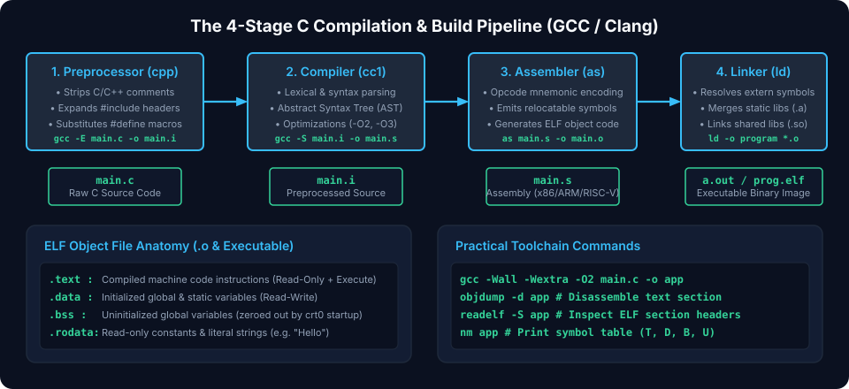
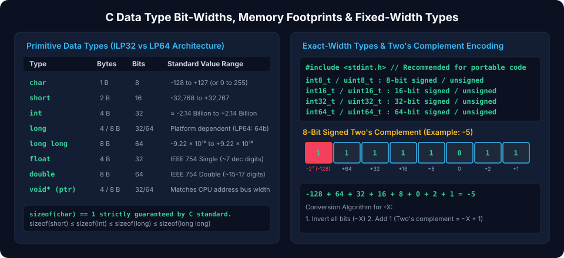
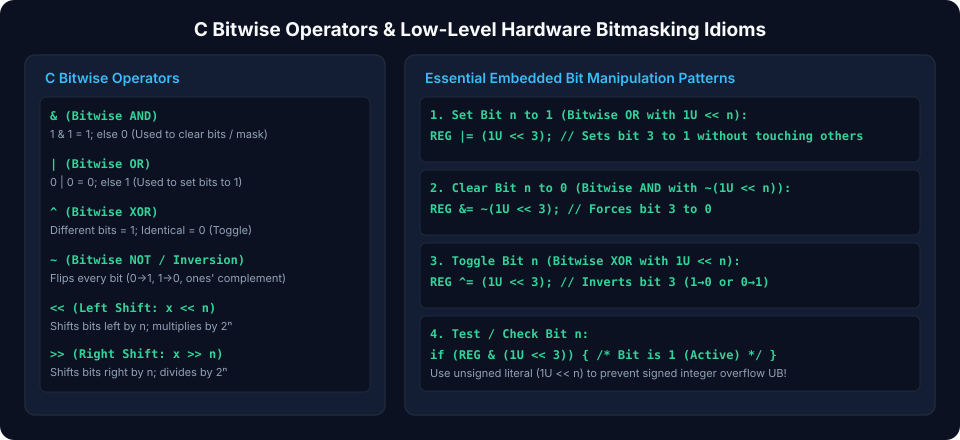

# Chapter 1: C Fundamentals, Compilation Pipeline & Data Types

The C programming language provides an abstraction layer that maps directly to underlying computer architecture and microprocessor execution models. Developing high-performance systems, operating system kernels, device drivers, and embedded firmware requires an intimate understanding of how C code translates into assembly instructions, how primitive types reside in physical memory, and how bitwise operators directly manipulate binary state.

---

## 1.1 Architecture of the C Compilation Toolchain

A standard C source file undergoes four distinct transformation phases before producing an executable binary image: Preprocessing, Compilation, Assembly, and Linking. Modern compilers such as `gcc` and `clang` encapsulate these steps, but systems engineers must inspect intermediate representations to diagnose low-level bugs, optimize instruction flow, and verify calling conventions.



### 1. The Preprocessor (`cpp`)

The preprocessor acts as a macro processor and textual filter. It parses directives starting with `#`:

- `#include`: Textually inserts the contents of referenced header files into the compilation unit.
- `#define`: Performs macro token expansion and textual substitution.
- `#ifdef`, `#ifndef`, `#endif`: Conditionally excludes or includes token blocks based on symbol definitions.
- Strips comments (`/* ... */` and `// ...`) and normalizes whitespace.

To stop compilation after preprocessing and view the pure expanded translation unit:

```bash
gcc -E main.c -o main.i
```

### 2. The Compiler (`cc1` / Clang frontend)

The compiler takes the preprocessed `.i` file, performs lexical analysis, abstract syntax tree (AST) construction, static semantic verification, optimization passes (e.g., dead code elimination, loop unrolling, register allocation), and generates target-specific assembly code (`.s`):

```bash
gcc -S -O2 main.c -o main.s
```

### 3. The Assembler (`as`)

The assembler translates human-readable machine assembly mnemonics into machine code instructions, outputting an unlinked relocatable object file (`.o` or `.obj`):

```bash
gcc -c main.s -o main.o
```

An object file contains machine instructions, relocation entries, symbol tables (exported functions, imported references), and debugging symbols (DWARF format).

### 4. The Linker (`ld`)

The linker resolves unresolved external symbols across multiple object files and static or dynamic libraries (`.a`, `.so`, `.lib`, `.dll`). It assigns real or relocatable virtual addresses to code and data sections:

```bash
gcc main.o utils.o -o firmware.elf -Wl,-Map=firmware.map
```

---

## 1.2 Primitive Data Types, Memory Sizes & `stdint.h`

In standard C, the bit width of fundamental types (`short`, `int`, `long`) depends on the target architecture's Data Model (such as **ILP32** for 32-bit systems or **LP64** for 64-bit Unix/Linux).



### Data Models Comparison

| Type              | LP32 (Win16) | ILP32 (ARM32 / x86) | LP64 (Linux / macOS 64-bit) | LLP64 (Windows 64-bit) |
| :---------------- | :----------: | :-----------------: | :-------------------------: | :--------------------: |
| `char`            |    8 bits    |       8 bits        |           8 bits            |         8 bits         |
| `short`           |   16 bits    |       16 bits       |           16 bits           |        16 bits         |
| `int`             |   16 bits    |       32 bits       |           32 bits           |        32 bits         |
| `long`            |   32 bits    |       32 bits       |           64 bits           |        32 bits         |
| `long long`       |   64 bits    |       64 bits       |           64 bits           |        64 bits         |
| Pointer (`void*`) |   32 bits    |       32 bits       |           64 bits           |        64 bits         |

### Exact-Width Integer Types (`<stdint.h>`)

Because variable width across compilers induces subtle cross-platform failures, systems and embedded firmware mandate exact-width types defined in ISO C99 `<stdint.h>`:

```c
#include <stdint.h>
#include <stdbool.h>

int8_t   s8_val  = -128;                 // Exactly 8 bits signed   [-128 to +127]
uint8_t  u8_val  = 255U;                 // Exactly 8 bits unsigned [0 to 255]
int16_t  s16_val = -32768;               // Exactly 16 bits signed
uint16_t u16_val = 65535U;               // Exactly 16 bits unsigned
int32_t  s32_val = -2147483648;          // Exactly 32 bits signed
uint32_t u32_val = 4294967295U;          // Exactly 32 bits unsigned
int64_t  s64_val = -9223372036854775807LL - 1; // Exactly 64 bits signed
uint64_t u64_val = 18446744073709551615ULL;    // Exactly 64 bits unsigned

uintptr_t addr_val = (uintptr_t)&u32_val; // Integer guaranteed to hold a void* address
```

---

## 1.3 Literal Constants, Type Promotions & Sign Extension

Expressions containing operands smaller than `int` undergo **Integer Promotion**. Operations on `uint8_t` or `int16_t` automatically promote operands to `int` (or `unsigned int`) before computing arithmetic or bitwise operations.

### Two's Complement and Sign Extension

Signed integers in modern architectures use Two's Complement notation. When a smaller signed value is converted to a larger type, the sign bit (MSB) is replicated across all upper bit positions (**sign extension**):

$$\text{Value} = -b_{N-1} 2^{N-1} + \sum_{i=0}^{N-2} b_i 2^i$$

```c
int8_t  small_neg = -5;          // Binary: 0xFB (1111 1011)
int16_t extended  = small_neg;   // Binary: 0xFFFB (1111 1111 1111 1011) -> sign bit preserved
uint16_t zero_ext = (uint8_t)small_neg; // Binary: 0x00FB (0000 0000 1111 1011) -> zero extended
```

> [!WARNING]
> Unintended signed-to-unsigned conversion can lead to critical security flaws. If a negative signed integer is compared against an unsigned length parameter, the negative number wraps into an enormous positive number, bypassing array boundary checks.

---

## 1.4 Bitwise Manipulation Operators & Low-Level Masks

Bitwise operators manipulate individual bits directly within registers and memory buffers. In embedded and hardware design, status and control registers map directly to bit arrays.



### Bitwise Operation Reference

1. **Bitwise AND (`&`)**: Isolates or clears specific bits using a zero-mask.
2. **Bitwise OR (`|`)**: Sets specific bits using a one-mask.
3. **Bitwise XOR (`^`)**: Inverts/toggles specific bits.
4. **Bitwise NOT (`~`)**: Inverts all bits (one's complement).
5. **Left Shift (`<<`)**: Shifts bits to the left, zero-filling the LSBs ($x \ll n \equiv x \times 2^n$).
6. **Right Shift (`>>`)**:
   - _Logical Shift_ on `unsigned`: Zero-fills MSBs.
   - _Arithmetic Shift_ on signed: Preserves the MSB (sign bit).

### Register Masking Idioms

```c
#include <stdint.h>

#define REG_ENABLE_BIT      (1U << 0)   // Bit 0
#define REG_RX_IRQ_BIT      (1U << 3)   // Bit 3
#define REG_TX_IRQ_BIT      (1U << 4)   // Bit 4
#define REG_BAUD_MASK       (0x0FU << 8) // Bits 8..11 (Baud rate field)

// Setting Bits (OR)
void enable_peripheral(volatile uint32_t *reg) {
    *reg |= (REG_ENABLE_BIT | REG_RX_IRQ_BIT);
}

// Clearing Bits (AND with NOT)
void disable_rx_irq(volatile uint32_t *reg) {
    *reg &= ~REG_RX_IRQ_BIT;
}

// Toggling Bits (XOR)
void toggle_tx_irq(volatile uint32_t *reg) {
    *reg ^= REG_TX_IRQ_BIT;
}

// Reading / Testing a Bit
bool is_rx_irq_pending(volatile uint32_t reg) {
    return (reg & REG_RX_IRQ_BIT) != 0U;
}

// Field Insertion (Clear field then OR new shifted value)
void set_baud_rate(volatile uint32_t *reg, uint8_t baud_val) {
    uint32_t current = *reg;
    current &= ~REG_BAUD_MASK;                   // Step 1: Clear bits 8..11
    current |= ((uint32_t)(baud_val & 0x0F) << 8); // Step 2: Insert 4-bit value
    *reg = current;
}
```

---

## 1.5 Control Flow, Branch Hints & Jump Tables

Efficient control flow is critical in microcontrollers and latency-sensitive loops. Compilers transform high-level `if`/`else` and `switch` statements into conditional branches or indirect jump tables.

### Branch Prediction Optimization

When pipelined CPUs encounter conditional branches, a branch misprediction flushes the execution pipeline, incurring an 8 to 20 cycle penalty. Compilers provide built-in branch hints:

```c
#define likely(x)   __builtin_expect(!!(x), 1)
#define unlikely(x) __builtin_expect(!!(x), 0)

void process_packet(const uint8_t *buffer, size_t len) {
    if (unlikely(buffer == NULL || len == 0)) {
        // Fast error path placed out of line in instruction cache
        handle_error_condition();
        return;
    }
    // Hot execution path executed without branch penalty
    execute_packet_checksum(buffer, len);
}
```

### Switch Statements vs. Jump Tables

When a `switch` statement has contiguous integer cases, compilers emit an indexed jump table ($O(1)$ constant-time dispatch) instead of sequential comparison branches ($O(n)$):

```c
typedef enum {
    CMD_IDLE = 0,
    CMD_RUN  = 1,
    CMD_STOP = 2,
    CMD_RESET= 3
} command_t;

void execute_state_machine(command_t cmd) {
    switch (cmd) {
        case CMD_IDLE:  idle_task();  break;
        case CMD_RUN:   run_task();   break;
        case CMD_STOP:  stop_task();  break;
        case CMD_RESET: reset_task(); break;
        default:        fault_task(); break;
    }
}
```

*Generated assembly creates a lookup table of code labels in `.rodata` and executes `jmp *jump_table(,%rdi,8)`.\*

---

##### Copyright (c) 2026 squared-studio
