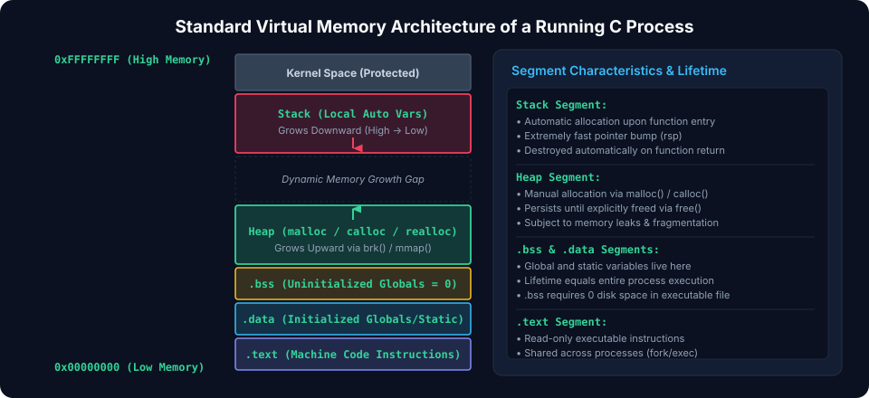
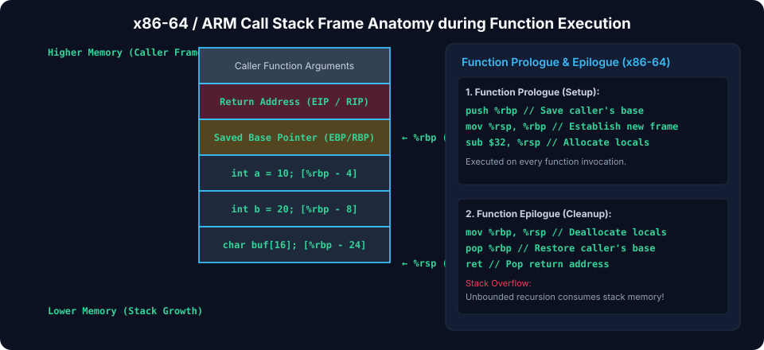
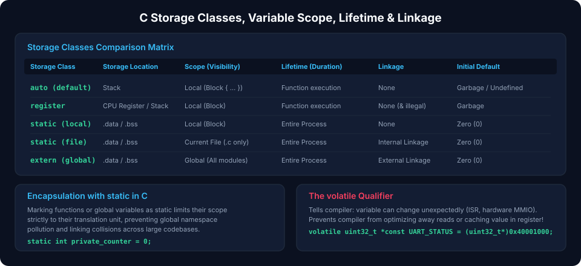

# Chapter 2: Functions, Call Stack Architecture & Memory Layout

A running C program executes within a structured virtual memory map provided by the operating system and CPU Memory Management Unit (MMU). Understanding the call stack, memory segments, calling conventions, and variable lifetimes is essential for writing robust systems software and diagnosing stack overflows, race conditions, and memory corruption.

---

## 2.1 Virtual Address Space Anatomy

When an operating system loads a C executable into memory, it assigns it a contiguous virtual address space partitioned into distinct segments with hardware-enforced read, write, and execute permissions.



### Virtual Memory Segments Breakdown

1. **Text (Code) Segment (`.text`)**:
   - Contains compiled CPU machine instructions.
   - Permissions: **Read-Only + Execute (`RX`)**.
   - Shared between multiple running instances of the same binary.
2. **Read-Only Data (`.rodata`)**:
   - Contains string literals (`"Hello World"`) and `const` initialized variables.
   - Permissions: **Read-Only (`R`)**. Writing to this segment triggers a Segmentation Fault (`SIGSEGV`).
3. **Initialized Data Segment (`.data`)**:
   - Contains global and `static` variables initialized to non-zero values at compile time.
   - Permissions: **Read-Write (`RW`)**. Embedded directly within the binary file on disk.
4. **Uninitialized Data Segment (`.bss`)**:
   - _Block Started by Symbol_. Contains global and `static` variables that are uninitialized or initialized to zero.
   - Does not consume space in the binary on disk; the C runtime startup (`crt0`) zeros this memory region before `main()` is invoked.
5. **Heap**:
   - Grows **upwards** from lower virtual addresses toward higher addresses via `brk`/`sbrk` or `mmap`.
   - Managed dynamically at runtime via `malloc()`, `calloc()`, and `free()`.
6. **Call Stack**:
   - Grows **downwards** from high virtual memory towards lower memory addresses.
   - Stores function stack frames, local automatic variables, return addresses, and register backups.
7. **Kernel Space**:
   - Top of virtual address space (e.g., upper 128 TB on x86-64). Protected by CPU ring privilege levels.

---

## 2.2 Stack Frame Anatomy & Calling Conventions

Every time a function is called, a new **Stack Frame** (or Activation Record) is allocated on top of the call stack. When the function returns, its frame is popped, reclaiming the allocated memory instantly.



### The Call / Return Lifecycle on x86-64

1. **Caller Prologue**:
   - The caller places the first 6 integer/pointer arguments into CPU registers (`%rdi`, `%rsi`, `%rdx`, `%rcx`, `%r8`, `%r9`).
   - Any additional arguments (7th+) are pushed onto the stack in reverse order.
2. **The `call` Instruction**:
   - The CPU pushes the **Return Address** (the instruction pointer `%rip` of the next instruction) onto the stack:
     $$\text{RSP} \leftarrow \text{RSP} - 8; \quad [\text{RSP}] \leftarrow \text{RIP}$$
   - Execution jumps to the callee's entry label.
3. **Callee Prologue**:
   - The callee saves the caller's Base Pointer (`%rbp`):
     ```assembly
     pushq   %rbp
     movq    %rsp, %rbp
     ```
   - Subtracts bytes from `%rsp` to allocate space for local variables:
     ```assembly
     subq    $32, %rsp
     ```
4. **Callee Epilogue & `ret`**:
   - Places the return value in `%rax`.
   - Restores the caller's stack frame:
     ```assembly
     movq    %rbp, %rsp
     popq    %rbp
     ret
     ```
   - The `ret` instruction pops the stored return address from the stack back into `%rip`.

> [!CAUTION]
> If a local buffer overflows (Stack Buffer Overflow), an attacker can overwrite the saved `%rbp` and **Return Address** on the stack, diverting CPU control flow to malicious code (Return-Oriented Programming, ROP).

---

## 2.3 Storage Classes, Scope, Linkage & Lifetime

The lifetime, visibility, and storage location of a C variable are controlled by its **Storage Class Specifier**.



### Comparison Matrix

| Specifier              | Memory Segment       | Scope / Visibility      | Lifetime            | Linkage            |
| :--------------------- | :------------------- | :---------------------- | :------------------ | :----------------- |
| `auto` (default local) | Stack                | Block `{}`              | Block entry to exit | None               |
| `register`             | CPU Register / Stack | Block `{}`              | Block entry to exit | None               |
| `static` (local)       | `.data` or `.bss`    | Block `{}`              | Program duration    | None               |
| `static` (global)      | `.data` or `.bss`    | File / Translation Unit | Program duration    | Internal (private) |
| `extern` (global)      | `.data` or `.bss`    | Entire Program          | Program duration    | External (public)  |

### Practical Code Demonstration

```c
// File: sensor_driver.c

// Global with External Linkage: accessible from other .c files via "extern int system_tick_count;"
int system_tick_count = 0;

// Global with Internal Linkage: strictly invisible to other files (private encapsulation)
static uint32_t private_filter_state = 0xAA55AA55;

void process_sample(int sample) {
    // Local static variable: initialized ONCE at program load, retains value between calls
    static int sample_history_count = 0;

    // Automatic local variable: allocated on stack every call, destroyed at return
    int local_normalized = sample - 512;

    sample_history_count++;
    private_filter_state += (uint32_t)local_normalized;
}
```

---

## 2.4 Compiler Qualifiers: `const`, `volatile`, and `restrict`

Type qualifiers inform the compiler's optimizer how memory accesses must be emitted in assembly.

### 1. `const`

Guarantees read-only semantics to the compiler. For global variables, placing `const` instructs the linker to map the data into the `.rodata` segment, saving RAM in microcontrollers by running directly from Flash/ROM:

```c
const uint32_t FACTORY_SERIAL_NUMBER = 0x12345678; // Stored in Flash / .rodata
```

### 2. `volatile`

Prevents the compiler from applying register caching, dead-code elimination, or instruction reordering to memory accesses. Mandatory for:

- Memory-Mapped Peripheral Registers (hardware updates asynchronously).
- Global flags modified inside Interrupt Service Routines (ISRs).
- Shared memory variables accessed across multiple threads.

```c
// Without volatile, the compiler optimizes "while (!g_uart_rx_flag)" into an infinite loop:
// "mov eax, [g_uart_rx_flag]; L1: test eax, eax; jz L1"
extern volatile uint8_t g_uart_rx_flag;

void wait_for_uart_byte(void) {
    while (g_uart_rx_flag == 0U) {
        // Compiler re-reads g_uart_rx_flag from memory on EVERY iteration
    }
    g_uart_rx_flag = 0U;
}
```

### 3. `restrict` (C99)

Applied to a pointer, `restrict` asserts that for the lifetime of that pointer, the target object will only be accessed through that pointer (no aliasing). This permits aggressive SIMD vectorization and register caching:

```c
void vector_add(int *restrict dest, const int *restrict src_a, const int *restrict src_b, size_t n) {
    for (size_t i = 0; i < n; i++) {
        dest[i] = src_a[i] + src_b[i]; // Guaranteed dest does not overlap src_a or src_b
    }
}
```

---

## 2.5 Recursion vs. Iteration & Stack Exhaustion

Every recursive call consumes a new stack frame (parameters, local variables, return address). If recursion depth grows unboundedly, the stack collides with the heap or guard page, causing a **Stack Overflow** crash.

```c
// Deep recursion risks stack exhaustion in embedded systems with 4KB stacks
uint32_t recursive_factorial(uint32_t n) {
    if (n <= 1) return 1;
    return n * recursive_factorial(n - 1);
}

// Tail-call optimized or iterative equivalent runs in O(1) stack space
uint32_t iterative_factorial(uint32_t n) {
    uint32_t accumulator = 1;
    for (uint32_t i = 2; i <= n; i++) {
        accumulator *= i;
    }
    return accumulator;
}
```

---

##### Copyright (c) 2026 squared-studio
