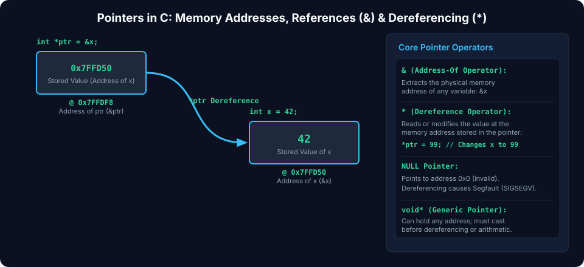
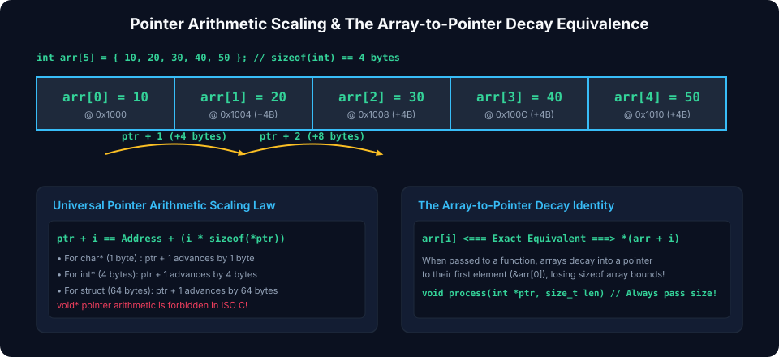
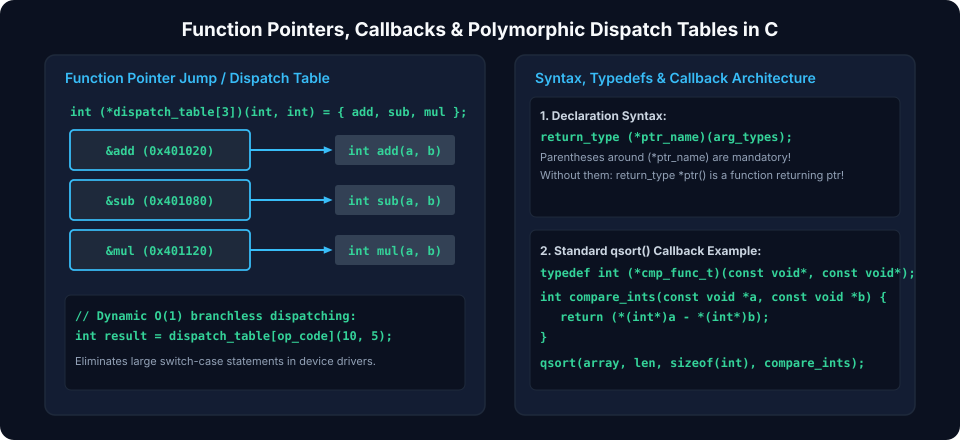

# Chapter 3: Pointers, Memory Addressing & Function Pointers

Pointers are variables that store physical or virtual memory addresses. Direct memory addressing gives C unmatched control over hardware devices, dynamic memory structures, and hardware interfaces. Mastering pointer dereferencing, pointer arithmetic, type casting, and function dispatch tables is fundamental to systems engineering.

---

## 3.1 Pointer Fundamentals & Memory Addressing

A pointer variable holds the byte address of another object in memory. On modern 64-bit systems, pointers are 8 bytes ($64\text{ bits}$), while on 32-bit microcontrollers, pointers are 4 bytes ($32\text{ bits}$).



### Address-of (`&`) and Dereference (`*`)

- **`&` (Address-of Operator)**: Evaluates to the memory address where the operand is stored.
- **`*` (Indirection / Dereference Operator)**: Accesses the value stored at the target address.

```c
#include <stdio.h>
#include <stdint.h>

int main(void) {
    uint32_t sensor_val = 0xAABBCCDD;
    uint32_t *ptr = &sensor_val; // ptr stores the address, e.g. 0x7FFF0010

    printf("Variable value:   0x%X\n", sensor_val);
    printf("Variable address: %p\n", (void*)&sensor_val);
    printf("Pointer value:    %p\n", (void*)ptr);
    printf("Dereferenced:     0x%X\n", *ptr);

    *ptr = 0x11223344; // Modifies sensor_val directly in memory
    printf("Updated value:    0x%X\n", sensor_val);
    return 0;
}
```

### Pointer Nullability & Validation

An uninitialized pointer contains garbage data (**wild pointer**). Always initialize unused pointers to `NULL` (which evaluates to address $0$):

```c
uint32_t *ptr = NULL;
if (ptr != NULL) {
    *ptr = 42; // Safe against dereferencing NULL
}
```

---

## 3.2 Pointer Arithmetic & Array Decay

Pointer arithmetic does not operate on raw byte offsets; instead, adding or subtracting integers scales automatically by the size of the referenced type:

$$\text{Target Address} = \text{Base Address} + (i \times \text{sizeof}(*p))$$



### Array-to-Pointer Decay

In most C expressions, the name of an array decays into a pointer to its first element (`&array[0]`).

```c
#include <stdio.h>
#include <stdint.h>

int main(void) {
    uint32_t buffer[4] = {0x10, 0x20, 0x30, 0x40};
    uint32_t *p = buffer; // Implicit decay: p points to &buffer[0]

    // Pointer arithmetic advances by sizeof(uint32_t) = 4 bytes per unit
    printf("p + 0: %p -> Value: 0x%X\n", (void*)(p + 0), *(p + 0));
    printf("p + 1: %p -> Value: 0x%X\n", (void*)(p + 1), *(p + 1));
    printf("p + 2: %p -> Value: 0x%X\n", (void*)(p + 2), *(p + 2));

    // Pointer subtraction calculates element distance, not raw byte count
    uint32_t *end = &buffer[3];
    ptrdiff_t distance = end - p; // Evaluates to 3 elements
    printf("Element distance: %td\n", distance);

    return 0;
}
```

> [!NOTE]
> `array[i]` is syntactic sugar for `*(array + i)`. Because addition is commutative, `*(array + i) == *(i + array)`, which means `i[array]` is legally valid C syntax!

---

## 3.3 Void Pointers, Type Casting & Strict Aliasing

### Generic Pointers (`void*`)

A `void*` is a generic pointer capable of pointing to any data type without type-checking. It cannot be directly dereferenced because the compiler does not know the size of the target type. It must be cast before dereferencing:

```c
void print_raw_bytes(const void *data, size_t num_bytes) {
    const uint8_t *byte_ptr = (const uint8_t *)data; // Byte-level access
    for (size_t i = 0; i < num_bytes; i++) {
        printf("%02X ", byte_ptr[i]);
    }
    printf("\n");
}
```

### Strict Aliasing Rule

Under C99/C11 standards, the compiler assumes that pointers of different types never point to the same memory location, permitting aggressive optimizations. Violating strict aliasing leads to silent data corruption under `-O2` or `-O3`:

```c
// ILLEGAL strict-aliasing violation:
uint32_t x = 0x12345678;
float *f = (float*)&x; // Undefined Behavior!

// LEGAL standard-compliant type punning via memcpy:
uint32_t raw = 0x3F800000;
float val;
memcpy(&val, &raw, sizeof(val)); // Validated type punning
```

---

## 3.4 Function Pointers & Callback Architectures

Functions reside in executable memory (`.text`). A **Function Pointer** holds the starting instruction address of a function, enabling runtime polymorphism, event-driven architectures, and hardware Interrupt Vector Tables (IVT).



### Function Pointer Syntax and Type Aliasing

Declaring a raw function pointer syntax can be cryptic. The standard convention is:
$$\text{return\_type}\;(*\text{ptr\_name})(\text{param1\_type}, \text{param2\_type});$$

Using `typedef` creates clean, readable abstractions:

```c
#include <stdio.h>
#include <stdint.h>

// Define a function pointer type that takes two int32_t and returns int32_t
typedef int32_t (*math_op_fn)(int32_t a, int32_t b);

int32_t op_add(int32_t a, int32_t b) { return a + b; }
int32_t op_sub(int32_t a, int32_t b) { return a - b; }
int32_t op_mul(int32_t a, int32_t b) { return a * b; }

// Higher-order function receiving a callback
int32_t compute(int32_t a, int32_t b, math_op_fn operation) {
    return operation(a, b);
}

int main(void) {
    math_op_fn my_op = op_add;
    printf("Result: %d\n", compute(10, 5, my_op));   // 15
    printf("Result: %d\n", compute(10, 5, op_mul));  // 50
    return 0;
}
```

---

## 3.5 Dispatch Tables & State Machines

A **Dispatch Table** is an array of function pointers indexed by an opcode, state, or event code. It eliminates deep nested `switch` or `if/else` ladders, providing guaranteed $O(1)$ constant-time execution.

```c
typedef enum {
    OP_READ  = 0,
    OP_WRITE = 1,
    OP_ERASE = 2,
    OP_MAX
} command_code_t;

typedef int (*command_handler_t)(uint32_t addr, const uint8_t *payload);

int handle_read(uint32_t addr, const uint8_t *payload) { /* ... */ return 0; }
int handle_write(uint32_t addr, const uint8_t *payload) { /* ... */ return 0; }
int handle_erase(uint32_t addr, const uint8_t *payload) { /* ... */ return 0; }

// Constant dispatch table stored in .rodata
static const command_handler_t DISPATCH_TABLE[OP_MAX] = {
    [OP_READ]  = handle_read,
    [OP_WRITE] = handle_write,
    [OP_ERASE] = handle_erase,
};

int dispatch_command(command_code_t opcode, uint32_t addr, const uint8_t *data) {
    if (opcode < OP_MAX && DISPATCH_TABLE[opcode] != NULL) {
        return DISPATCH_TABLE[opcode](addr, data); // O(1) jump
    }
    return -1; // Unknown opcode fault
}
```

---

##### Copyright (c) 2026 squared-studio
