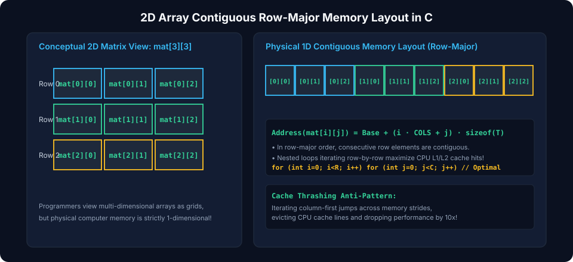
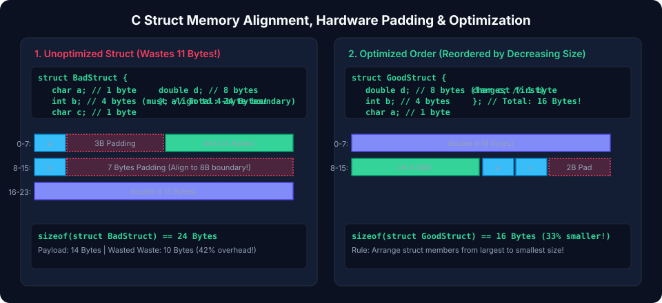
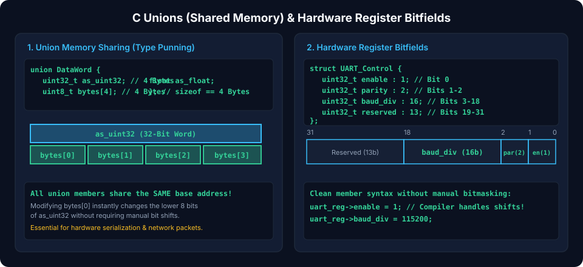

# Chapter 4: Arrays, Structs, Alignment & Memory Packing

Data structures in C map directly to contiguous memory bytes. Hardware processors access data most efficiently when operands align with natural memory word boundaries (2, 4, 8 bytes). Understanding array layouts, struct padding, natural alignment constraints, and hardware bitfields is critical for writing high-performance algorithms, serializing binary protocols, and communicating with memory-mapped peripherals.

---

## 4.1 Array Layouts & Multi-Dimensional Indexing

An array is a contiguous block of homogeneous elements stored sequentially in memory.



### Row-Major Ordering in 2D Arrays

In C, multidimensional arrays follow **Row-Major Order**, meaning consecutive elements of a row reside adjacently in physical memory:

$$\text{Address}(A[i][j]) = \text{Base} + \big(i \times N_{\text{cols}} + j\big) \times \text{sizeof}(\text{type})$$

```c
#include <stdio.h>
#include <stdint.h>

void iterate_cache_friendly(int matrix[4][4]) {
    // Row-major traversal: sequential access maximizes CPU L1 cache hits
    for (int r = 0; r < 4; r++) {
        for (int c = 0; c < 4; c++) {
            matrix[r][c] += 1;
        }
    }
}

void iterate_cache_hostile(int matrix[4][4]) {
    // Column-major traversal: jumps between rows causing CPU cache line thrashing
    for (int c = 0; c < 4; c++) {
        for (int r = 0; r < 4; r++) {
            matrix[r][c] += 1;
        }
    }
}
```

---

## 4.2 Struct Memory Padding & Natural Alignment

CPUs do not read memory byte-by-byte; they read memory in 32-bit (4-byte) or 64-bit (8-byte) aligned words. If an integer is stored at an unaligned address (e.g., address `0x03`), the memory controller must issue two read cycles and execute bit-shift operations, severely degrading throughput or triggering a hardware `Bus Error` (on architectures like ARM Cortex-M0 or SPARC).



### Alignment Rules

1. A primitive type of size $S$ must reside at an address evenly divisible by $S$:
   $$\text{Address} \pmod S = 0$$
   - `char` ($1\text{ byte}$): aligned to $1\text{ byte}$.
   - `uint16_t` ($2\text{ bytes}$): address must be multiple of $2$.
   - `uint32_t` ($4\text{ bytes}$): address must be multiple of $4$.
   - `uint64_t` / pointers ($8\text{ bytes}$): address must be multiple of $8$.
2. The compiler automatically inserts unused **Padding Bytes** between members to maintain natural alignment.
3. The total size of a `struct` is always padded to a multiple of its largest member's alignment.

### Padding in Action

```c
#include <stdio.h>
#include <stdint.h>

// Poorly ordered struct: excessive padding
struct UnalignedSensor {
    uint8_t  flag;     // 1 byte  + 3 padding bytes (offset 0..3)
    uint32_t counter;  // 4 bytes (offset 4..7)
    uint8_t  status;   // 1 byte  + 7 padding bytes (offset 8..15)
    uint64_t timestamp;// 8 bytes (offset 16..23)
}; // Total: 24 bytes! (14 bytes data + 10 bytes wasted padding)

// Optimal ordering: sorted by descending member alignment
struct OptimizedSensor {
    uint64_t timestamp;// 8 bytes (offset 0..7)
    uint32_t counter;  // 4 bytes (offset 8..11)
    uint8_t  flag;     // 1 byte  (offset 12)
    uint8_t  status;   // 1 byte  + 2 tail padding bytes (offset 13..15)
}; // Total: 16 bytes! (Saved 33% memory footprint)
```

---

## 4.3 Packed Structs & Cache Line Alignment

When exchanging raw binary packets across network interfaces or mapping hardware registers, compiler padding breaks byte-for-byte protocol compatibility.

### Attribute Packed (`__attribute__((packed))`)

Instructs the compiler to eliminate all padding bytes:

```c
struct __attribute__((packed)) EthernetHeader {
    uint8_t  dest_mac[6]; // 6 bytes
    uint8_t  src_mac[6];  // 6 bytes
    uint16_t ether_type;  // 2 bytes
}; // Exact size: 14 bytes (No padding)
```

> [!CAUTION]
> Accessing multi-byte members of a packed struct directly via pointers (e.g. `uint16_t *p = &header.ether_type;`) invokes **Undefined Behavior** on architectures requiring strict alignment. Always access members directly or use `memcpy()`.

### Cache Line Alignment (`alignas`)

In high-concurrency systems, variables on the same CPU cache line ($64\text{ bytes}$) cause **False Sharing**, degrading multicore performance. C11 provides `<stdalign.h>`:

```c
#include <stdalign.h>

struct alignas(64) PerCoreCounter {
    uint64_t count;
    // Guaranteed to occupy a distinct 64-byte cache line
};
```

---

## 4.4 Unions & Hardware Bitfields

A `union` allocates all its members in the same overlapping memory space. The size of a `union` equals the size of its largest member.



### Bitfields for Register Modeling

C bitfields allow developers to specify exact bit widths for struct members:

```c
#include <stdint.h>

// 32-bit Control Register layout
typedef union {
    uint32_t raw; // Direct 32-bit register read/write
    struct {
        uint32_t enable     : 1;  // Bit 0: Module Enable
        uint32_t mode       : 3;  // Bits 1..3: Operating Mode
        uint32_t irq_en     : 1;  // Bit 4: Interrupt Enable
        uint32_t reserved   : 11; // Bits 5..15: Reserved
        uint32_t prescaler  : 16; // Bits 16..31: Timer Prescaler
    } fields;
} timer_ctrl_reg_t;

void configure_timer(void) {
    timer_ctrl_reg_t reg = {0};
    reg.fields.enable = 1;
    reg.fields.mode = 0x03;
    reg.fields.prescaler = 1000;

    // Write full 32-bit word to hardware register address
    volatile uint32_t *hardware_addr = (volatile uint32_t *)0x40001000;
    *hardware_addr = reg.raw;
}
```

> [!WARNING]
> The C standard does not specify bitfield endianness or bit packing direction (MSB-first vs LSB-first is compiler-defined). For strictly portable code across compilers, prefer explicit shift and mask idioms.

---

##### Copyright (c) 2026 squared-studio
