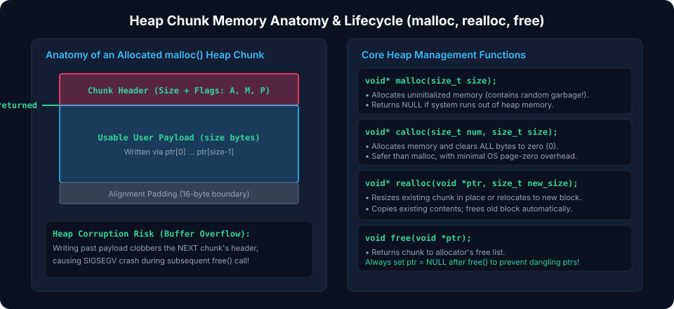
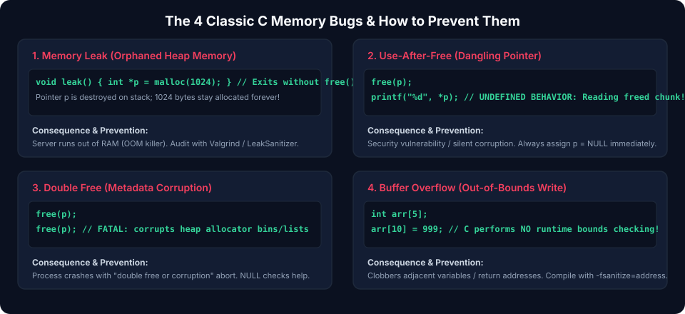
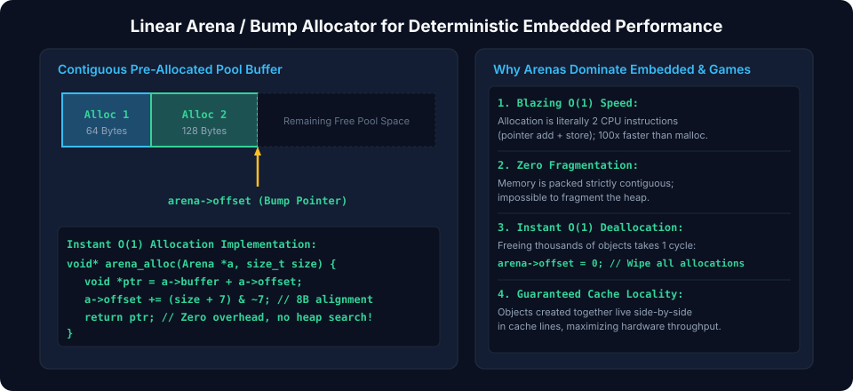

# Chapter 5: Dynamic Memory Management & Allocator Design

Programs often require memory whose size is only known at runtime. Dynamic memory is allocated from the process **Heap**. While dynamic memory provides immense flexibility, improper lifecycle management causes memory leaks, heap fragmentation, and security vulnerabilities. Systems engineers must understand how dynamic allocators manage heap chunks and how to build deterministic custom allocators.

---

## 5.1 Dynamic Memory Lifecycle: `malloc`, `calloc`, `realloc`, and `free`

The standard C library provides four primary allocation primitives in `<stdlib.h>`:

| Function    | Signature                                   | Description                                                                  |
| :---------- | :------------------------------------------ | :--------------------------------------------------------------------------- |
| `malloc()`  | `void* malloc(size_t size)`                 | Allocates uninitialized memory of `size` bytes. Contains indeterminate data. |
| `calloc()`  | `void* calloc(size_t num, size_t size)`     | Allocates memory for array of elements and zeroes every byte.                |
| `realloc()` | `void* realloc(void *ptr, size_t new_size)` | Resizes an existing heap allocation, moving data if necessary.               |
| `free()`    | `void free(void *ptr)`                      | Releases memory back to the allocator. Passing `NULL` is a safe no-op.       |

### Allocator System Calls: `brk` vs. `mmap`

Under Linux and POSIX systems, `malloc` requests memory from the operating system kernel using two system calls:

1. **`brk` / `sbrk`**: Expands the program break (the top of the process heap) for small allocations ($< 128\text{ KB}$).
2. **`mmap`**: Requests a distinct anonymous memory mapping directly from the kernel for large allocations ($\ge 128\text{ KB}$). When freed, `munmap` immediately returns pages to the OS.

---

## 5.2 Heap Chunk Anatomy & Boundary Tags

Standard heap allocators (such as `ptmalloc` in glibc) embed metadata headers adjacent to each user memory buffer.



### Chunk Structure

- **Chunk Size & Flags**: Encodes total chunk size rounded up to 8 or 16-byte alignment. Lower 3 bits store status flags (`PREV_INUSE`, `IS_MMAPPED`, `NON_MAIN_ARENA`).
- **User Payload**: The address returned to the application by `malloc()`.
- **Free Chunk Pointers**: When a chunk is freed, its payload area is repurposed into forward (`fd`) and backward (`bk`) pointers forming circular doubly linked free lists (**bins**).
- **Chunk Coalescing**: When adjacent chunks become free, the allocator merges them into a single larger chunk to mitigate external fragmentation.

---

## 5.3 Memory Safety Hazards

Dynamic memory bugs represent the vast majority of critical software vulnerabilities (CVEs).



### 1. Memory Leak

Failing to call `free()` on dynamically allocated memory. In long-running daemons or embedded controllers, leaked memory progressively consumes the entire heap until `malloc` fails or the OS Out-Of-Memory (OOM) killer terminates the process.

### 2. Use-After-Free (UAF)

Accessing or dereferencing a pointer after its target memory has been returned to the heap via `free()`. If the allocator subsequently reassigns that chunk to another object, reading or writing through the dangling pointer corrupts application data or enables remote code execution.

### 3. Double Free

Calling `free()` twice on the exact same pointer. Corrupts the allocator's free-list links, allowing an attacker to cause `malloc` to return an arbitrary pointer (such as a function pointer in the stack or `.data`).

### Defensive Pointer Hygiene

```c
void safe_free(void **pptr) {
    if (pptr != NULL && *pptr != NULL) {
        free(*pptr);
        *pptr = NULL; // Zero pointer immediately after freeing
    }
}

#define SAFE_FREE(ptr) safe_free((void**)&(ptr))
```

---

## 5.4 Diagnostic Tooling: AddressSanitizer & Valgrind

Modern compilers provide built-in instrumentation to detect dynamic memory errors at runtime with negligible overhead.

### AddressSanitizer (ASan)

Compile with `-fsanitize=address -g`:

```bash
gcc -fsanitize=address -g main.c -o main
./main
```

ASan replaces standard `malloc`/`free` with red-zone poison boundaries, immediately trapping out-of-bounds reads/writes and use-after-free conditions with full stack traces.

### Valgrind Memcheck

Runs arbitrary binaries in a CPU emulator to detect uninitialized memory reads and leaks:

```bash
valgrind --leak-check=full --show-leak-kinds=all ./main
```

---

## 5.5 High-Performance Custom Allocator: Linear Arena

In real-time embedded systems, game engines, and high-frequency trading, standard `malloc` is unacceptable due to non-deterministic execution times and fragmentation. A **Linear Arena Allocator** preallocates a contiguous block of memory and satisfies allocations by bumping a single pointer forward ($O(1)$ constant time).



### Implementation

```c
#include <stdint.h>
#include <stddef.h>
#include <stdbool.h>

typedef struct {
    uint8_t *buffer;
    size_t   capacity;
    size_t   offset;
} Arena;

void arena_init(Arena *arena, void *backing_buffer, size_t capacity) {
    arena->buffer   = (uint8_t *)backing_buffer;
    arena->capacity = capacity;
    arena->offset   = 0;
}

void* arena_alloc(Arena *arena, size_t size, size_t alignment) {
    // Calculate current address and aligned offset
    uintptr_t current_addr = (uintptr_t)arena->buffer + arena->offset;
    uintptr_t aligned_addr = (current_addr + (alignment - 1)) & ~(alignment - 1);
    size_t new_offset = (aligned_addr - (uintptr_t)arena->buffer) + size;

    if (new_offset > arena->capacity) {
        return NULL; // Out of memory
    }

    arena->offset = new_offset;
    return (void *)aligned_addr;
}

// O(1) Instant Bulk Deallocation
void arena_reset(Arena *arena) {
    arena->offset = 0;
}
```

_The entire arena memory pool can be cleared and reused in a single instruction (`arena_reset`), completely eliminating memory fragmentation and individual `free()` overhead._

---

##### Copyright (c) 2026 squared-studio
