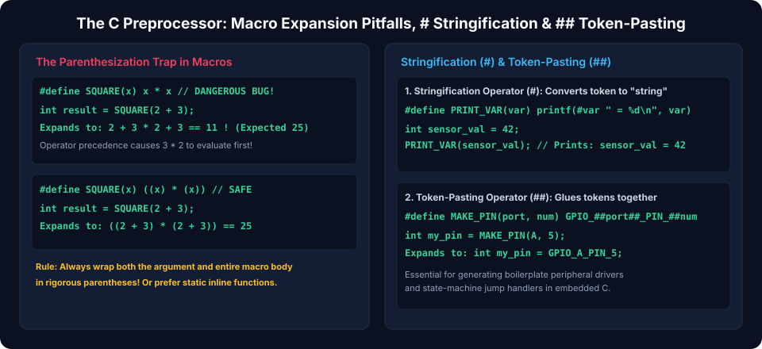
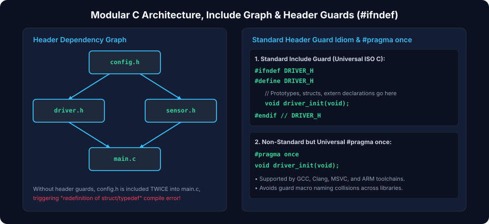
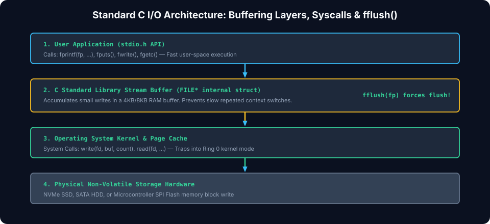

# Chapter 6: Preprocessor, Header Architecture & File I/O

Scalable C software requires clean modular separation between interface contracts (`.h` header files) and implementation units (`.c` source files). Mastering macro hygiene, preprocessor token manipulation, double-inclusion guards, and buffered stream I/O guarantees clean builds, maintainable codebases, and optimal filesystem throughput.

---

## 6.1 The C Preprocessor: Macro Hygiene & Token Pasting

The preprocessor performs lexical macro substitutions before compilation. Improper macro authoring introduces insidious bugs.



### Macro Hygiene Rules

1. **Always wrap macro parameters in parentheses**: Prevents operator precedence distortion.
2. **Always wrap macro expressions in parentheses**:

   ```c
   // BAD: SQUARE(1 + 2) expands to 1 + 2 * 1 + 2 = 5
   #define BAD_SQUARE(x)    x * x

   // GOOD: SAFE_SQUARE(1 + 2) expands to ((1 + 2) * (1 + 2)) = 9
   #define SAFE_SQUARE(x)   ((x) * (x))
   ```

3. **Use `do { ... } while(0)` for Multi-Statement Macros**: Ensures safe usage inside `if/else` control blocks without dangling semicolon syntax errors:
   ```c
   #define LOG_EVENT(lvl, msg) \
       do { \
           log_write(lvl, msg); \
           system_flush(); \
       } while(0)
   ```

### Stringification (`#`) and Token Pasting (`##`)

- **`#` (Stringification)**: Converts a macro argument into a string literal.
- **`##` (Token Pasting / Concatenation)**: Concatenates two tokens into a single language token at compile time.

```c
#include <stdio.h>

#define STRINGIFY(x) #x
#define DECLARE_HANDLER(name) void handle_##name(void)

DECLARE_HANDLER(init) {
    printf("Invoked: %s\n", STRINGIFY(handle_init));
}

int main(void) {
    handle_init(); // Calls handle_init() generated by token pasting
    return 0;
}
```

---

## 6.2 Modular Header Architecture & Include Guards

When multiple source files include common headers, headers can be included multiple times across the dependency graph. Redefining structs or typedefs causes fatal compiler errors.



### Standard Include Guards vs. `#pragma once`

```c
// File: sensor_interface.h
#ifndef SENSOR_INTERFACE_H_
#define SENSOR_INTERFACE_H_

#ifdef __cplusplus
extern "C" {
#endif

// Public Type Definitions and API Declarations
typedef struct SensorDevice SensorDevice; // Opaque struct pointer

SensorDevice* sensor_create(uint32_t bus_id);
int           sensor_read_sample(SensorDevice *dev, float *out_val);
void          sensor_destroy(SensorDevice *dev);

#ifdef __cplusplus
}
#endif

#endif // SENSOR_INTERFACE_H_
```

> [!TIP]
> `#pragma once` is supported by virtually all modern compilers (`gcc`, `clang`, `msvc`). While non-standard in pure ISO C, it prevents file I/O overhead by instructing the preprocessor to skip the file entirely on repeated encounters.

---

## 6.3 Opaque Pointers & Information Hiding

C achieves Object-Oriented encapsulation through **Opaque Pointers** (often termed the _PIMPL_ or _Handle_ pattern). By declaring an incomplete `struct` in the public header and defining its fields solely within the private `.c` file, callers cannot inspect or tamper with internal implementation details:

```c
// In private sensor_interface.c:
struct SensorDevice {
    uint32_t bus_id;
    int      calibration_offset;
    bool     is_initialized;
};
```

_Client code only handles `SensorDevice_`. If internal fields change, client compilation units do not require recompilation, preserving binary compatibility (ABI stability).\*

---

## 6.4 Standard File I/O & Stream Buffering

The standard C library abstracts file access via stream buffers (`FILE*`).



### Buffering Modes (`setvbuf`)

1. **Full Buffering (`_IOFBF`)**: Writes are flushed to disk only when the internal buffer ($4096\text{ bytes}$) fills completely (default for regular disk files).
2. **Line Buffering (`_IOLBF`)**: Flushes whenever a newline (`\n`) character is written (default for interactive terminals / `stdout`).
3. **No Buffering (`_IONBF`)**: Every write operation directly invokes an OS system call (default for `stderr`).

### Formatted vs. Binary File Access

```c
#include <stdio.h>
#include <stdint.h>

typedef struct {
    uint32_t id;
    float    value;
} Record;

void write_binary_records(const char *filename, const Record *records, size_t count) {
    FILE *fp = fopen(filename, "wb");
    if (fp == NULL) {
        perror("Failed to open file for writing");
        return;
    }
    // High-speed block binary write
    size_t written = fwrite(records, sizeof(Record), count, fp);
    if (written != count) {
        fprintf(stderr, "Short write occurred!\n");
    }
    fclose(fp);
}

void read_binary_records(const char *filename, Record *records, size_t max_count) {
    FILE *fp = fopen(filename, "rb");
    if (fp == NULL) return;

    size_t read_count = fread(records, sizeof(Record), max_count, fp);
    printf("Read %zu records.\n", read_count);
    fclose(fp);
}
```

---

##### Copyright (c) 2026 squared-studio
