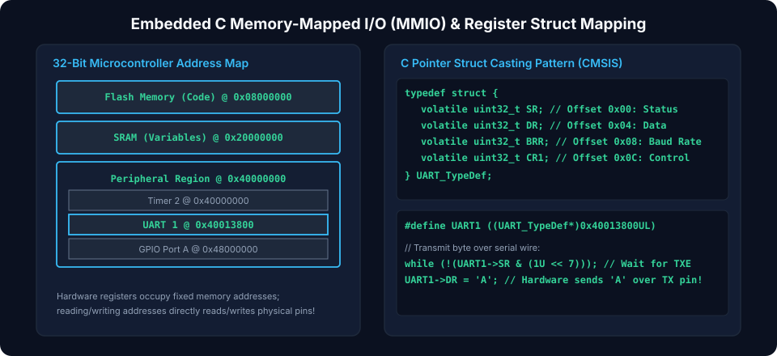
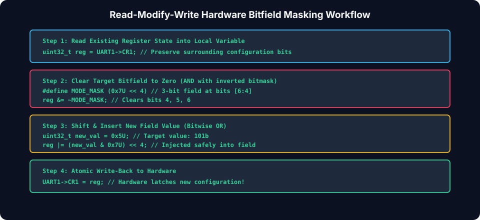
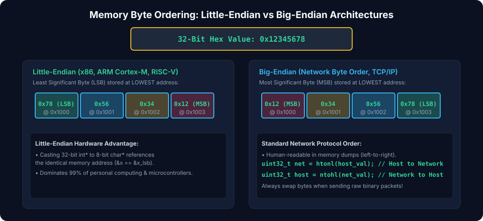

# Chapter 7: Embedded Systems C, MMIO & Hardware Interfaces

In bare-metal embedded firmware, microcontrollers, and system-on-chip (SoC) architectures, software interfaces directly with physical hardware peripherals (UART, SPI, I2C, Timers, GPIO) through **Memory-Mapped I/O (MMIO)**. This chapter explores register mapping, strict pointer volatile semantics, register read-modify-write idioms, hardware endianness conversions, and low-level startup code.

---

## 7.1 Memory-Mapped I/O (MMIO) Architecture

In an MMIO architecture, peripheral control, status, and data registers share the exact same address space as physical SRAM and Flash memory. The CPU communicates with hardware peripherals using standard load (`LDR`) and store (`STR`) assembly instructions.



### Struct-Based Register Mapping

Peripherals provide blocks of contiguous registers starting at a designated base address. Mapping a C `struct` over this base address provides clean, type-safe hardware abstraction:

```c
#include <stdint.h>

// UART Peripheral Register Layout
typedef struct {
    volatile uint32_t DATA;    // Offset 0x00: Data Register
    volatile uint32_t STATUS;  // Offset 0x04: Status Register
    volatile uint32_t CTRL;    // Offset 0x08: Control Register
    volatile uint32_t BAUD;    // Offset 0x0C: Baud Rate Prescaler
} UART_TypeDef;

// Base address from microcontroller datasheet / memory map
#define UART0_BASE   (0x4000C000UL)
#define UART0        ((UART_TypeDef *)UART0_BASE)

void uart0_init(uint32_t baud_divider) {
    UART0->BAUD = baud_divider;
    UART0->CTRL = 0x00000003; // Enable Transmitter and Receiver
}
```

---

## 7.2 Read-Modify-Write (RMW) Bitfield Masking

Hardware registers contain independent bitfields that must be updated without overwriting adjacent configuration settings.



### RMW Operations Reference

```c
#define UART_CTRL_TX_EN_POS     (0U)
#define UART_CTRL_TX_EN_MASK    (1U << UART_CTRL_TX_EN_POS)

#define UART_CTRL_RX_EN_POS     (1U)
#define UART_CTRL_RX_EN_MASK    (1U << UART_CTRL_RX_EN_POS)

#define UART_CTRL_PARITY_POS    (4U)
#define UART_CTRL_PARITY_MASK   (0x03U << UART_CTRL_PARITY_POS) // 2-bit field

// 1. SET BITS: Bitwise OR with mask
void uart_enable_tx(UART_TypeDef *uart) {
    uart->CTRL |= UART_CTRL_TX_EN_MASK;
}

// 2. CLEAR BITS: Bitwise AND with inverted mask
void uart_disable_tx(UART_TypeDef *uart) {
    uart->CTRL &= ~UART_CTRL_TX_EN_MASK;
}

// 3. TOGGLE BITS: Bitwise XOR with mask
void uart_toggle_rx(UART_TypeDef *uart) {
    uart->CTRL ^= UART_CTRL_RX_EN_MASK;
}

// 4. INSERT FIELD: Clear field bits, then OR new shifted value
void uart_set_parity(UART_TypeDef *uart, uint8_t parity_mode) {
    uint32_t reg = uart->CTRL;
    reg &= ~UART_CTRL_PARITY_MASK;                                // Step 1: Clear
    reg |= ((uint32_t)(parity_mode & 0x03) << UART_CTRL_PARITY_POS); // Step 2: Set
    uart->CTRL = reg;
}

// 5. POLL STATUS FLAG: Busy-wait until hardware sets status bit
void uart_send_byte(UART_TypeDef *uart, uint8_t byte) {
    #define UART_STATUS_TX_READY (1U << 0)
    while ((uart->STATUS & UART_STATUS_TX_READY) == 0U) {
        // Spin wait for hardware buffer to empty
    }
    uart->DATA = (uint32_t)byte;
}
```

---

## 7.3 Endianness & Hardware Byte Swapping

Endianness dictates the order in which individual bytes of a multi-byte word reside in memory.



### Little-Endian vs. Big-Endian

Given the 32-bit value `0x12345678`:

- **Little-Endian (x86, ARM, RISC-V default)**: Least Significant Byte (LSB `0x78`) is stored at the lowest memory address ($A$).
- **Big-Endian (Network Protocol Byte Order, PowerPC, SPARC)**: Most Significant Byte (MSB `0x12`) is stored at the lowest memory address ($A$).

### Runtime Endianness Detection & Built-In Byte Swapping

```c
#include <stdio.h>
#include <stdint.h>
#include <stdbool.h>

bool is_system_little_endian(void) {
    uint16_t word = 0x0001;
    uint8_t *byte = (uint8_t *)&word;
    return (*byte == 0x01); // 1 if little-endian, 0 if big-endian
}

// Byte-swap using compiler intrinsics (emits single assembly instruction like REV or BSWAP)
uint32_t swap_endian_32(uint32_t val) {
    return __builtin_bswap32(val);
}

uint16_t swap_endian_16(uint16_t val) {
    return __builtin_bswap16(val);
}
```

---

## 7.4 Bare-Metal Startup Code & C Runtime Initialization

Before the CPU jumps to `main()`, the hardware executes bare-metal initialization code (`Reset_Handler` or `crt0.s`).

### Sequence of Reset Initialization

1. **Initialize Stack Pointer (`SP`)**: Loaded from the vector table (first entry at `0x00000000`).
2. **Copy `.data` Section**: Copies initialized global/static variables from Flash ROM to RAM.
3. **Zero `.bss` Section**: Clears uninitialized global memory to `0x00`.
4. **Configure System Clock & FPU**: Initializes PLL oscillators and enables hardware floating-point units.
5. **Call Constructors**: Executes global constructors (`__init_array`).
6. **Branch to `main()`**: Enters user application code.

```c
// Example C runtime startup sequence in C
extern uint32_t _sidata; // Start of .data initialization values in Flash
extern uint32_t _sdata;  // Start address of .data in RAM
extern uint32_t _edata;  // End address of .data in RAM
extern uint32_t _sbss;   // Start address of .bss in RAM
extern uint32_t _ebss;   // End address of .bss in RAM

void Reset_Handler(void) {
    // 1. Copy initialized data from Flash to RAM
    uint32_t *src = &_sidata;
    uint32_t *dst = &_sdata;
    while (dst < &_edata) {
        *dst++ = *src++;
    }

    // 2. Zero-fill the uninitialized .bss segment in RAM
    dst = &_sbss;
    while (dst < &_ebss) {
        *dst++ = 0U;
    }

    // 3. Jump to main()
    extern int main(void);
    main();

    // 4. Trap infinite loop if main returns
    while (1) {}
}
```

---

##### Copyright (c) 2026 squared-studio
