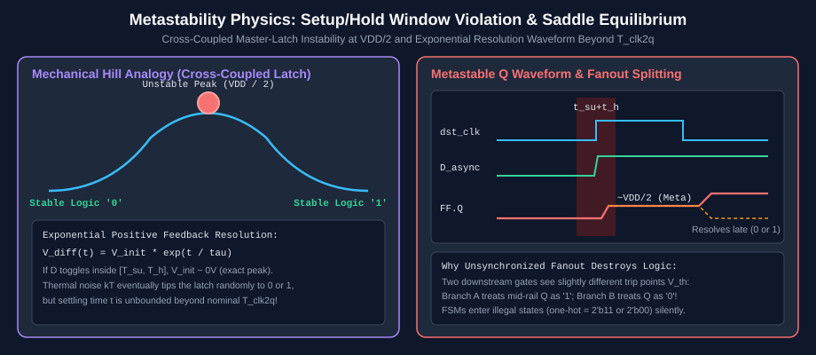
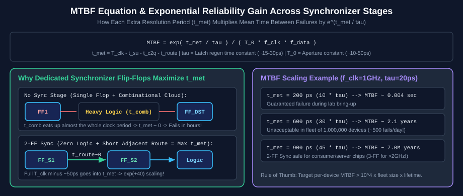

# Metastability Physics, Setup and Hold Violations, and MTBF

In a single-clock synchronous circuit, static timing analysis (STA) guarantees that every launch flip-flop transition reaches the capture flip-flop cleanly outside its setup and hold window. In modern Systems-on-Chip (SoCs) integrating CPU clusters, PCIe PHYs, DDR controllers, and external peripheral interfaces, dozens of unrelated oscillators and PLLs run at independent frequencies and drifting phases. When a signal crosses between asynchronous clocks—a **Clock Domain Crossing (CDC)**—transition collisions with capture clock edges become inevitable, throwing receiving flip-flops into **metastability**.

---

## Learning Goals

After completing this chapter, you should be able to:

- Define the flip-flop setup ($t_{su}$) and hold ($t_h$) timing aperture and explain how violations force a cross-coupled latch into a metastable equilibrium state.
- Model metastable voltage resolution mathematically using positive-feedback time constant $\tau$ and trace how indeterminate voltages cause downstream fanout splitting.
- Derive and apply the **Mean Time Between Failures (MTBF)** formula to compute system reliability across fleet sizes and operating frequencies.
- Explain why adding dedicated synchronizer flip-flops multiplies resolution time $t_{\text{met}}$ exponentially rather than adding linear stages blindly.

---

## Flip-Flop Timing Aperture and Metastability Physics

A positive-edge-triggered D flip-flop consists of two back-to-back clocked latches (Master and Slave), each storing a bit inside a regenerative cross-coupled inverter pair. Before the rising clock edge closes the Master latch transmission gate, input `D` must remain stable across a critical aperture bounded by:

- **Setup Time ($t_{su}$):** Minimum interval before the active clock edge during which `D` must already be settled at valid `0` or `1`.
- **Hold Time ($t_h$):** Minimum interval after the active clock edge during which `D` must continue holding steady so the closing input switch captures cleanly.

### Cross-Coupled Saddle Equilibrium

When `D` transitions right inside the $[t_{su}, t_h]$ aperture across an asynchronous CDC boundary, the Master latch captures an intermediate voltage near $V_{DD}/2$—the exact **metastable saddle equilibrium** where PMOS and NMOS pull-up/pull-down currents temporarily cancel (analogous to balancing a sphere on the sharp crest between two hills).

Any microscopic thermal noise voltage $V_{\text{init}}$ eventually knocks the cross-coupled inverters away from $V_{DD}/2$ via positive feedback:

$$V_{\text{diff}}(t) = V_{\text{init}} \cdot \exp\left(\frac{t}{\tau}\right)$$

Where:
- **$\tau$ (Resolution Time Constant):** Determined by inverter small-signal gain-bandwidth ($\tau \approx C_{\text{node}} / g_m$; typically $10\text{ps}$–$30\text{ps}$ in FinFET processes, growing larger in ultra-low-voltage near-threshold nodes).
- **$t$:** Time elapsed after the clock edge.

Because $V_{\text{init}}$ can approach $0\text{V}$ arbitrarily closely when transitions strike dead-center inside the aperture, **no finite upper bound exists** on how long a flip-flop may remain hovering near $V_{DD}/2$ before resolving cleanly to `'0'` or `'1'`.

### Three Failure Symptoms Downstream

1. **Propagated Mid-Rail Voltage & Fanout Splitting:** Two logic gates fed by a hovering $V_{DD}/2$ signal have slightly different threshold trip points ($V_{\text{th}}$) due to process variation—causing Gate A to read `'1'` while Gate B reads `'0'`, shattering one-hot FSM invariants and bus handshakes.
2. **Extended Clock-to-Q ($t_{c2q}$) Setup Failure:** Even if the flip-flop eventually picks `'1'`, resolving $600\text{ps}$ late eats away downstream combinational slack and fails the next register's setup time.
3. **Silent Rare Corruptions:** A crossing that goes wrong once every $10^9$ clock cycles at $1\text{GHz}$ fails once per second—impossible to reproduce easily in casual lab sweeps if undetected structurally!

---

## Mean Time Between Failures (MTBF) Mathematics

While metastability cannot be reduced to exact zero probability between truly asynchronous clocks, engineers drive its failure rate down to astronomical timescales (millions of years per fleet) using the standard **MTBF equation**:

$$\text{MTBF} = \frac{\exp\left(\frac{t_{\text{met}}}{\tau}\right)}{T_0 \cdot f_{\text{clk}} \cdot f_{\text{data}}}$$

### Every Parameter Defined

| Parameter | Physical Meaning | Effect on MTBF |
| :--- | :--- | :--- |
| **$t_{\text{met}}$** | Available settling time inside the synchronizer stage: $t_{\text{met}} = T_{\text{dst}} - t_{su} - t_{c2q} - t_{\text{route}}$ | **Exponential gain!** Increasing $t_{\text{met}}$ by just $7\tau$ multiplies MTBF by $e^7 \approx 1,096\times$ |
| **$\tau$** | Flip-flop regeneration time constant | Smaller $\tau$ (faster gain-bandwidth sync cells) dramatically boosts MTBF |
| **$T_0$** | Effective metastability failure window constant related to $[t_{su}, t_h]$ | Smaller $T_0$ reduces failure likelihood linearly |
| **$f_{\text{clk}}$** | Destination sampling clock frequency | Faster sampling increases collision attempts linearly |
| **$f_{\text{data}}$** | Average transition toggle rate of the asynchronous data net ($f_{\text{data}} \le f_{\text{src}}$) | Higher data toggle rate increases failure risk linearly |

> [!IMPORTANT]
> **Always Multiply Per-Device MTBF by Total Sync Count and Fleet Volume!** If a single synchronizer boasts an MTBF of $10,000\text{ years}$, an SoC containing $2,000$ synchronizers deployed across $5,000,000$ smartphones ($10^{10}$ instances total!) experiences a fleet failure roughly **once every 30 seconds**! Target **per-synchronizer MTBF $> 10^{12}$ years** for high-volume SoCs.

---

## Why Adding a Dedicated Synchronizer Stage Works

Notice how a single flop followed by combinational logic leaves almost zero slack for $t_{\text{met}}$ ($t_{\text{met}} = T_{\text{clk}} - t_{\text{comb}} - t_{su} - t_{c2q} \approx 0$). Inserting a dedicated **first-stage synchronizer flip-flop (`FF_SYNC_1`)** wired directly with zero combinational gates and minimal physical routing distance to a **second-stage flip-flop (`FF_SYNC_2`)** dedicates nearly an entire clock period $T_{\text{dst}}$ purely to resolving metastability!

At ultra-high destination frequencies ($f_{\text{clk}} > 1.0\text{GHz}$–$2.5\text{GHz}$ where a single $400\text{ps}$ clock period gives insufficient $t_{\text{met}}/\tau$) or low-voltage DVFS corners, designers cascade a **3-FF synchronizer**, effectively doubling total resolution budget to $\approx 2 \cdot T_{\text{dst}} - 2 \cdot (t_{su} + t_{c2q})$.

---

## Best Practices and Common Pitfalls

- **Never Connect Unsynchronized Inputs Directly to Multiple Flip-Flops:** Fanning a raw asynchronous wire to two destination flops does *not* synchronize it safely—it violates single-point resolution and triggers fanout splitting across both flip-flops.
- **Evaluate MTBF at Worst-Case Slow PVT Corners:** Transistor drive current weakens and $\tau$ lengthens significantly at **Low Voltage / Cold or Slow-Slow (SS)** corners! Calculate MTBF at the slowest legal DVFS operating voltage, not typical $25^\circ\text{C}$ nominal conditions.
- **Zero-Delay Functional RTL Hides Metastability Completely:** Behavioral Verilog models edge captures as instantaneous step functions with $t_{su} = t_h = 0$. You *must* pair functional RTL simulation with static CDC rule verification (Chapter 10) and dynamic jitter injection (Chapter 11).

---

## Practical Exercises with Solutions

### Exercise 1 Computing MTBF Across Stage Counts

**Problem:**
A destination domain runs at $f_{\text{clk}} = 800\text{MHz}$ ($T_{\text{clk}} = 1.25\text{ns}$) receiving asynchronous toggle events at $f_{\text{data}} = 50\text{MHz}$. Foundry characterization gives $\tau = 22\text{ps}$, $T_0 = 40\text{ps}$, and $t_{su} + t_{c2q} = 110\text{ps}$.
1. If a single flop drives combinational logic consuming $t_{\text{comb}} + t_{\text{route}} = 850\text{ps}$, compute $t_{\text{met}}$ and MTBF in seconds.
2. With a dedicated 2-FF synchronizer placed adjacently ($t_{\text{comb}} = 0$, $t_{\text{route}} = 40\text{ps}$), recompute $t_{\text{met}}$ and MTBF in years ($1\text{ year} \approx 3.15 \times 10^7\text{s}$).

**Solution:**
1. **Without 2-FF Sync:**
   $$t_{\text{met}} = 1250 - 110 - 850 = 290\text{ps}$$
   $$\frac{t_{\text{met}}}{\tau} = \frac{290}{22} \approx 13.18 \implies \exp(13.18) \approx 5.30 \times 10^5$$
   $$T_0 \cdot f_{\text{clk}} \cdot f_{\text{data}} = (40 \times 10^{-12})(800 \times 10^6)(50 \times 10^6) = 1.60 \times 10^6\text{s}^{-1}$$
   $$\text{MTBF}_1 = \frac{5.30 \times 10^5}{1.60 \times 10^6} \approx 0.33\text{ seconds}$$
   *(Guaranteed failure within one second of power-on!)*
2. **With Adjacent 2-FF Sync:**
   $$t_{\text{met}} = 1250 - 110 - 40 = 1100\text{ps}$$
   $$\frac{t_{\text{met}}}{\tau} = \frac{1100}{22} = 50.0 \implies \exp(50) \approx 5.18 \times 10^{21}$$
   $$\text{MTBF}_2 = \frac{5.18 \times 10^{21}}{1.60 \times 10^6} \approx 3.24 \times 10^{15}\text{s} \approx 1.03 \times 10^8\text{ years}$$

### Exercise 2 Explaining Fanout Splitting

**Problem:**
A rookie designer skips a 2-FF synchronizer on asynchronous signal `ext_irq` and routes `ext_irq` directly into two downstream blocks: an FSM `state_q` transition and a counter increment `cnt_q`. Why can `cnt_q` increment on a cycle when `state_q` ignores `ext_irq`?

**Solution:**
If `ext_irq` transitions during the rising clock edge's setup/hold aperture, routing mismatch and tiny input capacitance differences cause `state_q`'s D-pin latch and `cnt_q`'s D-pin latch to see slightly different effective samples/trip voltages, or one flop goes metastable and resolves to `'1'` while the other resolves to `'0'`, creating an impossible logical split between blocks.

### Exercise 3 Fleet-Scale MTBF Budgeting

**Problem:**
An automotive radar chip contains $500$ independent 2-FF synchronizers per IC, and $10\text{ million}$ cars ship for a $15\text{-year}$ operating lifetime. If reliability sign-off demands $< 1\%$ chance of *any* metastability event across the entire fleet over 15 years, what minimum MTBF per individual synchronizer is required?

**Solution:**
Total synchronizer-years across the fleet $= 500 \times 10^7 \times 15 = 7.5 \times 10^{10}\text{ sync-years}$. For failure probability $P_{\text{fail}} \approx \frac{T_{\text{fleet}}}{\text{MTBF}_{\text{per\_sync}}} < 0.01$:
$$\text{MTBF}_{\text{per\_sync}} > \frac{7.5 \times 10^{10}}{0.01} = 7.5 \times 10^{12}\text{ years}$$

##### Copyright (c) 2026 squared-studio
