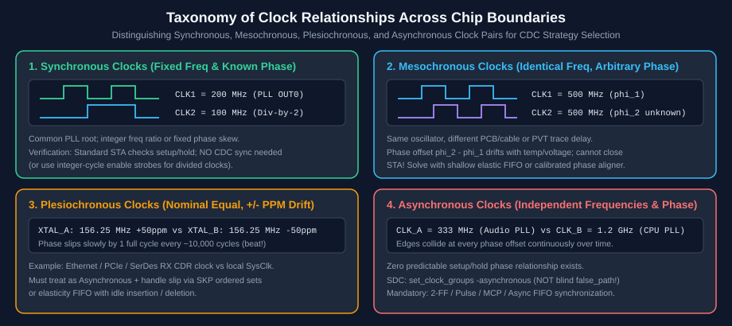
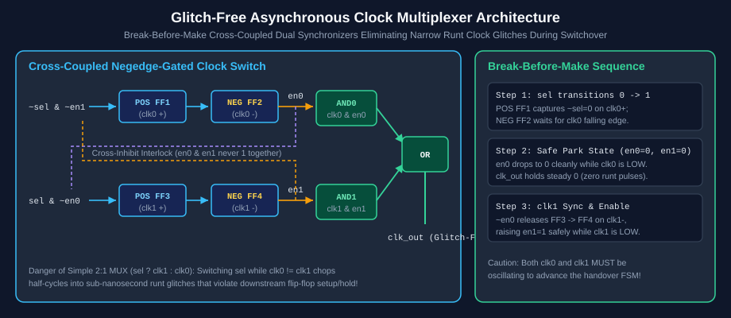

# Clock Topologies, Clock Relationships, and Domain Classification

Not every signal crossing between differently named clock nets requires a full multi-cycle asynchronous synchronizer. Over-synchronizing synchronous divided clocks wastes latency and breaks cycle-accurate bus handshakes, whereas misclassifying a drifting plesiochronous or mesochronous clock as synchronous produces catastrophic timing failures on silicon. Classifying every clock pair rigorously in your architecture and SDC constraints is the foundation of clean CDC design.

---

## Learning Goals

After completing this chapter, you should be able to:

- Classify any two clocks on an SoC into **Synchronous**, **Mesochronous**, **Plesiochronous**, or **Asynchronous** relationships.
- Design phase-aligned data transfers across **integer-ratio synchronous clocks** without introducing asynchronous latency.
- Explain why **Plesiochronous** $\pm\text{PPM}$ clock slips require elasticity buffers (such as PCIe/Ethernet SKP insertion) rather than static timing analysis.
- Implement a synthesizable, break-before-make **Glitch-Free Clock Multiplexer** for dynamic clock switching.

---

## Clock Relationship Taxonomy

Every pair of clock domains `(CLK_SRC, CLK_DST)` falls strictly into one of four physical timing categories:



| Clock Pair Type | Frequency Match | Phase Relationship | STA Closure? | CDC Sync Required? | Example Hardware Sources |
| :--- | :--- | :--- | :---: | :---: | :--- |
| **Synchronous** | Exact integer ratio ($N:M$, e.g. $2:1$) | Fixed, deterministic phase via shared PLL root | **Yes** | **No** (use cycle enable / phase align) | CPU `400MHz` & AXI `200MHz` from same PLL |
| **Mesochronous** | Identical nominal freq ($f_1 = f_2$) | Unknown or PVT-drifting constant phase offset $\phi$ | **No** (cross-die/PCB skew drifts) | **Yes** (shallow elastic FIFO / delay cal) | Source-synchronous TX/RX link on same ref XTAL |
| **Plesiochronous** | Nominal equal, differs by $\pm\text{PPM}$ ($100\text{ppm}$) | Continuously slips $360^\circ$ every few $\mu\text{s}$ | **No** (cycles slip over time) | **Yes** (Async Elastic FIFO + idle slip/drop) | Two $156.25\text{MHz}$ crystals on Link Partner & NIC |
| **Asynchronous** | Unrelated arbitrary freqs ($333\text{MHz}$ vs $1.2\text{GHz}$) | Completely uncorrelated; edges collide everywhere | **No** | **Yes** (2-FF / Pulse / MCP / Async FIFO) | Independent PLLs, SPI external `SCLK` vs `sys_clk` |

> [!WARNING]
> **Fractional-Ratio Rational Clocks Are Practically Asynchronous!** Clocks at $200\text{MHz}$ ($5.0\text{ns}$) and $300\text{MHz}$ ($3.333\text{ns}$) derived from the *same* PLL share periodic coincident edges every $10\text{ns}$, yet their minimum setup margin drops to $1.667\text{ns}$—and with realistic PLL jitter + clock-tree OCV uncertainty, non-integer ratios like $3:5$ or $7:11$ often collapse to unclosable picosecond setup windows. Most ASIC sign-off flows classify non-integer ratios as **Asynchronous** and insert proper CDC synchronizers!

---

## Synchronous Divided Clock Crossing Techniques

When `clk_fast` ($200\text{MHz}$) and `clk_div2` ($100\text{MHz}$) originate from the **same PLL** with balanced clock-tree synthesis (CTS) skew:
- **Zero Metastability Risk:** STA (`PrimeTime` / `Tempus`) directly verifies setup and hold across `clk_fast <-> clk_div2`.
- **Cleanest Design Style (Clock Enable Architecture):** Instead of generating a physically divided `clk_div2` tree (which introduces clock-tree insertion skew between `clk_fast` and `clk_div2`), keep all registers clocked on **`clk_fast`** and gate updates using a 50%-duty **phase-enable strobe (`en_100m`)** generated cleanly from a `clk_fast` counter! That keeps 100% of logic strictly inside one clock tree with zero cross-clock skew!

---

## Glitch-Free Clock Multiplexing Architecture

Modern SoCs dynamically switch a block's clock between multiple asynchronous sources (e.g., booting on safe `24MHz XTAL`, switching to `1.2GHz PLL`, or switching to backup `clk_div` during DVFS). Using a naive combinational mux (`assign clk_out = sel ? clk1 : clk0;`) chops clock pulses into sub-nanosecond **runt glitches** whenever `sel` toggles while `clk0 != clk1`, corrupting every flip-flop in the downstream domain!



### Synthesizable Glitch-Free Clock Switch RTL

Below is the canonical break-before-make dual-synchronizer clock switch. Notice the use of **negedge** gating registers (`en0_n`, `en1_n`), ensuring each branch turns OFF and ON strictly while its own clock sits cleanly LOW (assuming active-HIGH clock gating via an `AND` cell, or using foundry ICG latches):

```systemverilog
module glitch_free_clk_mux #(
    parameter int SYNC_STAGES = 2
) (
    input  logic clk0,
    input  logic clk1,
    input  logic rst0_n,  // Synced to clk0
    input  logic rst1_n,  // Synced to clk1
    input  logic sel,     // 0 -> clk0, 1 -> clk1 (can be async!)
    output logic clk_out
);
    (* ASYNC_REG = "TRUE" *) logic [SYNC_STAGES-1:0] sync0_q;
    (* ASYNC_REG = "TRUE" *) logic [SYNC_STAGES-1:0] sync1_q;
    logic en0_n, en1_n;

    // Synchronize enable request (~sel && ~other_active) into clk0 domain
    always_ff @(posedge clk0 or negedge rst0_n) begin
        if (!rst0_n)
            sync0_q <= {{(SYNC_STAGES-1){1'b0}}, 1'b1}; // Default boot on clk0!
        else
            sync0_q <= {sync0_q[SYNC_STAGES-2:0], (~sel & ~en1_n)};
    end

    // Latch enable cleanly on NEGEDGE clk0 so clk0 & en0_n NEVER glitch
    always_ff @(negedge clk0 or negedge rst0_n) begin
        if (!rst0_n) en0_n <= 1'b1;
        else         en0_n <= sync0_q[SYNC_STAGES-1];
    end

    // Synchronize enable request (sel && ~en0_n) into clk1 domain
    always_ff @(posedge clk1 or negedge rst1_n) begin
        if (!rst1_n)
            sync1_q <= '0;
        else
            sync1_q <= {sync1_q[SYNC_STAGES-2:0], (sel & ~en0_n)};
    end

    always_ff @(negedge clk1 or negedge rst1_n) begin
        if (!rst1_n) en1_n <= 1'b0;
        else         en1_n <= sync1_q[SYNC_STAGES-1];
    end

    // Use foundry stdcell clock gating / ICG + OR macros in ASIC implementation!
    assign clk_out = (clk0 & en0_n) | (clk1 & en1_n);
endmodule
```

> [!CAUTION]
> **Live Clock Requirement & ASIC Gate Don't-Touch:**
> 1. Both `clk0` and `clk1` **must be actively oscillating** for the handover FSM to advance! If `clk0` stops while `en0_n == 1`, `en0_n` freezes high forever, locking out `clk1` permanently. (Use an idle-detect monitor if a source clock can gate/power off!)
> 2. Never let synthesis optimize `(clk0 & en0_n) | (clk1 & en1_n)` into random AOI/LUT structures! Instantiate qualified foundry **ICG (`CLKGATE`)** and balanced clock-OR primitives wrapped in `dont_touch`.

---

## Best Practices and Common Pitfalls

- **Prefer Clock-Enable Strobes Over Divided Clocks:** Keep derived rates on the fast parent clock with cycle-enable qualifiers whenever possible to eliminate unnecessary clock skew and CTS headaches.
- **Treat Multi-Crystal SerDes Links as Asynchronous / Plesiochronous:** Never omit an elastic buffer between a recovered RX CDR clock (`156.25MHz +50ppm`) and local system clock (`156.25MHz -50ppm`), even when nominal frequencies appear identical on paper!
- **Mark Generated Clocks Explicitly in SDC:** Always define `create_generated_clock` on mux outputs and integer dividers so both STA and static CDC tools propagate exact clock-domain colors downstream.

---

## Practical Exercises with Solutions

### Exercise 1 Classifying Real SoC Clock Pairs

**Problem:**
Classify each clock pair `(CLK_A, CLK_B)` as Synchronous, Mesochronous, Plesiochronous, or Asynchronous, and state whether an Async FIFO / Synchronizer is needed:
1. `clk_cpu = 1.0 GHz` and `clk_ahb = 250 MHz` generated from the same integer PLL divider with balanced CTS.
2. Board 1 sends `TX_CLK` + `TX_DATA` via a long variable-length PCB backplane to Board 2 running from the *same* reference crystal (`125 MHz`).
3. Two independent `25 MHz` Ethernet PHYs feeding one MAC block via separate board crystals rated at $\pm 50\text{ppm}$.

**Solution:**
1. **Synchronous (4:1 Integer Ratio):** Single PLL root with deterministic edges; STA verifies timing directly—**no async CDC sync needed**.
2. **Mesochronous:** Identical average frequency (`125 MHz`), but arbitrary/PVT-drifting trace phase $\phi$ prevents static setup/hold timing closure—**shallow elastic FIFO or calibrated source-sync buffer required**.
3. **Plesiochronous:** Slightly drifting frequencies ($\pm 100\text{ppm}$ worst-case slip) cause periodic cycle slips—**treat as Asynchronous + use Async Elasticity FIFO with IPG/idle adjustment**.

### Exercise 2 Detecting the Runt Glitch Bug in a Simple MUX

**Problem:**
Explain why replacing `glitch_free_clk_mux` with `assign clk_out = sel ? clk1 : clk0;` inside an ASIC design violates downstream flop `min_pulse_width` even if `sel` was already synchronized to `clk0`.

**Solution:**
Even if `sel` transitions synchronously on `posedge clk0`, it flips `clk0 -> clk1` while `clk1` (an independent asynchronous clock!) could be right in the middle of a `1`-phase about to fall `200ps` later—producing a narrow $200\text{ps}$ `clk_out` sliver that triggers metastability and `min_pulse_width` errors throughout the downstream register file!

### Exercise 3 Handling Dead-Clock Lockup in Clock Switching

**Problem:**
In `glitch_free_clk_mux`, what happens if software sets `sel = 1` (asking to switch from PLL `clk0` to backup crystal `clk1`) right *after* shutting down the PLL (`clk0` stuck at `0`)? How do safety-critical SoCs avoid this lockup?

**Solution:**
Because `sync0_q` and `en0_n` clock exclusively on `clk0`, shutting down `clk0` before completing the switch freezes `en0_n == 1` forever—preventing `en1_n` from ever rising (`~en0_n` stays `0`)!
**Mitigation:** Always verify `clk_out` switched via `en1_n == 1` readback **before** turning off the old PLL, or include an emergency watchdog/dead-clock fallback mux for safety-critical failover.

##### Copyright (c) 2026 squared-studio
