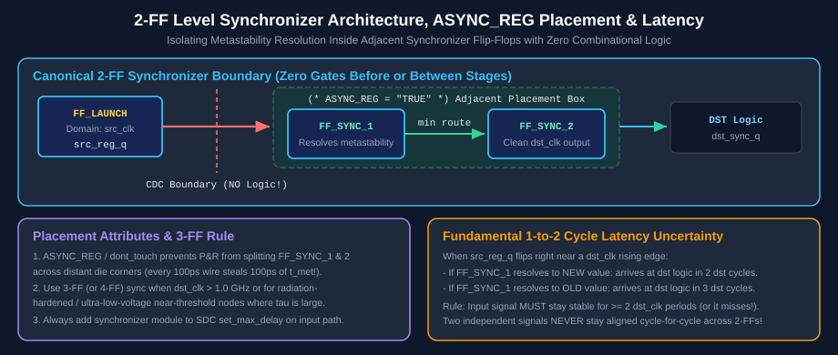
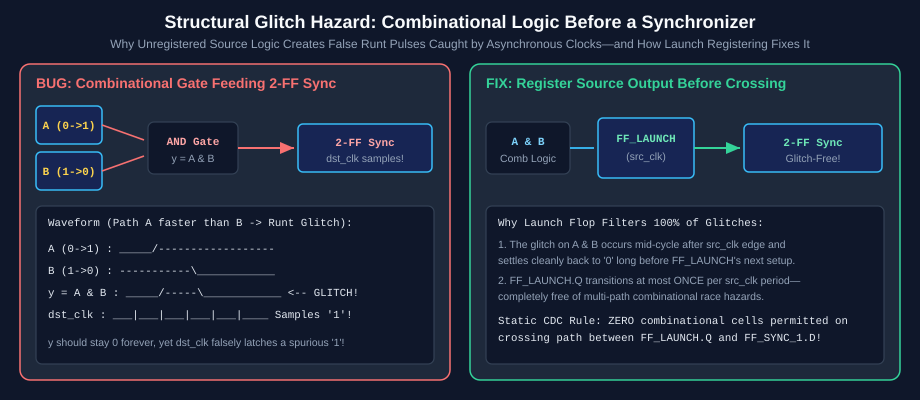

# Single-Bit Level Synchronizers and Structural Glitches

The **2-Flip-Flop (2-FF) synchronizer** is the fundamental building block of Clock Domain Crossing hardware. Despite containing only two flip-flops, misapplying a 2-FF synchronizer—by placing combinational logic upstream, allowing fanout to diverge, forgetting physical placement attributes, or feeding narrow fast pulses directly into a slower clock—accounts for a huge fraction of real silicon CDC bugs.

---

## Learning Goals

After completing this chapter, you should be able to:

- Write a parameterizable, synthesis-clean **2-FF / 3-FF Single-Bit Level Synchronizer** in SystemVerilog with `ASYNC_REG` and `dont_touch` attributes.
- Explain why combinational gates between the source launch flip-flop and `FF_SYNC_1` create structural glitch hazards and how launch registering eliminates them.
- Analyze the fundamental **1-to-2 destination cycle latency uncertainty** of a level synchronizer and derive the minimum source stability rule ($\Delta t_{\text{stable}} \ge 2 \cdot T_{\text{dst}}$).
- Distinguish safe **3-FF synchronizer** scaling at gigahertz clock rates from naive over-pipelining.

---

## Anatomy of the 2-FF Level Synchronizer

A canonical 2-FF synchronizer isolates metastability strictly inside the first capture register (`FF_SYNC_1`) and delivers a cleanly resolved signal out of `FF_SYNC_2`.



### Parameterizable SystemVerilog 2-FF / 3-FF Synchronizer

```systemverilog
module cdc_bit_sync #(
    parameter int unsigned STAGES = 2, // Use 3 for dst_clk > 1 GHz or ultra-low Vdd
    parameter logic        RST_VAL = 1'b0
) (
    input  logic dst_clk,
    input  logic dst_rst_n, // Synchronized cleanly to dst_clk!
    input  logic src_in,    // MUST come directly from a registered src_clk flop!
    output logic dst_out
);
    // Preserve physical adjacency (prevents P&R splitting FF1 -> FF2 across die!)
    // and blocks retiming/replication across synchronizer stages.
    (* ASYNC_REG = "TRUE", dont_touch = "yes" *)
    logic [STAGES-1:0] sync_pipe;

    always_ff @(posedge dst_clk or negedge dst_rst_n) begin
        if (!dst_rst_n)
            sync_pipe <= {STAGES{RST_VAL}};
        else
            sync_pipe <= {sync_pipe[STAGES-2:0], src_in};
    end

    assign dst_out = sync_pipe[STAGES-1];
endmodule
```

### Why `ASYNC_REG` / Physical Adjacency Attributes Are Mandatory

Recall from Chapter 1 that $t_{\text{met}} = T_{\text{dst}} - t_{su} - t_{c2q} - t_{\text{route}}$ sits inside an **exponential** term $\exp(t_{\text{met}} / \tau)$!
- If Place-and-Route scatters `sync_pipe[0]` and `sync_pipe[1]` $400\,\mu\text{m}$ apart because `set_false_path` lowered routing priority, $t_{\text{route}}$ balloons by $300\text{ps}$—collapsing MTBF by $e^{300/20} = e^{15} \approx 3.2\text{ million}\times$!
- Marking `sync_pipe` with `(* ASYNC_REG = "TRUE" *)` (Vivado/Xilinx) and/or `set_dont_touch` / physical placement group (`create_bound` / `pblock` in ASIC ICC2/Innovus) forces the router to place `FF_SYNC_1` and `FF_SYNC_2` side-by-side in the same physical row/tile (`t_route ~ 10-30ps`).

---

## Combinational Glitch Hazard Before a Synchronizer

Never drive an asynchronous crossing wire directly from combinational logic (`AND`, `OR`, `MUX`, decoder, comparator)!



### Why Synchronous Systems Ignore Mid-Cycle Glitches—While CDC Breaks

Inside a single synchronous clock domain, combinational inputs `A` and `B` can race across unequal wire paths (`A` flips `0 -> 1` $200\text{ps}$ faster than `B` flips `1 -> 0`), briefly pulsing `y = A & B` high (`0 -> 1 -> 0`) before settling back to `0` well before the next clock edge. A synchronous downstream flop never notices that transient glitch!

Across an **asynchronous CDC boundary**, however, `dst_clk` edges sweep uniformly through every picosecond of the `src_clk` period—meaning sooner or later an asynchronous `dst_clk` rising edge lands dead-center on that $200\text{ps}$ glitch, latching a phantom `'1'` that was logically impossible!

**The Golden Fix:** Register every crossing signal directly inside `src_clk` (`FF_LAUNCH`) immediately before leaving the source domain, and **never** allow any combinational gate, mux, or inverter on the wire between `FF_LAUNCH.Q` and `FF_SYNC_1.D`. (Note: even a synthesis buffer inserted for high fanout can invert or split paths—prefer single-sink dedicated launch flops!)

---

## Latency Uncertainty and Minimum Source Hold Rule

A 2-FF level synchronizer does **not** guarantee exact fixed latency:
1. If `src_in` changes far before `dst_clk` rises, `FF_SYNC_1` latches the new value immediately, appearing at `dst_out` after **2 destination edges** (essentially 1 full destination cycle + initial phase remainder).
2. If `src_in` changes inside `FF_SYNC_1`'s $[t_{su}, t_h]$ aperture and resolves back to the **old** value, `FF_SYNC_1` must wait an extra destination clock edge to capture the new value, appearing at `dst_out` after **3 destination edges**!

### Deriving the Minimum Source Stability Rule (Fast-to-Slow Failure)

To guarantee `dst_clk` never completely misses a `0 -> 1 -> 0` pulse:
- Suppose `src_in` rises right **after** a `dst_clk` edge ($t = 0^+$) and drops right **before** a subsequent `dst_clk` edge.
- In the worst-case phase skew + metastability resolution (`OLD` resolution on Edge 1, followed by dropping before Edge 2), `src_in` must remain cleanly stable for at least:

$$\Delta t_{\text{hold\_min}} \ge 2 \cdot T_{\text{dst}} \quad (\text{or } 1.5 \cdot T_{\text{dst}} + t_{\text{margin}})$$

Specifically, any **single-cycle pulse** from a faster domain ($f_{\text{src}} > f_{\text{dst}}$, e.g. $400\text{MHz} \to 100\text{MHz}$) has width $2.5\text{ns} < T_{\text{dst}} = 10\text{ns}$ and **will vanish completely** between destination clock edges! Always use a **Pulse Synchronizer** (Chapter 4) for fast-to-slow pulses rather than a bare 2-FF level synchronizer!

---

## Best Practices and Common Pitfalls

- **Never Put Synchronizers on Unregistered Combinational Wires:** Always check static CDC logs for `Ac_glitch03` / `combo_before_sync` errors and add a dedicated `src_clk` launch register.
- **Avoid Resetting Synchronizers With Unsynchronized Resets Unless Required:** Use the destination domain's properly synchronized `dst_rst_n` on `sync_pipe`, and make sure `RST_VAL` matches the safe idle polarity of `src_in` (`1'b1` for active-low flags like `empty_n` or `idle_n`) so wakeup never fires false pulses!
- **Never Sync the Same Signal Through Two Parallel 2-FFs:** Remember the fanout reconvergence hazard—always instantiate `cdc_bit_sync` **once** at the boundary and distribute `dst_out` within `dst_clk`.
- **Keep Multi-Stage Syncs Clean of Synthesis Retiming:** Tag synchronizer modules (`dont_touch` / `ASYNC_REG`) so synthesis never merges `FF_SYNC_1` into source logic or pulls downstream logic backwards between `FF_SYNC_1` and `FF_SYNC_2`.

---

## Practical Exercises with Solutions

### Exercise 1 Debugging a Missing Pulse Across Clock Speeds

**Problem:**
A `250 MHz` peripheral generates a 1-cycle active-high interrupt pulse `irq_pulse` ($4\text{ns}$ wide) wired directly into a `cdc_bit_sync` running on a `50 MHz` CPU bus clock ($20\text{ns}$ period). In simulation, roughly 80% of interrupts vanish completely! Why?

**Solution:**
Because `irq_pulse` lasts only $4\text{ns}$ while `dst_clk` samples every $20\text{ns}$, any pulse falling strictly inside the $16\text{ns}$ window *between* rising `50 MHz` edges returns back to `0` long before `FF_SYNC_1` ever samples it!
**Fix:** Convert `irq_pulse` via an Open-Loop Toggle or Closed-Loop REQ-ACK Pulse Synchronizer (Chapter 4) so the crossing wire holds a persistent level change until acknowledged/sampled.

### Exercise 2 Fixing a `combo_before_sync` Static CDC Violation

**Problem:**
Identify the CDC hazard in the SystemVerilog snippet below and rewrite it safely:

```systemverilog
// In src_clk domain:
wire valid_crossing = fifo_not_empty & dma_enable_q & ~err_flag_q;
cdc_bit_sync u_sync (.dst_clk(dst_clk), .dst_rst_n(dst_rst_n),
                     .src_in(valid_crossing), .dst_out(dst_valid));
```

**Solution:**
**Hazard:** `valid_crossing` is combinational logic (`&` and `~`). When `dma_enable_q` rises slightly faster than `err_flag_q` rises (disabling it), `valid_crossing` emits a narrow combinational glitch caught as a false `'1'` by `dst_clk`!
**Fix:** Register `valid_crossing` cleanly in `src_clk` first:

```systemverilog
logic valid_crossing_q;
always_ff @(posedge src_clk or negedge src_rst_n) begin
    if (!src_rst_n) valid_crossing_q <= 1'b0;
    else            valid_crossing_q <= fifo_not_empty & dma_enable_q & ~err_flag_q;
end

cdc_bit_sync u_sync (
    .dst_clk   (dst_clk),
    .dst_rst_n (dst_rst_n),
    .src_in    (valid_crossing_q),
    .dst_out   (dst_valid)
);
```

### Exercise 3 Determining Reset Polarity on a Synchronizer

**Problem:**
Active-low status flag `src_busy_n` idles at `1'b1` when idle and drops to `1'b0` when active. What happens during reset release if `cdc_bit_sync` uses default `RST_VAL = 1'b0`, and what parameter fixes it?

**Solution:**
During `dst_rst_n == 0`, `dst_out` starts at `1'b0`, falsely telling the destination domain that the source is **busy** for 2–3 clock cycles right after reset deassertion even though `src_busy_n` is idle (`1'b1`)! Setting `.RST_VAL(1'b1)` ensures `dst_out` resets cleanly into the true idle state `1'b1`.

##### Copyright (c) 2026 squared-studio
