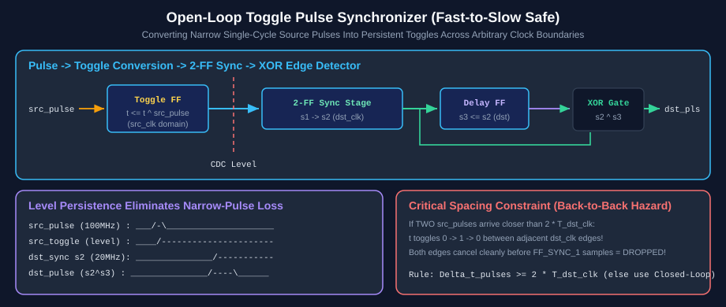
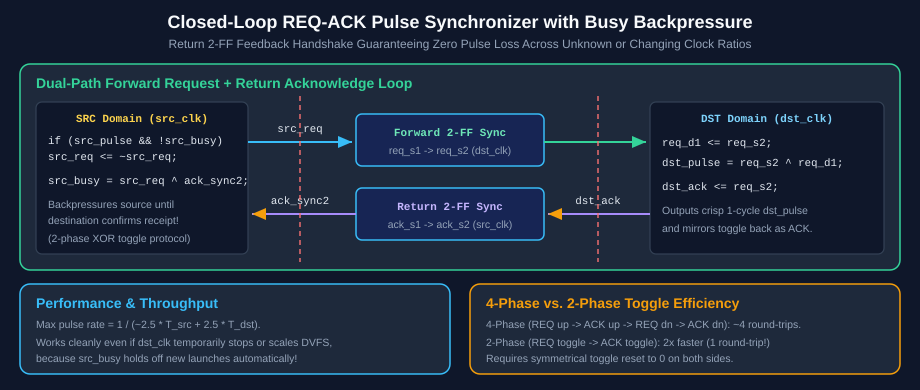

# Pulse Synchronizers, Toggle Handshakes, and Edge Detectors

A standard 2-FF level synchronizer requires input signals to stay stable for at least two destination clock periods. However, real hardware modules constantly exchange **single-cycle event pulses** (such as DMA completion triggers, interrupt pulses, or packet EOF strobes) from a faster clock domain into a slower clock domain—where a 1-cycle source pulse vanishes between two destination clock edges! Transferring events safely requires converting short pulses into **persistent toggles** (Open-Loop) or **acknowledged requests** (Closed-Loop).

---

## Learning Goals

After completing this chapter, you should be able to:

- Explain why an **Open-Loop Toggle Pulse Synchronizer** captures fast-to-slow single-cycle pulses reliably without dropping them.
- Derive the strict minimum input spacing constraint ($\Delta t_{\text{pulses}} \ge 2 \cdot T_{\text{dst}}$) for open-loop pulse synchronizers.
- Design a synthesizable **Closed-Loop 2-Phase REQ-ACK Pulse Synchronizer** with `src_busy` backpressure that never drops pulses under *any* clock ratio.
- Compare Open-Loop vs. Closed-Loop latency, maximum throughput, and area/complexity trade-offs.

---

## Open-Loop Toggle Pulse Synchronizer

Because level changes cannot vanish until toggled *back*, turning every incoming 1-cycle `src_pulse` into a state transition (`0 -> 1`, then later `1 -> 0`) on a **Toggle Flip-Flop** makes the event arbitrarily wide in time! Once synchronized via a 2-FF chain into `dst_clk`, a third flop + `XOR` gate recovers a crisp 1-cycle `dst_pulse` on **both** rising and falling toggle transitions.



### Synthesizable Open-Loop Toggle Pulse Synchronizer

```systemverilog
module cdc_pulse_open_loop #(
    parameter int unsigned SYNC_STAGES = 2
) (
    input  logic src_clk,
    input  logic src_rst_n,
    input  logic src_pulse,   // Single-cycle pulse (spacing >= 2 * T_dst_clk!)

    input  logic dst_clk,
    input  logic dst_rst_n,
    output logic dst_pulse    // Single-cycle pulse in dst_clk
);
    logic src_tgl_q;
    (* ASYNC_REG = "TRUE" *) logic [SYNC_STAGES-1:0] sync_q;
    logic dst_dly_q;

    // 1. Source Toggle FF: Each valid pulse flips persistent level state
    always_ff @(posedge src_clk or negedge src_rst_n) begin
        if (!src_rst_n)
            src_tgl_q <= 1'b0;
        else if (src_pulse)
            src_tgl_q <= ~src_tgl_q;
    end

    // 2. Multi-stage Synchronizer + Delay stage for Edge Detection
    always_ff @(posedge dst_clk or negedge dst_rst_n) begin
        if (!dst_rst_n) begin
            sync_q    <= '0;
            dst_dly_q <= 1'b0;
        end else begin
            sync_q    <= {sync_q[SYNC_STAGES-2:0], src_tgl_q};
            dst_dly_q <= sync_q[SYNC_STAGES-1];
        end
    end

    // 3. Registered or combinational XOR detects every 0->1 AND 1->0 edge!
    assign dst_pulse = sync_q[SYNC_STAGES-1] ^ dst_dly_q;
endmodule
```

> [!WARNING]
> **Critical Spacing Constraint & Reset Synchronization Hazard:**
> 1. **Double-Toggle Cancellation:** If `src_pulse` fires twice faster than $2 \cdot T_{\text{dst}}$, `src_tgl_q` flips `0 -> 1 -> 0` between adjacent `dst_clk` edges—**silently erasing both pulses**!
> 2. **Asymmetric Reset Hazard:** If `src_rst_n` resets `src_tgl_q` to `0` while `dst_rst_n` is *not* asserted and `sync_q` was holding `1`, resetting `src_tgl_q` creates a `1 -> 0` edge that fires a **spurious phantom `dst_pulse`**! Reset both domains together or assert reset isolation!

---

## Closed-Loop REQ-ACK Pulse Synchronizer

Whenever pulse arrival intervals are unknown, clocks dynamically change via DVFS, or bursty traffic can fire back-to-back cycles, an open-loop synchronizer is unsafe. Adding a **return 2-FF feedback path** creates a **Closed-Loop 2-Phase Toggle Handshake** that provides a cycle-accurate `src_busy` flag to guarantee zero dropped events.



### Synthesizable Closed-Loop 2-Phase Pulse Synchronizer

```systemverilog
module cdc_pulse_req_ack #(
    parameter int unsigned SYNC_STAGES = 2
) (
    input  logic src_clk,
    input  logic src_rst_n,
    input  logic src_pulse,   // Ignored/backpressured while src_busy == 1
    output logic src_busy,    // 1 while handshake is in flight

    input  logic dst_clk,
    input  logic dst_rst_n,
    output logic dst_pulse    // 1-cycle synchronized event
);
    logic src_req_q, dst_dly_q, dst_ack_q;
    (* ASYNC_REG = "TRUE" *) logic [SYNC_STAGES-1:0] req_sync_q;
    (* ASYNC_REG = "TRUE" *) logic [SYNC_STAGES-1:0] ack_sync_q;

    // SRC domain: Busy whenever request != returned ack
    assign src_busy = src_req_q ^ ack_sync_q[SYNC_STAGES-1];

    always_ff @(posedge src_clk or negedge src_rst_n) begin
        if (!src_rst_n)
            src_req_q <= 1'b0;
        else if (src_pulse && !src_busy)
            src_req_q <= ~src_req_q;
    end

    // Forward REQ Sync + Destination Edge Detect + Return ACK
    always_ff @(posedge dst_clk or negedge dst_rst_n) begin
        if (!dst_rst_n) begin
            req_sync_q <= '0;
            dst_dly_q  <= 1'b0;
            dst_ack_q  <= 1'b0;
        end else begin
            req_sync_q <= {req_sync_q[SYNC_STAGES-2:0], src_req_q};
            dst_dly_q  <= req_sync_q[SYNC_STAGES-1];
            dst_ack_q  <= req_sync_q[SYNC_STAGES-1]; // Registered ACK back to SRC!
        end
    end

    assign dst_pulse = req_sync_q[SYNC_STAGES-1] ^ dst_dly_q;

    // Return ACK Sync into SRC domain
    always_ff @(posedge src_clk or negedge src_rst_n) begin
        if (!src_rst_n)
            ack_sync_q <= '0;
        else
            ack_sync_q <= {ack_sync_q[SYNC_STAGES-2:0], dst_ack_q};
    end
endmodule
```

Notice why `dst_ack_q` is cleanly **registered** in `dst_clk` (or directly tapped off `req_sync_q[STAGES-1]`, which is already a registered flip-flop in `dst_clk`!): tapping directly from `req_sync_q[STAGES-1]` reduces round-trip latency by 1 `dst_clk` cycle with zero extra flop overhead while remaining 100% glitch-free!

---

## Comparing Synchronizer Architectures

| Feature | 2-FF Level Sync | Open-Loop Toggle Pulse Sync | Closed-Loop 2-Phase REQ-ACK | Async Pulse/Event Counter + FIFO |
| :--- | :--- | :--- | :--- | :--- |
| **Input Waveform** | Slow Level ($\ge 2 T_{\text{dst}}$) | 1-cycle Pulse ($\Delta t \ge 2 T_{\text{dst}}$) | 1-cycle Pulse (Arbitrary bursts w/ ready/busy) | Back-to-back every `src_clk` |
| **Throughput** | $\le 1$ transition per $2 T_{\text{dst}}$ | $\le 1$ pulse per $2 T_{\text{dst}}$ | $\le 1$ pulse per $\sim 2.5(T_{\text{src}} + T_{\text{dst}})$ | **1 event / cycle sustained** |
| **Area / Complexity** | 2 FFs | 4 FFs + XOR | 7–8 FFs + 2 XORs | Async FIFO or dual counters |
| **Backpressure Feedback** | None | None | **Yes (`src_busy`)** | **Yes (`full` flag)** |

---

## Best Practices and Common Pitfalls

- **Register `dst_pulse` if Needed for Clean Timing:** Notice `assign dst_pulse = sync_q ^ dst_dly_q;` adds one XOR gate delay on the `dst_clk` output path; if `dst_pulse` feeds deep combinational logic or must drive a module port cleanly registered, register `dst_pulse` (or tap `sync_q[STAGES-2] ^ sync_q[STAGES-1]` inside `dst_clk`, Wait—no! Never tap `sync_q[STAGES-2]` directly into logic, because `STAGES-2 == FF_SYNC_1` can still be resolving metastability! Only tap **post-`FF_SYNC_2`**!).
- **Respect `src_busy` in Source Control Logic:** Calling `cdc_pulse_req_ack` without checking `!src_busy` silently ignores pulses that arrive while a prior handshake is in flight. If back-to-back un-stallable pulses can arrive faster than one round-trip, use an accumulator counter (increment on `src_pulse`, decrement on `!src_busy`) or a small Async FIFO!
- **Verify Independent Reset Safety:** Ensure source and destination domains enter/exit reset cleanly before enabling `src_pulse` launches so `src_tgl_q` and `dst_dly_q` never initialize out of phase (`0` vs `1`).

---

## Practical Exercises with Solutions

### Exercise 1 Calculating Maximum Closed-Loop Pulse Rate

**Problem:**
A `200 MHz` DMA engine ($T_{\text{src}} = 5\text{ns}$) sends completion interrupts through a 2-stage `cdc_pulse_req_ack` module to a `50 MHz` interrupt controller ($T_{\text{dst}} = 20\text{ns}$). Roughly how many nanoseconds elapse from `src_pulse` assertion until `src_busy` drops back low (worst-case +1 jitter), and what is the maximum interrupt throughput in MHz?

**Solution:**
- **Forward crossing (`src_clk` -> `dst_clk`):** `src_req_q` launches at `0ns`; worst-case 2-FF sync captures on the 3rd edge of `50 MHz` $\approx 3 \times 20\text{ns} = 60\text{ns}$.
- **Return crossing (`dst_clk` -> `src_clk`):** `dst_ack` updates synchronously on `dst_clk`, crossing back into `200 MHz` via 2–3 edges $\approx 3 \times 5\text{ns} = 15\text{ns}$.
- **Total round-trip worst-case busy window:** $\approx 60\text{ns} + 15\text{ns} = 75\text{ns}$ (average $\approx 55\text{ns}$), yielding a safe sustained maximum pulse rate of **$\approx 13.3\text{ million pulses/sec}$ ($13.3\text{MHz}$)**.

### Exercise 2 Spotting the `FF_SYNC_1` Tap Mistake

**Problem:**
To shave 1 cycle off `cdc_pulse_open_loop`, an engineer removes `dst_dly_q` and changes the XOR to:
`assign dst_pulse = sync_q[0] ^ sync_q[1];`
Why does static CDC immediately flag a **critical metastability violation**?

**Solution:**
`sync_q[0]` is `FF_SYNC_1`—the raw synchronizer input flip-flop whose output **can go metastable (`~VDD/2` or late transition)**! Feeding `sync_q[0]` directly into combinational XOR logic (`dst_pulse`) leaks unresolved metastability straight into the destination clock domain, completely defeating the 2-FF synchronizer!

### Exercise 3 Accumulating Fast Back-to-Back Pulses

**Problem:**
A `400 MHz` packet classifier fires 1-cycle hit strobes that can legally happen back-to-back on consecutive cycles, and feeds a `100 MHz` statistics counter (`stat_cnt`). Neither an open-loop toggle sync nor a bare `req_ack` handshake keeps up if pulses occur back-to-back without stalling the classifier! Propose a lightweight CDC solution without building a 32-bit-wide Async FIFO.

**Solution:**
Maintain a small **credit / pending-event counter** (`pend_cnt`) in the `400 MHz` `src_clk` domain:
- Increment `pend_cnt` whenever `hit_strobe` fires (and subtract `1` whenever `!src_busy && pend_cnt > 0` dispatches a closed-loop `req_ack` pulse—or better yet, count `hit_strobe` continuously into a Gray-coded event counter and compute delta on the `100 MHz` side!).
- Wait: **Gray-code counter polling** is even simpler! Increment an $N$-bit binary counter in `400 MHz` on every hit, convert to Gray (`cnt_gray`), 2-FF sync `cnt_gray` into `100 MHz`, convert back to binary, and add `(curr_bin - prev_bin)` to `stat_cnt`—sustaining **zero drops at 100% back-to-back rate**!

##### Copyright (c) 2026 squared-studio
