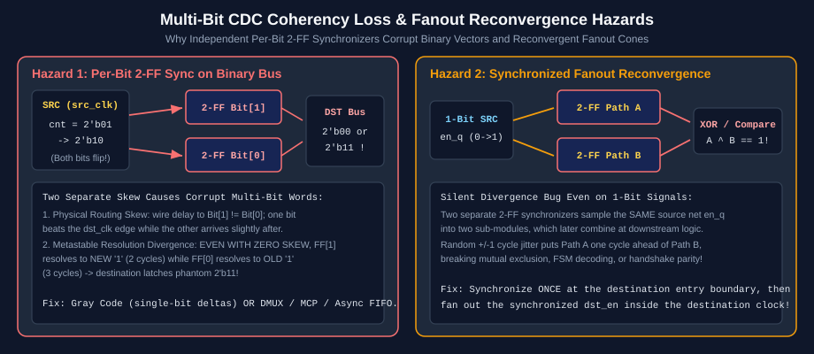
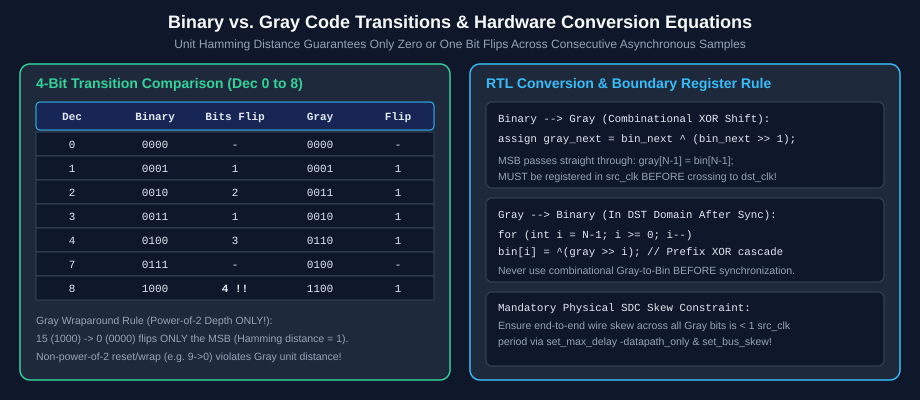

# Multi-Bit CDC Hazards, Coherency, Reconvergence, and Gray Coding

Single-bit 2-FF and toggle synchronizers solve metastability for isolated 1-bit wires—yet putting an array of 2-FF synchronizers across a multi-bit bus is one of the most destructive CDC anti-patterns in digital design. Even if zero flip-flops go metastable physically, **wire routing skew** and **1-cycle resolution jitter** scramble multi-bit values into phantom states that never existed in the source domain.

---

## Learning Goals

After completing this chapter, you should be able to:

- Explain why independent per-bit 2-FF synchronizers corrupt multi-bit binary buses (`Ac_coherency06`) through both physical trace skew and probabilistic 0/+1 resolution jitter.
- Identify **fanout reconvergence (convergence) hazards (`Ac_conv01`)** when separate synchronized copies of one or more bits combine downstream.
- Prove mathematically why **Gray Coding** maintains a unit Hamming distance of `1` across consecutive monotonic counts—including wraparound at power-of-2 boundaries.
- Implement synthesizable Binary-to-Gray and Gray-to-Binary hardware converters in SystemVerilog while honoring the mandatory **launch-register-before-crossing** rule.

---

## Multi-Bit Coherency Failure and Reconvergence Hazards

Both multi-bit bus skew and single-bit fanout convergence arise from the same fundamental law: **every individual 2-FF synchronizer exhibits an independent stochastic latency of 2 or 3 destination clock cycles**.



### 1. Multi-Bit Binary Skew Hazard (`01 -> 10` Becomes `00` or `11`)

Suppose a 2-bit source counter increments `2'b01 -> 2'b10`, so **both** bit `1` (`0 -> 1`) and bit `0` (`1 -> 0`) switch simultaneously on `posedge src_clk`.
If routed across two separate 2-FF synchronizers:
- Bit `1` arrives `80ps` earlier (or resolves to the **new** `'1'` in 2 cycles) while Bit `0` arrives `80ps` later (or resolves to the **old** `'1'` in 2 cycles, updating on cycle 3).
- For an entire destination clock cycle, the receiving domain latches **`2'b11` (decimal 3)**—a state that **never existed** in the source domain!

### 2. Fanout Reconvergence Hazard (Even on 1-Bit Signals!)

Reconvergence happens whenever two signals that cross the CDC boundary through *separate* synchronizers meet again inside downstream combinational or sequential logic:
- **Type A (Split Fanout):** One source flop `req_a` splits across two blocks, each instantiating its own `cdc_bit_sync`. Later an arbiter or XOR compares `sync_block1 ^ sync_block2`. Random `+1` jitter on either branch triggers false parity/protocol glitches!
- **Type B (Correlated Pairs):** Two independent control flags (`mode_a` and `mode_b`) change together on one `src_clk` cycle (`10 -> 01`), pass through two 2-FF synchronizers, and enter a 2-bit case decoder (`{dst_a, dst_b}`)—temporarily firing invalid `11` (enable collision) or `00` states!

> [!CAUTION]
> **Never Synchronize Twice and Recombine!** Synchronize a signal **exactly once** at the domain entry point and distribute the resolved output inside `dst_clk`. If two related control bits must switch together coherently (`{mode_a, mode_b}`), encode them into a single multi-bit bus transferred via **DMUX / MCP** (Chapter 6) or Gray coding!

---

## Gray Code Mathematics and Hardware Converters

Invented by Frank Gray, a **reflected binary Gray code** orders $2^N$ bit strings such that any two adjacent values differ in **exactly 1 bit position** ($\text{Hamming distance} = 1$).



### Why Gray Coding Solves Monotonic Crossings

If at most **one** bit toggles between consecutive clock cycles ($G_k \to G_{k+1}$):
- If the destination clock catches that single changing bit cleanly before the edge: destination observes **$G_{k+1}$**.
- If the destination clock catches the old value (or goes metastable and resolves late): destination observes **$G_k$**.
- It is **physically impossible** to sample a bogus third value outside $\{G_k, G_{k+1}\}$—so long as physical routing skew across bits stays shorter than 1 source clock period (`src_clk`)!

### Synthesizable Binary-to-Gray and Gray-to-Binary Modules

```systemverilog
module bin_to_gray #(
    parameter int unsigned WIDTH = 4
) (
    input  logic [WIDTH-1:0] bin_in,
    output logic [WIDTH-1:0] gray_out
);
    assign gray_out = bin_in ^ (bin_in >> 1);
endmodule

module gray_to_bin #(
    parameter int unsigned WIDTH = 4
) (
    input  logic [WIDTH-1:0] gray_in,
    output logic [WIDTH-1:0] bin_out
);
    // Prefix XOR reduction: bin[i] = ^(gray[WIDTH-1:i])
    always_comb begin
        bin_out[WIDTH-1] = gray_in[WIDTH-1];
        for (int i = WIDTH - 2; i >= 0; i--) begin
            bin_out[i] = bin_out[i + 1] ^ gray_in[i];
        end
    end
endmodule
```

### Mandatory Power-of-2 Wraparound Rule

A full $N$-bit Gray counter maintains unit Hamming distance across **wraparound** from $2^N - 1 \to 0$ (e.g., `4'b1000` (15) $\to$ `4'b0000` (0) flips only the MSB!).
- **Fatal Bug:** Wrapping a 4-bit Gray counter prematurely at depth `10` (`4'b1111` back to `4'b0000`) flips **4 bits simultaneously**, immediately destroying CDC coherency!
- For **non-power-of-2** counters or FIFO depths (e.g., depth `12`), keep the counter symmetric around the midpoint of the full power-of-2 wheel (starting at `2` and ending at `13`, where `2` = `0011` and `13` = `1011` differ only in the MSB!) OR round pointer width to the next power of 2!

### Registering Gray Bits Before Crossing

Notice `bin_to_gray` uses XOR gates! Never feed `bin ^ (bin >> 1)` straight across a CDC boundary (`Ac_glitch03`), because multi-bit input timing skew inside `bin_in` creates combinational glitches on `gray_out`! Always **register `gray_q` in `src_clk`** first:

```systemverilog
always_ff @(posedge src_clk or negedge src_rst_n) begin
    if (!src_rst_n) begin
        bin_q  <= '0;
        gray_q <= '0;
    end else if (inc_en) begin
        bin_q  <= bin_q + 1'b1;
        gray_q <= bin_next ^ (bin_next >> 1); // Computed next, LATCHED into FF!
    end
end
```

---

## Best Practices and Common Pitfalls

- **Never Use Gray Code on Arbitrary Jumping Data:** Gray coding only works when values change strictly by $\pm 1$ per step (counters, FIFO pointers, sequence tags). Random jumping buses (like AXI addresses or `wdata`) flip multiple bits even in Gray representation—use DMUX/MCP (Chapter 6) or Async FIFO (Chapter 7)!
- **Bound Physical Skew Across Gray Bus Wires (`set_max_delay`):** If bit `3` routes $5\text{ns}$ slower than bit `0` while `src_clk` runs at $500\text{MHz}$ ($2\text{ns}$), two consecutive pointer increments overlap in flight and corrupt destination decoding! Constrain `set_max_delay -datapath_only` + `set_bus_skew < T_src`!
- **Convert Gray Back to Binary Only AFTER `FF_SYNC_2`:** Keep `gray_to_bin` strictly on the synchronized destination outputs, never before the synchronizer!
- **Eliminate One-Hot Violations by Packaging Related Control Signals:** Whenever static CDC flags `Ac_conv01`, consolidate parallel independent synchronizers into a single qualified payload or prove mutual exclusion formally.

---

## Practical Exercises with Solutions

### Exercise 1 Detecting a Phantom Binary Bus State

**Problem:**
A 4-bit binary counter in `src_clk` increments from `7` (`4'b0111`) to `8` (`4'b1000`) and passes through four parallel 2-FF synchronizers into `dst_clk`. If bits `[3:2]` happen to resolve after 2 cycles while slow routing delays bits `[1:0]` to resolve on cycle 3, what bogus decimal value does `dst_clk` observe for one full clock cycle?

**Solution:**
`dst_clk` captures new MSB bits (`10`) combined with old LSB bits (`11`), reading **`4'b1011` (decimal `11`)**—jumping from `7 -> 11 -> 8` instead of `7 -> 8`!

### Exercise 2 Fixing a Non-Power-of-2 Gray Wrap Bug

**Problem:**
An engineer builds a depth-`6` Asynchronous FIFO using 3-bit Gray pointers counting `0, 1, 2, 3, 4, 5` and resetting back to `0`. List the Gray codes for `5` and `0` and prove why this fails in CDC.

**Solution:**
- Binary `5` = `3'b101` $\implies$ Gray = `5 ^ (5 >> 1)` = `3'b101 ^ 3'b010` = **`3'b111`**.
- Binary `0` = `3'b000` $\implies$ Gray = **`3'b000`**.
Transitioning from `5 -> 0` flips **all 3 bits simultaneously** (`111 -> 000`)!
**Fix for depth-6:** Offset the 3-bit Gray sequence symmetrically around the middle (`1..6`: binary `001..110`, Gray `001` to `101` differs by 2? Wait—offset by `+1`: `1=001 -> 6=101` flips only MSB `001` $\leftrightarrow$ `101`!) Or use standard power-of-2 depth `8`! Let's double-check: `bin=1 -> gray=001`, `bin=2 -> 011`, `bin=3 -> 010`, `bin=4 -> 110`, `bin=5 -> 111`, `bin=6 -> 101`, and `101 -> 001` flips **only bit `[2]`** (Hamming distance = `1`)!

### Exercise 3 Auditing a Gray-Encoded Counter Crossing

**Problem:**
Spot the CDC bug in the RTL snippet below:

```systemverilog
logic [7:0] wptr_bin;
logic [7:0] wptr_gray;
assign wptr_gray = wptr_bin ^ (wptr_bin >> 1); // Combinational output!
cdc_bit_sync u_sync [7:0] (.dst_clk(rclk), .dst_rst_n(rrst_n),
                           .src_in(wptr_gray), .dst_out(r_wptr_gray));
```

**Solution:**
`wptr_gray` is driven directly by combinational XOR logic (`Ac_glitch03` violation!). When `wptr_bin` flips from `0111_1111` to `1000_0000`, wire skew inside `wptr_bin` causes the XOR network `wptr_gray` to emit temporary multi-bit glitches before settling, which `rclk` can sample!
**Fix:** Register `wptr_gray` cleanly inside `wclk` (`always_ff @(posedge wclk)`) before connecting it to `u_sync`.

##### Copyright (c) 2026 squared-studio
