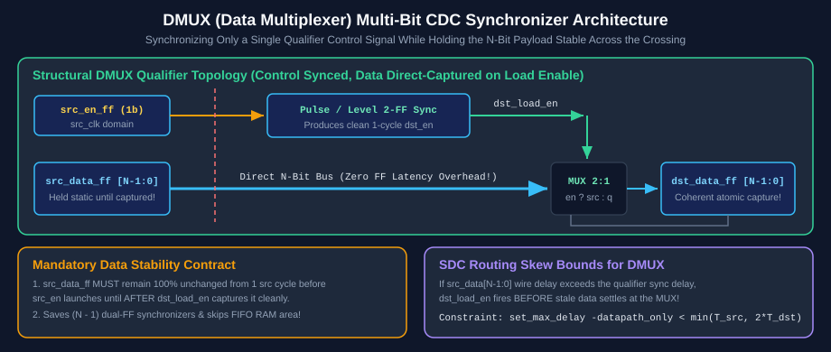
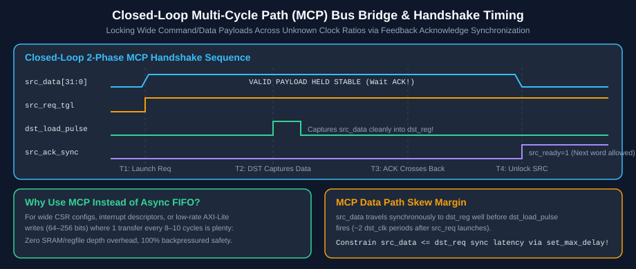

# Multi-Bit Data Synchronization via DMUX, MCP, and Handshake Protocols

Gray coding works only for single-step ($\pm 1$) counters. When transferring arbitrary wide multi-bit payloads—such as 64-bit DMA descriptors, AXI-Lite configuration writes, interrupt vectors, or pixel metadata—every bit can change arbitrarily between updates. For moderate-rate or sporadic buses where a full Dual-Port Async FIFO is overkill, designers synchronize **only a single control qualifier** using **Data Multiplexer (DMUX)** or **Closed-Loop Multi-Cycle Path (MCP)** bridges.

---

## Learning Goals

After completing this chapter, you should be able to:

- Design a **DMUX (Data Multiplexer) Synchronizer** where a synchronized `valid`/`enable` pulse gates direct capture of an unsynchronized $N$-bit data bus.
- Upgrade open-loop DMUX into a **Closed-Loop 2-Phase MCP Bus Bridge** with `src_ready` backpressure that locks source data cleanly across any clock ratio.
- Contrast **Open-Loop DMUX** vs. **Closed-Loop MCP** vs. **Async FIFO** in terms of area, latency, throughput, and safety guarantees.
- Write strict `set_max_delay -datapath_only` and `set_bus_skew` SDC timing constraints so wide data lanes never lag behind the synchronized enable qualifier.

---

## Open-Loop DMUX Qualifier Synchronizer

The key insight of **DMUX synchronization** (also called an Open-Loop Multi-Cycle Path Formulation) is simple: instead of synchronizing $N$ parallel data wires and risking multi-bit skew, synchronize **only one control qualifier bit**, while enforcing an architectural contract that the $N$-bit payload stays completely frozen while that qualifier crosses!



### How Open-Loop DMUX Works

1. The source domain loads `src_data_q[WIDTH-1:0]` cleanly and holds it **100% static** for at least $3$–$4$ destination clock periods.
2. Simultaneously (or 1 cycle after `src_data_q` stabilizes), the source pulses `src_valid`, driving a toggle pulse synchronizer (`cdc_pulse_open_loop`) into `dst_clk`.
3. Once the single-bit qualifier resolves cleanly out of `dst_clk`'s 2-FF sync + edge detector (`dst_load_en`), it opens the capture MUX / clock enable on `dst_data_q[WIDTH-1:0]`, atomically sampling all $N$ bits simultaneously on one clean rising `dst_clk` edge!
4. Notice why **zero `dst_data_q` flops go metastable**: every single bit of `src_data_q` already settled multiple nanoseconds *before* `dst_load_en` rose to `1`!

> [!WARNING]
> **The Hidden Open-Loop Trap:** Open-loop DMUX has **no hardware feedback** preventing source software/RTL from overwriting `src_data_q` too early! If `src_clk` speeds up under DVFS or `dst_clk` pauses briefly, overwriting `src_data_q` before `dst_load_en` fires silently corrupts data mid-flight. Use Open-Loop DMUX *only* when source inter-packet spacing is structurally guaranteed (e.g., slow APB register writes or fixed-cadence timers).

---

## Closed-Loop MCP Bus Handshake Architecture

Eliminating timing guesswork across arbitrary clock frequency ratios requires adding a **return 2-FF Acknowledge path**—creating a **Closed-Loop Multi-Cycle Path (MCP) Synchronizer**.



### Synthesizable Closed-Loop Ready/Valid MCP Data Bridge

The bridge below implements a standard AXI-style `valid` / `ready` multi-bit transfer across completely arbitrary clock speeds (`src_clk` $\leftrightarrow$ `dst_clk`):

```systemverilog
module cdc_mcp_data_bridge #(
    parameter int unsigned WIDTH       = 32,
    parameter int unsigned SYNC_STAGES = 2
) (
    // Source Domain Interface
    input  logic             src_clk,
    input  logic             src_rst_n,
    input  logic             src_valid,
    output logic             src_ready,
    input  logic [WIDTH-1:0] src_data,

    // Destination Domain Interface
    input  logic             dst_clk,
    input  logic             dst_rst_n,
    output logic             dst_valid,  // 1-cycle coherent pulse (or hold w/ ready)
    output logic [WIDTH-1:0] dst_data
);
    logic             src_req_q;
    logic [WIDTH-1:0] src_data_q;
    logic             dst_dly_q;
    logic             dst_ack_q;
    logic             dst_load_en;

    (* ASYNC_REG = "TRUE" *) logic [SYNC_STAGES-1:0] req_sync_q;
    (* ASYNC_REG = "TRUE" *) logic [SYNC_STAGES-1:0] ack_sync_q;

    // 1. Source Backpressure: Ready only when no MCP transfer is currently active
    wire busy = src_req_q ^ ack_sync_q[SYNC_STAGES-1];
    assign src_ready = ~busy;

    always_ff @(posedge src_clk or negedge src_rst_n) begin
        if (!src_rst_n) begin
            src_req_q  <= 1'b0;
            src_data_q <= '0;
        end else if (src_valid && src_ready) begin
            src_data_q <= src_data;   // Latch & LOCK payload stable until ACK!
            src_req_q  <= ~src_req_q; // Launch 2-phase toggle request
        end
    end

    // 2. Destination Qualifier Sync + Atomic Data Load Enable
    always_ff @(posedge dst_clk or negedge dst_rst_n) begin
        if (!dst_rst_n) begin
            req_sync_q <= '0;
            dst_dly_q  <= 1'b0;
            dst_ack_q  <= 1'b0;
        end else begin
            req_sync_q <= {req_sync_q[SYNC_STAGES-2:0], src_req_q};
            dst_dly_q  <= req_sync_q[SYNC_STAGES-1];
            dst_ack_q  <= req_sync_q[SYNC_STAGES-1]; // Return ACK after capture edge!
        end
    end

    assign dst_load_en = req_sync_q[SYNC_STAGES-1] ^ dst_dly_q;

    // 3. Destination Payload Register (Clock-enabled ONLY when dst_load_en == 1!)
    always_ff @(posedge dst_clk or negedge dst_rst_n) begin
        if (!dst_rst_n) begin
            dst_data  <= '0;
            dst_valid <= 1'b0;
        end else begin
            dst_valid <= dst_load_en;
            if (dst_load_en)
                dst_data <= src_data_q; // 100% settled! Zero metastability!
        end
    end

    // 4. Return ACK Sync back into Source Clock Domain
    always_ff @(posedge src_clk or negedge src_rst_n) begin
        if (!src_rst_n)
            ack_sync_q <= '0;
        else
            ack_sync_q <= {ack_sync_q[SYNC_STAGES-2:0], dst_ack_q};
    end
endmodule
```

> [!IMPORTANT]
> **Check `dst_ack_q` Capture Alignment Carefully!** Notice that `dst_load_en` pulses during the cycle where `req_sync_q[STAGES-1]` first mismatches `dst_dly_q`, and `dst_data` registers `src_data_q` on that exact clock edge (`dst_valid <= dst_load_en`), **at the exact same edge** `dst_ack_q` launches toward `src_clk`. Thus `src_data_q` stays strictly untouched for an extra 2–3 `src_clk` sync cycles **after** `dst_data` already captured it! That guarantees generous data-hold security across every corner.

---

## Physical Routing Skew Constraint for DMUX / MCP

One deadly physical layout bug breaks even perfect MCP RTL:
If SDC marks `src_clk <-> dst_clk` as a blanket **`set_false_path`**, Place-and-Route allows `src_data_q[31:0]` traces to snake $12\text{ns}$ around a large SRAM macro while `src_req_q` travels in $0.5\text{ns}$ across a fast straight track! When `dst_clk` is very fast (`1 GHz`), `dst_load_en` arrives only $2\text{ns}$ after `src_req_q`—capturing stale/half-skewed bits on `src_data_q`!

**Mandatory SDC Fix:** Always bound both `src_req_q` and `src_data_q` tightly using `set_max_delay -datapath_only`:

```tcl
# Bound MCP payload + control path delay strictly below 1.5 destination periods (or <= 2ns)
set_max_delay -datapath_only \
    -from [get_cells -hier *src_data_q_reg*] \
    -to   [get_cells -hier *dst_data_reg*] 1.5

set_max_delay -datapath_only \
    -from [get_cells -hier *src_req_q_reg*] \
    -to   [get_cells -hier *req_sync_q_reg[0]*] 1.0
```

---

## Choosing Between MCP, DMUX, and Async FIFO

| Metric | Open-Loop DMUX | Closed-Loop MCP Bridge | Dual-Clock Async FIFO |
| :--- | :--- | :--- | :--- |
| **Throughput** | 1 word / $\ge 3 T_{\text{dst}}$ | 1 word / $\sim 2.5(T_{\text{src}} + T_{\text{dst}})$ | **1 word / clock cycle sustained!** |
| **Flip-Flop / Memory Cost** | Lowest ($2N$ FFs + pulse sync) | Low ($2N$ FFs + 2x pulse sync) | Higher ($D \cdot N$ RAM/FFs + 2 Gray counters) |
| **Requires Fixed Freq Ratio?** | Yes (to avoid overrun) | **No** (works across any ratio/halt) | **No** (works across any ratio) |
| **Ideal Workload** | Periodic sensor polling | APB/CSR configs, slow commands, descriptors | DMA bursts, AXI channels, video/Ethernet streams |

---

## Best Practices and Common Pitfalls

- **Always Enable `dst_data` Capture With a Clock-Enable MUX (`if (dst_load_en)`):** Never register `dst_data <= src_data_q;` unconditionally on every `dst_clk` cycle—while `src_data_q` updates on `src_clk`, unconditional sampling captures switching data mid-transition and sends the whole 32-bit `dst_data` bus metastable!
- **Honor `src_ready` Backpressure at the Upstream Master:** If a bus protocol (`AXI`, `APB`, `OBI`) allows backpressure (`READY`), wire `src_ready` straight to `PREADY`/`WREADY` rather than dropping beats silently.
- **Verify `src_data_q` Stability With SVA:** Bind `assert property (@(posedge src_clk) !src_ready |-> $stable(src_data_q));` during UVM regression and JasperGold formal runs!

---

## Practical Exercises with Solutions

### Exercise 1 Catching an Unconditional Data Capture Bug

**Problem:**
An engineer simplifies `cdc_mcp_data_bridge` by removing `if (dst_load_en)` and coding:

```systemverilog
always_ff @(posedge dst_clk) begin
    dst_data  <= src_data_q;
    dst_valid <= dst_load_en;
end
```

Why does static CDC immediately flag `Ac_unsync01` on all 32 bits of `dst_data`, even though upstream `src_data_q` holds steady when `src_req_q` toggles?

**Solution:**
Removing `if (dst_load_en)` allows `dst_data` to continuously clock and capture `src_data_q` even during the clock cycle right when `src_clk` updates `src_data_q` to a brand-new value (`src_valid && src_ready`)! That violates setup/hold across all 32 `dst_data` flip-flops, driving them metastable (especially risky if `dst_data` drives downstream logic before checking `dst_valid`). Static CDC recognizes a true **DMUX structure** *only* when the synced qualifier cleanly gates the load-enable MUX (`if (dst_load_en)`).

### Exercise 2 Bounding MCP Routing Delay vs. Destination Clock Speed

**Problem:**
`src_clk = 100 MHz` ($10\text{ns}$) sends 64-bit commands through `cdc_mcp_data_bridge` (`SYNC_STAGES=2`) to `dst_clk = 500 MHz` ($2\text{ns}$). What is the **earliest** possible time after `src_req_q` launches at `FF` output that `dst_load_en` can enable `dst_data`? Therefore, what upper limit must `set_max_delay -datapath_only` enforce on `src_data_q -> dst_data`?

**Solution:**
In the worst-case phase alignment (where `src_req_q` transitions right *before* a rising edge of `500 MHz` `dst_clk`):
- Edge 1 (`t ~ 0.1ns`): `req_sync_q[0]` latches `src_req_q`.
- Edge 2 (`t ~ 2.1ns`): `req_sync_q[1]` resolves cleanly, raising `dst_load_en = 1`!
- Edge 3 (`t ~ 4.1ns`): `dst_data` samples `src_data_q`!
Because `src_data_q` and `src_req_q` launch simultaneously at `t = 0`, `src_data_q` **must settle at `dst_data.D` strictly before Edge 3 (`4.1ns`)** minus `t_su`, even if `req_sync_q` took the shortest $0.1\text{ns}$ wire! Setting **`set_max_delay -datapath_only 3.5`** (or conservatively `< 1 * T_dst = 2.0ns`) safely guarantees `src_data_q` always beats `dst_load_en`!

### Exercise 3 Computing Closed-Loop MCP Transfer Latency

**Problem:**
For the same $100\text{MHz} \to 500\text{MHz}$ bridge, estimate how many nanoseconds one complete `src_valid && src_ready` handshake cycle takes before `src_ready` returns high (`1`). Can this bridge sustain `50 Mtransfers/s`?

**Solution:**
- `src_req_q` launches (`t=0`), crosses into `500 MHz` ($\approx 2$–$3$ cycles of $2\text{ns} = 4$–$6\text{ns}$), `dst_ack_q` launches 1 cycle later ($\approx 6$–$8\text{ns}$), and `ack_sync_q` crosses back into `100 MHz` ($\approx 2$–$3$ cycles of $10\text{ns} = 20$–$30\text{ns}$).
- Total round-trip busy window $\approx 30$–$40\text{ns}$ ($\approx 3$–$4$ `src_clk` cycles), giving max throughput of **$\approx 25$–$33\text{ Mtransfers/s}$**—so `50 Mtransfers/s` exceeds its capability and requires a **Dual-Clock Async FIFO** instead!

##### Copyright (c) 2026 squared-studio
