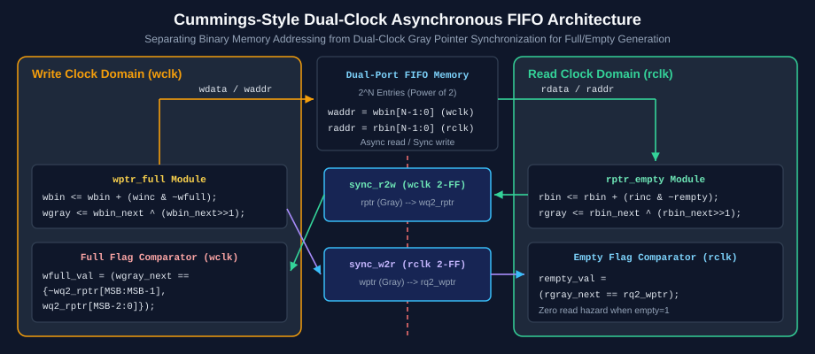
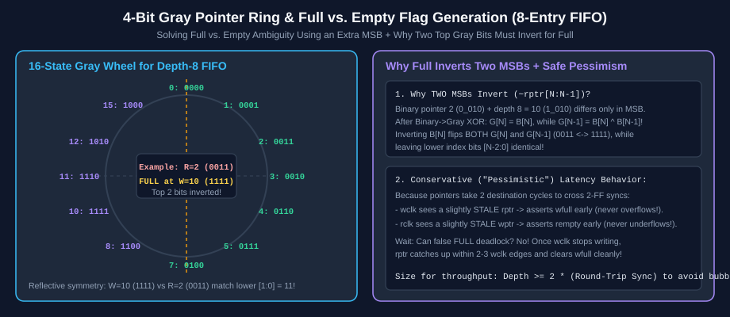

# Asynchronous FIFO Architecture and Dual-Clock Pointer Design

Whenever data streams must cross asynchronous clock boundaries continuously at full wire rate—one transaction per clock cycle on Ethernet MACs, AXI interconnect bridges, PCIe transaction layers, or video pixel pipelines—open-loop DMUX and closed-loop MCP handshakes fall short due to round-trip backpressure overhead. The **Dual-Clock Asynchronous FIFO** (popularized cleanly by Clifford Cummings' landmark paper) achieves **zero-bubble sustained full-rate throughput** by decoupling read and write pointers through synchronized Gray code.

---

## Learning Goals

After completing this chapter, you should be able to:

- Architect a complete **Cummings-Style Dual-Clock Asynchronous FIFO** separating memory indexing, Gray-code pointer generation, dual-2-FF pointer synchronizers, and Full/Empty comparators.
- Explain why **Empty** (`wgray == rgray_sync`) uses equal Gray codes while **Full** (`wgray == {~rgray_sync[N:N-1], rgray_sync[N-2:0]}`) inverts the top **two** MSBs in Gray representation.
- Prove why 2-FF pointer synchronization latency causes safe **conservative ("pessimistic") Full and Empty flags** that prevent overflow and underflow cleanly without deadlock.
- Compute minimum FIFO depth required to avoid throughput stalls across arbitrary frequency ratios and write/read burst sizes.
- Implement a complete, parameterized, synthesis-clean SystemVerilog Async FIFO with proper `ASYNC_REG` and SDC datapath bounds.

---

## Complete Dual-Clock Async FIFO Architecture

To safely pass continuous streams across independent `wclk` and `rclk` clocks, an Async FIFO splits control across six clean hardware modules:



1. **`fifomem` (Dual-Port RAM / Register File):** Stores $2^N$ data words addressed via binary index bits `[N-1:0]` (`waddr` on `wclk`, `raddr` on `rclk`).
2. **`wptr_full` (`wclk` Domain):** Maintains an $(N+1)$-bit binary write pointer `wbin` (`waddr = wbin[N-1:0]`), converts `wbin_next` to Gray `wptr`, registers `wptr` (`wclk`), and evaluates `wfull`.
3. **`rptr_empty` (`rclk` Domain):** Maintains an $(N+1)$-bit binary read pointer `rbin` (`raddr = rbin[N-1:0]`), converts `rbin_next` to Gray `rptr`, registers `rptr` (`rclk`), and evaluates `rempty`.
4. **`sync_r2w` (2-FF in `wclk`):** Synchronizes `rptr` (Gray) safely into `wclk` (`wq2_rptr`).
5. **`sync_w2r` (2-FF in `rclk`):** Synchronizes `wptr` (Gray) safely into `rclk` (`rq2_wptr`).

> [!IMPORTANT]
> **Notice Why Binary Drives Memory While Gray Crosses the Boundary:** Gray code cannot directly index standard SRAM arrays (`addr 0..7` scrambled) cleanly or increment with simple `+1` arithmetic. Keeping a **dual shadow counter (`bin` + `gray`)** lets the memory use clean binary indexing while only the registered Gray copy crosses the CDC gap—combining minimal gate overhead with single-bit Hamming transitions!

---

## Pointer Arithmetic, Extra MSB, and Full vs. Empty Logic

For a FIFO of depth $2^N$ (e.g., depth $8$, $N = 3$ address bits), pointer wraparound creates an inherent ambiguity: **both** a completely Empty FIFO and a completely Full FIFO have `waddr[N-1:0] == raddr[N-1:0]`!
Adding **one extra wraparound lap bit** (bit `[N]`, making pointers $N+1 = 4$ bits wide) resolves this cleanly:



### Deriving the Gray Full Comparison Rule (`{~MSB, ~MSB-1, rest}`)

- **Empty Condition (in `rclk`):** Write and Read pointers are in the **same wrap lap** and point to the same address (`wbin == rbin`). In Gray representation, identical binary inputs yield identical Gray codes:
  $$\text{rempty} \iff (\text{rgray\_next} == \text{rq2\_wptr})$$
- **Full Condition (in `wclk`):** Write pointer has wrapped **one exact lap ahead** of Read pointer (`wbin[N] != rbin[N]` while `wbin[N-1:0] == rbin[N-1:0]`).
  Remember the Binary-to-Gray conversion equations:
  $$G[N] = B[N], \qquad G[N-1] = B[N] \oplus B[N-1], \qquad G[k] = B[k+1] \oplus B[k] \;\;(k < N-1)$$
  When $B_w[N] = \overline{B_r[N]}$ and $B_w[N-1:0] = B_r[N-1:0]$, **both** $G[N]$ and $G[N-1]$ invert, while all lower bits $[N-2:0]$ stay identical! Therefore:
  $$\text{wfull} \iff (\text{wgray\_next} == \{\sim\text{wq2\_rptr}[N:N-1], \;\text{wq2\_rptr}[N-2:0]\})$$

### Why Conservative ("Pessimistic") Stale Flags Never Overflow or Underflow

Because `rptr` passes through a 2-FF synchronizer (`sync_r2w`), the write domain always sees a **slightly delayed (older)** snapshot of the true read pointer (`wq2_rptr`).
- When the consumer reads data out, the write domain briefly assumes the FIFO still holds those extra words and **keeps `wfull = 1` early ("pessimistic full")** for 2 `wclk` cycles longer than physical capacity. It **never** allows a write when physically full (zero overflow!).
- Symmetrically, when the producer pushes data in, `sync_w2r` briefly delays `wptr`, keeping **`rempty = 1` early ("pessimistic empty")** for 2 `rclk` cycles. It **never** allows reading stale un-written garbage (zero underflow!).

---

## Complete Synthesizable SystemVerilog Async FIFO

Below is a compact, production-clean, Cummings-compliant SystemVerilog Async FIFO (split cleanly into logic sections for clarity):

```systemverilog
module async_fifo #(
    parameter int unsigned DATA_WIDTH  = 32,
    parameter int unsigned ADDR_WIDTH  = 3,   // Depth = 2^ADDR_WIDTH (e.g., 8)
    parameter int unsigned SYNC_STAGES = 2
) (
    // Write Clock Domain
    input  logic                  wclk,
    input  logic                  wrst_n,     // Synced to wclk
    input  logic                  winc,
    input  logic [DATA_WIDTH-1:0] wdata,
    output logic                  wfull,

    // Read Clock Domain
    input  logic                  rclk,
    input  logic                  rrst_n,     // Synced to rclk
    input  logic                  rinc,
    output logic [DATA_WIDTH-1:0] rdata,
    output logic                  rempty
);
    localparam int unsigned DEPTH = 1 << ADDR_WIDTH;

    // Dual-port memory array
    logic [DATA_WIDTH-1:0] mem [DEPTH];

    logic [ADDR_WIDTH:0] wbin, wbin_next, wgray_next;
    logic [ADDR_WIDTH:0] wptr, rptr;
    logic [ADDR_WIDTH:0] rbin, rbin_next, rgray_next;

    (* ASYNC_REG = "TRUE" *) logic [ADDR_WIDTH:0] wq1_rptr, wq2_rptr;
    (* ASYNC_REG = "TRUE" *) logic [ADDR_WIDTH:0] rq1_wptr, rq2_wptr;

    // ---------------- Memory Array ----------------
    always_ff @(posedge wclk) begin
        if (winc && !wfull)
            mem[wbin[ADDR_WIDTH-1:0]] <= wdata;
    end
    assign rdata = mem[rbin[ADDR_WIDTH-1:0]]; // Async combinational read (FWFT style)

    // ---------------- Write Logic & Full Flag ----------------
    assign wbin_next  = wbin + (winc & ~wfull);
    assign wgray_next = wbin_next ^ (wbin_next >> 1);

    wire wfull_next = (wgray_next == {~wq2_rptr[ADDR_WIDTH:ADDR_WIDTH-1],
                                       wq2_rptr[ADDR_WIDTH-2:0]});

    always_ff @(posedge wclk or negedge wrst_n) begin
        if (!wrst_n) begin
            wbin  <= '0;
            wptr  <= '0;
            wfull <= 1'b0;
        end else begin
            wbin  <= wbin_next;
            wptr  <= wgray_next;
            wfull <= wfull_next;
        end
    end

    // ---------------- Read Logic & Empty Flag ----------------
    assign rbin_next  = rbin + (rinc & ~rempty);
    assign rgray_next = rbin_next ^ (rbin_next >> 1);

    wire rempty_next = (rgray_next == rq2_wptr);

    always_ff @(posedge rclk or negedge rrst_n) begin
        if (!rrst_n) begin
            rbin   <= '0;
            rptr   <= '0;
            rempty <= 1'b1; // Safely empty during reset!
        end else begin
            rbin   <= rbin_next;
            rptr   <= rgray_next;
            rempty <= rempty_next;
        end
    end

    // ---------------- Gray Pointer Synchronizers ----------------
    always_ff @(posedge wclk or negedge wrst_n) begin
        if (!wrst_n) {wq2_rptr, wq1_rptr} <= '0;
        else         {wq2_rptr, wq1_rptr} <= {wq1_rptr, rptr};
    end

    always_ff @(posedge rclk or negedge rrst_n) begin
        if (!rrst_n) {rq2_wptr, rq1_wptr} <= '0;
        else         {rq2_wptr, rq1_wptr} <= {rq1_wptr, wptr};
    end
endmodule
```

> [!CAUTION]
> **Watch Out for Synchronous-Read SRAM Wrappers!** The code above uses zero-latency combinational read (`assign rdata = mem[raddr];`), ideal for register-file / LUTRAM FIFOs. If you swap `mem` for a hard **1-cycle registered synchronous SRAM macro**, reading `mem[raddr]` updates `rdata` 1 cycle *after* `rinc`, requiring a 1-word prefetch skid stage (`valid_q`) so `rempty` and `rinc` never corrupt unread SRAM words!

---

## Sizing FIFO Depth for Bubble-Free Throughput

Suppose a burst producer writes $B$ words continuously at rate $f_w$, while a consumer drains continuously at rate $f_r$:
1. **Worst-Case Burst Accumulation:** Time to write $B$ words is $B / f_w$; words drained during that window $= \lfloor B \cdot f_r / f_w \rfloor$, leaving net buffer depth $\ge B - \lfloor B \cdot f_r / f_w \rfloor$ (plus safety margin for pointer sync delay).
2. **Continuous Same-Rate Full-Bandwidth Rule:** To avoid false `wfull`/`rempty` pauses under sustained 1-word/cycle transfers when $f_w \approx f_r$, depth must exceed the **round-trip synchronization latency** (roughly $2\text{–}3$ `wclk` + $2\text{–}3$ `rclk` cycles $\implies$ **minimum Depth $\ge 8$ entries** (`ADDR_WIDTH >= 3`) for high-throughput CDC bridges; Depth `4` frequently suffers momentary bubble stalls!).

---

## Best Practices and Common Pitfalls

- **Always Keep Async FIFO Depth Strictly Power-of-2 (`2^N`):** Non-power-of-2 modulo wraps jump multiple Gray bits simultaneously unless using specialized symmetric offset tables—power-of-2 sizing makes Gray wraparound free and 100% glitch-proof.
- **Avoid Reading Un-Registered Gray Outputs Across Domains:** Notice `wptr` and `rptr` are **registered** in `wclk`/`rclk` *after* the XOR converter (`wptr <= wgray_next`), satisfying zero-combinational-logic rules at the CDC gap!
- **Constrain Pointer Bus Skew Strictly (`set_max_delay` + `set_bus_skew`):** Constrain `wptr -> wq1_rptr` and `rptr -> rq1_wptr` below $\min(T_{\text{wclk}}, T_{\text{rclk}})$ so two pointer steps never pass each other in flight.
- **Synchronize Resets Safely When Clearing Asymmetric Sides:** Never assert `wrst_n` while `rclk` keeps running actively unless the destination gracefully expects `rptr` resetting to `0` (or reset both halves synchronously across a clean idle drain boundary). Note also that setting `wfull <= 1'b1` during `wrst_n == 0` can prevent premature pushes while the FIFO resets!

---

## Practical Exercises with Solutions

### Exercise 1 Computing Full/Empty Gray Pointer Values

**Problem:**
In an 8-entry Async FIFO (`ADDR_WIDTH = 3`, 4-bit pointers):
1. Suppose `wbin = 4'd11` (`4'b1011`) and `rbin = 4'd3` (`4'b0011`). Convert both to Gray code and evaluate the FIFO Full equation!
2. Why is `wfull` equal to `1` even though `wptr != rptr`?

**Solution:**
1. - `wbin = 4'b1011` $\implies$ `wptr = 1011 ^ 0101 = 4'b1110`.
   - `rbin = 4'b0011` $\implies$ `rptr = 0011 ^ 0001 = 4'b0010`.
   - Test Full comparison: `{~rptr[3:2], rptr[1:0]} = {~2'b00, 2'b10} = 4'b1110 == wptr` $\implies$ **`wfull = 1`**!
2. They occupy identical RAM index `[2:0] = 3'b011` (address `3`), while `wbin` is exactly $8$ entries (`11 - 3 = 8`) ahead on the next wraparound lap (`MSB` flipped $\implies$ top two Gray bits `[3:2]` flipped)!

### Exercise 2 Finding the Bug in Depth-6 Async FIFO

**Problem:**
A designer parameterizes a modified Async FIFO with `DEPTH = 6` (`wbin` wraps from `5` back to `0` and toggles an extra MSB bit manually). At `wbin = 5 -> 0`, `wptr` changes from `4'b0111` to `4'b1000`. Why does this break `async_fifo` permanently?

**Solution:**
`4'b0111 -> 4'b1000` flips **all 4 bits simultaneously**! When `rclk` samples `wptr` asynchronously across that edge, routing skew or +1 jitter can latch any bogus 4-bit combination (e.g., `4'b0000`, indicating **Empty** when 6 entries are actually full, or `4'b1111`, jumping pointers wildly!), permanently corrupting FIFO occupancy!

### Exercise 3 Sizing Async FIFO Depth for Burst Transfers

**Problem:**
A camera sensor bursts $128$ pixels consecutively into a FIFO at `200 MHz` (`1` pixel every `wclk`, $T_w = 5\text{ns}$), while the ISP reads at `125 MHz` ($T_r = 8\text{ns}$). Ignoring sync startup overhead temporarily, calculate the exact minimum FIFO capacity needed to avoid stalling `200 MHz` bursts, and select the smallest valid **power-of-2** Async FIFO depth (including pointer sync latency margin).

**Solution:**
- Time to burst $128$ pixels at `200 MHz`: $T_{\text{burst}} = 128 \times 5\text{ns} = 640\text{ns}$.
- Pixels drained by `125 MHz` consumer during $640\text{ns}$: $N_{\text{read}} = \lfloor 640\text{ns} / 8\text{ns} \rfloor = 80$ pixels.
- Peak buffered backlog: $128 - 80 = 48$ words (plus $\sim 3\text{–}4$ extra words so conservative `wfull` pessimism does not stall early during the sync round-trip $\approx 52$ words total).
- Smallest valid power-of-2 depth $\ge 52$ is **`DEPTH = 64`** (`ADDR_WIDTH = 6`)!

##### Copyright (c) 2026 squared-studio
